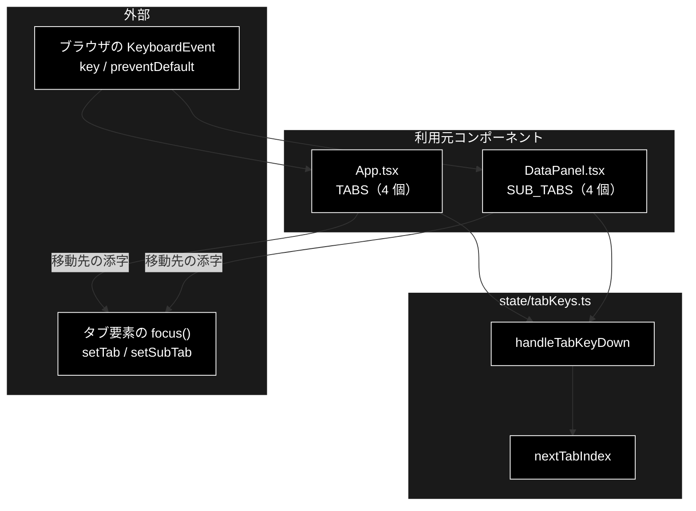

# tabKeys.ts - タブの矢印キー移動 ドキュメント

**Version 1.0** | 最終更新: 2026-10-12

---

## 目次

- [概要](#概要)
- [1. アーキテクチャ構成図](#1-アーキテクチャ構成図)
- [2. エクスポート一覧](#2-エクスポート一覧)
- [3. 判断の規則](#3-判断の規則)
- [4. テスト](#4-テスト)
- [5. 変更履歴](#5-変更履歴)

---

## 概要

| 項目 | 内容 |
|---|---|
| ファイル | `frontend/src/state/tabKeys.ts`（49 行） |
| 種別 | 純ロジック（キー判定） |
| 利用元 | `App.tsx`（4 タブ）/ `components/DataPanel.tsx`（データ管理の 4 サブタブ） |
| 対応バックエンド | なし |

WAI-ARIA の tablist パターンでは、タブ間を Tab キーではなく**矢印キー**で移り、Home / End で端へ飛ぶ。
その移動先の計算を本モジュールが持つ（2 か所の tablist で共用する）。

### 主な責務

- 矢印・Home・End キーから移動先のタブを計算する
- 移動したときだけ既定動作（ページのスクロール）を止める

### 各責務対応のモジュール

| # | 責務 | 対応モジュール | 説明 |
|---|---|---|---|
| 1 | 移動先の計算 | `nextTabIndex` | 右・下で次、左・上で前、端で回り込む。Home / End で端へ |
| 2 | 既定動作の抑止 | `handleTabKeyDown` | 移動したときだけ `preventDefault()`。同じ位置に留まるなら移動扱いにしない |

---

## 1. アーキテクチャ構成図

### 1.1 位置づけ



---

## 2. エクスポート一覧

```ts
export function nextTabIndex(
  currentIndex: number,
  count: number,
  key: string,
): number | null

export function handleTabKeyDown(
  event: { key: string; preventDefault: () => void },
  currentIndex: number,
  count: number,
): number | null
```

| 名前 | 戻り値 |
|---|---|
| `nextTabIndex` | 移動先の添字。移動しないキー・タブ 0 個なら `null` |
| `handleTabKeyDown` | 移動先の添字。移動しなかった（移動先が今と同じ・移動しないキー）なら `null` |

---

## 3. 判断の規則

### 3.1 使用例

`App.tsx` の `onKeyDown` と同じ使い方（戻り値が `null` でなければタブを切り替えて焦点を移す）。

```ts
import { handleTabKeyDown, nextTabIndex } from '../../src/state/tabKeys';

console.log(nextTabIndex(3, 4, 'ArrowRight'), nextTabIndex(0, 4, 'ArrowLeft'), nextTabIndex(1, 4, 'End'));

let prevented = 0;
const ev = (key: string) => ({ key, preventDefault: () => { prevented += 1; } });
console.log(handleTabKeyDown(ev('ArrowRight'), 0, 4)); // 移動する → preventDefault
console.log(handleTabKeyDown(ev('Home'), 0, 4));       // 既に先頭 → 移動扱いにしない
console.log(handleTabKeyDown(ev('a'), 0, 4));          // 移動しないキー
console.log('preventDefault:', prevented);
```

```text
0 3 3
1
null
null
preventDefault: 1
```

> 📝 **確かめ方（2026-10-12）**: 上の例を esbuild で束ねて node で実行し、出力が一致することを確かめた。

### 3.2 規則

`nextTabIndex(currentIndex, count, key)`:

| キー | 結果 |
|---|---|
| `ArrowRight` / `ArrowDown` | `(currentIndex + 1) % count`（末尾 → 先頭へ回り込む） |
| `ArrowLeft` / `ArrowUp` | `(currentIndex - 1 + count) % count`（先頭 → 末尾へ回り込む） |
| `Home` / `End` | `0` / `count - 1` |
| それ以外 | `null` |
| `count <= 0` | `null`（ゼロ除算・`NaN` を防ぐ） |
| `count = 1` | 自分自身（回り込みが自分に戻る） |

`handleTabKeyDown(event, currentIndex, count)`:

| 条件 | `preventDefault()` | 戻り値 |
|---|:--:|---|
| 移動先が今と違う | 呼ぶ | 移動先 |
| 移動しないキー | 呼ばない | `null` |
| 移動先が今と同じ（タブ 1 個・Home で既に先頭） | 呼ばない | `null` |

---

## 4. テスト

| テストファイル | 対象 | 件数 | 実行 |
|---|---|---:|---|
| `src/state/tabKeys.test.ts` | `nextTabIndex` 8 件・`handleTabKeyDown` 4 件 | 12 | `npm test` |

件数は 2026-10-12 に `npx vitest run` で実測した。

---

## 5. 変更履歴

| バージョン | 日付 | 変更内容 |
|---|---|---|
| 1.0 | 2026-10-12 | 新規作成（`a_react_page_md_format.md` §2.4 の軽量構成）。使用例は esbuild + node で実行して確かめた |
