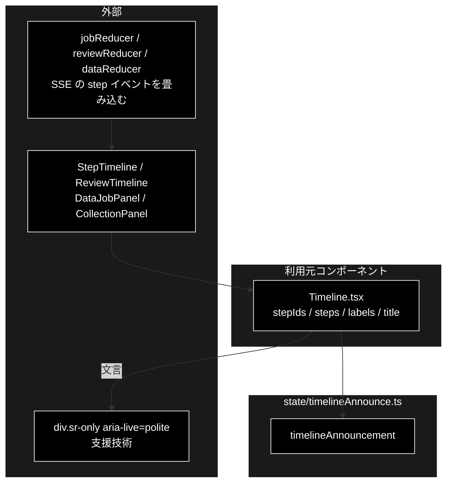

# timelineAnnounce.ts - タイムラインの読み上げ文言 ドキュメント

**Version 1.0** | 最終更新: 2026-10-12

---

## 目次

- [概要](#概要)
- [1. アーキテクチャ構成図](#1-アーキテクチャ構成図)
- [2. エクスポート一覧](#2-エクスポート一覧)
- [3. 判断の規則](#3-判断の規則)
- [4. テスト](#4-テスト)
- [5. 変更履歴](#5-変更履歴)

---

## 概要

| 項目 | 内容 |
|---|---|
| ファイル | `frontend/src/state/timelineAnnounce.ts`（43 行） |
| 種別 | 純ロジック（表示用の派生値） |
| 利用元 | `components/Timeline.tsx`（`StepTimeline` / `ReviewTimeline` / `DataJobPanel` / `CollectionPanel` が共用） |
| 対応バックエンド | なし（SSE の `step` イベントを畳み込んだ状態から作る） |

`<ol>` 全体に `aria-live` を張ると、ログ 1 行ごとに読み上げが走って実用にならない。
**いま動いているステップ名だけ**を小さなライブ領域に流す。何を読ませるかを本モジュールが決める。

### 主な責務

- 走っているステップがあれば、その名前を読ませる
- 全ステップが決着したら完了を読ませる
- それ以外は何も読ませない（空文字）

### 各責務対応のモジュール

| # | 責務 | 対応モジュール | 説明 |
|---|---|---|---|
| 1 | 実行中のステップ | `timelineAnnouncement` | 描画順で最初の `running` を `実行中: {ラベル}`。ラベルが無ければ ID |
| 2 | 完了 | `timelineAnnouncement` | 全ステップが `done` か `skipped` なら `{タイトル}が完了しました` |
| 3 | 読み上げない | `timelineAnnouncement` | 未開始・途中で止まっている・ステップ 0 個は `''` |

---

## 1. アーキテクチャ構成図

### 1.1 位置づけ



---

## 2. エクスポート一覧

```ts
export interface AnnounceableStep {
  status: 'pending' | 'running' | 'done' | 'skipped';
}

export function timelineAnnouncement(
  stepIds: readonly string[],
  steps: Record<string, AnnounceableStep>,
  labels: Record<string, string>,
  title: string,
): string
```

| 引数 | 説明 |
|---|---|
| `stepIds` | 描画順のステップ ID |
| `steps` | ID → ステップ状態（3 つの reducer の `StepState` がそのまま当てはまる） |
| `labels` | ID → 表示名 |
| `title` | 節見出し（完了時の文言に使う） |

---

## 3. 判断の規則

### 3.1 使用例

```ts
import { timelineAnnouncement } from '../../src/state/timelineAnnounce';

const ids = ['plan', 'execute', 'web'];
const labels = { plan: '① Plan', execute: '② Execute' };   // web はラベル未定義
const title = 'ステップトレース';

console.log(JSON.stringify(timelineAnnouncement(ids, {}, labels, title)));                // 未開始
console.log(timelineAnnouncement(ids, { plan: { status: 'done' }, execute: { status: 'running' } }, labels, title));
console.log(timelineAnnouncement(ids, { plan: { status: 'done' }, execute: { status: 'done' }, web: { status: 'running' } }, labels, title));
console.log(timelineAnnouncement(ids, { plan: { status: 'done' }, execute: { status: 'done' }, web: { status: 'skipped' } }, labels, title));
```

```text
""
実行中: ② Execute
実行中: web
ステップトレースが完了しました
```

> 📝 **確かめ方（2026-10-12）**: 上の例を esbuild で束ねて node で実行し、出力が一致することを確かめた。

### 3.2 規則

| 状態 | 結果 |
|---|---|
| `running` のステップがある | `実行中: {ラベル}` |
| `running` が 2 つ以上 | 描画順で最初の 1 つだけ |
| 全ステップが `done` | `{title}が完了しました` |
| `done` と `skipped` だけ | 完了扱い（スキップがあっても完了と言える） |
| 何も始まっていない | `''`（読み上げない） |
| `running` が無く `pending` が残る（途中で止まった） | `''` |
| ステップが 0 個 | `''` |
| ラベル未定義 | ID を出す（無言にしない） |
| `steps` に無い ID が混ざる | 落ちない（その ID は未決着として扱う） |

---

## 4. テスト

| テストファイル | 対象 | 件数 | 実行 |
|---|---|---:|---|
| `src/state/timelineAnnounce.test.ts` | §3.2 の 9 行 | 9 | `npm test` |

件数は 2026-10-12 に `npx vitest run` で実測した。

---

## 5. 変更履歴

| バージョン | 日付 | 変更内容 |
|---|---|---|
| 1.0 | 2026-10-12 | 新規作成（`a_react_page_md_format.md` §2.4 の軽量構成）。使用例は esbuild + node で実行して確かめた |
