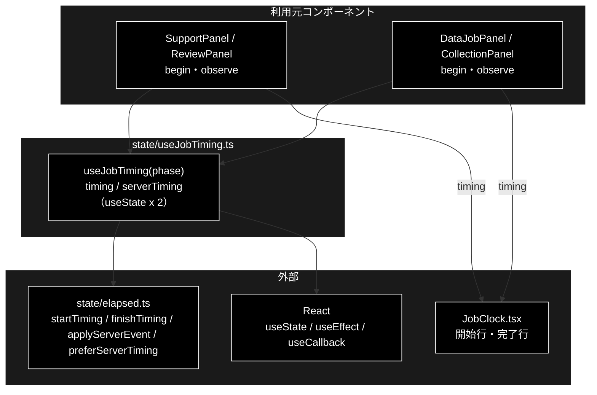

# useJobTiming.ts - 開始・完了時刻を持つフック ドキュメント

**Version 1.0** | 最終更新: 2026-10-12

---

## 目次

- [概要](#概要)
- [1. アーキテクチャ構成図](#1-アーキテクチャ構成図)
- [2. エクスポート一覧](#2-エクスポート一覧)
- [3. 判断の規則](#3-判断の規則)
- [4. テスト](#4-テスト)
- [5. 変更履歴](#5-変更履歴)

---

## 概要

| 項目 | 内容 |
|---|---|
| ファイル | `frontend/src/state/useJobTiming.ts`（56 行） |
| 種別 | **フック（`state/` の例外）**。`useState` / `useEffect` / `useCallback` を持つ |
| 利用元 | `components/SupportPanel.tsx` / `ReviewPanel.tsx` / `DataJobPanel.tsx` / `CollectionPanel.tsx` |
| 対応バックエンド | `backend/app/core/jobs.py`（SSE の `ts`、`done` の `started_at`） |

4 つのコンテナが共用する、ジョブの開始・完了時刻のフック。`state/` は純関数を置く場所だが、本モジュールだけは例外的にフックである。
ただし**判断は持たない**。やるのは「`Date.now()` を呼ぶ」「`useState` に載せる」「`phase` を見て決着を検知する」の 3 つだけで、
判断と整形はすべて [`elapsed.ts`](elapsed.md) の純関数に任せる。**ここに分岐を足さない**（CLAUDE.md §6）。

### 主な責務

- 送信の瞬間にブラウザの時計で開始時刻を打つ
- SSE イベントのサーバ時刻を畳み込む
- `phase` が決着（`completed` / `failed`）したら完了時刻を 1 度だけ入れる
- 表示に使う組（サーバ / ブラウザ）を返す

### 各責務対応のモジュール

| # | 責務 | 対応モジュール | 説明 |
|---|---|---|---|
| 1 | 開始時刻 | `begin`（戻り値の 2 番目）→ `elapsed.ts::startTiming` | サーバ側の組も `EMPTY_TIMING` に戻す |
| 2 | サーバ時刻 | `observe`（戻り値の 3 番目）→ `elapsed.ts::applyServerEvent` | `ts` の無いイベントでは同じ参照が返り、再レンダーしない |
| 3 | 完了時刻 | `useEffect([phase])` → `elapsed.ts::finishTiming` | 何度走っても完了時刻は動かない（二重確定を `finishTiming` が弾く） |
| 4 | 組の選択 | 戻り値の 1 番目 → `elapsed.ts::preferServerTiming` | — |

---

## 1. アーキテクチャ構成図

### 1.1 位置づけ



> 📌 4 つのコンテナはどれも `begin` と `observe` の両方を使う（2026-10-12 にコードで確認）。タブを離れて戻った再購読でも、
> サーバの時刻から所要時間が出る。姉妹リポジトリ grace_v2 の `CollectionPanel` は `observe` を使っていない（あちらの README §13）。

---

## 2. エクスポート一覧

```ts
export function useJobTiming(
  phase: string,
): [JobTiming, () => void, (event: ServerTimedEvent) => void]
```

| 戻り値 | 説明 |
|---|---|
| `[0]` `JobTiming` | 表示に使う時刻（`preferServerTiming(serverTiming, timing)`）。`JobClock` へ渡す |
| `[1]` `begin()` | 送信時に呼ぶ。開始時刻を打ち、サーバ側の組を消す |
| `[2]` `observe(event)` | SSE イベントを受けるたびに呼ぶ |

`phase` は 3 つの reducer の `phase`（`idle` / `running` / `completed` / `failed`）。型名は違うが値は共通なので `string` で受ける。

| フック | 依存配列 | クリーンアップ |
|---|---|---|
| `useEffect`（決着の検知） | `[phase]` | なし（`setState` だけ） |
| `useCallback(begin)` | `[]` | — |
| `useCallback(observe)` | `[]` | — |

`begin` / `observe` は参照が変わらないので、呼び出し側の `useCallback` の依存配列に入れても再生成を招かない。

---

## 3. 判断の規則

### 3.1 使用例

`SupportPanel` と同じ組み立て方（送信の瞬間に `begin`、SSE イベントごとに `observe`、決着は `phase` から自動）。

```tsx
import { useCallback, useReducer } from 'react';

import { startQuery, subscribeStream } from '../../src/api/client';
import { JobFinishLine, JobStartLine } from '../../src/components/JobClock';
import { initialJobState, jobReducer } from '../../src/state/jobReducer';
import { useJobTiming } from '../../src/state/useJobTiming';
import type { QueryParams } from '../../src/types';

export function MiniPanel({ params }: { params: QueryParams }) {
  const [state, dispatch] = useReducer(jobReducer, initialJobState);
  const [timing, begin, observe] = useJobTiming(state.phase);

  const submit = useCallback(async (params: QueryParams) => {
    begin();                                    // 起動 API を待たずに打つ（押した瞬間が開始）
    const { job_id } = await startQuery(params);
    dispatch({ type: 'started', jobId: job_id });
    subscribeStream(job_id, (event) => {
      observe(event);                           // サーバ時刻（再購読でも復元できる）
      dispatch({ type: 'event', event });       // phase が completed / failed になれば完了が自動で入る
    }, (message) => dispatch({ type: 'failed', message }), 'support');
  }, [begin, observe]);

  return (
    <>
      <button type="button" onClick={() => void submit(params)}>送信</button>
      <JobStartLine timing={timing} />
      <JobFinishLine timing={timing} />
    </>
  );
}
```

> 📝 **確かめ方（2026-10-12）**: フックは DOM（`useEffect` の実行）が要り、vitest も node 環境なので**実行はしていない**。
> 上の例は `frontend/src` に一時ファイルとして置き、`npx tsc --noEmit` で型検査が通ることを確かめた（確認後に削除）。
> 振る舞い（開始・完了・組の選択）は [`elapsed.md`](elapsed.md) §3.1 の例で実行して確かめている。

### 3.2 規則

| 出来事 | ブラウザの組（`timing`） | サーバの組（`serverTiming`） |
|---|---|---|
| `begin()` | `startTiming(Date.now())` | `EMPTY_TIMING` |
| `observe(event)` | 変えない | `applyServerEvent(prev, event)` |
| `phase` が `completed` / `failed` になる | `finishTiming(prev, Date.now())`（開始していなければ・確定済みなら据え置き） | 変えない |
| `phase` がそれ以外 | 変えない | 変えない |
| 戻り値の 1 番目 | `preferServerTiming(serverTiming, timing)` | |

---

## 4. テスト

本モジュール自体のテストは無い（フックのレンダリングテストは書けない。`@testing-library/react` 未導入・vitest は node 環境）。
判断はすべて `elapsed.ts` にあり、そちらで検証している。

| テストファイル | 対象 | 件数 | 実行 |
|---|---|---:|---|
| `src/state/elapsed.test.ts` | `startTiming` / `finishTiming` / 書式 | 22 | `npm test` |
| `src/state/serverTiming.test.ts` | `applyServerEvent` / `preferServerTiming` | 16 | `npm test` |

件数は 2026-10-12 に `npx vitest run` で実測した。

---

## 5. 変更履歴

| バージョン | 日付 | 変更内容 |
|---|---|---|
| 1.0 | 2026-10-12 | 新規作成（`a_react_page_md_format.md` §2.4 の軽量構成）。使用例は tsc の型検査で確かめた（フックなので実行はしていない）。4 つのコンテナがすべて `observe` を使うことを確かめた |
