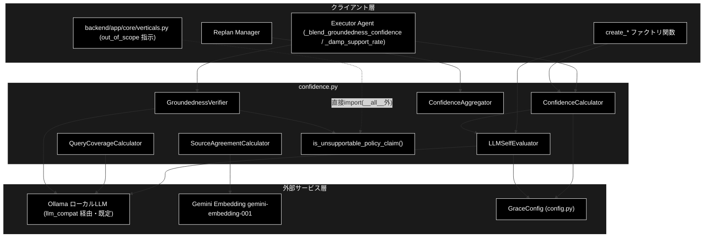
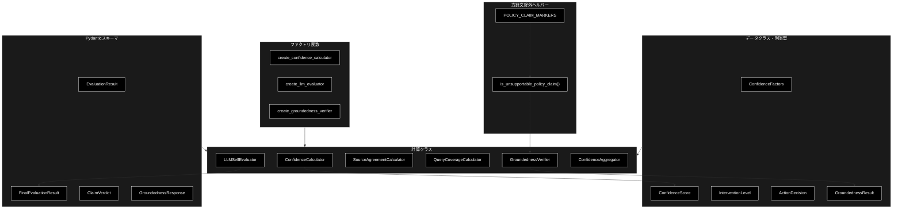
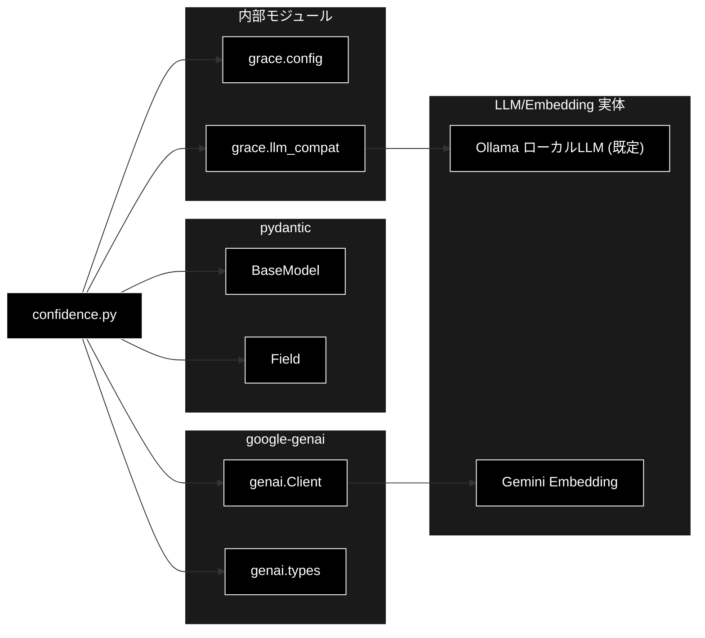

# confidence.py - 信頼度計算システム ドキュメント

**Version 3.7** | 最終更新: 2026-10-10

---

## 目次

1. [概要](#概要)
2. [アーキテクチャ構成図](#1-アーキテクチャ構成図)
3. [モジュール構成図](#2-モジュール構成図)
4. [クラス・関数一覧表](#3-クラス関数一覧表)
5. [クラス・関数 IPO詳細](#4-クラス関数-ipo詳細)
6. [設定・定数](#5-設定定数)
7. [エクスポート](#6-エクスポート)
8. [変更履歴](#7-変更履歴)
9. [付録: 依存関係図](#付録-依存関係図)

---

## 概要

`confidence.py` は、GRACE（Guided Reasoning with Adaptive Confidence Execution）における信頼度計算システムを実装するモジュールです。ハイブリッド方式（重み付き平均 + LLM 自己評価 + 根拠妥当性検証）による多軸の信頼度算出と、その結果に基づく介入レベル（自動進行〜ユーザー入力要求）の判定を担います。

LLM 呼び出しは `llm_compat.create_chat_client()` が返す genai 互換クライアント経由で行われ、**本プロジェクトではローカル LLM（Ollama、既定モデルは `config.py::get_default_ollama_model()` が返す `gemma4:26b-a4b-it-qat`）が実体**です（API キー不要）。一方、ソース一致度計算の Embedding は Gemini（`gemini-embedding-001`、3072次元）を継続利用します（`GOOGLE_API_KEY` が必要）。

### 主な責務

- RAG 検索品質・ツール成功率などの要素から多軸信頼度を計算する
- LLM 自己評価により回答の確信度・網羅度を取得する
- 複数ソース間の意味的一致度を計算する
- 最終回答の各主張が引用ソースに支持されるか（groundedness）を検証する
- 担当範囲外の断り文（方針文）を根拠検証の母数から除外する
- 信頼度スコアに基づいて介入レベル（アクション）を決定する
- 複数ステップの信頼度を集計する

### 各責務対応のモジュール

| # | 責務 | 対応モジュール | 説明 |
|---|------|--------------|------|
| 1 | 多軸信頼度の計算 | `grace/confidence.py` / `grace/config.py` | `ConfidenceCalculator` が検索品質・ツール成功率等を統合。重み・閾値は `GraceConfig.confidence` |
| 2 | LLM 自己評価 | `grace/confidence.py` / `grace/llm_compat.py` | `LLMSelfEvaluator` が確信度・網羅度を評価。クライアントは `create_chat_client()` |
| 3 | 複数ソース一致度 | `grace/confidence.py` | `SourceAgreementCalculator` が Gemini Embedding で類似度を算出 |
| 4 | 根拠妥当性の検証 | `grace/confidence.py` | `GroundednessVerifier` が主張ごとに支持 / 矛盾 / 中立を判定 |
| 5 | 方針文の除外 | `grace/confidence.py` | `is_unsupportable_policy_claim()` が担当範囲外の断りを母数から除外 |
| 6 | 介入レベルの決定 | `grace/confidence.py` | `ConfidenceCalculator.decide_action()` が閾値で判定 |
| 7 | 複数ステップの集計 | `grace/confidence.py` / `grace/executor.py` | `ConfidenceAggregator` が集計。支持率の判定率減衰・矛盾キャップは `Executor._damp_support_rate()` / `_blend_groundedness_confidence()` が本モジュールの出力に適用（M-6） |

### 主要機能一覧

| 機能 | 説明 |
|------|------|
| `ConfidenceFactors` | 信頼度を構成する各要素を保持するデータクラス |
| `ConfidenceScore` | 信頼度スコアと内訳・ペナルティを保持するデータクラス |
| `ConfidenceScore.level` | スコアから信頼度レベル文字列を導出するプロパティ |
| `InterventionLevel` | 介入レベルの列挙型（silent/notify/confirm/escalate） |
| `ActionDecision` | 信頼度に基づくアクション決定を保持するデータクラス |
| `ConfidenceCalculator` | ハイブリッド方式の信頼度計算クラス |
| `ConfidenceCalculator.calculate()` | 要素から信頼度スコアを算出 |
| `ConfidenceCalculator.llm_calculate()` | LLM を用いた信頼度計算 |
| `ConfidenceCalculator.decide_action()` | スコアから介入レベルを決定 |
| `LLMSelfEvaluator` | LLM による自己評価クラス |
| `LLMSelfEvaluator.evaluate()` | 確信度を単一スコアで評価 |
| `LLMSelfEvaluator.evaluate_final()` | 確信度＋網羅度を1回の呼び出しで統合評価 |
| `LLMSelfEvaluator.evaluate_with_factors()` | Factors を考慮した総合評価 |
| `SourceAgreementCalculator` | 複数ソース間一致度計算クラス |
| `SourceAgreementCalculator.calculate()` | 回答群の平均コサイン類似度を算出 |
| `SourceAgreementCalculator._embed_all()` | 全ソースの Embedding を BATCH_SIZE 単位でまとめて取得 |
| `QueryCoverageCalculator` | クエリ網羅度計算クラス |
| `QueryCoverageCalculator.calculate()` | 質問要素のカバー度を評価 |
| `POLICY_CLAIM_MARKERS` | 方針文（担当範囲外の断り）に現れる語のタプル |
| `is_unsupportable_policy_claim()` | neutral かつ方針文の claim かを判定する関数 |
| `GroundednessVerifier` | 根拠妥当性（S1）検証クラス |
| `GroundednessVerifier.verify()` | 主張ごとの支持率を検証（方針文は母数から除外） |
| `ConfidenceAggregator` | 複数ステップの信頼度集計クラス |
| `ConfidenceAggregator.aggregate()` | mean/min/weighted で集計 |
| `ConfidenceAggregator.aggregate_with_critical_check()` | 致命的失敗を考慮した集計 |
| `create_confidence_calculator()` | `ConfidenceCalculator` のファクトリ関数 |
| `create_llm_evaluator()` | `LLMSelfEvaluator` のファクトリ関数 |
| `create_source_agreement_calculator()` | `SourceAgreementCalculator` のファクトリ関数 |
| `create_query_coverage_calculator()` | `QueryCoverageCalculator` のファクトリ関数 |
| `create_confidence_aggregator()` | `ConfidenceAggregator` のファクトリ関数 |
| `create_groundedness_verifier()` | `GroundednessVerifier` のファクトリ関数 |

---

## 1. アーキテクチャ構成図

### 1.1 システム全体構成



### 1.2 データフロー

1. クライアント層（Executor / Replan Manager）が `ConfidenceFactors` を構築する
2. `ConfidenceCalculator.calculate()` または `llm_calculate()` が信頼度スコアを算出する
3. LLM 評価（`LLMSelfEvaluator` / `QueryCoverageCalculator` / `GroundednessVerifier`）は `llm_compat` 経由でローカル LLM（Ollama）を呼び出す
4. `GroundednessVerifier.verify()` は判定結果から `is_unsupportable_policy_claim()` で方針文（担当範囲外の断り）を母数から除外してから `support_rate` を算出する
5. ソース一致度（`SourceAgreementCalculator`）は Gemini Embedding で複数回答をまとめてベクトル化しコサイン類似度を計算する
6. `ConfidenceScore` を `decide_action()` に渡し `InterventionLevel` を決定する
7. 複数ステップは `ConfidenceAggregator` で集計され、最終的な信頼度として返却される
8. **本モジュールの外側**（`executor.py`）が `GroundednessResult` を消費し、M-6 判定率減衰（`_damp_support_rate`）と矛盾時の `answer_conf` 0.30 キャップを適用する（§5.6）

---

## 2. モジュール構成図

### 2.1 内部モジュール構成



### 2.2 外部依存関係

| ライブラリ | バージョン | 用途 |
|-----------|-----------|------|
| `google-genai` | - | Gemini Embedding（`genai.Client` / `SourceAgreementCalculator`）専用。LLM テキスト生成には使わない |
| `pydantic` | - | 構造化出力スキーマ（`BaseModel` / `Field`） |
| `openai`（間接） | - | `llm_compat.create_chat_client()` の既定経路（Ollama）が内部で openai SDK 互換クライアントを使う（`confidence.py` は直接 import しない） |

### 2.3 内部依存モジュール

| モジュール | 用途 |
|-----------|------|
| `grace.config` | `get_config` / `GraceConfig`（重み・閾値・モデル名）/ `resolve_heavy_model`（M-1 論理層モデルの解決） |
| `grace.llm_compat` | `create_chat_client`（genai 互換クライアント。既定は Ollama）/ `parse_score`（LLM 応答から 0.0〜1.0 のスコアを抽出） |

---

## 3. クラス・関数一覧表

### 3.1 クラス一覧

#### EvaluationResult

| メソッド | 概要 |
|---------|------|
| （フィールドのみ） | `score: float`, `reason: str` — LLM 信頼度評価の応答スキーマ |

#### ConfidenceFactors

| メソッド | 概要 |
|---------|------|
| （データクラス） | 信頼度を構成する各要素（検索・ソース・ツール・クエリ等） |

#### ConfidenceScore

| メソッド | 概要 |
|---------|------|
| `level` | スコアから信頼度レベル文字列を返すプロパティ |

#### InterventionLevel

| メソッド | 概要 |
|---------|------|
| （列挙型） | `SILENT` / `NOTIFY` / `CONFIRM` / `ESCALATE` |

#### ActionDecision

| メソッド | 概要 |
|---------|------|
| `should_proceed` | 自動進行可能かを返すプロパティ |
| `needs_confirmation` | 確認が必要かを返すプロパティ |
| `needs_user_input` | ユーザー入力が必要かを返すプロパティ |

#### ConfidenceCalculator

| メソッド | 概要 |
|---------|------|
| `__init__(config=None)` | コンストラクタ（設定・重みの読込と検証） |
| `_validate_weights()` | 重みの合計が 1.0 であることを検証 |
| `calculate(factors)` | ハイブリッド方式で信頼度スコアを算出 |
| `llm_calculate(factors, step_description, tool_output)` | LLM を用いた信頼度計算 |
| `_calc_search_quality(factors)` | RAG 検索品質をスコア化 |
| `_calc_tool_success(factors)` | ツール成功率を計算 |
| `_apply_penalties(base_score, factors)` | 特定条件でペナルティを適用 |
| `decide_action(score)` | スコアから介入レベルを決定 |

#### FinalEvaluationResult

| メソッド | 概要 |
|---------|------|
| （フィールドのみ） | `self_eval_score`, `coverage_score`, `reason` |

#### LLMSelfEvaluator

| メソッド | 概要 |
|---------|------|
| `__init__(config=None, model_name=None)` | コンストラクタ（クライアント生成） |
| `evaluate(query, answer, sources=None)` | 確信度を単一スコアで評価 |
| `evaluate_final(query, answer, sources=None)` | 確信度＋網羅度を1回で統合評価 |
| `evaluate_with_factors(description, output, factors)` | Factors を考慮した総合評価 |

#### SourceAgreementCalculator

| メソッド | 概要 |
|---------|------|
| `__init__(config=None)` | コンストラクタ（Gemini クライアント生成） |
| `calculate(answers)` | 回答群の平均コサイン類似度を算出 |
| `_embed_all(answers)` | 全ソースの Embedding を `BATCH_SIZE`（100）単位でまとめて取得 |
| `_cosine_similarity(vec1, vec2)` | コサイン類似度（静的メソッド） |

#### QueryCoverageCalculator

| メソッド | 概要 |
|---------|------|
| `__init__(config=None, model_name=None)` | コンストラクタ（クライアント生成） |
| `calculate(query, answer)` | クエリ網羅度を評価 |

#### ClaimVerdict

| メソッド | 概要 |
|---------|------|
| （フィールドのみ） | `claim: str`, `verdict: Literal["supported","contradicted","neutral"]` |

#### GroundednessResponse

| メソッド | 概要 |
|---------|------|
| （フィールドのみ） | `claims: List[ClaimVerdict]`, `reason: str` |

#### GroundednessResult

| メソッド | 概要 |
|---------|------|
| （データクラス） | 支持率・支持数・矛盾数・検証可否・**主張ごとの判定（`claims`）**を保持 |

> ⚠️ **`claims` は集計の内訳であり、消してはならない。** 矛盾が 1 件でもあると
> `executor._blend_groundedness_confidence()` が `answer_conf` を 0.30 に cap するため、誤検知だと正しい回答の信頼度を
> 不当に下げる。以前は件数（`supported` / `contradicted` / `total`）だけを保持して
> 判定された主張そのものを捨てており、実測「明日の東京の天気は？」で
> `contradicted=1` と出たときに**どの主張が矛盾とされたのか追跡できなかった**。
>
> ⚠️ **`total` は方針文（担当範囲外の断り）を除いた「判定対象」の件数である。** `verify()` は
> `is_unsupportable_policy_claim()` で neutral かつ方針文と判定された claim を集計前に除外する
> （全件が方針文の場合を除く）。`claims` フィールド自体は除外前の**全件**を保持するため、
> 「何を除外したか」は `claims` を見れば後から追える。

#### GroundednessVerifier

| メソッド | 概要 |
|---------|------|
| `__init__(config=None, model_name=None)` | コンストラクタ（クライアント生成） |
| `verify(query, answer, sources=None)` | 主張ごとの支持率を検証（方針文は母数から除外） |
| `_log_claims(result)` | 矛盾主張を WARNING、全判定の内訳を INFO で出力 |
| `_abbreviate(text, limit=120)` | ログ 1 行に収まる長さへ縮める（静的メソッド） |
| `_remember(key, result)` | 判定できた結果だけをキャッシュに記憶（失敗はキャッシュしない） |

#### ConfidenceAggregator

| メソッド | 概要 |
|---------|------|
| `__init__(config=None)` | コンストラクタ |
| `aggregate(scores, method="mean")` | mean/min/weighted で集計 |
| `aggregate_with_critical_check(scores, critical_threshold=0.3)` | 致命的失敗を考慮した集計 |

### 3.2 関数一覧（カテゴリ別）

#### 方針文除外ヘルパー

| 関数名 | 概要 |
|-------|------|
| `is_unsupportable_policy_claim(claim)` | neutral 判定かつ `POLICY_CLAIM_MARKERS` を含む claim か（＝母数から外すべきか）を判定 |

#### ファクトリ関数

| 関数名 | 概要 |
|-------|------|
| `create_confidence_calculator(config=None)` | `ConfidenceCalculator` を生成 |
| `create_llm_evaluator(config=None, model_name=None)` | `LLMSelfEvaluator` を生成 |
| `create_source_agreement_calculator(config=None)` | `SourceAgreementCalculator` を生成 |
| `create_query_coverage_calculator(config=None, model_name=None)` | `QueryCoverageCalculator` を生成 |
| `create_confidence_aggregator(config=None)` | `ConfidenceAggregator` を生成 |
| `create_groundedness_verifier(config=None, model_name=None)` | `GroundednessVerifier` を生成 |

---

## 4. クラス・関数 IPO詳細

### 4.1 使用例

信頼度は**測る対象で使う部品が違う**。executor の内側ではステップごとに ①（既定。`judges.step_confidence_llm=true` なら ②）、最後に ③ / ④ が動く（[`grace_process_flow.md` §2.2](./grace_process_flow.md#22-全体信頼度の算出)）。

| 処理パターン | 呼び方 | 向いている場面 | 例 |
|---|---|---|---|
| ステップ信頼度（ヒューリスティック） | `ConfidenceCalculator.calculate(factors)` → `decide_action(score)` | LLM を使わずに採点し、介入レベルを決める | 4.1.1 |
| ステップ信頼度（LLM） | `ConfidenceCalculator.llm_calculate(factors, step_description=..., tool_output=..., query=...)` | LLM に採点させる（`judges.step_confidence_llm=true` のときだけ executor が使う。失敗時はヒューリスティック） | 4.1.2 |
| 最終回答の評価と根拠検証 | `LLMSelfEvaluator.evaluate_final` ＋ `GroundednessVerifier.verify` → `damp_support_rate` | 回答が情報源に裏付けられているか（GRACE-Support ③・GRACE-Review ④） | 4.1.3 |
| 集約と一致度 | `ConfidenceAggregator.aggregate` / `aggregate_with_critical_check`・`SourceAgreementCalculator.calculate` | 複数ステップをまとめる・内部回答と Web 回答の一致を見る（GRACE-Support ⑤） | 4.1.4 |

> 📝 4 本とも、LLM（自己評価・根拠検証・採点は固定の JSON を返す）と Gemini Embedding をスタブに差し替えて**そのまま実行し**、
> 出力を確かめてある（2026-10-10）。4.1.1 と 4.1.4 の集約は LLM を使わないので、出力は実際と同じ。

#### 4.1.1 基本的なワークフロー（ステップ信頼度 → 介入レベル。executor の既定）

```python
from grace.confidence import ConfidenceFactors, create_confidence_calculator

calc = create_confidence_calculator()

# 1. 検索ステップの要素（executor は rag_search の confidence_factors から作る）
factors = ConfidenceFactors(
    search_result_count=5,
    search_max_score=0.82,
    search_avg_score=0.71,
    is_search_step=True,
)

# 2. 信頼度を計算し、介入レベルを決める（しきい値は config.confidence.thresholds: 0.9 / 0.7 / 0.4）
score = calc.calculate(factors)
decision = calc.decide_action(score)
print(f"信頼度: {score.score:.2f} ({score.level}) -> {decision.level.value}")
print(f"自動で進めてよいか: {decision.should_proceed} / 確認が要るか: {decision.needs_confirmation}")
```

```
# 出力例:
# 信頼度: 0.82 (medium) -> notify
# 自動で進めてよいか: True / 確認が要るか: False
```

> 📝 **検索ステップの素点は検索品質そのもの**（最大スコアが 0.6 以上ならそのまま）。非検索ステップは、検索品質・ツール成功率・
> ソース一致・自己評価・網羅度のうち**有効な軸だけ**を内蔵の重みで平均する。`config.confidence.weights` は検証用で、合成には使わない。

#### 4.1.2 LLM で採点する（`judges.step_confidence_llm=true` のときの executor と同じ呼び方）

```python
from grace.confidence import ConfidenceFactors, create_confidence_calculator

calc = create_confidence_calculator()
factors = ConfidenceFactors(
    search_result_count=1, search_max_score=0.82, search_avg_score=0.82, is_search_step=True,
)

# config.llm.light_model（本リポジトリでは llm.model と同じ）で、要素の要約・ツール出力・質問から採点する
score = calc.llm_calculate(
    factors,
    step_description="関連情報を検索",
    tool_output="『金色夜叉』は尾崎紅葉の小説である。",
    query="『金色夜叉』の作者は誰ですか？",   # 渡さないと「質問に合う根拠か」を評価できない
)
print(f"{score.score:.2f} {score.reason}")
```

```
# 出力例（LLM の採点による。検索スコアが 0.7 を超えるので検索スコアが優先される）:
# 0.82 根拠が質問に合っている (検索スコア 0.8200 を優先)
```

> 📝 検索ステップで `search_max_score` が 0.7 を超えるときは、LLM が下げすぎないよう**検索スコアを優先**する（`reason` に「検索スコア … を優先」と付く）。
>
> ⚠️ **executor は既定でこの経路を使わない**（`judges.step_confidence_llm=false`）。ローカル LLM ではこの 1 呼び出しに 90〜250 秒かかり、
> 空応答なら検索スコアへ落ちるだけなので、待った分がまるごと無駄になるため。既定ではヒューリスティック（4.1.1）で採点する。
> 有効にしたときは、検索ステップで LLM の値が 0.6 未満ならヒューリスティックでも計算して**高い方**を採り、LLM が失敗したらヒューリスティックに落ちる
> （`Executor._llm_calculate_step_confidence`）。

#### 4.1.3 最終回答の評価と根拠検証

```python
from grace.config import get_config
from grace.confidence import create_groundedness_verifier, create_llm_evaluator, damp_support_rate

query = "保証期間は？"
answer = "保証期間は購入から1年間です。修理は窓口で受け付けます。"
sources = ["保証規定: 製品保証は購入から1年間"]   # 識別子ではなく本文を渡す（識別子だと全主張が neutral になる）

# 1. 自己評価＋網羅度を 1 回の LLM 呼び出しで
final = create_llm_evaluator().evaluate_final(query, answer, sources)
print(f"self_eval={final.self_eval_score} coverage={final.coverage_score}")

# 2. 主張ごとに supported / contradicted / neutral を判定する
verifier = create_groundedness_verifier()
g = verifier.verify(query, answer, sources)
print(f"verified={g.verified} supported={g.supported} contradicted={g.contradicted} total={g.total}")

# 3. 判定できた割合で支持率を割り引く（neutral が多いほど下がる）
print(f"support_rate={g.support_rate:.2f} -> damped={damp_support_rate(g, get_config().confidence):.2f}")
```

```
# 出力例（判定は LLM による）:
# self_eval=0.85 coverage=0.8
# verified=True supported=2 contradicted=0 total=2
# support_rate=1.00 -> damped=1.00
```

> ⚠️ **ソースが無い・回答が空・LLM が失敗したときは `verified=False`** で返し、例外にしない。検証 LLM が空応答・タイムアウトで
> 落ちたときは `verification_failed=True` も立つ（回答の質とは無関係のインフラ障害。ローカル LLM では起こりやすい）。`support_rate=0` を「裏付け 0」と
> 読まないこと（executor はこのとき従来のブレンドへ落とす）。同じ入力の `verify()` は 2 回目から LLM を呼ばない（直近 4 件のキャッシュ。`verification_failed` の結果はキャッシュしない）。

#### 4.1.4 集約と一致度

```python
from grace.confidence import (
    ConfidenceFactors,
    ConfidenceScore,
    create_confidence_aggregator,
    create_source_agreement_calculator,
)

# 1. 複数ステップの集約（executor は "weighted" ＝ 後のステップほど重い）
scores = [ConfidenceScore(score=s, factors=ConfidenceFactors()) for s in (0.9, 0.8, 0.25)]
aggregator = create_confidence_aggregator()
print(f"mean={aggregator.aggregate(scores, method='mean'):.3f} weighted={aggregator.aggregate(scores, method='weighted'):.3f}")

# 2. 1 つでも 0.3 未満があれば、平均を 0.7 倍にして知らせる
total, has_critical = aggregator.aggregate_with_critical_check(scores)
print(f"total={total:.3f} critical={has_critical}")

# 3. 回答どうしの意味の近さ（Gemini Embedding のコサイン類似度の平均。2 件未満は 1.0）
agreement = create_source_agreement_calculator().calculate([
    "保証期間は1年です。",
    "製品保証は購入から1年間です。",
])
print(f"agreement={agreement:.2f}")
```

```
# 出力例（3 行目は Embedding による）:
# mean=0.650 weighted=0.542
# total=0.455 critical=True
# agreement=1.00
```

---

### 4.2 ConfidenceFactors クラス

信頼度を構成する各要素を保持するデータクラス。検索・ソース・LLM 自己評価・ツール・クエリの各指標を集約する。

**概要**: 信頼度計算の入力となる全要素を1つに束ねるデータクラス。

```python
@dataclass
class ConfidenceFactors:
    search_result_count: int = 0
    search_avg_score: float = 0.0
    search_max_score: float = 0.0
    search_score_variance: float = 1.0
    source_agreement: float = 0.0
    source_count: int = 0
    llm_self_confidence: float = 0.5
    groundedness: float = 0.0
    tool_success_rate: float = 1.0
    tool_execution_count: int = 0
    tool_success_count: int = 0
    query_coverage: float = 0.0
    is_search_step: bool = False
```

| パラメータ | 型 | デフォルト | 説明 |
|------------|------|-----------|------|
| `search_result_count` | int | 0 | 検索結果数 |
| `search_avg_score` | float | 0.0 | 平均類似度スコア |
| `search_max_score` | float | 0.0 | 最高類似度スコア |
| `search_score_variance` | float | 1.0 | スコアの分散（低いほど一貫性あり） |
| `source_agreement` | float | 0.0 | 情報源間の一致度 (0-1) |
| `source_count` | int | 0 | 引用ソース数 |
| `llm_self_confidence` | float | 0.5 | LLM の自己評価 (0-1) |
| `groundedness` | float | 0.0 | 根拠支持率 (0-1)。0 は未検証を含む |
| `tool_success_rate` | float | 1.0 | ツール成功率 |
| `tool_execution_count` | int | 0 | 実行ツール数 |
| `tool_success_count` | int | 0 | 成功ツール数 |
| `query_coverage` | float | 0.0 | クエリへの回答網羅度 |
| `is_search_step` | bool | False | 検索ステップかどうか |

| 項目 | 内容 |
|------|------|
| **Input** | 上記フィールド（すべて任意・デフォルト値あり） |
| **Process** | dataclass として値を保持 |
| **Output** | `ConfidenceFactors` インスタンス |

**戻り値例**:
```python
ConfidenceFactors(
    search_result_count=5,
    search_max_score=0.82,
    search_avg_score=0.71,
    is_search_step=True
)
```

```python
# 使用例
from grace.confidence import ConfidenceFactors

factors = ConfidenceFactors(search_max_score=0.82, search_result_count=5, is_search_step=True)
print(factors.search_max_score)
# 0.82
```

### 4.3 ConfidenceScore クラス

信頼度スコアと内訳・適用ペナルティを保持するデータクラス。

**概要**: 最終スコア・内訳・ペナルティ・理由を保持し、`level` プロパティでレベル文字列を導出する。

```python
@dataclass
class ConfidenceScore:
    score: float
    factors: ConfidenceFactors
    breakdown: Dict[str, float] = field(default_factory=dict)
    penalties_applied: List[str] = field(default_factory=list)
    reason: str = ""
```

| パラメータ | 型 | デフォルト | 説明 |
|------------|------|-----------|------|
| `score` | float | - | 最終スコア (0.0-1.0) |
| `factors` | ConfidenceFactors | - | 計算に使用した要素 |
| `breakdown` | Dict[str, float] | `{}` | 各要素のスコア内訳 |
| `penalties_applied` | List[str] | `[]` | 適用されたペナルティ |
| `reason` | str | "" | 信頼度スコアの理由 |

| 項目 | 内容 |
|------|------|
| **Input** | `score`, `factors`, `breakdown`, `penalties_applied`, `reason` |
| **Process** | 値を保持。`level` プロパティで 0.9/0.7/0.4 を境にレベル判定 |
| **Output** | `ConfidenceScore` インスタンス |

**戻り値例**:
```python
{
    "score": 0.82,
    "breakdown": {"search_quality": 0.82, "tool_success": 1.0},
    "penalties_applied": [],
    "reason": ""
}
```

```python
# 使用例
score = ConfidenceScore(score=0.82, factors=factors)
print(score.level)
# medium
```

#### プロパティ: `level`

**概要**: スコアに応じて信頼度レベル文字列を返す。

```python
@property
def level(self) -> str
```

| 項目 | 内容 |
|------|------|
| **Input** | なし（self のみ） |
| **Process** | `>=0.9 → high` / `>=0.7 → medium` / `>=0.4 → low` / それ以外 `very_low` |
| **Output** | `str`: 信頼度レベル |

**戻り値例**:
```python
"medium"
```

```python
# 使用例
print(ConfidenceScore(score=0.95, factors=factors).level)
# high
```

### 4.4 InterventionLevel 列挙型

介入レベルを表す文字列列挙型。

**概要**: 自動進行から人間介入までの4段階を定義する `str, Enum`。

```python
class InterventionLevel(str, Enum):
    SILENT = "silent"
    NOTIFY = "notify"
    CONFIRM = "confirm"
    ESCALATE = "escalate"
```

| 項目 | 内容 |
|------|------|
| **Input** | なし |
| **Process** | 列挙メンバーの定義 |
| **Output** | `InterventionLevel` メンバー |

**戻り値例**:
```python
InterventionLevel.SILENT  # "silent"
```

```python
# 使用例
from grace.confidence import InterventionLevel
print(InterventionLevel.CONFIRM.value)
# confirm
```

### 4.5 ActionDecision クラス

信頼度に基づくアクション決定を保持するデータクラス。

**概要**: 介入レベル・スコア・理由・推奨アクションを保持し、判定用プロパティを提供する。

```python
@dataclass
class ActionDecision:
    level: InterventionLevel
    confidence_score: float
    reason: str
    suggested_action: Optional[str] = None
```

| パラメータ | 型 | デフォルト | 説明 |
|------------|------|-----------|------|
| `level` | InterventionLevel | - | 介入レベル |
| `confidence_score` | float | - | 信頼度スコア |
| `reason` | str | - | 判定理由 |
| `suggested_action` | Optional[str] | None | 推奨アクション |

| 項目 | 内容 |
|------|------|
| **Input** | `level`, `confidence_score`, `reason`, `suggested_action` |
| **Process** | 値を保持。`should_proceed` / `needs_confirmation` / `needs_user_input` で判定 |
| **Output** | `ActionDecision` インスタンス |

**戻り値例**:
```python
{
    "level": "silent",
    "confidence_score": 0.92,
    "reason": "高い信頼度: 自動進行",
    "suggested_action": "proceed"
}
```

```python
# 使用例
decision = ActionDecision(level=InterventionLevel.SILENT, confidence_score=0.92, reason="高い信頼度")
print(decision.should_proceed)
# True
```

### 4.6 ConfidenceCalculator クラス

ハイブリッド方式による信頼度計算クラス。

#### コンストラクタ: `__init__`

**概要**: 設定と重みを読み込み、重みの整合性を検証する。

```python
def __init__(self, config: Optional[GraceConfig] = None)
```

| パラメータ | 型 | デフォルト | 説明 |
|------------|------|-----------|------|
| `config` | Optional[GraceConfig] | None | 設定。未指定時は `get_config()` |

| 項目 | 内容 |
|------|------|
| **Input** | `config: Optional[GraceConfig] = None` |
| **Process** | 1. config 解決<br>2. `confidence.weights` を取得<br>3. `_validate_weights()` で合計1.0を検証 |
| **Output** | `ConfidenceCalculator` インスタンス |

**戻り値例**:
```python
ConfidenceCalculator(config=None)
```

```python
# 使用例
from grace.confidence import ConfidenceCalculator
calc = ConfidenceCalculator()
```

#### メソッド: `calculate`

**概要**: 要素から信頼度スコアを算出する（検索ステップと非検索ステップで分岐）。

```python
def calculate(self, factors: ConfidenceFactors) -> ConfidenceScore
```

| パラメータ | 型 | デフォルト | 説明 |
|------------|------|-----------|------|
| `factors` | ConfidenceFactors | - | 計算対象の要素 |

| 項目 | 内容 |
|------|------|
| **Input** | `factors: ConfidenceFactors` |
| **Process** | 1. 検索品質・ツール成功率等を算出<br>2. 検索ステップは検索品質を基準（ツール成功率<1.0なら乗算）、非検索ステップは有効重みで加重平均（`search_quality>0`→0.6, `tool_success`→0.4固定, `source_count>1`→`source_agreement`0.2, `llm_self_eval>0.6`→0.3, `query_coverage>0.1`→0.1）<br>3. `_apply_penalties()` でペナルティ適用<br>4. 0.0〜1.0 にクリップし小数3桁に丸め |
| **Output** | `ConfidenceScore`: スコアと内訳 |

**戻り値例**:
```python
{
    "score": 0.82,
    "breakdown": {
        "search_quality": 0.82,
        "source_agreement": 0.0,
        "llm_self_eval": 0.0,
        "tool_success": 1.0,
        "query_coverage": 0.0
    },
    "penalties_applied": []
}
```

```python
# 使用例
factors = ConfidenceFactors(search_max_score=0.82, search_result_count=5, is_search_step=True)
score = calc.calculate(factors)
print(score.score, score.level)
# 0.82 medium
```

#### メソッド: `llm_calculate`

**概要**: LLM 評価器を用いて信頼度を計算し、検索スコアが高い検索ステップでは検索スコアを優先する。

```python
def llm_calculate(
    self,
    factors: ConfidenceFactors,
    step_description: str = "",
    tool_output: str = ""
) -> ConfidenceScore
```

| パラメータ | 型 | デフォルト | 説明 |
|------------|------|-----------|------|
| `factors` | ConfidenceFactors | - | 計算対象の要素 |
| `step_description` | str | "" | ステップの目的説明 |
| `tool_output` | str | "" | ツール出力（評価対象） |

| 項目 | 内容 |
|------|------|
| **Input** | `factors`, `step_description: str = ""`, `tool_output: str = ""` |
| **Process** | 1. `create_llm_evaluator(config=self.config, model_name=self.config.llm.light_model)` で**軽量モデル**の評価器を生成<br>2. `evaluate_with_factors()` でスコアと理由を取得<br>3. 検索ステップで `search_max_score>0.7` かつ上回る場合は検索スコアを優先 |
| **Output** | `ConfidenceScore`: LLM スコアと理由 |

> 📝 **注意**: 評価は Factors 要約タスク（score＋短い理由の定型出力）のため、`config.llm.model` ではなく `config.llm.light_model` を使う（ローカル LLM では既定で同一モデル。§5.4 参照）。

**戻り値例**:
```python
{
    "score": 0.78,
    "breakdown": {"llm_score": 0.78, "reason": 1.0},
    "reason": "主要な情報は得られている",
    "penalties_applied": []
}
```

```python
# 使用例
score = calc.llm_calculate(factors, step_description="製品仕様を検索", tool_output="...")
print(score.score, score.reason)
```

#### メソッド: `decide_action`

**概要**: 信頼度スコアと設定閾値から介入レベルを決定する。

```python
def decide_action(self, score: ConfidenceScore) -> ActionDecision
```

| パラメータ | 型 | デフォルト | 説明 |
|------------|------|-----------|------|
| `score` | ConfidenceScore | - | 判定対象のスコア |

| 項目 | 内容 |
|------|------|
| **Input** | `score: ConfidenceScore` |
| **Process** | `thresholds.silent`(0.9)/`notify`(0.7)/`confirm`(0.4) と比較し4段階のいずれかを返す |
| **Output** | `ActionDecision`: 介入レベルと推奨アクション |

**戻り値例**:
```python
(
    "notify",
    0.78,
    "中程度の信頼度: ステータス表示しながら進行",
    "proceed_with_status"
)
```

```python
# 使用例
decision = calc.decide_action(score)
print(decision.level, decision.suggested_action)
# InterventionLevel.NOTIFY proceed_with_status
```

### 4.7 LLMSelfEvaluator クラス

LLM による自己評価クラス。`llm_compat` 経由でローカル LLM（Ollama）を呼び出す。

#### コンストラクタ: `__init__`

**概要**: 設定とモデル名を解決し、genai 互換チャットクライアントを生成する。

```python
def __init__(
    self,
    config: Optional[GraceConfig] = None,
    model_name: Optional[str] = None
)
```

| パラメータ | 型 | デフォルト | 説明 |
|------------|------|-----------|------|
| `config` | Optional[GraceConfig] | None | 設定。未指定時は `get_config()` |
| `model_name` | Optional[str] | None | モデル名。未指定時は `config.llm.model` |

| 項目 | 内容 |
|------|------|
| **Input** | `config`, `model_name` |
| **Process** | 1. config 解決<br>2. model_name 解決（既定 `get_default_ollama_model()` が返すモデル名。例: `gemma4:26b-a4b-it-qat`）<br>3. `create_chat_client(config)` でクライアント生成（既定は Ollama） |
| **Output** | `LLMSelfEvaluator` インスタンス |

**戻り値例**:
```python
LLMSelfEvaluator(config=None, model_name="gemma4:26b-a4b-it-qat")
```

```python
# 使用例
from grace.confidence import LLMSelfEvaluator
evaluator = LLMSelfEvaluator()
```

#### メソッド: `evaluate`

**概要**: 質問・回答・情報源から確信度を単一スコア（0.0-1.0）で評価する。

```python
def evaluate(
    self,
    query: str,
    answer: str,
    sources: Optional[List[str]] = None
) -> float
```

| パラメータ | 型 | デフォルト | 説明 |
|------------|------|-----------|------|
| `query` | str | - | 元の質問 |
| `answer` | str | - | 生成された回答 |
| `sources` | Optional[List[str]] | None | 使用した情報源 |

| 項目 | 内容 |
|------|------|
| **Input** | `query`, `answer`, `sources=None` |
| **Process** | 1. `EVAL_PROMPT` を整形<br>2. `generate_content`（temperature=0.0, max_output_tokens=512）<br>3. `llm_compat.parse_score()` でテキストから 0.0〜1.0 の数値を正規表現抽出（「答えは 0.8 です」形式にも対応）<br>4. 抽出失敗・空応答・例外時は 0.5 |
| **Output** | `float`: 確信度 (0.0-1.0) |

**戻り値例**:
```python
0.8
```

```python
# 使用例
conf = evaluator.evaluate(query="保証期間は？", answer="1年間です。", sources=["保証規定"])
print(conf)
# 0.8
```

#### メソッド: `evaluate_final`

**概要**: 確信度と網羅度を1回の LLM 呼び出しで統合評価する（構造化出力）。

```python
def evaluate_final(
    self,
    query: str,
    answer: str,
    sources: Optional[List[str]] = None
) -> FinalEvaluationResult
```

| パラメータ | 型 | デフォルト | 説明 |
|------------|------|-----------|------|
| `query` | str | - | 元の質問 |
| `answer` | str | - | 生成された回答 |
| `sources` | Optional[List[str]] | None | 使用した情報源 |

| 項目 | 内容 |
|------|------|
| **Input** | `query`, `answer`, `sources=None` |
| **Process** | 1. `FINAL_EVAL_PROMPT` を整形<br>2. JSON 構造化出力で `generate_content`（max_output_tokens=1024）<br>3. `FinalEvaluationResult.model_validate_json()` で検証 |
| **Output** | `FinalEvaluationResult`: `self_eval_score` / `coverage_score` / `reason` |

> 📝 **注意**: LLM 呼び出し失敗時は例外を送出する（呼び出し元でフォールバック）。

**戻り値例**:
```python
{
    "self_eval_score": 0.85,
    "coverage_score": 0.9,
    "reason": "主要要素を網羅し正確"
}
```

```python
# 使用例
result = evaluator.evaluate_final(query="保証は？", answer="1年です。", sources=["規定"])
print(result.self_eval_score, result.coverage_score)
# 0.85 0.9
```

#### メソッド: `evaluate_with_factors`

**概要**: ステップ目的・ツール出力・Factors を考慮し総合スコアと理由を返す。

```python
def evaluate_with_factors(
    self,
    description: str,
    output: str,
    factors: ConfidenceFactors
) -> Dict[str, Any]
```

| パラメータ | 型 | デフォルト | 説明 |
|------------|------|-----------|------|
| `description` | str | - | ステップの目的 |
| `output` | str | - | ツール出力（先頭2000文字を使用） |
| `factors` | ConfidenceFactors | - | 統計データ |

| 項目 | 内容 |
|------|------|
| **Input** | `description`, `output`, `factors` |
| **Process** | 1. Factors を埋め込んだプロンプト生成<br>2. JSON モードで `generate_content`（max_output_tokens=1024, `response_schema` は使わず `response_mime_type` のみ指定）<br>3. `response.parsed` → 手動 JSON パース（`` ``` `` コードブロック除去・`{`〜`}`抽出）の順で抽出<br>4. 失敗時は `search_max_score` か 0.5 にフォールバック |
| **Output** | `Dict[str, Any]`: `{"score": float, "reason": str}` |

**戻り値例**:
```python
{
    "score": 0.78,
    "reason": "主要な情報は得られており、信頼できる"
}
```

```python
# 使用例
res = evaluator.evaluate_with_factors(description="仕様検索", output="...", factors=factors)
print(res["score"], res["reason"])
```

### 4.8 SourceAgreementCalculator クラス

複数ソース間の意味的一致度を Gemini Embedding で計算するクラス。

#### コンストラクタ: `__init__`

**概要**: Gemini クライアントと Embedding モデル名を初期化する。

```python
def __init__(self, config: Optional[GraceConfig] = None)
```

| パラメータ | 型 | デフォルト | 説明 |
|------------|------|-----------|------|
| `config` | Optional[GraceConfig] | None | 設定。未指定時は `get_config()` |

| 項目 | 内容 |
|------|------|
| **Input** | `config: Optional[GraceConfig] = None` |
| **Process** | 1. config 解決<br>2. `genai.Client()` を生成<br>3. `config.embedding.model`（`gemini-embedding-001`）を保持 |
| **Output** | `SourceAgreementCalculator` インスタンス |

> 📝 **注意**: LLM がローカル（Ollama）でも、`SourceAgreementCalculator` は Embedding に `genai.Client()`（Gemini）を使い続ける。既存 Qdrant コレクション（3072次元）をそのまま使うための恒久ルール（§プロバイダ方針）であり、待ち時間・課金は Gemini 側で発生する。

**戻り値例**:
```python
SourceAgreementCalculator(config=None)
```

```python
# 使用例
from grace.confidence import SourceAgreementCalculator
src = SourceAgreementCalculator()
```

#### メソッド: `calculate`

**概要**: 複数回答をベクトル化し、全ペアの平均コサイン類似度を一致度として返す。

```python
def calculate(self, answers: List[str]) -> float
```

| パラメータ | 型 | デフォルト | 説明 |
|------------|------|-----------|------|
| `answers` | List[str] | - | 比較対象の回答群 |

| 項目 | 内容 |
|------|------|
| **Input** | `answers: List[str]` |
| **Process** | 1. 要素2未満なら 1.0<br>2. `_embed_all()` で全回答を Gemini Embedding によりベクトル化（一括バッチ）<br>3. 全ペアのコサイン類似度を平均<br>4. 失敗時は 0.5 |
| **Output** | `float`: 一致度 (0.0-1.0) |

**戻り値例**:
```python
0.873
```

```python
# 使用例
agreement = src.calculate(["保証は1年です", "保証期間は1年間"])
print(agreement)
# 0.873
```

#### メソッド: `_embed_all`

**概要**: 全ソースの Embedding を `BATCH_SIZE`（100件）単位でまとめて取得する。1 件ずつ呼ぶより API 往復を削減する。

```python
def _embed_all(self, answers: List[str]) -> List[List[float]]
```

| パラメータ | 型 | デフォルト | 説明 |
|------------|------|-----------|------|
| `answers` | List[str] | - | Embedding 対象の回答群 |

| 項目 | 内容 |
|------|------|
| **Input** | `answers: List[str]` |
| **Process** | 1. `answers` を `BATCH_SIZE`（100）ごとに分割<br>2. チャンクごとに `embed_content(model=..., contents=separate_contents(chunk))`（1 件 = 1 Content に包んで 1 往復）を呼ぶ<br>3. 返却件数が入力チャンク件数と食い違ったら**黙って続けず**、そのチャンクだけ1件ずつ再取得して整合を保つ<br>4. 全チャンクの結果を結合して返す |
| **Output** | `List[List[float]]`: 入力と同順の Embedding ベクトル列 |

> ⚠️ **なぜ 1 件ずつではないのか（grace_v2 実測 2026-08-17）**: Web フォールバックで出典が 9 件あると、以前の実装では 1 質問あたり `embed_content` を 9 回呼んでいた（約4秒）。`contents` はリストを受けられるため、内容も件数も変えずに 1 往復へ畳める。順番対応の前提が崩れると「別のソース同士を比較した一致度」という気付けない誤りになるため、件数不一致時のみ 1 件ずつの取得へフォールバックする。

> ⚠️ **文字列のリストをそのまま `contents=` に渡さない（grace_v2 実測 2026-09-26）**: `gemini-embedding-2` は文字列リストを 1 入力として扱い、N 件送っても 1 本しか返さない。そのままだと毎回 1 件ずつ取得し直す経路に落ち、まとめた意味が無くなる。`helper.helper_embedding.separate_contents()` で 1 件 = 1 Content に包んで渡す（いまの `gemini-embedding-001` は包まなくても件数どおり返るが、モデルを変えても壊れないよう常に包む）。

**戻り値例**:
```python
[
    [0.0123, -0.0456, ...],  # answers[0] の Embedding（3072次元）
    [0.0789, 0.0234, ...],   # answers[1] の Embedding
]
```

```python
# 使用例（通常は calculate() 経由で呼ばれる）
embeddings = src._embed_all(["回答A", "回答B", "回答C"])
print(len(embeddings), len(embeddings[0]))
# 3 3072
```

### 4.9 QueryCoverageCalculator クラス

クエリ網羅度を LLM で評価するクラス。

#### コンストラクタ: `__init__`

**概要**: 設定・モデル名を解決し、チャットクライアントを生成する。

```python
def __init__(
    self,
    config: Optional[GraceConfig] = None,
    model_name: Optional[str] = None
)
```

| パラメータ | 型 | デフォルト | 説明 |
|------------|------|-----------|------|
| `config` | Optional[GraceConfig] | None | 設定 |
| `model_name` | Optional[str] | None | モデル名（既定は `config.llm.model`） |

| 項目 | 内容 |
|------|------|
| **Input** | `config`, `model_name` |
| **Process** | config / model_name 解決後、`create_chat_client(config)` でクライアント生成 |
| **Output** | `QueryCoverageCalculator` インスタンス |

**戻り値例**:
```python
QueryCoverageCalculator(config=None, model_name="gemma4:26b-a4b-it-qat")
```

```python
# 使用例
from grace.confidence import QueryCoverageCalculator
cov = QueryCoverageCalculator()
```

#### メソッド: `calculate`

**概要**: 質問のすべての要素を回答がカバーしているかを 0.0-1.0 で評価する。

```python
def calculate(self, query: str, answer: str) -> float
```

| パラメータ | 型 | デフォルト | 説明 |
|------------|------|-----------|------|
| `query` | str | - | 元の質問 |
| `answer` | str | - | 生成された回答 |

| 項目 | 内容 |
|------|------|
| **Input** | `query`, `answer` |
| **Process** | 1. `COVERAGE_PROMPT` 整形<br>2. `generate_content`（temperature=0.0, max_output_tokens=512）<br>3. `parse_score()` で float 化＋クリップ<br>4. 非空回答（20文字超）で 0.0 の異常値は floor 0.4 を適用<br>5. 失敗時は 0.5 |
| **Output** | `float`: 網羅度 (0.0-1.0) |

**戻り値例**:
```python
0.8
```

```python
# 使用例
coverage = cov.calculate(query="価格と保証は？", answer="価格は1万円です。")
print(coverage)
# 0.6
```

### 4.10 方針文除外ヘルパー（`POLICY_CLAIM_MARKERS` / `is_unsupportable_policy_claim`）

担当範囲外の質問に対して業界プロファイルの `SCOPE_POLICY` が要求する「断り＋窓口案内」の定型文を、`GroundednessVerifier.verify()` の支持率計算・M-6 判定率減衰の母数から除外するためのモジュール関数。**2026-08-29 の変更で新規追加**（`__all__` には含まれないが、`backend/app/core/verticals.py` が `grace.confidence.is_unsupportable_policy_claim` として直接 import して参照している）。

**概要**: `POLICY_CLAIM_MARKERS` は担当範囲外の断り文に現れる語のタプル。`is_unsupportable_policy_claim()` は、ある `ClaimVerdict` が「`neutral` 判定 かつ 方針文マーカーを含む」場合にのみ True を返す。

```python
POLICY_CLAIM_MARKERS = (
    "担当範囲外",
    "対応範囲外",
    "範囲外です",
    "お答えできません",
    "回答できません",
    "お答えいたしかね",
    "お問い合わせください",
    "ご利用ください",
)


def is_unsupportable_policy_claim(claim) -> bool
```

| パラメータ | 型 | デフォルト | 説明 |
|------------|------|-----------|------|
| `claim` | `ClaimVerdict`（または `.verdict`/`.claim` を持つ任意オブジェクト） | - | 判定対象の1主張 |

| 項目 | 内容 |
|------|------|
| **Input** | `claim`（`verdict` 属性と `claim` 属性を参照する。型注釈は付けていない＝ダックタイピング） |
| **Process** | 1. `claim.verdict != "neutral"` なら即 False（**neutral 以外は絶対に除外しない**。情報源に裏付けのある `supported` な記述は落とさない）<br>2. `claim.claim` のテキストに `POLICY_CLAIM_MARKERS` のいずれかが含まれるかを判定 |
| **Output** | `bool`: 母数から除外すべき方針文なら True |

> ⚠️ **なぜ除外するのか**: 業界プロファイルの `SCOPE_POLICY` は担当範囲外の話題を「範囲外である旨を明示し、窓口を案内する」ことを求める。方針どおりに断ると、その断り文は claim として抽出され、社内ナレッジには載っていないので必ず `neutral` になる。`neutral` は `support_rate` の分子にも分母にも入らないが、`executor._damp_support_rate()` の M-6 判定率減衰（`decided / total`）の **`total` には入る**。除外しないと「正しく断るほど信頼度が下がる」逆転が起きる（実測: supported 7 / neutral 2 → decided 7/9 → damped 0.992 → final 0.906、住民票への回答 7/7 すべて supported なのに 0.99 → 0.91 へ落ちていた）。
>
> ⚠️ **限界**: 語による照合のため、断りに付随する案内（「気象庁公式サイトの URL は…」のように事実文の形をとるもの）までは捕まえられない。方針文の本体（「担当範囲外です」「お問い合わせください」）を落とすところまでが範囲。

**戻り値例**:
```python
True   # ClaimVerdict(claim="天気の予報は担当範囲外です。", verdict="neutral")
False  # ClaimVerdict(claim="住民票は市役所の窓口で取得できます。", verdict="supported")
```

```python
# 使用例
from grace.confidence import ClaimVerdict, is_unsupportable_policy_claim

c1 = ClaimVerdict(claim="天気については担当範囲外のため、気象庁へお問い合わせください。", verdict="neutral")
c2 = ClaimVerdict(claim="住民票の写しは市役所窓口で取得できます。", verdict="supported")
print(is_unsupportable_policy_claim(c1), is_unsupportable_policy_claim(c2))
# True False
```

### 4.11 GroundednessVerifier クラス

最終回答の各主張が引用ソースに支持されるか（entailment）を LLM 判定する S1 の中核クラス。

#### コンストラクタ: `__init__`

**概要**: 設定・モデル名を解決し、チャットクライアントを生成する。

```python
def __init__(
    self,
    config: Optional[GraceConfig] = None,
    model_name: Optional[str] = None
)
```

| パラメータ | 型 | デフォルト | 説明 |
|------------|------|-----------|------|
| `config` | Optional[GraceConfig] | None | 設定 |
| `model_name` | Optional[str] | None | モデル名。None なら **`resolve_heavy_model(config)`**（`llm.heavy_model` → 未設定なら `llm.model`）で解決する（M-1 論理層） |

| 項目 | 内容 |
|------|------|
| **Input** | `config`, `model_name` |
| **Process** | 1. config を解決<br>2. `model_name` 未指定なら **`resolve_heavy_model(config)`** で論理層モデルを解決<br>3. `create_chat_client(config)` でクライアント生成（既定は Ollama）<br>4. 検証結果キャッシュ（`OrderedDict`, `_CACHE_SIZE=4`）を初期化 |
| **Output** | `GroundednessVerifier` インスタンス |

> 📝 **claim 分解と支持判定は論理層（M-1）。** 主張を切り出して情報源との
> entailment を取る作業は推論の質が効くため、`llm.heavy_model` を設定していれば
> そちらを使う（詳細は [`config.md`](./config.md)）。

**戻り値例**:
```python
GroundednessVerifier(config=None, model_name="gemma4:26b-a4b-it-qat")
```

```python
# 使用例
from grace.confidence import GroundednessVerifier
verifier = GroundednessVerifier()
```

#### メソッド: `verify`

**概要**: 回答を主張に分解し、各主張が情報源に支持/矛盾/無関係のいずれかを判定して支持率を返す。担当範囲外の断り（方針文）は集計の母数から除外する。**同一入力（query, answer, sources のタプル）は再検証しない**（インスタンス単位のキャッシュ）。

```python
def verify(
    self,
    query: str,
    answer: str,
    sources: Optional[List[str]] = None
) -> GroundednessResult
```

| パラメータ | 型 | デフォルト | 説明 |
|------------|------|-----------|------|
| `query` | str | - | 元の質問 |
| `answer` | str | - | 検証対象の回答 |
| `sources` | Optional[List[str]] | None | 引用ソース |

| 項目 | 内容 |
|------|------|
| **Input** | `query`, `answer`, `sources=None` |
| **Process** | 1. 回答が空 or `sources` が無ければ `verified=False, verification_failed=False` で即返却<br>2. `(query, answer, tuple(sources))` をキーにキャッシュを確認、ヒットすれば再検証せず返却<br>3. `PROMPT` を整形し JSON 構造化出力で `generate_content`（max_output_tokens=1024）<br>4. 応答が空なら `verification_failed=True` で返却（検証器のインフラ障害。回答の質とは無関係）<br>5. `GroundednessResponse.model_validate_json()` でパース<br>6. **`is_unsupportable_policy_claim()` で neutral かつ方針文の claim を抽出**し、全部が方針文でなければ `scored` から除外（全部方針文なら除外せず全件で集計。除外すると検証対象0で「未検証」に倒れるのを防ぐ）<br>7. `scored` から `supported` / `contradicted` / `total` を集計、`decided = supported + contradicted`、`support_rate = supported / decided`（`decided=0` なら 0.0）<br>8. `_log_claims()` で判定内訳をログへ出す（矛盾は WARNING で本文つき）<br>9. `_remember()` で結果をキャッシュ（`verification_failed=True` はキャッシュしない）<br>10. 例外時は `verification_failed=True` で未検証扱い返却 |
| **Output** | `GroundednessResult`: 支持率・支持数・矛盾数・検証可否・**主張ごとの判定（除外前の全件）** |

> ⚠️ **`verified=False` は 2 つの異なる事態を含む**。単独で「回答が悪い」根拠にしてはいけない。区別は `verification_failed` で行う。

| 事態 | verified | verification_failed | 意味 |
|---|---|---|---|
| 主張 0 件で判定できず | False | False | 検証は動いたが肯定材料が無い |
| ソースが無い／回答が空 | False | False | 検証対象が無い |
| **検証 LLM が落ちた・タイムアウトした** | False | **True** | **回答の質とは無関係のインフラ障害** |
| 判定できた | True | False | support_rate が有効 |

> 📝 **ローカル LLM 特有の事情**: 検証 1 回に 90〜250 秒かかり、タイムアウトが常態化する。これを「支持できなかった」と同一視すると、生成に成功した回答まで捨てて escalate してしまう（実測: 正しい回答が出たのに検証タイムアウトで破棄され escalate）。呼び出し側は `verification_failed` を見て「未検証注記つきで回答を残す」判断ができる。

**戻り値例**（方針文を含まない通常ケース）:
```python
(
    0.8333,   # support_rate
    5,        # supported
    1,        # contradicted
    7,        # total（決定件数＋neutralの非方針文）
    True,     # has_contradiction
    True,     # verified
    "",       # reason
    False,    # verification_failed
    [...],    # claims: List[ClaimVerdict]（除外前の全件）
)
```

**戻り値例**（担当範囲外の断りを含むケース。住民票7件 supported + 天気の断り2件が neutral/方針文）:
```python
(
    1.0,      # support_rate = 7 / (7 + 0)（方針文2件を母数から除外済み）
    7,        # supported
    0,        # contradicted
    7,        # total（方針文2件は除外され、住民票の7件のみが対象）
    False,    # has_contradiction
    True,     # verified
    "",       # reason
    False,    # verification_failed
    [...],    # claims: 全9件（方針文2件を含む、除外前の全件）
)
```

**ログ出力**:
```
INFO    [groundedness] 方針文 2 件を母数から除外（正しく断ったことを減点しない）: 天気については担当範囲外… / 気象庁のURLは…
WARNING [groundedness] contradicted: その他の情報源からは明日の東京の…
INFO    [groundedness] 判定内訳 — supported: …／supported: …／neutral: 天気については担当範囲外…
```

矛盾主張は `backend/app/core/gates.py::_contradicted_claims()` で取り出され、
③ のステップイベント（`contradicted_claims`）と UI のステップログにも載る。

```python
# 使用例
result = verifier.verify(query="保証は？", answer="保証は1年です。", sources=["保証規定: 1年"])
print(result.support_rate, result.verified)
# 1.0 True
```

### 4.12 ConfidenceAggregator クラス

複数ステップの信頼度を集計するクラス。

#### コンストラクタ: `__init__`

**概要**: 設定を解決して初期化する。

```python
def __init__(self, config: Optional[GraceConfig] = None)
```

| パラメータ | 型 | デフォルト | 説明 |
|------------|------|-----------|------|
| `config` | Optional[GraceConfig] | None | 設定 |

| 項目 | 内容 |
|------|------|
| **Input** | `config: Optional[GraceConfig] = None` |
| **Process** | config を解決して保持 |
| **Output** | `ConfidenceAggregator` インスタンス |

**戻り値例**:
```python
ConfidenceAggregator(config=None)
```

```python
# 使用例
from grace.confidence import ConfidenceAggregator
agg = ConfidenceAggregator()
```

#### メソッド: `aggregate`

**概要**: 複数の信頼度スコアを mean/min/weighted で集計する。

```python
def aggregate(
    self,
    scores: List[ConfidenceScore],
    method: Literal["mean", "min", "weighted"] = "mean"
) -> float
```

| パラメータ | 型 | デフォルト | 説明 |
|------------|------|-----------|------|
| `scores` | List[ConfidenceScore] | - | 集計対象スコア群 |
| `method` | Literal["mean","min","weighted"] | "mean" | 集計方式 |

| 項目 | 内容 |
|------|------|
| **Input** | `scores`, `method="mean"` |
| **Process** | 1. 空なら 0.0<br>2. mean=平均 / min=最小 / weighted=後段ほど重い加重平均<br>3. 未知 method は ValueError |
| **Output** | `float`: 集計信頼度 |

**戻り値例**:
```python
0.785
```

```python
# 使用例
total = agg.aggregate([s1, s2, s3], method="weighted")
print(total)
# 0.785
```

#### メソッド: `aggregate_with_critical_check`

**概要**: 致命的に低いスコアが含まれる場合に平均をペナルティ補正して返す。

```python
def aggregate_with_critical_check(
    self,
    scores: List[ConfidenceScore],
    critical_threshold: float = 0.3
) -> tuple[float, bool]
```

| パラメータ | 型 | デフォルト | 説明 |
|------------|------|-----------|------|
| `scores` | List[ConfidenceScore] | - | 集計対象スコア群 |
| `critical_threshold` | float | 0.3 | 致命的失敗とみなす閾値 |

| 項目 | 内容 |
|------|------|
| **Input** | `scores`, `critical_threshold=0.3` |
| **Process** | 1. 空なら `(0.0, False)`<br>2. 平均を算出<br>3. 閾値未満が1つでもあれば平均×0.7 と `True` を返す |
| **Output** | `Tuple[float, bool]`<br>- float: 集計スコア<br>- bool: 致命的失敗の有無 |

**戻り値例**:
```python
(
    0.49,
    True
)
```

```python
# 使用例
score, has_failure = agg.aggregate_with_critical_check([s1, s2])
print(score, has_failure)
# 0.49 True
```

### 4.13 ファクトリ関数

#### `create_confidence_calculator`

**概要**: `ConfidenceCalculator` インスタンスを生成するファクトリ関数。

```python
def create_confidence_calculator(config: Optional[GraceConfig] = None) -> ConfidenceCalculator
```

| パラメータ | 型 | デフォルト | 説明 |
|------------|------|-----------|------|
| `config` | Optional[GraceConfig] | None | 設定 |

| 項目 | 内容 |
|------|------|
| **Input** | `config: Optional[GraceConfig] = None` |
| **Process** | `ConfidenceCalculator(config=config)` を生成 |
| **Output** | `ConfidenceCalculator` |

**戻り値例**:
```python
ConfidenceCalculator(config=None)
```

```python
# 使用例
from grace.confidence import create_confidence_calculator
calc = create_confidence_calculator()
```

#### `create_llm_evaluator`

**概要**: `LLMSelfEvaluator` インスタンスを生成するファクトリ関数。

```python
def create_llm_evaluator(
    config: Optional[GraceConfig] = None,
    model_name: Optional[str] = None
) -> LLMSelfEvaluator
```

| パラメータ | 型 | デフォルト | 説明 |
|------------|------|-----------|------|
| `config` | Optional[GraceConfig] | None | 設定 |
| `model_name` | Optional[str] | None | モデル名 |

| 項目 | 内容 |
|------|------|
| **Input** | `config`, `model_name` |
| **Process** | `LLMSelfEvaluator(config=config, model_name=model_name)` を生成 |
| **Output** | `LLMSelfEvaluator` |

**戻り値例**:
```python
LLMSelfEvaluator(config=None, model_name=None)
```

```python
# 使用例
from grace.confidence import create_llm_evaluator
evaluator = create_llm_evaluator()
```

#### `create_source_agreement_calculator`

**概要**: `SourceAgreementCalculator` インスタンスを生成するファクトリ関数。

```python
def create_source_agreement_calculator(config: Optional[GraceConfig] = None) -> SourceAgreementCalculator
```

| パラメータ | 型 | デフォルト | 説明 |
|------------|------|-----------|------|
| `config` | Optional[GraceConfig] | None | 設定 |

| 項目 | 内容 |
|------|------|
| **Input** | `config: Optional[GraceConfig] = None` |
| **Process** | `SourceAgreementCalculator(config=config)` を生成 |
| **Output** | `SourceAgreementCalculator` |

**戻り値例**:
```python
SourceAgreementCalculator(config=None)
```

```python
# 使用例
from grace.confidence import create_source_agreement_calculator
src = create_source_agreement_calculator()
```

#### `create_query_coverage_calculator`

**概要**: `QueryCoverageCalculator` インスタンスを生成するファクトリ関数。

```python
def create_query_coverage_calculator(
    config: Optional[GraceConfig] = None,
    model_name: Optional[str] = None
) -> QueryCoverageCalculator
```

| パラメータ | 型 | デフォルト | 説明 |
|------------|------|-----------|------|
| `config` | Optional[GraceConfig] | None | 設定 |
| `model_name` | Optional[str] | None | モデル名 |

| 項目 | 内容 |
|------|------|
| **Input** | `config`, `model_name` |
| **Process** | `QueryCoverageCalculator(config=config, model_name=model_name)` を生成 |
| **Output** | `QueryCoverageCalculator` |

**戻り値例**:
```python
QueryCoverageCalculator(config=None, model_name=None)
```

```python
# 使用例
from grace.confidence import create_query_coverage_calculator
cov = create_query_coverage_calculator()
```

#### `create_confidence_aggregator`

**概要**: `ConfidenceAggregator` インスタンスを生成するファクトリ関数。

```python
def create_confidence_aggregator(config: Optional[GraceConfig] = None) -> ConfidenceAggregator
```

| パラメータ | 型 | デフォルト | 説明 |
|------------|------|-----------|------|
| `config` | Optional[GraceConfig] | None | 設定 |

| 項目 | 内容 |
|------|------|
| **Input** | `config: Optional[GraceConfig] = None` |
| **Process** | `ConfidenceAggregator(config=config)` を生成 |
| **Output** | `ConfidenceAggregator` |

**戻り値例**:
```python
ConfidenceAggregator(config=None)
```

```python
# 使用例
from grace.confidence import create_confidence_aggregator
agg = create_confidence_aggregator()
```

#### `create_groundedness_verifier`

**概要**: `GroundednessVerifier` インスタンスを生成するファクトリ関数。

```python
def create_groundedness_verifier(
    config: Optional[GraceConfig] = None,
    model_name: Optional[str] = None
) -> GroundednessVerifier
```

| パラメータ | 型 | デフォルト | 説明 |
|------------|------|-----------|------|
| `config` | Optional[GraceConfig] | None | 設定 |
| `model_name` | Optional[str] | None | モデル名 |

| 項目 | 内容 |
|------|------|
| **Input** | `config`, `model_name` |
| **Process** | `GroundednessVerifier(config=config, model_name=model_name)` を生成 |
| **Output** | `GroundednessVerifier` |

**戻り値例**:
```python
GroundednessVerifier(config=None, model_name=None)
```

```python
# 使用例
from grace.confidence import create_groundedness_verifier
verifier = create_groundedness_verifier()
```

---

## 5. 設定・定数

### 5.1 ConfidenceWeights（`config.py`）

`ConfidenceCalculator` が参照する重み設定。`calculate()` は要素の有無に応じた動的重みを使うが、`_validate_weights()` で合計が 1.0 であることを起動時に検証する。

```python
class ConfidenceWeights(BaseModel):
    search_quality: float = 0.25
    source_agreement: float = 0.20
    llm_self_eval: float = 0.25
    tool_success: float = 0.15
    query_coverage: float = 0.15
```

| キー | デフォルト値 | 説明 |
|-----|-------------|------|
| `search_quality` | 0.25 | RAG 検索品質の重み |
| `source_agreement` | 0.20 | ソース一致度の重み |
| `llm_self_eval` | 0.25 | LLM 自己評価の重み |
| `tool_success` | 0.15 | ツール成功率の重み |
| `query_coverage` | 0.15 | クエリ網羅度の重み |

### 5.2 ConfidenceThresholds（`config.py`）

`decide_action()` が介入レベル判定に用いる閾値。

```python
class ConfidenceThresholds(BaseModel):
    silent: float = 0.9
    notify: float = 0.7
    confirm: float = 0.4
```

| キー | デフォルト値 | 説明 |
|-----|-------------|------|
| `silent` | 0.9 | 以上なら自動進行（SILENT） |
| `notify` | 0.7 | 以上ならステータス表示（NOTIFY） |
| `confirm` | 0.4 | 以上なら確認要求（CONFIRM）、未満は ESCALATE |

### 5.3 ConfidenceConfig（`config.py`）— S1 groundedness ブレンド設定

`GraceConfig.confidence` が保持する、`weights`/`thresholds` 以外の groundedness 関連パラメータ。**`confidence.py` 自身は参照しない**が、`executor.py::Executor._blend_groundedness_confidence()` / `_damp_support_rate()` が `GroundednessResult` と組み合わせて消費するため、`GroundednessResult` の読み方を理解するには必須の設定である。

```python
class ConfidenceConfig(BaseModel):
    weights: ConfidenceWeights = Field(default_factory=ConfidenceWeights)
    thresholds: ConfidenceThresholds = Field(default_factory=ConfidenceThresholds)
    groundedness_enabled: bool = True
    groundedness_weight: float = 0.6   # 支持率（主成分）の重み
    self_eval_weight: float = 0.25     # 自己評価（従）
    coverage_weight: float = 0.15      # 網羅度（従）
    search_aux_weight: float = 0.2     # 検索ベース集約値（補助）の重み
    groundedness_coverage_strength: float = 0.3
    groundedness_coverage_target: float = 0.8
    clarification_confidence: float = 0.3
    calibration_path: str = "config/calibration.json"
```

| キー | デフォルト値 | 説明 |
|-----|-------------|------|
| `groundedness_enabled` | True | False なら groundedness ブレンドをスキップし従来集計にフォールバック |
| `groundedness_weight` | 0.6 | `support_rate`（判定率減衰後）の重み（主成分） |
| `self_eval_weight` | 0.25 | LLM 自己評価の重み（従） |
| `coverage_weight` | 0.15 | クエリ網羅度の重み（従） |
| `search_aux_weight` | 0.2 | 検索ベース集約値（`aggregated`）の補助重み。最終値は `(1-search_aux_weight)*answer_conf + search_aux_weight*aggregated` |
| `groundedness_coverage_strength` | 0.3 | M-6: 判定率減衰の強さ（0=減衰なし＝従来どおり） |
| `groundedness_coverage_target` | 0.8 | M-6: 判定率がこの値以上なら減衰しない目標値 |
| `clarification_confidence` | 0.3 | ask_user 等の明確化計画（最終回答なし）に使う低信頼値 |
| `calibration_path` | `"config/calibration.json"` | 較正（temperature scaling）パラメータの保存先 |

### 5.4 LLM/Embedding 設定（参考・`LLMConfig`/`EmbeddingConfig`）

| 設定 | 既定値 | 説明 |
|-----|-------|------|
| `LLMConfig.provider` | `"ollama"` | LLM プロバイダー。ローカル実行、API キー不要 |
| `LLMConfig.model` | `get_default_ollama_model()`（例: `gemma4:26b-a4b-it-qat`） | 既定 LLM モデル。1箇所（`config.py::get_default_ollama_model()`）で管理 |
| `LLMConfig.light_model` | `get_default_ollama_model()`（既定は `model` と同一） | `llm_calculate()` 等の定型評価タスクに使う軽量モデル |
| `LLMConfig.heavy_model` | `""`（空＝`model` と同一） | M-1 論理層（`GroundednessVerifier` の claim 分解等）で使う上位モデル |
| `LLMConfig.timeout` | 180（秒） | LLM 1 呼び出しの期限。ローカル 9B 級モデルの実測は 1 回 90〜250 秒 |
| `EmbeddingConfig.provider` | `"gemini"` | Embedding プロバイダー（`SourceAgreementCalculator` が使用） |
| `EmbeddingConfig.model` | `"gemini-embedding-001"` | Embedding モデル（3072次元） |

> 📝 **注意**: LLM 用 API キーは不要（ローカル実行）。Embedding 用に `GOOGLE_API_KEY` が必要。LLM 呼び出しは `llm_compat.create_chat_client()` の genai 互換アダプター経由で行われる。

### 5.5 プロンプト定数（`confidence.py`）

| 定数 | 所属クラス | 用途 |
|-----|-----------|------|
| `FINAL_EVAL_PROMPT` | `LLMSelfEvaluator` | 確信度＋網羅度の統合評価プロンプト |
| `EVAL_PROMPT` | `LLMSelfEvaluator` | 確信度の単一評価プロンプト |
| `COVERAGE_PROMPT` | `QueryCoverageCalculator` | クエリ網羅度評価プロンプト |
| `PROMPT` | `GroundednessVerifier` | 根拠妥当性検証プロンプト |
| `POLICY_CLAIM_MARKERS` | （モジュール直下） | 方針文（担当範囲外の断り）に現れる語のタプル。8語。§4.10 参照 |

| クラス変数 | 所属クラス | 値 | 用途 |
|-----------|-----------|-----|------|
| `SourceAgreementCalculator.BATCH_SIZE` | `SourceAgreementCalculator` | 100 | `_embed_all()` が1リクエストへまとめる件数の上限 |
| `GroundednessVerifier._CACHE_SIZE` | `GroundednessVerifier` | 4 | `verify()` の同一入力再検証防止キャッシュの保持件数 |

### 5.6 M-6 判定率減衰と矛盾キャップ（`executor.py`・参考）

**本モジュールの外側**にあるが、`GroundednessResult` を正しく読むには必須の挙動なので参考として記す（実装は `grace/executor.py::Executor`）。

- `support_rate = supported / (supported + contradicted)`（`confidence.py` 側で算出。neutral は分母から除外＝答えていない内容を減点しない）
- **M-6 判定率減衰**（`_damp_support_rate`、`executor.py`）: `support_rate` は「判定できた（supported+contradicted）」だけを見るため、claim の大半が `neutral`（根拠不明）でも 1.0 になりうる。判定率 `decided/total` が低いほど支持率を割り引く。
  ```python
  damping   = min(1.0, (decided / total) / groundedness_coverage_target)  # target=0.8
  effective = support_rate * (1 - groundedness_coverage_strength + groundedness_coverage_strength * damping)  # strength=0.3
  ```
  `total` は `is_unsupportable_policy_claim()` で除外済みの件数（§4.10/§4.11）なので、担当範囲外の断りは判定率の計算にも影響しない。
- **矛盾 1 件以上での `answer_conf` 0.30 cap**: `gres.has_contradiction`（`contradicted>0`）が True なら、`_blend_groundedness_confidence()` は `answer_conf = min(answer_conf, 0.3)` を適用する（過信検出）。矛盾主張の中身は `GroundednessResult.claims` から追跡できる（§4.11）。
- **`verification_failed` による切り分け**: `gres.verified=False` かつ `decided==0` のときは「未検証／判定不能」として `self_eval`/`coverage`/`aggregated` の従来ブレンドにフォールバックする。検証器のインフラ障害（タイムアウト等）と、回答の質そのものの問題を混同しない設計になっている（§4.11 の表）。

### 5.7 プロンプト全文

`grace/confidence.py` の定数をそのまま書き出した（2026-10-10。`{...}` は実行時に埋め込まれる）。いずれも `llm_compat.py` 経由で
Ollama に送られ、JSON を求めるもの（`FINAL_EVAL_PROMPT` / `PROMPT` / `evaluate_with_factors`）には JSON のシステム指示と
応答スキーマの JSON Schema が付き、`response_format={"type": "json_object"}` で送る。数値だけを求めるもの（`EVAL_PROMPT` / `COVERAGE_PROMPT`）は
応答を `parse_score` で読む。

**`LLMSelfEvaluator.FINAL_EVAL_PROMPT`**（最終評価。自己評価と網羅度を 1 回で取る）:

```text
以下の【質問】に対する【回答】を2つの観点で評価し、JSON形式で出力してください。

【観点1: 確信度 (self_eval_score)】
- 正確性: 回答は提供された情報源に基づいているか？捏造はないか？
- 適切性: 質問に直接的かつ明確に答えているか？
- スタイル: 丁寧で読みやすい日本語（です・ます調）か？
スコア目安: 1.0=完全に正確・適切 / 0.6=やや確信あり / 0.4=不確実 / 0.0=不適切

【観点2: 網羅度 (coverage_score)】
- 質問のすべての要素をカバーしているか？
スコア目安: 1.0=すべての要素に回答 / 0.6=主要な要素に回答 / 0.2=ほとんど回答できていない

質問: {query}
回答: {answer}
使用した情報源: {sources}
```

**`LLMSelfEvaluator.EVAL_PROMPT`**（`evaluate()`。確信度だけ）:

```text
以下の基準に基づいて、回答の確信度を0.0から1.0の数値で評価してください。

【評価基準】
1. 正確性 (Accuracy):
   - 回答は提供された情報源（検索結果）に基づいているか？
   - 情報源にない情報を捏造していないか？
2. 適切性 (Relevance):
   - ユーザーの質問に直接的かつ明確に答えているか？
   - 質問の意図を正しく理解しているか？
3. スタイル (Style):
   - 親しみやすく、丁寧な日本語（です・ます調）か？
   - 読みやすい構成か？

【スコアの目安】
- 1.0: 完全に正確で、適切かつスタイルも完璧（複数の信頼できる情報源で確認済み）
- 0.8: ほぼ確実（信頼できる情報源あり、回答も適切）
- 0.6: やや確信あり（関連情報はあるが、完全ではない、またはスタイルに改善の余地あり）
- 0.4: 不確実（情報が限定的、または質問への回答として不十分）
- 0.2: 推測に近い（根拠が弱い）
- 0.0: 全く分からない、または不適切な回答

質問: {query}
回答: {answer}
使用した情報源: {sources}

確信度（0.0-1.0の数値のみ回答）:
```

**`QueryCoverageCalculator.COVERAGE_PROMPT`**:

```text
以下の質問に対する回答が、質問のすべての要素をカバーしているか評価してください。

質問: {query}
回答: {answer}

網羅度（0.0-1.0の数値のみ回答）:
- 1.0: すべての質問要素に完全に回答
- 0.8: ほぼすべての要素に回答
- 0.6: 主要な要素に回答
- 0.4: 一部の要素のみに回答
- 0.2: ほとんど回答できていない
- 0.0: 全く回答できていない

数値のみ回答:
```

**`GroundednessVerifier.PROMPT`**（根拠検証。`{sources}` は `[1] 本文` の形で番号を振って並べる）:

```text
あなたは厳密なファクトチェッカーです。
【回答】を短い主張（claim）に分解し、各主張が【情報源】によって
支持されるか判定してください。判定は次の3値のみです。

- supported   : 情報源の記述から主張が読み取れる（含意される）
- contradicted: 情報源と主張が矛盾する
- neutral     : 情報源に関連記述がなく判断できない

あなた自身の事前知識は使わず、提示された【情報源】のみを根拠にしてください。

情報源は FAQ・Q&A 形式（「Q: 質問文 / A: 回答文」等）のことがあります。
その場合は A（回答）部分の記述を通常の本文と同様に根拠として扱い、
主張が読み取れれば supported と判定してください。情報源が Q&A 形式で
あること自体を neutral（判断できない）の理由にしないでください。

# 質問
{query}

# 回答
{answer}

# 情報源
{sources}
```

**`LLMSelfEvaluator.evaluate_with_factors` のプロンプト**（ステップ信頼度。`ConfidenceCalculator.llm_calculate` が呼ぶ。
executor は `judges.step_confidence_llm=true` のときだけ使う）。定数ではなくメソッドの中で組み立てるので、
`judges.step_confidence_llm=true` にして検索ステップを 1 回実行したときに実際に送られた文面を載せる
（2026-10-10・質問「住民票の写しの取り方は？」・検索結果 1 件のスタブ。値は例示）:

```text
あなたはAIエージェントの実行監視役です。
現在のステップが「成功」し、十分な信頼度があるかを評価してください。

【ユーザーの質問】
住民票の写しの取り方は？

【ステップの目的】
関連情報を検索

【実行結果（ツールの出力）】
[{'score': 0.82, 'collection': 'gov_faq_anthropic', 'payload': {'question': 'q', 'answer': '住民票の写しは窓口で請求できます', 'source': 'faq.csv'}}]... (省略)

【統計データ（Factors）】
- 検索品質 (Search Quality):
    - ヒット数: 1
    - 最高スコア: 0.8200
    - 平均スコア: 0.8200
- ツール成功 (Tool Success):
    - 成功: Yes
- ソース一致度 (Source Agreement):
    - スコア: 1.0000 (1.0に近いほど複数の情報源が一致)
    - ソース数: 1

【評価基準】
以下の4項目を総合的に判断して、0.0 〜 1.0 の信頼度スコアを付けてください。

1. 検索品質: 質問に対する回答の根拠となる情報が十分にマッチしているか。
2. ツール成功: 計画されたアクションがエラーなく、期待される情報を返しているか。
3. ソース一致度: 複数の情報源がある場合、それらが矛盾していないか。
4. 目標達成度: このステップの出力だけで（またはこれまでの蓄積で）ステップの目的を達成できているか。

【スコアリング目安】
- 1.0: 完璧。根拠が明確で、矛盾もなく、目的を完全に達成した。
- 0.8: ほぼ十分。主要な情報は得られており、信頼できる。
- 0.5: 部分的。核心的な情報が不足している、または情報源に不安がある。
- 0.3: 不十分。再検索や再試行（Replan）が必要なレベル。
- 0.0: 失敗。全く無関係な情報、またはエラー。

回答は以下のJSON形式のみで出力してください。Markdownのコードブロックは不要です。
{"score": 0.0, "reason": "評価理由"}
```

---

## 6. エクスポート

`grace.confidence` の `__all__` でエクスポートされる要素：

```python
__all__ = [
    # データクラス・列挙型
    "ConfidenceFactors",
    "ConfidenceScore",
    "ActionDecision",
    "InterventionLevel",
    # 計算クラス
    "ConfidenceCalculator",
    "LLMSelfEvaluator",
    "SourceAgreementCalculator",
    "QueryCoverageCalculator",
    "ConfidenceAggregator",
    "GroundednessVerifier",
    # groundedness 関連
    "GroundednessResult",
    "GroundednessResponse",
    "ClaimVerdict",
    # ファクトリ関数
    "create_confidence_calculator",
    "create_llm_evaluator",
    "create_source_agreement_calculator",
    "create_query_coverage_calculator",
    "create_confidence_aggregator",
    "create_groundedness_verifier",
]
```

> 📝 **注意**: `EvaluationResult` と `FinalEvaluationResult` は内部スキーマであり `__all__` には含まれません。
>
> ⚠️ **`POLICY_CLAIM_MARKERS` と `is_unsupportable_policy_claim()` も `__all__` に含まれません。** それにもかかわらず `backend/app/core/verticals.py` が `from grace.confidence import is_unsupportable_policy_claim`（または `grace.confidence.is_unsupportable_policy_claim` の直接参照）で外部から利用している。`__all__` は `from grace.confidence import *` の対象を絞るだけで、明示的な import 自体は妨げない点に注意。

---

## 7. 変更履歴

| バージョン | 日付 | 変更内容 |
|---|---|---|
| 1.0 | — | 初版作成 |
| 2.0 | — | groundedness（S1）検証・統合評価（evaluate_final）の追加に対応 |
| 2.1 | 2026-06-16 | 実ソースに整合（2026-06-16）。LLM 呼び出しを `llm_compat`（当時は Anthropic 互換）経由として明記、Embedding を Gemini に統一、全 Mermaid 図を黒背景・白文字スタイルに更新、IPO 詳細・設定値・`__all__` を最新化 |
| 2.2 | 2026-08-01 | 実装（07-27）へ追随（2026-08-01）。`GroundednessVerifier.__init__` のモデル解決を **`resolve_heavy_model(config)`**（M-1 論理層）へ更新し、`heavy_thinking_budget(config)` を `thinking_budget_tokens` として渡すこと、**`heavy_model` 未設定なら拡張思考は無効（0）**であることを明記。内部依存に `grace.config` の新関数 2 つを追記 |
| 3.0 | 2026-09-03 | 実装（2026-08-29 時点、コミット `3842576`）へ全面追随（2026-09-03）。**(1) 用語の全面是正**: LLM 実体を「Anthropic Claude」から「ローカル LLM（Ollama、既定 `get_default_ollama_model()` が返す `gemma4:12b-mlx`）」へ訂正（Embedding のみ引き続き Gemini・`gemini-embedding-001`）。`provider="anthropic"` は grace_v2 との A/B 用の後方互換経路として明記。**(2) 方針文除外の新規追加**: `POLICY_CLAIM_MARKERS` 定数と `is_unsupportable_policy_claim()` 関数（§4.9）を新規文書化。`GroundednessVerifier.verify()` の Process が「neutral かつ方針文の claim を集計前に除外（全件方針文なら除外しない）」を含むよう更新し、`GroundednessResult.total` の意味（除外後の判定対象件数）を明記。**(3) `SourceAgreementCalculator._embed_all()` を新規文書化**（`BATCH_SIZE=100` の一括バッチ Embedding。grace_v2 逆移植 #84）。**(4) M-6 判定率減衰・矛盾キャップの明記**: `executor.py::_damp_support_rate()`（`groundedness_coverage_strength=0.3` / `groundedness_coverage_target=0.8`）と、矛盾1件以上での `answer_conf` 0.30 cap、`verification_failed` による検証器障害の切り分けを §5.6 として新規追加し、`ConfidenceConfig` の全フィールドを §5.3 に追記。**(5)** アーキテクチャ図・モジュール構成図・依存関係図を上記に合わせて更新（黒背景・白文字スタイルは維持）。クラス・関数一覧表に `_embed_all` / `is_unsupportable_policy_claim` / `POLICY_CLAIM_MARKERS` を追加。 |
| 3.1 | 2026-09-24 | 使用例を IPO 詳細の冒頭（`### 4.1 使用例`）へ移し、末尾の「## 6. 使用例」章を削除（基本フォーマット `a_class_method_md_format.md` v1.6〜 §6.1 に準拠。2026-09-24）。IPO の小節を 4.2 以降へ繰り下げ、後続の章番号を 1 つ繰り上げた。文書内の `§4.x` 参照も追随 |
| 3.2 | 2026-09-24 | 概要の「各責務対応のモジュール」を主な責務と 1:1 に揃えた（基本フォーマット §2.4。2026-09-24）（10 行 → 7 行。LLM クライアント・M-6・設定の行は説明列へ畳んだ） |
| 3.3 | 2026-09-24 | IPO 表のセル内で閉じていなかったバッククォート 3 連をインラインコード表記へ修正（2026-09-24） |
| 3.4 | 2026-10-06 | 2026-10-06: 現在の既定モデルの記載 `gemma4:12b-mlx` を、2026-10-03 の変更後の値 `gemma4:26b-a4b-it-qat`（`config.py::get_default_ollama_model()` の戻り値）へ是正（変更履歴の中の記述は当時の値として残す） |
| 3.5 | 2026-10-07 | 2026-10-07: `_embed_all()` が `helper.helper_embedding.separate_contents()` で 1 件 = 1 Content に包んで渡すようにした（grace_v2 から移植。`gemini-embedding-2` は文字列リストに 1 本しか返さないため） |
| 3.6 | 2026-10-08 | 2026-10-08: Anthropic 予備経路と拡張思考予算（`heavy_thinking_budget()`・`thinking_budget_tokens`）の削除に追随。概要・依存表・`GroundednessVerifier` の注記と Process・設定の注意書きから該当記述を外した |
| 3.7 | 2026-10-10 | §4.1 使用例を処理パターン別（ステップ信頼度〔ヒューリスティック・executor の既定〕／LLM 採点／最終評価と根拠検証／集約と一致度）の 4 本に書き直した（2026-10-10。`executor.md` §4.1 を手本に、処理パターンの表 → パターンごとの例 → 落とし穴の注記の形にし、外部をスタブにして全例を実行して出力を確かめた）。§5.7 プロンプト全文を新設（旧 `grace_core_flow.md` §E.4.4 を実装の定数と実行時の文面から書き出し直した） |

---

## 付録: 依存関係図


