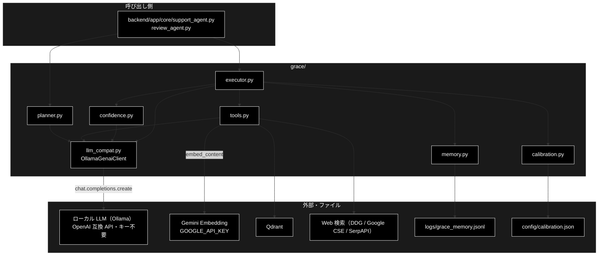
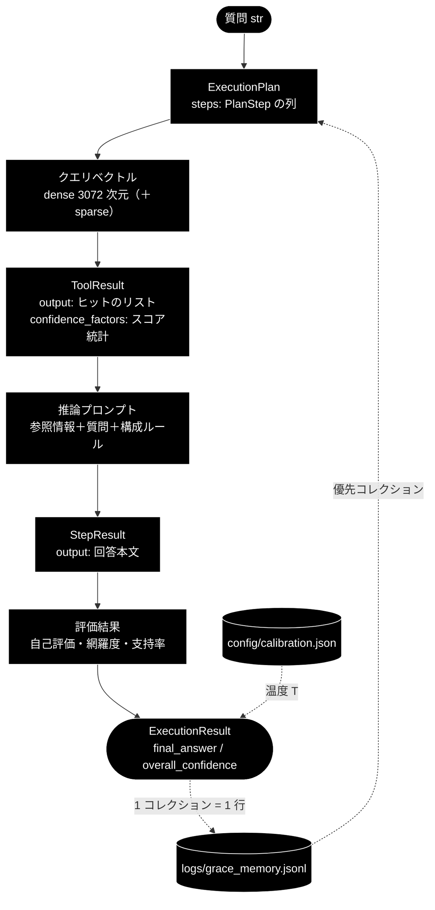

# grace_data_flow.md - grace/ データフロー

**Version 3.4** | 最終更新: 2026-10-30

GRACE を 1 クエリ動かしたときに、**どんなデータがどこからどこへ渡り、どこに残るか**をまとめる。
外部 API（ローカル LLM〔Ollama〕・Gemini Embedding・Qdrant・Web）に渡るもの、プロンプトの所在、
実行メモリ（`logs/grace_memory.jsonl`）と較正ファイル（`config/calibration.json`）の形式を扱う。
処理の順番と分岐は [`grace_process_flow.md`](./grace_process_flow.md)、ディレクトリ全体の入口は [`README_grace.md`](./README_grace.md)。

---

## 目次

- [概要](#概要)
- [1. データの流れ全体](#1-データの流れ全体)
- [2. データ項目と形式](#2-データ項目と形式)
- [3. 変換の詳細](#3-変換の詳細)
  - [3.1 外部 API の発行部](#31-外部-api-の発行部)
  - [3.2 既定の質問で発行される API の順番](#32-既定の質問で発行される-api-の順番)
  - [3.3 実行メモリの蓄積と読み戻し](#33-実行メモリの蓄積と読み戻し)
  - [3.4 プロンプトの所在](#34-プロンプトの所在)
- [4. 保存先・命名・上書き](#4-保存先命名上書き)
- [5. 関連ドキュメント](#5-関連ドキュメント)
- [6. 変更履歴](#6-変更履歴)

---

## 概要

grace の LLM 呼び出しは、すべて genai 形式の `client.models.generate_content(...)` で書かれており、
`grace/llm_compat.py` が Ollama の OpenAI 互換 API（`chat.completions.create(...)`）へ変換して発行する。
LLM はローカルで動くので API キーもトークン課金も無い。検索の Embedding だけは外部の Gemini を使う（課金される）。
grace がディスクへ書くのは実行メモリ（追記）と、オフラインで作る較正ファイル（上書き）の 2 つだけである。

### 主な責務

- 計画・推論・評価のプロンプトを組み立て、ローカル LLM（Ollama）へ送る
- 検索クエリを Gemini Embedding でベクトル化し、Qdrant を検索する
- ツールの結果を `ToolResult` → `StepResult` → `ExecutionResult` の形へまとめる
- 実行の実績を JSONL に追記し、次の計画で読み戻す
- 較正パラメータを JSON に保存し、起動時に読む

### 各責務対応のモジュール

| # | 責務 | 対応モジュール | 説明 |
|---|------|--------------|------|
| 1 | LLM 呼び出しの変換と発行 | `grace/llm_compat.py` / `helper/helper_llm.py` | `_OllamaModels.generate_content` → `OllamaClient.generate_content` → `chat.completions.create(**kwargs)` |
| 2 | ベクトル化と検索 | `grace/tools.py` / `qdrant_client_wrapper.py` | `RAGSearchTool._embed_query_once` → `embed_query`（Gemini `embed_content`）→ Qdrant |
| 3 | 結果の型 | `grace/schemas.py` / `grace/tools.py` | `ToolResult`（ツール）→ `StepResult` / `ExecutionResult`（Pydantic） |
| 4 | 実行メモリ | `grace/memory.py` | `ExecutionMemory.record_many`（書く）/ `best_collection`（読む） |
| 5 | 較正ファイル | `grace/calibration.py` | `Calibrator.save` / `Calibrator.load` |

### アーキテクチャ構成図



**データフロー**:

1. 質問（`str`）が `ExecutionPlan`（JSON 互換の Pydantic）になる。LLM で計画するときは JSON Schema をシステム指示に入れて Ollama へ送る
2. `rag_search` はクエリを 1 回だけベクトル化し、コレクションを順に検索して `ToolResult.output`（ヒットのリスト）と `confidence_factors`（スコアの統計）を返す
3. 推論・評価のプロンプトが Ollama へ送られ、`StepResult` と `ExecutionResult` にまとまる
4. 使ったコレクションと成否が JSONL に 1 行ずつ追記され、次の計画で読み戻される

---

## 1. データの流れ全体



> 📝 本リポジトリでは、検索結果を推論プロンプトへ入れる前に、関連度の低い RAG の結果を外して重複を除き、上限で切る
> （`executor.reasoning_min_rag_score` 0.64・`executor.reasoning_max_sources` 20。`Executor._filter_low_relevance_sources` → `_dedupe_sources`）。
> リプランのたびに同じ検索結果が積み上がり、プロンプトが肥大してローカル LLM がタイムアウトする悪循環を断つため。

---

## 2. データ項目と形式

| データ | 形式（主な項目） | 作る側 | 使う側 | 置き場所 |
|---|---|---|---|---|
| `ExecutionPlan` | Pydantic。`original_query` / `complexity` / `estimated_steps` / `requires_confirmation` / `steps` / `success_criteria` / `created_at` / `plan_id` | `planner.py` | `executor.py` / `replan.py` | メモリ上 |
| `PlanStep` | `step_id` / `action`（`rag_search` / `web_search` / `reasoning` / `ask_user` / `code_execute`）/ `description` / `query` / `collection` / `depends_on` / `expected_output` / `dynamic` / `fallback` / `web_query`（rag_search に持たせる Web 検索語）/ `required`（利用者が求めた web_search）/ `timeout_seconds`（**既定 None＝`planner.step_timeout_seconds` に従う**） | `planner.py`（動的挿入は `executor.py`） | `executor.py` | メモリ上 |
| `ToolResult` | dataclass。`success` / `output` / `confidence_factors` / `error` / `execution_time_ms` | `tools.py` の各ツール | `executor.py` | メモリ上 |
| `rag_search` の `output` | リスト。1 件 = `{"score": float, "collection": str, "payload": {"question", "answer", "source", ...}}` | `RAGSearchTool` | `executor.py`・`ReasoningTool`・GRACE-Review の ② | メモリ上 |
| `rag_search` の `confidence_factors` | 辞書。`result_count` / `avg_score` / `max_score` / `min_score` / `score_variance`（正準キー）と旧キー `top_score` / `score_spread`、使ったコレクション `used_collection` | `RAGSearchTool` | `executor._build_confidence_factors`・実行メモリ | メモリ上 |
| `StepResult` | Pydantic。`step_id` / `status`（`success` / `failed`）/ `output` / `confidence` / `sources`（表示用の識別子）/ `source_texts`（根拠検証用の本文）/ `error` / `execution_time_ms` / `token_usage` / `created_at` | `executor._execute_step` | `executor.py`・呼び出し側 | メモリ上 |
| `ConfidenceScore` | dataclass。`score` / `factors`（`ConfidenceFactors`）/ `breakdown` / `penalties_applied` / `reason` | `confidence.py` | `executor.py`（`step_confidence_scores`） | メモリ上 |
| `GroundednessResult` | dataclass。`support_rate` / `supported` / `contradicted` / `total` / `has_contradiction` / `verified` / `reason` / `claims`（主張ごとの判定）/ `verification_failed`（検証 LLM の空応答・タイムアウト） | `GroundednessVerifier.verify` | `executor.py`・GRACE-Support ③・GRACE-Review ④ | メモリ上（同じ入力の結果は 4 件までキャッシュ。失敗はキャッシュしない） |
| `ExecutionResult` | Pydantic。`plan_id` / `original_query` / `final_answer` / `step_results` / `overall_confidence` / `overall_status` / `replan_count` / `total_execution_time_ms` / `total_token_usage` / `total_cost_usd` / `rag_max_score` / `rag_search_count` / `web_search_used` / `web_searches`（実行した Web 検索の `step_id` / `query` / `reason`）/ `created_at` | `executor._create_execution_result` | 呼び出し側 | メモリ上 |
| 実行メモリの 1 行 | JSON。`{"query", "keywords", "collection", "success", "confidence", "timestamp"}` | `ExecutionMemory.record` | `ExecutionMemory.collection_priors` / `best_collection` | `logs/grace_memory.jsonl`（`memory.path`） |
| 較正ファイル | JSON。`{"method": "temperature_scaling", "temperature": T}` | `Calibrator.save` | `Calibrator.load`（executor の起動時） | `config/calibration.json`（`confidence.calibration_path`） |
| LLM への要求 | `chat.completions.create` の引数。`model` / `messages=[{"role": "system", ...}（JSON を求めるときだけ）, {"role": "user", "content": プロンプト}]` / `max_tokens` / `temperature`（指定があるときだけ）/ `response_format={"type": "json_object"}`（JSON を求めるときだけ）/ `reasoning_effort="none"`（思考の抑止。未対応の Ollama では自動で外す） | `llm_compat.py` → `helper_llm.OllamaClient` | Ollama | — |

> 📝 `total_token_usage` / `total_cost_usd` は、ローカル LLM の分は 0（`llm_compat.py` は usage を空で返す）。

---

## 3. 変換の詳細

### 3.1 外部 API の発行部

| API | プロバイダ | 発行場所（実コード） | 渡すもの | 鍵 |
|---|---|---|---|---|
| LLM テキスト生成 | ローカル LLM（Ollama。既定 `gemma4:26b-a4b-it-qat`） | `grace/llm_compat.py::_OllamaModels.generate_content` → `helper/helper_llm.py::OllamaClient.generate_content` → `chat.completions.create(**kwargs)` | プロンプト 1 本（user メッセージ）と、JSON を求めるときのシステム指示 | **不要**（`ollama serve` が前提。接続先は `OLLAMA_BASE_URL`、既定 `http://localhost:11434/v1`） |
| Embedding | Gemini `gemini-embedding-001`（3072 次元） | `qdrant_client_wrapper.py::embed_query` → `helper/helper_embedding.py` の `embed_content` | 検索クエリの文字列 | `GOOGLE_API_KEY` |
| ベクトル検索 | Qdrant（DB） | `agent_tools.py` / `qdrant_client_wrapper.py` 経由 | クエリベクトル（dense ＋ 取れれば sparse）・コレクション名 | — |
| Web 検索 | DDG / Google CSE / SerpAPI | `grace/tools.py::WebSearchTool` | 検索クエリ | 選んだ backend による |

`generate_content(model, contents, config)` から `chat.completions.create` の引数への変換（`grace/llm_compat.py` → `helper/helper_llm.py`）:

| genai 側（`config` のキー） | Ollama 側 | 変換の規則 |
|---|---|---|
| `model` | `model` | 省略すると `create_chat_client()` に渡した `config.llm.model` |
| `contents` | `messages=[..., {"role": "user", "content": ...}]` | 文字列でなければ `str()` |
| `response_mime_type="application/json"` / `response_schema` | `messages` の先頭の system ＋ `response_format={"type": "json_object"}` | 「厳密な JSON ジェネレーター」の指示と、`response_schema` の JSON Schema を system に入れる。返答は `_strip_think`（思考タグ）→ `_strip_to_json`（コードフェンス・前後の文）の順で掃除する |
| `max_output_tokens` | `max_tokens` | 未指定は 4096（Ollama は `max_tokens` しか受け付けない） |
| `temperature` | `temperature` | 指定があるときだけ送る |
| — | `reasoning_effort` | 既定 `"none"`（`OLLAMA_REASONING_EFFORT`）。思考モデルが思考だけで出力枠を使い切るのを防ぐ。拒否されたら外して送り直し、以降そのクライアントでは送らない |
| — | 期限・再試行 | 1 リクエストの期限は `config.llm.timeout`（既定 180 秒）、SDK の再試行は 0 回。`planner.step_timeout_seconds`（240 秒）より必ず短くする |

> ⚠️ **`json_object` は「有効な JSON」しか保証しない**（スキーマへの適合は保証しない）。受け取った側で必ず `model_validate_json` し、
> 失敗したら呼び出し側の既定値へ落ちる。数値だけを求める呼び出し（自己評価・網羅度）は `parse_score` で数値部分を拾う。
> 詳細は [`llm_compat.md`](./llm_compat.md)。

`rag_search` は**クエリを 1 回だけベクトル化**して（`RAGSearchTool._embed_query_once`）、許可されたコレクションを順に検索する
（コレクションが 2 つ以上のとき。1 つなら下位が都度ベクトル化する）。一次しきい値に届くコレクションがあればそこで採用し、
無ければいちばんスコアの高いコレクションを保留して、`executor.reasoning_min_rag_score`（0.64）以上なら採用する。
それも下回れば 0 件で返し、Web 検索へ委ねる。検索できるコレクションが 1 つも無い（Qdrant 未起動など）ときは `success=False` を返す。

### 3.2 既定の質問で発行される API の順番

「住民票の写しの取り方は？」（ルールベースで `rag_search → reasoning` の 2 ステップになる典型例）を、
Ollama と `rag_search` をスタブにして 1 回実行し、`OllamaClient.generate_content` の呼び出しを記録した（2026-10-10・既定の設定）。

| 順 | 段 | 発行 API | モデル・出力 | 用途（プロンプトの所在は §3.4） |
|:--:|---|---|---|---|
| 1 | ① Plan | （発行なし） | — | ルールベースの計画。LLM は使わない |
| 2 | ② `rag_search` | Gemini `embed_content` → Qdrant | `gemini-embedding-001` | クエリのベクトル化と検索（今回の記録ではスタブ） |
| 3 | ② RAG の適合性 | Ollama（テキスト・`max_tokens=256`） | `gemma4:26b-a4b-it-qat` | 検索結果が質問に答える根拠として使えるか（`Executor._evaluate_rag_relevance`。スコアが 0.64 以上のときだけ） |
| 4 | ② `reasoning` | Ollama（テキスト・4096） | `gemma4:26b-a4b-it-qat` | 回答の生成（`ReasoningTool`） |
| 5 | ③ 最終評価 | Ollama（JSON・1024） | `gemma4:26b-a4b-it-qat` | 自己評価＋網羅度（`LLMSelfEvaluator.evaluate_final`） |
| 6 | ③ 根拠検証 | Ollama（JSON・1024） | `gemma4:26b-a4b-it-qat` | 主張ごとの supported / contradicted / neutral（`GroundednessVerifier.verify`） |

> 📝 **ステップ信頼度の LLM 採点は発行されない**（`judges.step_confidence_llm=false`。ヒューリスティックで採点する）。
> true にすると、`rag_search` と `reasoning` の後に 1 回ずつ（JSON・1024）増える（同じ条件で記録して確かめた）。
> 5・6 は 4 の後に**順番に**発行する（grace_v2 にある先行実行〔`_prefetch_final_evaluation`〕は本リポジトリには無い）。
> 軽量モデル（`llm.light_model`）も既定で同じモデルなので、ローカル LLM はモデルを載せ替えずに済む。
> RAG のスコアが 0.64 未満なら 3 の代わりに Web 検索が入る（`WebSearchTool`）。
> リプラン（`context_hints` あり）と `planner.force_llm_plan` のときは、1 の代わりに計画生成（JSON）が 1 回発行される（2026-10-29 に複雑度の LLM 推定は削除した）。
> GRACE-Support は、この前に 0-(A) 質問の整理（`backend/app/core/question_refiner.py`）をローカル LLM で 1 回呼び（`judges.enabled` に関係なく毎回）、① は観点ごとの計画（`create_plan_for_topic`）にするので、
> 観点が 2 つなら検索と適合性の判定が観点ごとに発行される。このあと判定系（`backend/app/core/gates.py`）を呼ぶが、`judges.enabled=false`（既定）ではキーワード判定に倒れる（いずれも grace の外）。

### 3.3 実行メモリの蓄積と読み戻し

**executor が書き、planner が読む**一方通行の学習ループ。旧 `grace_core.md` §4 を実装と突き合わせて移した。

**書く（`executor.py::Executor._record_memory`）**

| # | 条件 | 動き |
|:--:|---|---|
| 1 | メモリが無効（`memory.enabled=false`） | 記録しない |
| 2 | 使った RAG コレクションが無い（Web 検索だけ・ask_user だけ） | 記録しない（RAG を使っていないので学習の対象外） |
| 3 | それ以外 | 計画どおりのステップ（**動的に挿入したステップは除く**）がすべて `success` で、かつ最終回答があれば `success=true`。**失敗も `success=false` として記録する** |

使ったコレクションは、`rag_search` が成功するたびに `ToolResult.confidence_factors["used_collection"]` から
`ExecutionState.used_collections` に重複なく追記される。`ExecutionMemory.record_many` はコレクションごとに 1 行ずつ JSONL へ追記する
（書き込みは best-effort。失敗しても警告だけで実行は止めない）。

> ⚠️ **3 で動的なステップを除く理由（回帰修正）。** RAG のスコアが足りないと `web_search` / `ask_user` が動的に挿入される。
> 以前は全ステップを集計していたため、**Web 検索が落ちただけで `success=false`** になり、正しく答えられた RAG コレクションに
> 「失敗」が刻まれて planner の優先順位を毒していた（実測 2026-08-29）。除外するのは `state.dynamic_steps`（実際に挿入して実行した id）と
> `PlanStep.dynamic`（ステップ側の印）の**両方**を足したもの（片方だけでは漏れる）。

**キーワードの抽出（`memory.py::extract_keywords`）**: NFKC で全角・半角を揃えて小文字にし、英数字・漢字・カタカナの
2 文字以上の連続を拾う。形態素解析はせず、**ひらがなを区切り**にする（助詞・活用語尾はひらがななので、内容語がほぼ残る）。

```python
extract_keywords("Python の歴史を教えて")
# → ['python', '歴史']
```

格納される 1 行の例:

```json
{"query": "Python の歴史を教えて", "keywords": ["python", "歴史"], "collection": "saas_docs_anthropic", "success": true, "confidence": 0.85, "timestamp": 1750000000.0}
```

> 📝 照合では行の `keywords` ではなく `query` から抽出し直す。2026-10-15 以前の行の `keywords` は旧規則
> （漢字・かな・カナの連続を 1 語。`['python', 'の歴史を教えて']`）の値なので、そのままでは今の規則の語と一致しない。

**読む（`planner.py::Planner._prioritized_collection` → `memory.py::ExecutionMemory.best_collection`）**

| 段 | 場合分け | 結果 |
|---|---|---|
| planner | メモリが無効 | `None`（全コレクションを検索） |
| `collection_priors` | 質問のキーワードと 1 つでも一致する過去の行がある | その行だけで集計する |
| `collection_priors` | 一致する行が 0 件 | `[]`（→ `best_collection` は `None`）。2026-10-15 までは全部の行で集計しており、実績の多いコレクションが無関係な質問にも付いていた |
| `best_collection` | 件数 ≥ `memory.min_count`（3）かつ スコア ≥ `memory.min_score`（0.6） | そのコレクション名（計画の `rag_search` の `collection` に入り、**先頭で**検索される。他のコレクションも後ろで検索される） |
| `best_collection` | それ以外・除外対象のコレクション | `None`（`qdrant.excluded_collections` に当たるものは返さない） |

スコアは `(成功数 + 1) / (件数 + 2) × 平均信頼度`（Laplace 平滑化）。「API の◯◯」を 3 回聞いて 3 回とも `saas_api_anthropic` が当たり、
信頼度が 0.85 / 0.88 / 0.80 だったとき、4 回目の質問「API のエラーコード一覧」では
`count=3`・スコア `(3+1)/(3+2) × 0.843 ≈ 0.675` で条件を満たし、`saas_api_anthropic` を先頭にして検索する（3 回目までは件数不足で全検索）。
コレクション名の `*_anthropic` は grace_v2 と共用している Qdrant の実データの名前で、LLM とは無関係（CLAUDE.md §3）。

> ⚠️ **`qdrant.excluded_collections` に当たるコレクションは、実績があっても選ばれない**（既定で `wikipedia` / `cc_news` / `fineweb` /
> `livedoor` / `japanese_text` を部分一致で除外）。除外対象が首位なら次点を採る（`best_collection(exclude=...)`）。

### 3.4 プロンプトの所在

プロンプトの**全文は各モジュールの文書**に置く（同じ文を 2 か所に持たない）。ここには所在と、どの呼び出しで使うかだけを書く。

| プロンプト | 定義（ファイル::シンボル） | 使う呼び出し | 全文の所在 |
|---|---|---|---|
| 計画生成 | `planner.py::PLAN_GENERATION_PROMPT`（f 文字列で `services/prompts.py::SEARCH_QUERY_INSTRUCTION` を埋め込む。`Planner._build_plan_prompt` が利用可能なコレクション・リプランの補足・JSON の念押しを足す） | LLM 計画（リプラン・`planner.force_llm_plan`） | [`planner.md` §5.5](./planner.md#55-プロンプト全文) |
| 推論（回答の生成） | `tools.py::ReasoningTool._build_prompt` | `reasoning` ステップ | [`tools.md` §5.6](./tools.md#56-推論プロンプトreasoningtool_build_prompt) |
| 自己評価＋網羅度 | `confidence.py::LLMSelfEvaluator.FINAL_EVAL_PROMPT` | 最終評価（`evaluate_final`） | [`confidence.md` §5.7](./confidence.md#57-プロンプト全文) |
| 確信度（単独） | `confidence.py::LLMSelfEvaluator.EVAL_PROMPT` | `evaluate()` | [`confidence.md` §5.7](./confidence.md#57-プロンプト全文) |
| ステップ信頼度 | `confidence.py::LLMSelfEvaluator.evaluate_with_factors` | 各ステップの信頼度（`llm_calculate`。`judges.step_confidence_llm=true` のときだけ） | [`confidence.md` §5.7](./confidence.md#57-プロンプト全文) |
| 網羅度（単独） | `confidence.py::QueryCoverageCalculator.COVERAGE_PROMPT` | `QueryCoverageCalculator.calculate()` | [`confidence.md` §5.7](./confidence.md#57-プロンプト全文) |
| 根拠検証 | `confidence.py::GroundednessVerifier.PROMPT` | 根拠検証（`verify`） | [`confidence.md` §5.7](./confidence.md#57-プロンプト全文) |
| RAG の適合性 | `executor.py::Executor._evaluate_rag_relevance` | RAG のスコアが十分なときの判定 | [`executor.md` §5.3](./executor.md#53-プロンプト) |
| ReAct の次の 1 手 | `executor.py::Executor.REACT_PROMPT` | ReAct ループ（`_decide_next_action`） | [`executor.md` §5.3](./executor.md#53-プロンプト) |
| JSON を求めるときのシステム指示 | `llm_compat.py::_OllamaModels.generate_content` | JSON を求める全呼び出し | [`llm_compat.md`](./llm_compat.md) |

---

## 4. 保存先・命名・上書き

| データ | 保存先（設定キー） | 書き方 | 消すとどうなるか |
|---|---|---|---|
| 実行メモリ | `logs/grace_memory.jsonl`（`memory.path`） | **追記**（1 実行 × 使ったコレクション数の行）。ディレクトリが無ければ作る | 学習した優先順位が消え、全コレクションの検索に戻るだけ |
| 較正ファイル | `config/calibration.json`（`confidence.calibration_path`） | `Calibrator.save` で**上書き**。executor は起動時（`Executor.__init__`）に読む | 恒等変換（T=1.0）に戻る |
| Qdrant のコレクション | Qdrant（`qdrant.url`。grace_v2 と共用） | grace は**読むだけ**（登録は `qa_qdrant/`） | — |

> ⚠️ 実行メモリはプロセスをまたいで効く。誤って採用されたコレクションが `success` として記録されると、以後の計画がそこへ絞られる
> （`planner._prioritized_collection` が `qdrant.excluded_collections` を見て除外するのはこのため）。おかしな絞り込みが続くときは
> `logs/grace_memory.jsonl` の該当行を確認する。

---

## 5. 関連ドキュメント

| 文書 | 内容 |
|---|---|
| [`README_grace.md`](./README_grace.md) | grace/ の概要・モジュール索引・使い方 |
| [`grace_process_flow.md`](./grace_process_flow.md) | 処理の順番・分岐・介入・リプラン |
| [`llm_compat.md`](./llm_compat.md) | LLM 呼び出しの変換の IPO |
| [`memory.md`](./memory.md) / [`calibration.md`](./calibration.md) | 実行メモリ・較正の IPO |
| [`README_backend_app.md` §4.3](../../backend/app/docs/README_backend_app.md) | モデル・プロバイダの方針とモデル名の解決経路 |

---

## 6. 変更履歴

| バージョン | 日付 | 変更内容 |
|---|---|---|
| 1.0 | — | 初版作成。参考ドキュメント（`grace_core.md` / `grace.md`）の明示、A: 5 段階設計、B: 8 コアモジュール構成（構成図＋依存テーブル）、C: 役割サマリー、D: `agent_example.py` の全文・実行フロー・行解説・実行方法、E: 補足説明を整備 |
| 1.1 | — | D の直後に「E. プロンプトと API 発行部」を追加（API 発行部の実コード、利用プロンプト全文＝計画生成／複雑度推定／推論／信頼度評価群、既定クエリの API 発行順フロー図）。旧 E「理解のための補足説明」を F に繰り下げ |
| 2.0 | — | 実装との突き合わせによる全面訂正。(1) **§D が題材にしていた `agent_example.py` はリポジトリに存在しない**ため、「本書内の解説用コード片」と明示し、実物のエントリポイント（`agent_support_example.py` / `grace/step_trace/`）を案内する形へ改めた。(2) プロバイダ表記を **Ollama（LLM）／Gemini（Embedding のみ）** へ是正（CLAUDE.md §3・§9.3）。§E.2 の LLM 発行部を `_AnthropicModels.generate_content` から**実際の既定経路である `_OllamaModels.generate_content`** へ差し替え、`_strip_think` の適用順・`json_object` の制約・`parse_score` の必要性を追記。(3) **§E.4.3 の推論プロンプトを現行実装へ更新**（規則 5 個 → 7 個。【現在日時】・出典種別の偽装対策・URL 転記・情報源番号の非露出が追加されており、いずれも実測の誤りを潰すために足されたもの）。(4) §E.4.4 (2) の `evaluate()` に**呼び出し元が存在しない**旨を追記。(5) `agent_rag.py` / Streamlit（本リポジトリに存在しない）の参照を React UI + FastAPI SSE へ差し替え。(6) `grace/doc/`（単数形）リンクを `grace/docs/` へ是正、モジュール図に opt-in の `CodeExecuteTool` を追記 |
| 2.1 | 2026-09-24 | `a_cross_doc_md_format.md` v1.2（種別 A）に準拠（2026-09-24）。概要に主な責務・各責務対応のモジュール・アーキテクチャ構成図（正本 `grace_core.md` §1.1 へのリンクとデータフロー）を追加。Mermaid の `classDef subgraphStyle` の欠落を補った。本文の章番号は変えていない |
| 2.2 | 2026-10-06 | 2026-10-06: 現在の既定モデルの記載 `gemma4:12b-mlx` を、2026-10-03 の変更後の値 `gemma4:26b-a4b-it-qat`（`config.py::get_default_ollama_model()` の戻り値）へ是正（変更履歴の中の記述は当時の値として残す） |
| 2.3 | 2026-10-08 | 2026-10-08: Anthropic 予備経路（`AnthropicGenaiClient`・拡張思考予算 `thinking_budget_tokens`）の削除に追随。§E.2 の `generate_content` / `create_chat_client` の抜粋を現行コードへ更新（`"anthropic"` は `ValueError`） |
| 2.4 | 2026-10-10 | `grace/step_trace/`（`benchmark.py` を含む）を 2026-10-10 にディレクトリごと削除したのに追随し、現状を述べる記述から外した（過去の経緯の記述は残す） |
| 3.0 | 2026-10-10 | **`grace_core_flow.md` を `grace_data_flow.md` へ改称し、データフローの文書に作り直した**（`a_cross_doc_md_format.md` §1.3）。(1) 旧 §A（5 段階設計）・§C（役割サマリー）・§F（補足説明）は `README_grace.md` の「設計の考え方」・§1 へ、旧 §B（モジュール構成図・依存関係）は `README_grace.md` §1 へ、旧 §D（最小実行サンプル）は `executor.md` §4.1 へのリンクに置き換えた（同じコードを 2 か所に置かない）。(2) 旧 §E.4 のプロンプト全文は、実装から書き出し直して各モジュールの文書（`planner.md` §5.5・`executor.md` §5.3・`tools.md` §5.6・`confidence.md` §5.7）へ移し、本書は所在だけを持つ（§3.4）。(3) §3.2 の API の順番を、スタブで 1 回実行して `OllamaClient.generate_content` を記録した実測に置き換えた（旧 §E.5 は RAG の適合性の判定を数えておらず、`judges.step_confidence_llm=false` でステップ信頼度の LLM 採点が発行されないことも書いていなかった）。(4) LLM 呼び出しの変換（§3.1）に、`reasoning_effort`・期限と再試行・`json_object` の制約を足した。(5) 旧 `grace_core.md` §4 の実行メモリの章を §3.3 へ移した。(6) データ項目と形式（§2）・保存先（§4）を新設した |
| 3.1 | 2026-10-12 | backend/docs/ の廃止（2026-10-12）に追随し、参照先を backend/app/docs/README_app.md・backend/app/api/docs/README_api.md・backend/app/core/docs/core_process_flow.md などへ付け替えた（テストの地図は docs/testing.md、実行例の txt は docs/examples/） |
| 3.2 | 2026-10-14 | 索引の改名（backend/app/docs/README_app.md → README_backend_app.md）に合わせて参照を付け替えた |
| 3.3 | 2026-10-15 | grace_v2 から移植。§3.3 実行メモリを実装に追随: キーワード抽出をひらがな区切りに変えたこと（例と格納行を新しい値に）、照合は `query` から抽出し直すこと、重なり 0 件は全体集計へ倒さず `[]` になること。`best_collection` の戻り値は rag_search を「絞る」のではなく「先頭に置く」（他のコレクションも検索される）と是正 |
| 3.4 | 2026-10-30 | §2 に `PlanStep.web_query` / `required` と `ExecutionResult.web_searches` を足し、§3.4 から削除した複雑度推定のプロンプト（`COMPLEXITY_ESTIMATION_PROMPT`）の行を外した。計画生成のプロンプトを使う場面（§3.2 の注記・§3.4）をリプラン・`force_llm_plan` に直し、§3.2 に 0-(A) の呼び出しと観点ごとの発行を書き足した（grace_v2 の grace_data_flow.md v4.4 と同じ） |
