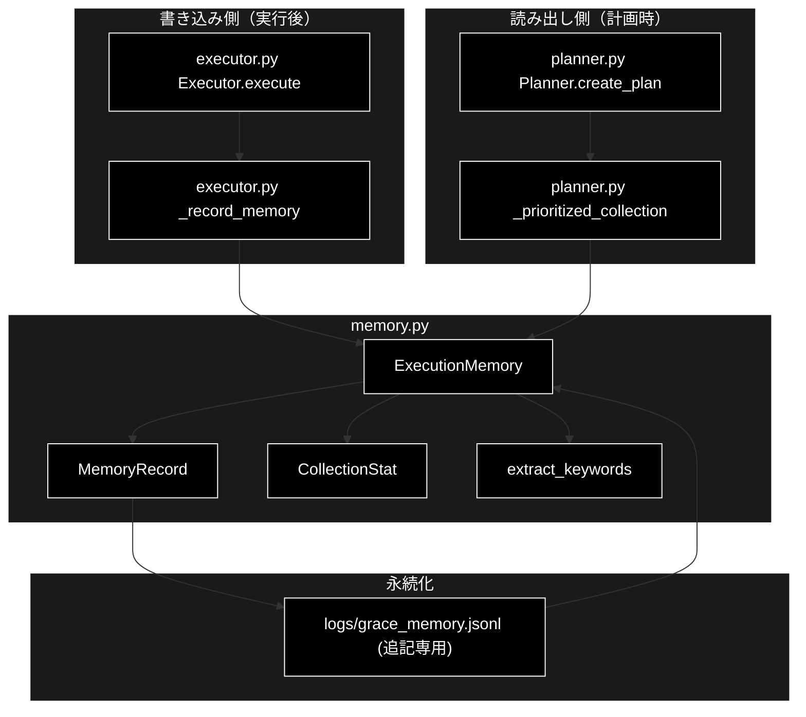
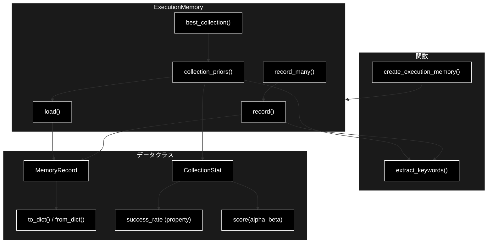
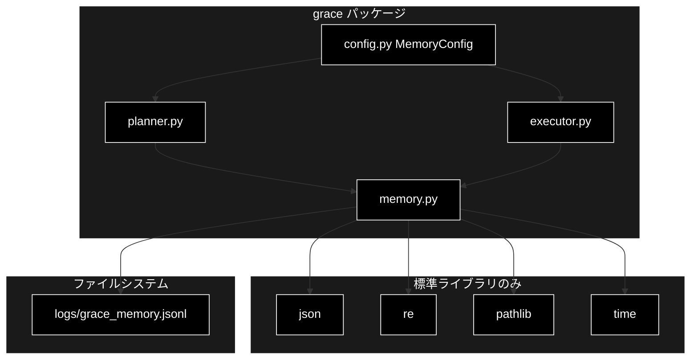

# memory.py - GRACE 実行メモリ層（P4） ドキュメント

**Version 1.3** | 最終更新: 2026-10-10

---

## 目次

1. [概要](#概要)
2. [アーキテクチャ構成図](#1-アーキテクチャ構成図)
3. [モジュール構成図](#2-モジュール構成図)
4. [クラス・関数一覧表](#3-クラス関数一覧表)
5. [クラス・関数 IPO詳細](#4-クラス関数-ipo詳細)
6. [設定・定数](#5-設定定数)
7. [エクスポート](#6-エクスポート)
8. [変更履歴](#7-変更履歴)
9. [付録: 依存関係図](#付録-依存関係図)

---

## 概要

`memory.py` は、GRACE の **実行メモリ層（P4）** を提供するモジュールです。実行のたびに
「(質問キーワード, 当たったコレクション, 成否, confidence)」を JSONL へ蓄積し、次回以降の
`Planner` のコレクション優先順位に反映します。**「この種の質問はどのコレクションで当たりやすいか」を
実績から学習する**のが役割です。

> 📌 **LLM も Embedding も使わない。** 本モジュールは外部依存なし・決定的で、キーワード抽出も
> 正規表現ベース（形態素解析非依存）です。そのためユニットテストが容易です。

### 主な責務

- 実行結果（質問・コレクション・成否・confidence）の JSONL への追記
- 破損行を飛ばした頑健な読み込み
- コレクションごとの成功率×平均 confidence の集計（Laplace 平滑化つき）
- 質問キーワードで絞り込んだ「その種の質問に対する」事前分布の算出
- 十分な実績があるときだけ最良コレクションを返す（早まった固定を避ける）

### 各責務対応のモジュール

| # | 責務 | 対応モジュール | 説明 |
|---|------|--------------|------|
| 1 | JSONL への追記 | `grace/memory.py` / `grace/executor.py` | `ExecutionMemory.record()` / `record_many()`。実行完了時に `Executor._record_memory()` が呼ぶ |
| 2 | 破損行を飛ばした読み込み | `grace/memory.py` | `ExecutionMemory.load()` |
| 3 | 成功率 × 平均 confidence の集計 | `grace/memory.py` | `ExecutionMemory.collection_priors()` と `CollectionStat.score()`（Laplace 平滑化） |
| 4 | 質問キーワードで絞った事前分布 | `grace/memory.py` | `extract_keywords()` で抽出したキーワードで `collection_priors()` の対象を絞る |
| 5 | 実績が十分なときだけ最良コレクションを返す | `grace/memory.py` / `grace/planner.py` | `ExecutionMemory.best_collection()`。呼び出し側は `Planner._prioritized_collection()` |

### 主要機能一覧

| 機能 | 説明 |
|------|------|
| `extract_keywords()` | 正規表現による軽量キーワード抽出（決定的・形態素解析非依存） |
| `MemoryRecord` | 1 実行レコードのデータクラス |
| `MemoryRecord.to_dict()` / `from_dict()` | JSONL との相互変換 |
| `CollectionStat` | コレクション単位の集計結果データクラス |
| `CollectionStat.success_rate` | 成功率（プロパティ） |
| `CollectionStat.score()` | Laplace 平滑化した成功率 × 平均 confidence |
| `ExecutionMemory` | 実行レコードの蓄積と事前分布の算出 |
| `ExecutionMemory.record()` | 1 レコードを JSONL へ追記（best-effort） |
| `ExecutionMemory.record_many()` | 複数コレクションをまとめて記録（重複除去つき） |
| `ExecutionMemory.load()` | JSONL を読み込む（破損行はスキップ） |
| `ExecutionMemory.collection_priors()` | コレクション事前分布を score 降順で返す |
| `ExecutionMemory.best_collection()` | 条件を満たす最良コレクションを返す（無ければ `None`） |
| `create_execution_memory()` | `ExecutionMemory` を生成するファクトリ関数 |

---

## 1. アーキテクチャ構成図

### 1.1 システム全体構成



### 1.2 データフロー

1. `Executor` が実行を終えると `_record_memory()` が `state.used_collections` を集める
   （**コレクション未使用＝Web のみ等は記録しない**）
2. `record_many()` が質問・各コレクション・成否・`overall_confidence` を JSONL へ 1 行ずつ追記
3. 次回以降、`Planner._prioritized_collection()` が `best_collection(query=...)` を呼ぶ
4. `collection_priors()` が JSONL を読み、質問キーワードが重なるレコードだけを集計
5. `count >= min_count` かつ `score >= min_score` を満たす先頭を優先コレクションとして返す
6. 条件を満たすものが無ければ `None` を返し、**全コレクション検索へフォールバック**する

---

## 2. モジュール構成図

### 2.1 内部モジュール構成



### 2.2 外部依存関係

| ライブラリ | バージョン | 用途 |
|-----------|-----------|------|
| `json` | 標準ライブラリ | JSONL の読み書き |
| `logging` | 標準ライブラリ | 失敗時の警告出力 |
| `re` | 標準ライブラリ | キーワード抽出 |
| `time` | 標準ライブラリ | タイムスタンプ |
| `dataclasses` | 標準ライブラリ | `MemoryRecord` / `CollectionStat` |
| `pathlib` | 標準ライブラリ | ファイルパス操作 |

> 📌 **サードパーティ依存はゼロ**。LLM クライアントも Embedding クライアントも使わない。

### 2.3 内部依存モジュール

なし（`grace/` 内の他モジュールを import しない）。逆に `planner.py` と `executor.py` から
`create_execution_memory` として import される。

---

## 3. クラス・関数一覧表

### 3.1 データクラス一覧

#### MemoryRecord

| フィールド | 型 | 概要 |
|---|---|---|
| `query` | `str` | 実行時の質問文 |
| `keywords` | `list[str]` | `extract_keywords()` の結果 |
| `collection` | `Optional[str]` | 使用したコレクション名 |
| `success` | `bool` | 実行が成功したか |
| `confidence` | `float` | `overall_confidence` |
| `timestamp` | `float` | 記録時刻（既定 `time.time()`） |

#### CollectionStat

| フィールド/プロパティ | 型 | 概要 |
|---|---|---|
| `collection` | `str` | コレクション名 |
| `count` | `int` | レコード件数 |
| `success_count` | `int` | 成功件数 |
| `mean_confidence` | `float` | confidence の平均 |
| `success_rate` | `float`（プロパティ） | `success_count / count`（0 件なら 0.0） |

### 3.2 クラス一覧

#### ExecutionMemory

| メソッド | 概要 |
|---|---|
| `__init__(path)` | JSONL のパスを保持 |
| `record(query, collection, success, confidence, keywords=None)` | 1 レコードを追記 |
| `record_many(query, collections, success, confidence, keywords=None)` | 複数コレクションを重複除去して記録 |
| `load()` | JSONL を読み込む（破損行はスキップ） |
| `collection_priors(query=None, min_keyword_overlap=1)` | 事前分布を score 降順で返す |
| `best_collection(query=None, min_count=3, min_score=0.6)` | 条件を満たす最良コレクション |

### 3.3 ファクトリ関数一覧

| 関数 | 概要 |
|---|---|
| `create_execution_memory(path=DEFAULT_MEMORY_PATH)` | `ExecutionMemory` を生成 |

---

## 4. クラス・関数 IPO詳細

### 4.1 使用例

実行メモリは **executor が書き、planner が読む**（流れの全体は [`grace_data_flow.md` §3.3](./grace_data_flow.md#33-実行メモリの蓄積と読み戻し)）。
使い方は次の 4 通り。

| 処理パターン | 呼び方 | 向いている場面 | 例 |
|---|---|---|---|
| 記録して推奨を得る | `record` / `record_many` → `collection_priors` → `best_collection` | メモリ単体の動きを確かめる | 4.1.1 |
| 除外述語つきで推奨を得る | `best_collection(..., exclude=...)` | planner と同じ呼び方。除外対象のコレクションを飛ばして次点を採る | 4.1.2 |
| planner に使わせる | `config.memory.path` を指定して `create_planner(config)` | 貯めた実績で計画の `rag_search` を絞る | 4.1.3 |
| テストで使う | `create_execution_memory(str(tmp_path / "m.jsonl"))` | API キーも Qdrant も不要な単体テスト | 4.1.4 |

> 📝 4 本とも**そのまま実行し**、出力を確かめてある（2026-10-10。外部は使わない。ファイルは一時ディレクトリへ書いた。
> 4.1.3 は Qdrant のコレクション一覧だけをスタブにした。4.1.4 は pytest で実行した）。

#### 4.1.1 基本的なワークフロー（記録して推奨を得る）

```python
from grace.memory import create_execution_memory

memory = create_execution_memory("logs/grace_memory.jsonl")

# 1. 1 回の実行を記録する（使ったコレクションごとに 1 行。失敗も success=False で記録する）
memory.record_many(query="API のレート制限は？", collections=["saas_api_anthropic"], success=True, confidence=0.85)
print(memory.best_collection(query="API のエラーコード一覧"))   # まだ 1 件なので None

# 2. 実績を貯める
memory.record("API キーの再発行方法", "saas_api_anthropic", success=True, confidence=0.88)
memory.record("API の認証方式", "saas_api_anthropic", success=True, confidence=0.80)

# 3. キーワードが一致する実績で集計する（一致が 0 件なら全部の実績で集計する）
for stat in memory.collection_priors(query="API のエラーコード一覧"):
    print(f"{stat.collection}: count={stat.count} score={stat.score():.3f}")

# 4. 件数 >= 3 かつ スコア >= 0.6 なら、そのコレクションを推す
print(memory.best_collection(query="API のエラーコード一覧"))
```

```
# 出力例:
# None
# saas_api_anthropic: count=3 score=0.675
# saas_api_anthropic
```

> 📝 スコアは `(成功数 + 1) / (件数 + 2) × 平均信頼度`（Laplace 平滑化）。キーワードは形態素解析をしないので、
> 日本語は区切りまでが丸ごと 1 語になる（`extract_keywords("Python の歴史を教えて")` → `['python', 'の歴史を教えて']`）。
> 英語・カタカナ語・型番などの**独立した語が共通する質問どうし**でだけ、キーワードの一致が効く。

#### 4.1.2 除外述語つきで推奨を得る（planner の呼び方）

```python
from grace.memory import create_execution_memory

memory = create_execution_memory("logs/grace_memory_exclude.jsonl")
for _ in range(3):
    memory.record_many(query="住民票の写しの取り方", collections=["wikipedia_ja_5per", "gov_faq"],
                       success=True, confidence=0.9)

excluded = ["wikipedia"]   # config.qdrant.excluded_collections と同じ「部分一致」

print(memory.best_collection(query="住民票の写しの取り方"))
print(memory.best_collection(
    query="住民票の写しの取り方",
    min_count=3,
    min_score=0.6,
    exclude=lambda c: any(k in c for k in excluded),   # Planner._is_excluded と同じ判定
))
```

```
# 出力例:
# wikipedia_ja_5per
# gov_faq
```

> ⚠️ **除外対象は「飛ばして次点を採る」**（None を返さない）。`best_collection()` の戻り値は計画の `PlanStep.collection` に入り、
> `RAGSearchTool` から見ると運用者の明示指定と区別が付かないので、`exclude` を渡さないと `qdrant.excluded_collections` を素通りする
> （実測 2026-08-17: 天気の質問で誤採用されたコレクションが首位に居座り、無関係な質問でもそこが選ばれた）。

#### 4.1.3 planner に使わせる

```python
import copy

from grace.config import get_config
from grace.memory import create_execution_memory
from grace.planner import create_planner

config = copy.deepcopy(get_config())
config.memory.path = "logs/grace_memory_planner.jsonl"   # 試すときは本番の logs/grace_memory.jsonl と分ける

# 1. executor の代わりに実績を書き込む
memory = create_execution_memory(config.memory.path)
for q in ["API のレート制限は？", "API キーの再発行方法", "API の認証方式"]:
    memory.record(q, "saas_api_anthropic", success=True, confidence=0.85)

# 2. planner は計画を作るときにメモリへ相談し、rag_search の collection を絞る
plan = create_planner(config).create_plan("API のエラーコード一覧")
print([(s.action, s.collection) for s in plan.steps])
```

```
# 出力例:
# [('rag_search', 'saas_api_anthropic'), ('reasoning', None)]
```

> ⚠️ **`qdrant.excluded_collections`（既定で `wikipedia` / `cc_news` / `fineweb` / `livedoor` / `japanese_text` を部分一致で除外）に当たるコレクションは、
> 実績があっても選ばれない**（4.1.2）。上の例を `wikipedia_ja` で試すと `collection` は `None` のままになる。
>
> 📝 `config.memory.enabled = False` にすると planner も executor もメモリを使わない（読みも書きもしない）。

#### 4.1.4 テストで使う

```python
from grace.memory import create_execution_memory


def test_best_collection_skips_excluded(tmp_path):
    memory = create_execution_memory(str(tmp_path / "m.jsonl"))
    for _ in range(3):
        memory.record_many(query="住民票", collections=["bad", "gov_faq"], success=True, confidence=0.9)

    # 除外しなければ首位が返る
    assert memory.best_collection(query="住民票") in {"bad", "gov_faq"}

    # 除外すると次点が返る（None にはならない）
    assert memory.best_collection(query="住民票", exclude=lambda c: c == "bad") == "gov_faq"
```

API キーも Qdrant も不要で、pytest の `tmp_path` を渡すだけで完結する。

---

### 4.2 `extract_keywords`

**概要**: 軽量なキーワード抽出（形態素解析非依存・決定的）。

```python
def extract_keywords(text: str, top_n: int = 8) -> list[str]
```

| パラメータ | 型 | 既定 | 説明 |
|---|---|---|---|
| `text` | `str` | - | 対象テキスト（質問文） |
| `top_n` | `int` | `8` | 抽出する最大件数 |

| 区分 | 内容 |
|---|---|
| **Input** | `text`（空なら即 `[]`） |
| **Process** | `_KEYWORD_RE`（英数字 2 文字以上、または漢字・かな・カナ 2 文字以上）で走査し、小文字化して**出現順に重複排除**。`top_n` 件に達したら打ち切る |
| **Output** | `list[str]`（出現順・重複なし・最大 `top_n` 件） |

**戻り値例**

```python
extract_keywords("住民票の写しの取り方と、その手数料を教えてください")
# ['住民票', 'その手数料', ...]  ※実際の分割は正規表現による
```

---

### 4.3 `MemoryRecord.to_dict` / `from_dict`

**概要**: JSONL 1 行との相互変換。

```python
def to_dict(self) -> dict
@classmethod
def from_dict(cls, d: dict) -> "MemoryRecord"
```

| 区分 | 内容 |
|---|---|
| **Input** | `to_dict`: なし ／ `from_dict`: `dict`（欠損キーを許容） |
| **Process** | `from_dict` は `d.get(...)` と型変換で**欠損・型違いを吸収**する（`keywords` は `list`、`success` は `bool`、`confidence`/`timestamp` は `float`） |
| **Output** | `dict` ／ `MemoryRecord` |

---

### 4.4 `CollectionStat.score`

**概要**: Laplace 平滑化した成功率 × 平均 confidence。

```python
def score(self, alpha: float = 1.0, beta: float = 1.0) -> float
```

| 区分 | 内容 |
|---|---|
| **Input** | `alpha` / `beta`（平滑化パラメータ） |
| **Process** | `smoothed_sr = (success_count + alpha) / (count + alpha + beta)` を計算し、`mean_confidence` を掛ける。**平滑化により、1〜2 件しか実績が無いコレクションが満点を取らない** |
| **Output** | `float`（スコア） |

**戻り値例**

```python
# count=1, success_count=1, mean_confidence=0.9 の場合
# smoothed_sr = (1+1)/(1+1+1) = 0.667 → score = 0.667 * 0.9 = 0.600
```

---

### 4.5 `ExecutionMemory.record` / `record_many`

**概要**: 実行レコードを JSONL へ追記する（**best-effort**）。

```python
def record(self, query: str, collection: Optional[str], success: bool,
           confidence: float, keywords: Optional[list[str]] = None) -> None

def record_many(self, query: str, collections: list[Optional[str]], success: bool,
                confidence: float, keywords: Optional[list[str]] = None) -> None
```

| 区分 | 内容 |
|---|---|
| **Input** | `query` / `collection`（`record_many` は `collections`）/ `success` / `confidence` / `keywords`（省略時は `extract_keywords(query)`） |
| **Process** | `record`: 親ディレクトリを作成し 1 行追記。**例外は握りつぶして警告ログのみ**（記録失敗で実行を止めない）<br>`record_many`: キーワードを 1 度だけ計算して使い回し、**同一コレクションの重複を除去**して `record()` を繰り返す |
| **Output** | なし（副作用のみ） |

**使用例**

```python
from grace.memory import create_execution_memory

mem = create_execution_memory("logs/grace_memory.jsonl")
mem.record_many(
    query="住民票の写しの取り方は？",
    collections=["gov_faq", "gov_faq"],   # 重複は除去される
    success=True,
    confidence=0.82,
)
```

---

### 4.6 `ExecutionMemory.load`

**概要**: JSONL を読み込む。**1 行の破損で全件を捨てない。**

```python
def load(self) -> list[MemoryRecord]
```

| 区分 | 内容 |
|---|---|
| **Input** | なし（`self.path`） |
| **Process** | ファイルが無ければ `[]`。1 行ずつ `json.loads` し、**壊れた行だけスキップして件数を警告ログに残す**。JSONL は追記専用のため、マージコンフリクトのマーカー混入・書き込み中断・手編集ミスで壊れた行が混ざりうる |
| **Output** | `list[MemoryRecord]` |

> ⚠️ **以前は `try` が `for` 全体を囲んでおり、1 行目以外の破損でもそれ以降が丸ごと失われていた。**
> 現在は行単位で例外を捕捉する。

---

### 4.7 `ExecutionMemory.collection_priors`

**概要**: コレクション事前分布を score 降順で返す。

```python
def collection_priors(
    self,
    query: Optional[str] = None,
    min_keyword_overlap: int = 1,
) -> list[CollectionStat]
```

| パラメータ | 型 | 既定 | 説明 |
|---|---|---|---|
| `query` | `Optional[str]` | `None` | 指定時はキーワードが重なるレコードのみ対象 |
| `min_keyword_overlap` | `int` | `1` | 重なりとみなすキーワード数の下限 |

| 区分 | 内容 |
|---|---|
| **Input** | `query` / `min_keyword_overlap` |
| **Process** | 1. `load()` で全レコード取得（0 件なら `[]`）<br>2. `query` 指定時はキーワード重なりで絞り込み。**該当が 0 件なら全体集計へフォールバック**<br>3. コレクションごとに件数・成功数・confidence 合計を集計<br>4. `CollectionStat` を作り `score()` 降順にソート |
| **Output** | `list[CollectionStat]`（score 降順） |

---

### 4.8 `ExecutionMemory.best_collection`

**概要**: 十分な実績があるコレクションだけを優先先として返す。

```python
def best_collection(
    self,
    query: Optional[str] = None,
    min_count: int = 3,
    min_score: float = 0.6,
) -> Optional[str]
```

| 区分 | 内容 |
|---|---|
| **Input** | `query` / `min_count` / `min_score`（呼び出し元は `config.memory` の値を渡す） |
| **Process** | `collection_priors(query)` を先頭から走査し、`count >= min_count` かつ `score() >= min_score` を満たす最初のコレクションを返す |
| **Output** | `Optional[str]`。条件を満たすものが無ければ **`None`（＝全コレクション検索）** |

> 📌 **早まった固定を避ける設計。** 実績が薄いコレクションに絞り込むと、本来当たるはずの
> 別コレクションを検索しなくなる。`min_count` / `min_score` の二重条件がその歯止めになっている。

---

## 5. 設定・定数

### 5.1 モジュール定数

| 定数 | 値 | 説明 |
|---|---|---|
| `DEFAULT_MEMORY_PATH` | `"logs/grace_memory.jsonl"` | 既定の永続化先 |
| `_KEYWORD_RE` | 正規表現 | 英数字 2 文字以上、または漢字・かな・カナ 2 文字以上 |

### 5.2 `GraceConfig.memory`（`MemoryConfig`）

| 項目 | 型 | 既定 | 説明 |
|---|---|---|---|
| `enabled` | `bool` | `True` | 実行メモリ層を使うか。`False` なら `planner` / `executor` は `ExecutionMemory` を生成しない |
| `path` | `str` | `"logs/grace_memory.jsonl"` | JSONL の保存先 |
| `min_count` | `int` | `3` | `best_collection` が要求する最小実績件数 |
| `min_score` | `float` | `0.6` | `best_collection` が要求する最小スコア |


---

## 6. エクスポート

`memory.py` に `__all__` は定義されていない。`grace/__init__.py` からも再エクスポートされておらず、
利用側は `from grace.memory import create_execution_memory` のように**モジュールを直接 import** する
（`planner.py` / `executor.py` の実装がそうしている）。

---

## 7. 変更履歴

| バージョン | 日付 | 変更内容 |
|---|---|---|
| 1.0 | 2026-09-04 | 2026-09-04: 初版作成。`grace/memory.py` は実行メモリ層（P4）として `planner.py` / `executor.py` から現に使われているにもかかわらず、`grace/docs/` に対応ドキュメントが存在しなかったため新規作成した。全公開シンボル（`extract_keywords` / `MemoryRecord` / `CollectionStat` / `ExecutionMemory` / `create_execution_memory`）と `MemoryConfig` の既定値を実装から確認して記載 |
| 1.1 | 2026-09-24 | 使用例を IPO 詳細の冒頭（`### 4.1 使用例`）へ移し、末尾の「## 6. 使用例」章を削除（基本フォーマット `a_class_method_md_format.md` v1.6〜 §6.1 に準拠。2026-09-24）。IPO の小節を 4.2 以降へ繰り下げ、後続の章番号を 1 つ繰り上げた。文書内の `§4.x` 参照も追随 |
| 1.2 | 2026-09-24 | 概要の「各責務対応のモジュール」を主な責務と 1:1 に揃えた（基本フォーマット §2.4。2026-09-24）（6 行 → 5 行。「記録の発生源」「利用先」の行は説明列へ畳んだ） |
| 1.3 | 2026-10-10 | §4.1 使用例を処理パターン別（記録と推奨／除外述語つき／planner に使わせる／テスト）の 4 本に書き直した（2026-10-10。`executor.md` §4.1 を手本に、処理パターンの表 → パターンごとの例 → 落とし穴の注記の形にし、外部をスタブにして全例を実行して出力を確かめた）。`qdrant.excluded_collections` に当たるコレクションは実績があっても選ばれないことを明記 |

---

## 付録: 依存関係図


