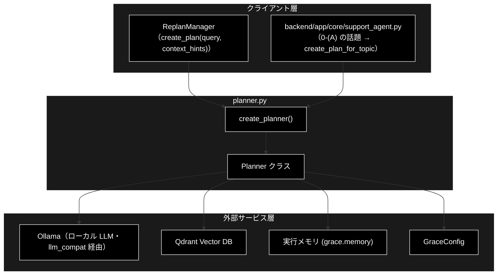
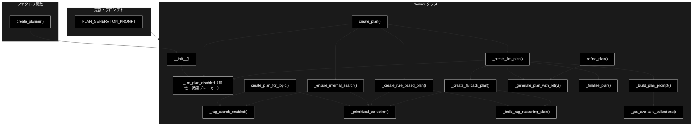
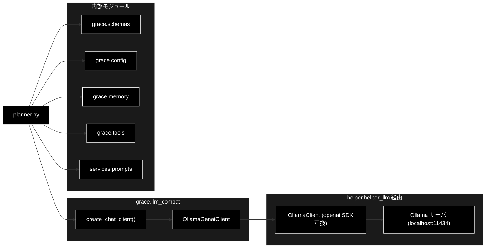

# planner.py - GRACE 計画生成エージェント ドキュメント

**Version 4.6** | 最終更新: 2026-10-30

---

## 目次

1. [概要](#概要)
2. [1. アーキテクチャ構成図](#1-アーキテクチャ構成図)
3. [2. モジュール構成図](#2-モジュール構成図)
4. [3. クラス・関数一覧表](#3-クラス関数一覧表)
5. [4. クラス・関数 IPO詳細](#4-クラス関数-ipo詳細)
6. [5. 設定・定数](#5-設定定数)
7. [6. エクスポート](#6-エクスポート)
8. [7. 変更履歴](#7-変更履歴)
9. [付録: 依存関係図](#付録-依存関係図)

---

## 概要

`planner.py`は、GRACE自律エージェントの「計画生成（Plan）」層を担うモジュールです。実行計画（`ExecutionPlan`）を作る入口は 2 つあります。

- **GRACE-Support の最初の計画: `create_plan_for_topic(topic)`**。0-(A) 質問の整理（`backend/app/core/question_refiner.py`）が LLM で問い合わせを「話題 → 観点」に整理した結果を受け取り、観点ごとに社内検索（`rag_search`。検索文は `search_query`）、利用者が最新情報を求めた観点には Web 検索（`web_search`。検索語は `web_query`・`required=True`）を置き、最後に回答生成（`reasoning`。質問文は `answer_question`）を置きます。**LLM は呼びません。**
- **リプラン: `create_plan(query, context_hints=...)`**。`ReplanManager` が前回の失敗の文脈（`context_hints`）を付けて呼び、ローカル LLM（Ollama）に計画を作らせます。補足が無ければルールベースの 2 ステップ計画（`rag_search` → `reasoning`）を返します。

どちらの計画も**必ず社内検索（`rag_search`）を含み、聞き返し（`ask_user`）を含みません**（`_ensure_internal_search`。設定で `rag_search` を禁止しているときを除く）。さらに **P4 実行メモリ層**（`grace/memory.py`）と連携し、過去の実行実績から「この質問で当たりやすいコレクション」を学習している場合は、`rag_search` の対象コレクションをその最良コレクションに固定します（十分な実績が無ければ全コレクション検索）。

> ⚠️ **2026-10-29 に、質問文の文字列で計画の作り方を決める処理を削除した。** 以前は、キーワードの加点表（`_COMPLEXITY_FACTORS`）と
> 「最新ニュース」などの語（`_LLM_PLAN_MARKERS`）で複雑度を推定し、LLM に計画を作らせるかを決め、どの検索にも同じ質問文を使っていた。
> 2026-10-22 には、「その件」などの指示語で質問を曖昧と判定して聞き返しだけの計画を返す処理（`is_ambiguous_query`）も削除した
> （検索もしない・聞き返しもしない行き止まりだったため）。いまは 0-(A) の LLM が観点と検索文を決める。

LLM 呼び出しは `grace/llm_compat.py` の `create_chat_client()` で生成したクライアント経由で行います。このクライアントは google-genai 互換の `client.models.generate_content(...)` インターフェースを保ったまま、内部では**ローカル LLM（Ollama、既定モデルは `config.py::get_default_ollama_model()` の1箇所で管理・現在値 `gemma4:26b-a4b-it-qat`）**を呼び出すアダプターです。Embedding（検索）は別途 Gemini `gemini-embedding-001`（3072次元）を使用します。

加えて、ローカル LLM が計画生成で空応答（思考だけを返す等）を返して LLM 計画が失敗すると、`Planner` インスタンス単位でそれ以降の LLM 計画生成を打ち切り、ルールベース計画へ固定します（`_llm_plan_disabled` フラグ。本リポジトリだけ）。

### 主な責務

- 0-(A) で整理した話題から、観点ごとの検索を置いた計画を組み立てる（LLM なし）
- リプランの補足に応じて、LLM 計画とルールベース計画を使い分ける
- どの計画にも社内検索を入れ、画面に出せない聞き返しを外す
- ローカル LLM（Ollama）を用いた実行計画の自動生成
- LLM 計画生成が空応答で倒れた場合、以降このインスタンスでは試みない（失敗の増幅ループを遮断）
- 利用可能なコレクション（Qdrant）の動的取得・実行メモリによる優先コレクションの反映
- フィードバックに基づく計画の修正（リファインメント）
- LLMエラー時のフォールバック計画の提供

### 各責務対応のモジュール

| # | 責務 | 対応モジュール | 説明 |
|---|------|--------------|------|
| 1 | 話題から計画を組み立てる | `planner.py` / `backend.app.core.question_refiner` | `create_plan_for_topic()` が `Topic.aspects` を `rag_search` / `web_search` へ、`answer_question` を `original_query` へ写す |
| 2 | LLM 計画とルールベース計画の使い分け | `planner.py` | `create_plan()`（`context_hints` か `force_llm_plan` があれば LLM 計画） |
| 3 | 社内検索を必ず入れる後処理 | `planner.py` | `_ensure_internal_search()` / `_rag_search_enabled()` |
| 4 | ローカル LLM を用いた実行計画の自動生成 | `planner.py` | `_create_llm_plan()` が `_build_plan_prompt()` / `_generate_plan_with_retry()` / `_finalize_plan()` を組み合わせ、`llm_compat.create_chat_client()`（既定 Ollama）経由で LLM を呼び出す |
| 5 | LLM 計画生成の失敗検知と以降の抑止 | `planner.py` | `__init__` が `self._llm_plan_disabled = False` を初期化し、`_create_llm_plan()` の例外ハンドラが `True` に設定。`create_plan()` がこのフラグを見てルールベース計画に固定 |
| 6 | 利用可能なコレクションの動的取得・優先反映 | `grace.tools` / `grace.memory` | 検索されるコレクションは `RAGSearchTool.search_candidates()` を `_get_available_collections()` から、実績は `_prioritized_collection()` から参照 |
| 7 | フィードバックに基づく計画の修正 | `planner.py` | `refine_plan()` |
| 8 | フォールバック計画の提供 | `planner.py` | `_create_fallback_plan()` / `_create_rule_based_plan()`（いずれも `_build_rag_reasoning_plan()` に委譲） |

### 主要機能一覧

| 機能 | 説明 |
|------|------|
| `Planner` | 計画生成エージェントクラス |
| `Planner.__init__()` | コンストラクタ（設定・モデル名・LLMクライアント・実行メモリ・`_llm_plan_disabled` フラグの初期化） |
| `Planner.create_plan_for_topic()` | 0-(A) で整理した 1 話題から計画を組み立てる（GRACE-Support の最初の計画。LLM なし） |
| `Planner.create_plan()` | リプラン用。補足があれば LLM 計画（`_llm_plan_disabled` が立っていればルールベース）、無ければルールベース計画。どちらも `_ensure_internal_search` を通す |
| `Planner.refine_plan()` | フィードバックに基づき計画を修正（`_generate_plan_with_retry` でリトライ・空/JSONガードを獲得） |
| `Planner._rag_search_enabled()` | 設定で `rag_search` が使えるか（`tools.enabled` にあり `tools.disabled` に無い） |
| `Planner._ensure_internal_search()` | 計画に社内検索を必ず入れ、`ask_user` を外す後処理 |
| `Planner._prioritized_collection()` | 実行メモリの事前分布から優先コレクションを取得 |
| `Planner._build_rag_reasoning_plan()` | rag_search → reasoning の標準2ステップ計画を組み立てる共通ビルダー |
| `Planner._create_rule_based_plan()` | ルールベースの標準2ステップ計画を生成（`_build_rag_reasoning_plan` に委譲） |
| `Planner._build_plan_prompt()` | 利用可能コレクションを埋め込んだLLM計画生成プロンプトを構築 |
| `Planner._generate_plan_with_retry()` | structured-output(JSON) で計画を生成する共通ヘルパー（リトライ・空/JSONガード） |
| `Planner._stamp_llm_plan()` | LLM 計画に plan_id・作成日時・設定のステップタイムアウトを入れる（計画生成・計画修正で共用） |
| `Planner._finalize_plan()` | LLM生成計画に複雑度・plan_id 等を適用し依存関係を検証・ログ |
| `Planner._create_llm_plan()` | LLMによる実行計画を生成（プロンプト構築 → リトライ生成 → 確定の委譲構成）。失敗時は `_llm_plan_disabled` を立てる |
| `Planner._create_fallback_plan()` | LLMエラー時の安全な代替計画を生成（`_build_rag_reasoning_plan` に委譲） |
| `Planner._get_available_collections()` | rag_search が実際に検索するコレクションを取得（除外・次元違いを落とした一覧） |
| `create_planner()` | Plannerインスタンスを作成するファクトリ関数 |
| `PLAN_GENERATION_PROMPT` | LLM計画生成用プロンプトテンプレート |

---

## 1. アーキテクチャ構成図

### 1.1 システム全体構成



### 1.2 データフロー

**GRACE-Support の最初の計画（`create_plan_for_topic`）**

1. `support_agent` の 0-(A) が `refine_question()` で問い合わせを話題・観点に整理し、採用した話題（`Topic`）を渡す
2. 観点ごとに `rag_search` を置く（`query` = `search_query`、`web_query` = `web_query`、`fallback` = `web_search`、`collection` = `_prioritized_collection(search_query)`）
3. `wants_latest_web` が真の観点には `web_search` を置く（`query` = `web_query`、`required=True`）
4. 最後に `reasoning` を置く（依存なし。`original_query` = `answer_question`）。複雑度は 0.5 固定で、executor は ReAct へ回さない（`execute(plan, allow_react=False)`）

**リプラン（`create_plan`）**

1. `ReplanManager` が `create_plan(original_query, context_hints=...)` を呼ぶ
2. `context_hints` があるか `planner.force_llm_plan` が真なら `_create_llm_plan()`、無ければ `_create_rule_based_plan()`（LLM なしの 2 ステップ）。ただし `self._llm_plan_disabled` が真（このインスタンスで LLM 計画が一度失敗済み）なら LLM 計画を試さずルールベース
3. `_create_llm_plan()` は `_build_plan_prompt()`（`_get_available_collections()` で利用可能コレクションを取得しプロンプトに埋め込む）→ `_generate_plan_with_retry()`（structured-output JSON でリトライ生成）→ `_finalize_plan()`（plan_id 適用と依存関係検証）の順に委譲する。失敗時は `_create_fallback_plan()` を返し、`self._llm_plan_disabled = True` を立てる
4. どちらの計画も `_ensure_internal_search()` を通す（`rag_search` が無ければ先頭に足し、`ask_user` を外す）

---

## 2. モジュール構成図

### 2.1 内部モジュール構成



### 2.2 外部依存関係

| ライブラリ | バージョン | 用途 |
|-----------|-----------|------|
| `pydantic` | >=2.0 | `ExecutionPlan` / `PlanStep` のバリデーション（`grace.schemas` 経由） |

> `planner.py` は google-genai / openai 等の SDK を直接 import しない。LLM 呼び出しは `grace.llm_compat.create_chat_client()` が返すアダプター（`OllamaGenaiClient` 既定）が担い、その内部で `helper.helper_llm.create_llm_client("ollama")`（openai SDK 経由で Ollama の OpenAI 互換エンドポイントを呼ぶ）に委譲する。

### 2.3 内部依存モジュール

| モジュール | 用途 |
|-----------|------|
| `grace.schemas` | `ExecutionPlan` / `PlanStep`（`web_query` / `required` を含む）/ `create_plan_id` / `validate_plan_dependencies` |
| `grace.config` | `GraceConfig` / `get_config` / `resolve_heavy_model`（M-1 論理層モデルの解決） |
| `grace.llm_compat` | `create_chat_client`（既定 Ollama の genai互換クライアント生成） |
| `services.prompts` | `SEARCH_QUERY_INSTRUCTION`（`PLAN_GENERATION_PROMPT` に埋め込む検索クエリの書き方。本リポジトリだけ） |
| `grace.memory` | `create_execution_memory`（P4 実行メモリ層・優先コレクションの学習） |
| `grace.tools` | `RAGSearchTool.search_candidates`（rag_search が検索するコレクション一覧。メソッド内で遅延 import） |
| `backend.app.core.question_refiner` | `Topic`（`create_plan_for_topic` の引数の型。planner は import せず、属性 `answer_question` / `aspects` だけを読む） |

---

## 3. クラス・関数一覧表

### 3.1 クラス一覧

#### Planner

| メソッド | 概要 |
|---------|------|
| `__init__(config, model_name)` | 設定・モデル名・LLMクライアント・実行メモリ・`_llm_plan_disabled` を初期化 |
| `create_plan_for_topic(topic)` | 0-(A) で整理した 1 話題から計画を組み立てる（LLM なし） |
| `create_plan(query, *, context_hints="")` | リプラン用。補足があれば LLM 計画、無ければルールベース計画 |
| `refine_plan(plan, feedback)` | フィードバックに基づき計画を修正（リトライ・空/JSONガード付き） |
| `_rag_search_enabled()` | 設定で `rag_search` が使えるか |
| `_ensure_internal_search(plan, query)` | 社内検索を必ず入れ、`ask_user` を外し、ステップ ID を振り直す |
| `_is_excluded(collection)` | `qdrant.excluded_collections` に部分一致するか。`best_collection(exclude=...)` へ渡す述語 |
| `_prioritized_collection(query)` | 実行メモリの事前分布から優先コレクションを取得（**除外対象は返さない**） |
| `_build_rag_reasoning_plan(query, *, complexity, collection, rag_description)` | rag_search → reasoning の標準2ステップ計画を組み立てる共通ビルダー |
| `_create_rule_based_plan(query, complexity=0.5)` | ルールベース2ステップ計画を生成（`_build_rag_reasoning_plan` に委譲） |
| `_build_plan_prompt(query)` | 利用可能コレクションを埋め込んだLLM計画生成プロンプトを構築 |
| `_generate_plan_with_retry(prompt, *, label, max_output_tokens, log_output)` | structured-output(JSON) で計画を生成する共通ヘルパー（リトライ・空/JSONガード） |
| `_stamp_llm_plan(plan)` | plan_id・作成日時・設定のステップタイムアウトを入れる |
| `_finalize_plan(plan, complexity)` | 複雑度・plan_id 等を適用し依存関係を検証・ログ |
| `_create_llm_plan(query, *, context_hints="")` | LLMによる計画を生成（プロンプト構築 → リトライ生成 → 確定の委譲構成）。失敗時は `_llm_plan_disabled` を立てる |
| `_create_fallback_plan(query)` | フォールバック計画を生成（`_build_rag_reasoning_plan` に委譲） |
| `_get_available_collections()` | rag_search が実際に検索するコレクション一覧を取得 |

### 3.2 関数一覧（カテゴリ別）

#### ファクトリ関数

| 関数名 | 概要 |
|-------|------|
| `create_planner(config, model_name)` | Plannerインスタンスを生成 |

---

## 4. クラス・関数 IPO詳細

### 4.1 使用例

`Planner` の呼び方は**5 通り**ある。どれも `ExecutionPlan` を返し、必ず社内検索（`rag_search`）を含む。

| 処理パターン | 呼び方 | 向いている場面 | 例 |
|---|---|---|---|
| 整理した話題から作る | `create_plan_for_topic(topic)` | GRACE-Support の最初の計画（`support_agent` の ① Plan）。LLM なし | 4.1.1 |
| LLM 計画を強制して修正する | `config.planner.force_llm_plan = True` ＋ `refine_plan(plan, feedback)` | 計画の中身を LLM に考えさせたい・フィードバックで直したい | 4.1.2 |
| リプランの補足を渡す | `create_plan(query, context_hints=...)` | 前回の失敗の文脈を次の計画へ渡す（`ReplanManager` の使い方）。LLM 計画になる | 4.1.3 |
| 補足なしで作る | `create_plan(query)` | 質問文 1 つで 2 ステップの計画が欲しいとき。LLM なし | 4.1.4 |
| LLM 計画が失敗したあと | `create_plan(query, context_hints=...)`（`_llm_plan_disabled` が立つと以降はルールベース） | ローカル LLM が本文を返せないとき、同じ失敗に何分も待たない | 4.1.5 |

> 📝 4.1.1 と 4.1.4 は LLM を呼ばないので、**そのまま実行して**出力を確かめてある（2026-10-30）。
> 4.1.3 は計画生成の LLM を固定の JSON を返すスタブに、4.1.5 は空応答を返すスタブに差し替えて実行した。4.1.2 の LLM 計画の中身（ステップ数）は実際の LLM によって変わる。

#### 4.1.1 基本的なワークフロー（0-(A) で整理した話題から作る）

```python
from backend.app.core.question_refiner import Aspect, Sentence, Topic
from grace.planner import create_planner

# 1. 0-(A) の整理結果（本番では refine_question が返す。ここでは手で組み立てる）
topic = Topic(
    answer_question="Jed York CEOが新しいGMとコーチを探す背景の経緯と、49ersの新GMとヘッドコーチの人事を教えてください。",
    sentences=[Sentence(text="Jed York CEOが新しいGMとコーチを探す背景には、どのような経緯がありますか？",
                        aspect="経緯", relation="主")],
    aspects=[
        Aspect(name="経緯", search_query="Jed York CEOが新しいGMとコーチを探す背景の経緯",
               web_query="Jed York CEO GM コーチ 経緯", wants_latest_web=False),
        Aspect(name="人事", search_query="49ersの新しいGMとヘッドコーチの人事",
               web_query="49ers 新GM ヘッドコーチ 人事", wants_latest_web=True),
    ],
)

# 2. 話題から計画を作る（LLM は呼ばない）
planner = create_planner()
plan = planner.create_plan_for_topic(topic)
print(plan.original_query == topic.answer_question, plan.complexity)
for step in plan.steps:
    print(f"  step{step.step_id}: {step.action:<10} query={step.query!r} "
          f"web_query={step.web_query!r} required={step.required} depends_on={step.depends_on}")
```

```
# 出力:
# True 0.5
#   step1: rag_search query='Jed York CEOが新しいGMとコーチを探す背景の経緯' web_query='Jed York CEO GM コーチ 経緯' required=False depends_on=[]
#   step2: rag_search query='49ersの新しいGMとヘッドコーチの人事' web_query='49ers 新GM ヘッドコーチ 人事' required=False depends_on=[]
#   step3: web_search query='49ers 新GM ヘッドコーチ 人事' web_query=None required=True depends_on=[]
#   step4: reasoning  query=None web_query=None required=False depends_on=[]
```

> 📝 **観点ごとに検索文が違う。** 以前は 3 行の問い合わせ全体を 1 つの検索文にしていた。`reasoning` が依存を持たないのは、
> 観点の 1 つ（例: Web 検索）が失敗しただけで回答が作られなくなるのを防ぐため（`Executor._check_dependencies` は失敗した依存があると
> そのステップを実行しない。`reasoning` は成功した全ステップの結果を読む）。
> `required=True` の `web_search` は、社内検索の結果が十分でも executor が飛ばさない。

#### 4.1.2 LLM 計画を強制して修正する（`force_llm_plan` / `refine_plan`）

```python
import copy

from grace.config import get_config
from grace.planner import create_planner

# 1. 設定をコピーしてから書き換える（get_config() の共有の設定を書き換えると、他の処理へ漏れる）
config = copy.deepcopy(get_config())
config.planner.force_llm_plan = True     # 補足が無くても LLM で計画する（create_plan_for_topic には効かない）

planner = create_planner(config)
plan = planner.create_plan("生成AIの最新動向を詳しく")

# 2. フィードバックで計画を直す（LLM が失敗したら元の計画をそのまま返す）
refined = planner.refine_plan(plan, "もっとステップを分けて、最新事例を含めて")
print(f"元: {len(plan.steps)} ステップ / 修正後: {len(refined.steps)} ステップ / plan_id は新しくなる: {refined.plan_id != plan.plan_id}")
```

```
# 出力例（ステップ数は LLM の計画による）:
# 元: 2 ステップ / 修正後: 2 ステップ / plan_id は新しくなる: True
```

#### 4.1.3 リプランの補足を渡す（`context_hints`）

前回の失敗の文脈は `context_hints` で渡す。**補足があると LLM 計画になる**（同じルールベースの計画を作って同じ失敗を繰り返さないため）。
補足は計画生成のプロンプトにだけ入り、検索クエリには混ざらない。LLM が `rag_search` を省いても、`_ensure_internal_search` が先頭に足す。

```python
from grace.planner import create_planner

planner = create_planner()
plan = planner.create_plan(
    "明日の東京の天気は？",
    context_hints="前回の試行: rag_search の最大スコアが 0.31 で、根拠にならなかった",
)
for step in plan.steps:
    print(f"  step{step.step_id}: {step.action} - {step.query} depends_on={step.depends_on}")
```

```
# 出力（LLM が grace_v2 の実測 2026-10-15 と同じ「web_search → reasoning」だけの計画を返した場合）:
#   step1: rag_search - 明日の東京の天気は？ depends_on=[]
#   step2: web_search - 東京 天気 明日 depends_on=[]
#   step3: reasoning - None depends_on=[1, 2]
```

> ⚠️ **`query` に補足を連結して渡さない。** 連結すると補足がそのまま `rag_search` の検索クエリになって Embedding が壊れる。
> 実測で「明日の東京の天気は？\n\n【追加情報】\n注意: 前回の試行で…」が検索クエリになっていた。

#### 4.1.4 補足なしで作る（ルールベースの 2 ステップ）

```python
from grace.planner import create_planner

planner = create_planner()
plan = planner.create_plan("『金色夜叉』の作者は誰ですか？")
for step in plan.steps:
    print(f"  step{step.step_id}: {step.action} - {step.query} depends_on={step.depends_on}")
```

```
# 出力:
#   step1: rag_search - 『金色夜叉』の作者は誰ですか？ depends_on=[]
#   step2: reasoning - None depends_on=[1]
```

> 📝 **ルールベースの計画の `rag_search` は、質問文をそのまま検索クエリにする**（キーワードに分解しない。ベクトル検索の精度が落ちるため）。
> 実行メモリに十分な実績があれば、`rag_search` の `collection` がそのコレクションに絞られる（`_prioritized_collection`）。

#### 4.1.5 LLM 計画が失敗したあと（`_llm_plan_disabled`・本リポジトリだけ）

```python
from types import SimpleNamespace

from grace.planner import create_planner

planner = create_planner()
# ローカル LLM が本文を返せない状態を模す（思考だけで出力枠を使い切った等）
empty = SimpleNamespace(text="", usage_metadata=None)
planner.client = SimpleNamespace(models=SimpleNamespace(generate_content=lambda **kw: empty))

query = "明日の東京の天気は？"
hints = "前回の試行: rag_search の最大スコアが 0.31 で、根拠にならなかった"
plan = planner.create_plan(query, context_hints=hints)   # 補足あり → LLM 計画 → 空応答で失敗
print([s.action for s in plan.steps], planner._llm_plan_disabled)

# 以降は、リプランの補足があっても LLM 計画を試さない（ルールベースの計画を返す）
plan = planner.create_plan(query, context_hints=hints)
print([s.action for s in plan.steps], plan.complexity)
```

```
# 出力:
# ['rag_search', 'reasoning'] True
# ['rag_search', 'reasoning'] 0.5
```

> ⚠️ **LLM 計画が 1 回でも失敗したら、その `Planner` では以降 LLM 計画を試さない**（空応答・不完全な JSON をリトライし尽くしたとき）。
> ローカル LLM が本文を返せない状態は投げ直しても直らず、実測ではリプラン 3 回で約 17 分をこれだけに使い、3 回とも同じフォールバック計画だった。
> 1 回目は `_create_fallback_plan`（`rag_search → reasoning`）、2 回目以降はルールベースの計画になる。`Planner` を作り直せば元に戻る。
> GRACE-Support の最初の計画（`create_plan_for_topic`）は LLM を呼ばないので、このフラグとは関係ない。

---

### 4.2 Planner クラス

実行計画（`ExecutionPlan`）を生成する計画生成エージェント。最初の計画は 0-(A) で整理した話題から組み立て（`create_plan_for_topic`）、リプランでは補足に応じて LLM 計画とルールベース計画を使い分ける（`create_plan`）。

#### コンストラクタ: `__init__`

**概要**: 設定・モデル名・LLMクライアント・実行メモリ層を初期化する。

```python
Planner(
    config: Optional[GraceConfig] = None,
    model_name: Optional[str] = None
)
```

| パラメータ | 型 | デフォルト | 説明 |
|------------|------|-----------|------|
| `config` | Optional[GraceConfig] | None | GRACE設定（Noneの場合は `get_config()` を使用） |
| `model_name` | Optional[str] | None | 使用するモデル名。None なら **`resolve_heavy_model(config)`**（`llm.heavy_model` → 未設定なら `llm.model`）で解決する（M-1 論理層） |

| 項目 | 内容 |
|------|------|
| **Input** | `config: Optional[GraceConfig] = None`, `model_name: Optional[str] = None` |
| **Process** | 1. `config` を解決（未指定なら `get_config()`）<br>2. `model_name` を解決（未指定なら **`resolve_heavy_model(config)`** = 論理層モデル。M-1）<br>3. `create_chat_client(config)` でLLMクライアントを生成（既定 `provider="ollama"` → `OllamaGenaiClient`）<br>4. `config.memory.enabled` が真なら `create_execution_memory(config.memory.path)` で実行メモリ層を初期化（無効時は `None`）<br>5. `self._llm_plan_disabled = False` を初期化（LLM計画生成が空応答で倒れた場合の循環ブレーカー。既存テストが `Planner.__new__` で `__init__` を迂回することがあるため、参照側は `getattr` で読む） |
| **Output** | Plannerインスタンス |

**戻り値例**:
```python
# Planner インスタンス（主な属性）
{
    "config": "<GraceConfig>",
    "model_name": "gemma4:26b-a4b-it-qat",
    "client": "<OllamaGenaiClient>",
    "_memory": "<ExecutionMemory or None>",
    "_llm_plan_disabled": False
}
```

```python
# 使用例
from grace.planner import Planner

planner = Planner()
print(planner.model_name)
# 出力: gemma4:26b-a4b-it-qat
```

#### メソッド: `create_plan_for_topic`

**概要**: 0-(A) 質問の整理（`backend/app/core/question_refiner.py`）で整理した 1 話題から計画を組み立てる。GRACE-Support の最初の計画（`support_agent` の ① Plan）。**LLM は呼ばない。**

```python
def create_plan_for_topic(self, topic) -> ExecutionPlan
```

| パラメータ | 型 | デフォルト | 説明 |
|------------|------|-----------|------|
| `topic` | `question_refiner.Topic` | - | 採用した話題。`answer_question`（回答用の質問文）と `aspects`（観点ごとの `name` / `search_query` / `web_query` / `wants_latest_web`）だけを読む |

| 項目 | 内容 |
|------|------|
| **Input** | `topic: Topic` |
| **Process** | 1. 観点ごとに、`_rag_search_enabled()` なら `rag_search` を置く（`query` = `search_query`、`web_query` = `web_query`、`collection` = `_prioritized_collection(search_query)`、`fallback` = `web_search`）<br>2. `wants_latest_web` が真の観点には `web_search` を置く（`query` = `web_query`、`required=True`）<br>3. 最後に `reasoning` を置く（`depends_on=[]`）<br>4. `ExecutionPlan(original_query=answer_question, complexity=0.5, ...)` を返す |
| **Output** | `ExecutionPlan`: 観点ごとの検索 ＋ 回答生成の計画 |

> ⚠️ **`reasoning` に依存を付けない。** `Executor._check_dependencies` は失敗した依存があるとそのステップを実行しないので、依存を付けると
> 観点の 1 つ（例: Web 検索）が失敗しただけで回答が作られなくなる。`reasoning` は成功した全ステップの結果を読む（`Executor._prepare_tool_kwargs`）。
>
> ⚠️ **複雑度は 0.5 固定で、ReAct へは回さない**（`support_agent` が `executor.execute(plan, allow_react=False)` で呼ぶ）。
> ReAct は次の検索語を LLM に決め直させるため、整理した検索文が使われなくなる。

使用例は 4.1.1。

#### メソッド: `create_plan`

**概要**: 質問から実行計画を生成する（リプラン用）。補足（`context_hints`）か `planner.force_llm_plan` があれば LLM 計画、無ければルールベースの 2 ステップ計画。どちらも `_ensure_internal_search()` を通す。

```python
def create_plan(self, query: str, *, context_hints: str = "") -> ExecutionPlan
```

| パラメータ | 型 | デフォルト | 説明 |
|------------|------|-----------|------|
| `query` | str | - | ユーザーの質問。**これがそのまま検索クエリになる** |
| `context_hints` | str | `""` | リプランの補足（前回のエラー・進捗・フィードバック）。LLM 計画生成のプロンプトにだけ足す |

| 項目 | 内容 |
|------|------|
| **Input** | `query: str`, `context_hints: str = ""` |
| **Process** | 1. `context_hints` があるか `config.planner.force_llm_plan` が真なら LLM 計画の対象<br>2. ただし `getattr(self, "_llm_plan_disabled", False)` が真なら LLM 計画を試さない（同じ空応答を待つ時間を節約）<br>3. LLM 計画の対象なら `_create_llm_plan(query, context_hints=...)`、それ以外は `_create_rule_based_plan(query)`（LLM なし）<br>4. `_ensure_internal_search(plan, query)` を通して返す |
| **Output** | `ExecutionPlan`: 必ず `rag_search` を含み `ask_user` を含まない計画 |

**戻り値例**（補足なし）:
```python
{
    "original_query": "RAGとは何ですか？",
    "complexity": 0.5,
    "estimated_steps": 2,
    "requires_confirmation": False,
    "steps": [
        {"step_id": 1, "action": "rag_search", "fallback": "web_search"},
        {"step_id": 2, "action": "reasoning", "depends_on": [1]}
    ],
    "success_criteria": "ユーザーの質問に適切に回答できている",
    "plan_id": "plan_xxxxxxxx"
}
```

使用例は 4.1.3（補足あり）と 4.1.4（補足なし）。

#### メソッド: `_rag_search_enabled`

**概要**: 設定で `rag_search` が使えるか（`tools.enabled` に含まれ、`tools.disabled` に含まれない）。

```python
def _rag_search_enabled(self) -> bool
```

| 項目 | 内容 |
|------|------|
| **Input** | なし（`self.config.tools`） |
| **Process** | `"rag_search" in tools.enabled and "rag_search" not in tools.disabled` |
| **Output** | `bool` |

#### メソッド: `_ensure_internal_search`

**概要**: 計画に**必ず社内検索（`rag_search`）を入れ**、画面に出せない聞き返し（`ask_user`）を外す後処理（`create_plan` の全経路）。

```python
def _ensure_internal_search(self, plan: ExecutionPlan, query: str) -> ExecutionPlan
```

| パラメータ | 型 | デフォルト | 説明 |
|------------|------|-----------|------|
| `plan` | ExecutionPlan | - | ルールベース計画または LLM 計画 |
| `query` | str | - | 足す `rag_search` の検索文 |

| 項目 | 内容 |
|------|------|
| **Input** | `plan`, `query` |
| **Process** | 1. `ask_user` のステップを外し、それへの依存も外す<br>2. `_rag_search_enabled()` かつ `rag_search` が無ければ先頭に足す（`query`・優先コレクション・`fallback=web_search`）。各 `reasoning` の依存に足す<br>3. `reasoning` が無ければ末尾に足す<br>4. 外したり足したりしたら、ステップ ID を 1 から振り直す |
| **Output** | `ExecutionPlan` |

> ⚠️ 2026-10-22 まで、`create_plan` は「その件」などを含む質問を曖昧と判定し（`is_ambiguous_query`）、`rag_search` を含まない `ask_user` だけの計画を
> 返していた。その聞き返しは画面につながっておらず、「検索もしない・聞き返しもしない」行き止まりだった（`tests/test_plan_always_searches.py`）。

#### メソッド: `refine_plan`

**概要**: ユーザーフィードバックに基づき既存の計画をLLMで修正する。`_generate_plan_with_retry`（label="refine_plan LLM"）を再利用し、`_create_llm_plan` と同等のリトライ・空レスポンス/不完全JSONガードを獲得した。失敗時は元の計画を返す。

```python
def refine_plan(self, plan: ExecutionPlan, feedback: str) -> ExecutionPlan
```

| パラメータ | 型 | デフォルト | 説明 |
|------------|------|-----------|------|
| `plan` | ExecutionPlan | - | 元の計画 |
| `feedback` | str | - | ユーザーからのフィードバック |

| 項目 | 内容 |
|------|------|
| **Input** | `plan: ExecutionPlan`, `feedback: str` |
| **Process** | 1. 元計画とフィードバックから修正用プロンプトを構築<br>2. `_generate_plan_with_retry(prompt, label="refine_plan LLM")` で計画を生成（空レスポンス・不完全JSONは `llm_plan_max_attempts` 回までリトライ）<br>3. `_stamp_llm_plan()` で新しい `plan_id`・作成日時（LLM が null を返した場合）・設定のステップタイムアウトを入れる<br>4. 例外時（全リトライ失敗等）は元の計画を返却 |
| **Output** | `ExecutionPlan`: 修正された計画（失敗時は元の計画） |

**戻り値例**:
```python
{
    "original_query": "RAGとは何ですか？",
    "complexity": 0.5,
    "estimated_steps": 3,
    "requires_confirmation": False,
    "steps": ["..."],
    "plan_id": "plan_yyyyyyyy"
}
```

```python
# 使用例
planner = Planner()
plan = planner.create_plan("RAGとは何ですか？")
refined = planner.refine_plan(plan, "もっと詳しく、最新事例も含めてください")
print(refined.plan_id != plan.plan_id)
# 出力: True
```

#### メソッド: `_is_excluded`

**概要**: コレクション名が `qdrant.excluded_collections` に**部分一致**するかを返す。

```python
def _is_excluded(self, collection: str) -> bool
```

| 項目 | 内容 |
|------|------|
| **Input** | `collection`: コレクション名 |
| **Process** | `config.qdrant.excluded_collections`（未設定なら `[]`）の各キーワードが `collection` に含まれるかを調べる |
| **Output** | `bool` |

> 📝 `_prioritized_collection()` が `ExecutionMemory.best_collection(exclude=...)` へ
> **そのまま述語として渡す**ためのメソッド。判定が部分一致なのは、実コレクション名に
> サフィックスが付く（`wikipedia_ja` → `wikipedia_ja_5per`）ため。

#### メソッド: `_prioritized_collection`

**概要**: P4 実行メモリの事前分布から、この質問で当たりやすいコレクションを返す。十分な実績が無ければ `None`（=全コレクション検索）。

```python
def _prioritized_collection(self, query: str) -> Optional[str]
```

| パラメータ | 型 | デフォルト | 説明 |
|------------|------|-----------|------|
| `query` | str | - | ユーザーの質問 |

| 項目 | 内容 |
|------|------|
| **Input** | `query: str` |
| **Process** | 1. `_memory` が `None`（メモリ無効）なら `None` を返却<br>2. `memory.best_collection(query, min_count=config.memory.min_count, min_score=config.memory.min_score, **exclude=self._is_excluded**)` を呼び出し<br>3. 採用条件を満たすコレクション名、または `None` を返却<br>4. 例外時は警告ログを出して `None` |
| **Output** | `Optional[str]`: 優先コレクション名（無ければ `None`） |

> ⚠️ **除外対象コレクションは返さない（`exclude` を渡す理由）。**
>
> メモリが返すのは「過去の実績からの**推測**」であって、運用者の明示指定ではない。
> ところがこの戻り値は `PlanStep.collection` に入り、`RAGSearchTool` 側では
> **「明示指定」と区別が付かない**ため、`qdrant.excluded_collections` を素通りする。
>
> 実測（2026-08-17）ではこうなっていた:
>
> ```
> 11:10 天気の実行で誤採用された wikipedia_ja_5per が success として記録
>   ↓
> [memory] prioritized collection for query: wikipedia_ja_5per
>   ↑ 「住民票の写しの取り方は？」でも「明日の東京の天気は？」でも同じ
>     （collection_priors はキーワード重複が無いと全体集計へフォールバックしていた。
>      2026-10-15 にフォールバックを廃止し、重なりが無ければ None にした。memory.md §4.8）
>   ↓
> 除外リストに載っているのに検索候補に残り、毎回無駄に検索される
> ```
>
> 除外は**運用者が設定した恒久的な意思**なので、学習結果より優先する。

> 📝 **除外対象は「飛ばして次点を採る」。** `best_collection()` 側の仕様で、
> 除外に当たっても `None` で諦めずに次点を探す（諦めるとメモリ機構が事実上死ぬ）。

**戻り値例**:
```python
"wikipedia_ja"  # 実績が薄い場合は None
```

```python
# 使用例
planner = Planner()
col = planner._prioritized_collection("金色夜叉の構成者は誰ですか？")
print(col)
# 出力: None  # 実績が蓄積されると "livedoor" 等が返る
```

#### メソッド: `_build_rag_reasoning_plan`

**概要**: `rag_search` → `reasoning` の標準2ステップ計画を組み立てる共通ビルダー。ルールベース計画（`_create_rule_based_plan`）とフォールバック計画（`_create_fallback_plan`）が共有する。rag_search は `collection`（優先コレクション or None=全コレクション検索）と `fallback="web_search"` を持ち、各 PlanStep のタイムアウトは `PlannerConfig.step_timeout_seconds`（既定 30 秒）を使用する。

```python
def _build_rag_reasoning_plan(
    self,
    query: str,
    *,
    complexity: float,
    collection: Optional[str],
    rag_description: str = "関連情報を検索",
) -> ExecutionPlan
```

| パラメータ | 型 | デフォルト | 説明 |
|------------|------|-----------|------|
| `query` | str | - | ユーザーの質問 |
| `complexity` | float | - | 計画に記録する複雑度 |
| `collection` | Optional[str] | - | rag_search の対象コレクション（None=全コレクション検索） |
| `rag_description` | str | "関連情報を検索" | rag_search ステップの description |

| 項目 | 内容 |
|------|------|
| **Input** | `query: str`, `*`, `complexity: float`, `collection: Optional[str]`, `rag_description: str = "関連情報を検索"` |
| **Process** | 1. `config.planner.step_timeout_seconds` を取得<br>2. step1=rag_search（`query`, `collection`, `fallback="web_search"`, `timeout_seconds=step_timeout`, `description=rag_description`）を作成<br>3. step2=reasoning（`depends_on=[1]`, `timeout_seconds=step_timeout`）を作成<br>4. `estimated_steps=2`, `requires_confirmation=False` で `ExecutionPlan` を構築し `plan_id` を採番 |
| **Output** | `ExecutionPlan`: 標準2ステップ計画 |

**戻り値例**:
```python
{
    "complexity": 0.5,
    "estimated_steps": 2,
    "requires_confirmation": False,
    "steps": [
        {"step_id": 1, "action": "rag_search", "collection": None, "fallback": "web_search", "timeout_seconds": 30},
        {"step_id": 2, "action": "reasoning", "depends_on": [1], "timeout_seconds": 30}
    ],
    "plan_id": "plan_xxxxxxxx"
}
```

```python
# 使用例（内部利用）
planner = Planner()
plan = planner._build_rag_reasoning_plan("RAGとは？", complexity=0.5, collection=None)
print(plan.steps[0].action, plan.steps[1].action)
# 出力: rag_search reasoning
```

#### メソッド: `_create_rule_based_plan`

**概要**: LLM呼び出しなしで標準2ステップ計画（rag_search → reasoning）を生成する。計画構築は共通ビルダー `_build_rag_reasoning_plan()` に委譲する。実行メモリに十分な実績があれば rag_search の対象コレクションを優先コレクションに固定する。

```python
def _create_rule_based_plan(self, query: str, complexity: float = 0.5) -> ExecutionPlan
```

| パラメータ | 型 | デフォルト | 説明 |
|------------|------|-----------|------|
| `query` | str | - | ユーザーの質問 |
| `complexity` | float | 0.5 | 計画に記録する複雑度（2026-10-29 に複雑度の推定を削除したので、通常は既定の 0.5） |

| 項目 | 内容 |
|------|------|
| **Input** | `query: str`, `complexity: float = 0.5` |
| **Process** | 1. `_prioritized_collection(query)` で優先コレクションを取得（無ければ `None`）<br>2. `_build_rag_reasoning_plan(query, complexity=complexity, collection=優先 or None)` に委譲して標準2ステップ計画を構築・返却 |
| **Output** | `ExecutionPlan`: 標準2ステップ計画 |

**戻り値例**:
```python
{
    "estimated_steps": 2,
    "requires_confirmation": False,
    "steps": [
        {"step_id": 1, "action": "rag_search", "collection": None, "fallback": "web_search"},
        {"step_id": 2, "action": "reasoning", "depends_on": [1]}
    ]
}
```

```python
# 使用例
planner = Planner()
plan = planner._create_rule_based_plan("RAGとは？")
print(plan.steps[0].action, plan.steps[1].action)
# 出力: rag_search reasoning
```

#### メソッド: `_create_llm_plan`

**概要**: ローカル LLM（Ollama）を使用して計画を生成する。プロンプト構築（`_build_plan_prompt`）→ リトライ生成（`_generate_plan_with_retry`）→ 確定（`_finalize_plan`）の委譲構成。各段の詳細はそれぞれのヘルパーが担う。**例外時はフォールバック計画を返すだけでなく、`self._llm_plan_disabled = True` を設定する**（ローカル LLM が本文を返せない状態は投げ直しても直らず、1 回あたり数分を無駄にするため）。

```python
def _create_llm_plan(self, query: str, *, context_hints: str = "") -> ExecutionPlan
```

| パラメータ | 型 | デフォルト | 説明 |
|------------|------|-----------|------|
| `query` | str | - | ユーザーの質問 |

| 項目 | 内容 |
|------|------|
| **Input** | `query: str`, `context_hints: str = ""` |
| **Process** | 1. `_build_plan_prompt(query, context_hints)` でプロンプトを構築<br>2. `_generate_plan_with_retry(prompt, label="create_plan LLM", max_output_tokens=config.planner.plan_max_output_tokens, log_output=True)` で計画を生成（空/JSON不完全をリトライ）<br>3. `_finalize_plan(plan, plan.complexity)` で plan_id を適用し依存関係を検証（複雑度は LLM が付けた値のまま。2026-10-29 に LLM での複雑度推定を削除した）<br>4. 例外時は `self._llm_plan_disabled = True` を設定し、`_create_fallback_plan()` を返す |
| **Output** | `ExecutionPlan`: LLM生成計画（失敗時はフォールバック計画） |

**戻り値例**:
```python
{
    "original_query": "量子コンピュータと従来型の違いを複数観点で詳しく",
    "complexity": 0.85,
    "estimated_steps": 2,
    "steps": ["..."],
    "plan_id": "plan_zzzzzzzz"
}
```

```python
# 使用例
planner = Planner()
plan = planner._create_llm_plan("最新ニュースを検索して教えて")
print(plan.complexity)
# 出力: 0.6
```

#### メソッド: `_build_plan_prompt`

**概要**: LLM計画生成用のプロンプトを構築する。利用可能なコレクション（`_get_available_collections()`）を `PLAN_GENERATION_PROMPT` に埋め込み、末尾にJSON完全性を促す指示を付加する。

```python
def _build_plan_prompt(self, query: str) -> str
```

| パラメータ | 型 | デフォルト | 説明 |
|------------|------|-----------|------|
| `query` | str | - | ユーザーの質問 |

| 項目 | 内容 |
|------|------|
| **Input** | `query: str` |
| **Process** | 1. `_get_available_collections()` でコレクション一覧を取得<br>2. カンマ区切り文字列化（空なら "(コレクションなし)"）<br>3. `PLAN_GENERATION_PROMPT.format(available_collections=..., query=query)` を構築<br>4. 末尾に "IMPORTANT: Ensure the output is a valid, complete JSON object..." を付加 |
| **Output** | `str`: 構築済みプロンプト文字列 |

**戻り値例**:
```python
"あなたは計画策定の専門家です。...（中略）...\n\nIMPORTANT: Ensure the output is a valid, complete JSON object. Do not truncate the response."
```

```python
# 使用例（内部利用）
planner = Planner()
prompt = planner._build_plan_prompt("RAGとは何ですか？")
print(prompt.endswith("Do not truncate the response."))
# 出力: True
```

#### メソッド: `_generate_plan_with_retry`

**概要**: structured-output（JSON）で `ExecutionPlan` を生成する共通ヘルパー。空レスポンス・不完全JSONを検知して `PlannerConfig.llm_plan_max_attempts`（既定 2）回までリトライし、全試行失敗時は最後に発生した例外を送出する。`_create_llm_plan`（計画生成）と `refine_plan`（計画修正）の双方が共有し、リトライ・ガードの挙動を揃える。

```python
def _generate_plan_with_retry(
    self,
    prompt: str,
    *,
    label: str,
    max_output_tokens: Optional[int] = None,
    log_output: bool = False,
) -> ExecutionPlan
```

| パラメータ | 型 | デフォルト | 説明 |
|------------|------|-----------|------|
| `prompt` | str | - | LLMへ渡すプロンプト |
| `label` | str | - | ログ用ラベル（例 "create_plan LLM"） |
| `max_output_tokens` | Optional[int] | None | 最大出力トークン数（None の場合は指定しない） |
| `log_output` | bool | False | True の場合、各試行のレスポンス本文をIPOログ出力する |

| 項目 | 内容 |
|------|------|
| **Input** | `prompt: str`, `*`, `label: str`, `max_output_tokens: Optional[int] = None`, `log_output: bool = False` |
| **Process** | 1. `response_mime_type="application/json"`, `response_schema=ExecutionPlan`, `temperature=config.llm.temperature` で config を構築（`max_output_tokens` 指定時は追加）<br>2. `config.planner.llm_plan_max_attempts` 回ループ<br>3. `client.models.generate_content()` を呼び出し<br>4. 空レスポンスガード（空なら次試行へ）<br>5. `json.loads()` でJSON完全性チェック（不完全なら次試行へ）<br>6. `ExecutionPlan.model_validate_json()` でパースして返却<br>7. 全試行失敗時は最後の例外を送出 |
| **Output** | `ExecutionPlan`: パース済みの実行計画 |

**戻り値例**:
```python
{
    "original_query": "...",
    "estimated_steps": 2,
    "steps": ["..."],
    "plan_id": "plan_xxxxxxxx"
}
```

```python
# 使用例（内部利用）
planner = Planner()
prompt = planner._build_plan_prompt("生成AIの最新動向を詳しく比較して")
plan = planner._generate_plan_with_retry(
    prompt, label="create_plan LLM",
    max_output_tokens=planner.config.planner.plan_max_output_tokens,
)
print(len(plan.steps))
# 出力: 2
```

#### メソッド: `_stamp_llm_plan`

**概要**: LLM が作った計画に、LLM に決めさせない値を入れる。`_finalize_plan()`（計画生成）と `refine_plan()`（計画修正）が共用する。

```python
def _stamp_llm_plan(self, plan: ExecutionPlan) -> ExecutionPlan
```

| パラメータ | 型 | デフォルト | 説明 |
|------------|------|-----------|------|
| `plan` | ExecutionPlan | - | LLMが生成した計画（その場で書き換える） |

| 項目 | 内容 |
|------|------|
| **Input** | `plan: ExecutionPlan` |
| **Process** | 1. `plan.plan_id` を採番<br>2. `plan.created_at` が None なら `datetime.now()`<br>3. 全ステップの `timeout_seconds` を `config.planner.step_timeout_seconds` に揃える |
| **Output** | `ExecutionPlan`: 引数と同じオブジェクト |

> ⚠️ **LLM は `"created_at": null` を返す**（実測 2026-10-15。毎回）。明示した null は「値あり」として扱われ、
> `ExecutionPlan.created_at` の `default_factory` が効かない。2026-10-15 までは LLM 計画の作成日時が null のままだった。
>
> ⚠️ **`timeout_seconds` を LLM の言い値（実測 60）のままにしない。** 2026-10-15 までは設定（既定 30）が効かず、
> 同じ質問でもルールベース計画か LLM 計画かでステップの待ち時間が変わっていた。ルールベース計画（`_build_rag_reasoning_plan`）と
> リプラン（`ReplanManager._adjust_step_ids`）は設定値を使う。

#### メソッド: `_finalize_plan`

**概要**: LLM生成計画に複雑度を適用し、`_stamp_llm_plan()` で `plan_id`・作成日時・ステップのタイムアウトを入れ、`validate_plan_dependencies()` で依存関係を検証してログ出力する。実行不能な依存（存在しないステップ ID への依存）は `repair_plan_dependencies()` でその場で取り除く。

```python
def _finalize_plan(self, plan: ExecutionPlan, complexity: float) -> ExecutionPlan
```

| パラメータ | 型 | デフォルト | 説明 |
|------------|------|-----------|------|
| `plan` | ExecutionPlan | - | LLMが生成した計画 |
| `complexity` | float | - | 適用する複雑度 |

| 項目 | 内容 |
|------|------|
| **Input** | `plan: ExecutionPlan`, `complexity: float` |
| **Process** | 1. `plan.complexity` に事前計算した複雑度を適用<br>2. `_stamp_llm_plan(plan)`（`plan_id` 採番・`created_at` 補完・`timeout_seconds` を設定値へ）<br>3. `validate_plan_dependencies(plan)` で検証し、エラーがあれば `repair_plan_dependencies(plan)` で実行不能な依存を除去（警告ログ）<br>4. ステップ数・複雑度・確認要否・計画JSONをログ出力 |
| **Output** | `ExecutionPlan`: 確定済みの計画 |

```python
# 使用例（LLM の出力をそのまま渡す。LLM は呼ばない）
import copy

from grace.config import get_config
from grace.planner import Planner
from grace.schemas import ExecutionPlan

config = copy.deepcopy(get_config())
config.memory.enabled = False
planner = Planner(config=config)

# 実測（2026-10-15）の LLM 出力と同じ形: created_at が null、timeout_seconds が 60
llm_json = (
    '{"original_query":"最新ニュースを検索して、49ersの人事を教えて","complexity":0.3,'
    '"estimated_steps":2,"requires_confirmation":false,"steps":['
    '{"step_id":1,"action":"web_search","description":"Web 検索","query":"49ers GM","depends_on":[],'
    '"expected_output":"記事","fallback":"rag_search","timeout_seconds":60},'
    '{"step_id":2,"action":"reasoning","description":"回答","depends_on":[1],'
    '"expected_output":"回答","timeout_seconds":60}],'
    '"success_criteria":"回答できている","created_at":null,"plan_id":null}'
)
plan = ExecutionPlan.model_validate_json(llm_json)
print(plan.created_at, [s.timeout_seconds for s in plan.steps])

final = planner._finalize_plan(plan, 0.4)
print(final.complexity, final.created_at is not None, bool(final.plan_id),
      [s.timeout_seconds for s in final.steps])
```

```
# 出力例:
# None [60, 60]
# 0.4 True True [30, 30]
```

#### メソッド: `_create_fallback_plan`

**概要**: LLMエラー時の安全な代替2ステップ計画を生成する。計画構築は共通ビルダー `_build_rag_reasoning_plan()` に委譲する。rag_search の `collection` は実行メモリの優先コレクション、無ければ None（＝ RAGSearchTool が全件を順に検索）。

```python
def _create_fallback_plan(self, query: str) -> ExecutionPlan
```

| パラメータ | 型 | デフォルト | 説明 |
|------------|------|-----------|------|
| `query` | str | - | ユーザーの質問 |

| 項目 | 内容 |
|------|------|
| **Input** | `query: str` |
| **Process** | 1. `_prioritized_collection(query)` で優先コレクションを取得（無ければ None）<br>2. `_build_rag_reasoning_plan(query, complexity=0.5, collection=..., rag_description="全コレクションから関連情報を検索")` に委譲して2ステップ計画を構築 |
| **Output** | `ExecutionPlan`: フォールバック2ステップ計画 |

> ⚠️ **2026-10-15 までは、メモリの実績が無いと名前に "wikipedia" を含むコレクションを先頭に固定していた。**
> wikipedia は `qdrant.excluded_collections` に入っているのに、`PlanStep.collection` に入ると `RAGSearchTool` から
> 「明示指定」に見えて除外を素通りしていた。検索順は `RAGSearchTool`（`search_priority`・許可リスト）に任せる。

```python
# 使用例（Qdrant の代わりにコレクション一覧をスタブにする。LLM は呼ばない）
import copy

from grace.config import get_config
from grace.planner import Planner
from grace.tools import RAGSearchTool

RAGSearchTool._get_all_collections_dynamic = lambda self: [
    "gov_faq_anthropic", "cc_news_2per_anthropic", "wikipedia_ja_5per", "ec_policy_anthropic"]

config = copy.deepcopy(get_config())
config.memory.enabled = False          # 実績なし
planner = Planner(config=config)

plan = planner._create_fallback_plan("Jed York CEOが新しいGMとコーチを探す背景には？")
print([(s.action, s.collection) for s in plan.steps])
```

```
# 出力例:
# [('rag_search', None), ('reasoning', None)]
```

#### メソッド: `_get_available_collections`

**概要**: rag_search が**実際に検索する**コレクションを、検索する順に返す。LLM 計画のプロンプト（【利用可能なコレクション】）に出す一覧。`RAGSearchTool.search_candidates()` をそのまま使うので、検索時と同じく次元違い・空のコレクションは出ず、除外リストも当たる（業界プロファイルの許可リストで名指しされたものは残る）。

```python
def _get_available_collections(self) -> list[str]
```

| パラメータ | 型 | デフォルト | 説明 |
|------------|------|-----------|------|
| なし（selfのみ） | - | - | - |

| 項目 | 内容 |
|------|------|
| **Input** | なし（`self.config.qdrant` の `allowed_collections` / `excluded_collections` / `restrict_to_collection` を読む） |
| **Process** | 1. `RAGSearchTool(config=self.config)` を初回だけ作って `self._rag_tool` に持つ<br>2. `search_candidates()` を呼ぶ（次元一致・実体あり → 許可リスト → 除外リスト。tools.md `search_candidates`）<br>3. Qdrant に繋がらない（None）・例外のときは `[]` |
| **Output** | `list[str]`: コレクション名のリスト |

> ⚠️ **2026-10-15 までは Qdrant の全件を返していた。** cc_news / wikipedia / fineweb（除外対象）や *_ollama / *_768（次元違い）まで
> LLM に見せており、LLM が名指しすると `PlanStep.collection` に入って、`RAGSearchTool` から「明示指定」に見えて除外を素通りする。
> Qdrant に繋がらないときは `search_priority`（`"wikipedia_ja"` などの**部分一致用キーワード**で、実在のコレクション名ではない）を返していた。

```python
# 使用例（Qdrant の代わりにコレクション一覧をスタブにする）
import copy

from grace.config import get_config
from grace.planner import Planner
from grace.tools import RAGSearchTool

# 次元が合い、実体のあるコレクション（本来は Qdrant から取る）
RAGSearchTool._get_all_collections_dynamic = lambda self: [
    "gov_faq_anthropic", "cc_news_2per_anthropic", "wikipedia_ja_5per", "ec_policy_anthropic"]

config = copy.deepcopy(get_config())
config.memory.enabled = False
print(Planner(config=config)._get_available_collections())      # 基本版（許可リストなし）

config.qdrant.allowed_collections = ["gov_faq_anthropic", "wikipedia_ja"]   # gov プロファイル相当
print(Planner(config=config)._get_available_collections())
```

```
# 出力例:
# ['gov_faq_anthropic', 'ec_policy_anthropic']
# ['gov_faq_anthropic', 'wikipedia_ja_5per']
```

### 4.3 ファクトリ関数

#### `create_planner`

**概要**: Plannerインスタンスを生成するファクトリ関数。

```python
def create_planner(
    config: Optional[GraceConfig] = None,
    model_name: Optional[str] = None
) -> Planner
```

| パラメータ | 型 | デフォルト | 説明 |
|------------|------|-----------|------|
| `config` | Optional[GraceConfig] | None | GRACE設定 |
| `model_name` | Optional[str] | None | 使用するモデル名 |

| 項目 | 内容 |
|------|------|
| **Input** | `config: Optional[GraceConfig] = None`, `model_name: Optional[str] = None` |
| **Process** | `Planner(config=config, model_name=model_name)` を生成して返す |
| **Output** | `Planner`: Plannerインスタンス |

**戻り値例**:
```python
# <grace.planner.Planner object at 0x...>
```

```python
# 使用例
from grace.planner import create_planner

# model_name を省略すると resolve_heavy_model(): llm.heavy_model（既定は空）→ llm.model（現在 gemma4:26b-a4b-it-qat）
planner = create_planner()
plan = planner.create_plan("RAGとは何ですか？")
print(len(plan.steps))
# 出力: 2
```

---

## 5. 設定・定数

### 5.1 PlannerConfig（grace.config）

計画生成の設定。

```python
class PlannerConfig(BaseModel):
    force_llm_plan: bool = False
    step_timeout_seconds: int = 240
    llm_plan_max_attempts: int = 2
    plan_max_output_tokens: int = 8192
```

| キー | デフォルト値 | 説明 |
|-----|-------------|------|
| `force_llm_plan` | False | True の場合、リプランの補足が無くても `create_plan` が LLM 計画生成を使う（`create_plan_for_topic` には効かない） |
| `step_timeout_seconds` | **240**（旧 30） | 生成する PlanStep の実行タイムアウト秒（`create_plan_for_topic` / `_build_rag_reasoning_plan` / `_ensure_internal_search` の PlanStep が使用）。**`LLMConfig.timeout`（既定180秒）× (リトライ回数+1) より必ず長く**する必要がある。ローカル 9B 級モデルの reasoning 1 呼び出しは 90〜250 秒かかるため、短いと reasoning が構造的に必ずタイムアウトしリプランループへ落ちる |
| `llm_plan_max_attempts` | 2 | LLM計画生成のリトライ回数（空レスポンス・不完全JSON時に再試行） |
| `plan_max_output_tokens` | 8192 | LLM計画生成の最大出力トークン数（計画JSONが途中で切れないよう大きめ） |

> 2026-10-29 に `llm_plan_complexity_threshold`（この複雑度以上で LLM 計画）・`complexity_temperature`・`complexity_max_output_tokens`
> （LLM での複雑度推定）を削除した。複雑度の推定そのものを削除したため（`config/grace_config.yml` からも削除）。

### 5.2 LLM関連設定（grace.config の LLMConfig）

```python
class LLMConfig(BaseModel):
    provider: str = "ollama"
    model: str = get_default_ollama_model()      # 既定 "gemma4:26b-a4b-it-qat"
    light_model: str = get_default_ollama_model()
    heavy_model: str = ""                          # 空="model"と同じ（M-1）
    temperature: float = 0.7
    max_tokens: int = 4096
    timeout: int = 180
    prompt_addendum: str = ""
    prompt_closing: str = ""
```

| キー | デフォルト値 | 説明 |
|-----|-------------|------|
| `provider` | "ollama" | LLMプロバイダー。既定はローカル LLM（Ollama）。受け付けるのは `"ollama"` / `"gemini"` のみで、`"anthropic"` などそれ以外は `create_chat_client()` が `ValueError` にする |
| `model` | `get_default_ollama_model()` の戻り値（現在値 `"gemma4:26b-a4b-it-qat"`。`config.py` の1箇所で一元管理・環境変数 `OLLAMA_DEFAULT_MODEL` で上書き可） | Planner が既定で使うモデル名（`resolve_heavy_model` 経由） |
| `light_model` | 同上 | 定型評価タスク用の軽量モデル。ローカル LLM では `model` と同一（別モデルにすると VRAM のロード/アンロードで却って遅くなるため） |
| `heavy_model` | "" | M-1 論理層（計画生成・推論・根拠検証）用の上位モデル。空なら `model` にフォールバック。`resolve_heavy_model(config)` が解決する |
| `temperature` | 0.7 | 計画生成時の温度（`_generate_plan_with_retry` が使用） |
| `max_tokens` | 4096 | LLMConfig全体の既定最大トークン数（Planner個別のリクエストは `plan_max_output_tokens` 等で上書き） |
| `timeout` | 180 | LLM 1 呼び出しのリクエスト期限（秒）。`step_timeout_seconds` はこれ×リトライ回数より長くする必要がある |

### 5.3 MemoryConfig（grace.config）

P4 実行メモリ層の設定。実行ログから (質問キーワード, コレクション, 成否, confidence) を蓄積し、優先コレクションに反映する。

```python
class MemoryConfig(BaseModel):
    enabled: bool = True
    path: str = "logs/grace_memory.jsonl"
    min_count: int = 3
    min_score: float = 0.6
```

| キー | デフォルト値 | 説明 |
|-----|-------------|------|
| `enabled` | True | 実行メモリ層の有効/無効。False の場合 `_prioritized_collection()` は常に `None` |
| `path` | "logs/grace_memory.jsonl" | 実行メモリの永続化パス |
| `min_count` | 3 | `best_collection` 採用に必要な最小実績件数 |
| `min_score` | 0.6 | 採用に必要なスコア下限（success_rate（平滑化）× mean_confidence） |

### 5.4 プロンプト定数

| 定数名 | 説明 |
|-------|------|
| `PLAN_GENERATION_PROMPT` | LLM計画生成用テンプレート。`available_collections` / `query` を埋め込み、`SEARCH_QUERY_INSTRUCTION` を含む（grace_v2 は 2026-09-29 に外した） |

> 削除した定数: `_AMBIGUOUS_REFERENT_PATTERNS` / `_DEMONSTRATIVES`（2026-10-22。曖昧判定）、
> `COMPLEXITY_ESTIMATION_PROMPT` / `Planner._LLM_PLAN_MARKERS` / `_COMPLEXITY_FACTORS`（2026-10-29。複雑度の推定と LLM 計画への振り分け）。

### 5.5 プロンプト全文

計画生成のプロンプト（`{...}` は実行時に埋め込まれる）。`grace/planner.py` の定数をそのまま書き出した（2026-10-30）。

**`PLAN_GENERATION_PROMPT`**（LLM 計画の経路でだけ発行。`Planner._build_plan_prompt` が使う）。
本リポジトリでは f 文字列で `services/prompts.py::SEARCH_QUERY_INSTRUCTION`（検索クエリの書き方）を埋め込んでいる
（「**重要: 検索クエリ作成のルール**」の段落。grace_v2 は 2026-09-29 に外した）:

```text
あなたは計画策定の専門家です。ユーザーの質問を分析し、回答を生成するための実行計画を作成してください。

【利用可能なアクション】
- rag_search: ベクトルDB（Qdrant）から関連情報を検索（社内ドキュメント・FAQ向け）
- web_search: Web検索で最新情報や一般的な情報を取得（最新ニュース・外部情報向け）
- reasoning: 収集した情報を分析・統合して回答を生成

【利用可能なコレクション (rag_search用)】
{available_collections}

【コレクション選択のルール (重要)】
- `rag_search` の `collection` 引数は、原則として指定しないでください（`null` または省略）。
   * 特定のコレクション（例: wikipedia_ja）に限定せず、利用可能なすべてのコレクションから網羅的に検索を行うためです。
   * システム側で自動的に最適なコレクション順序で検索を実行します。
- 例外: ユーザーが明示的に「livedoorニュースから検索して」のように指定した場合のみ、そのコレクション名を指定してください。

【検索クエリの作成ルール】
- `rag_search` の `query` 引数は、ユーザーの質問文を極力そのまま使用してください。
   * 単語の羅列（例: "金色夜叉 尾崎紅葉"）に変換せず、自然言語の文脈
   （例:"〜の構成者は誰ですか？"）を維持することで、ベクトル検索の精度が向上します。

【計画作成のルール (厳守)】
1. 検索アクション（rag_search）は、可能な限り「1つのステップ」にまとめてください。
    * 質問を分解して複数の検索ステップを作らないでください。
2. `rag_search` の `query` は、ユーザーの元の質問文を「完全一致でコピー」してください。
    * 要約、キーワード化、分割は一切禁止です。
    * 悪い例: "金色夜叉 構成者"
    * 良い例: "『金色夜叉:尾崎紅葉不如帰:徳富蘆花』の構成者は誰ですか？"
3. 依存関係を正しく設定してください（depends_onは先行ステップのIDのみ）。
4. 失敗時の代替手段（fallback）を検討してください。
5. 最後のステップは必ず "reasoning" で回答を生成してください
6. rag_search と web_search の使い分け:
    * 計画には web_search ステップを含めないでください
    * web_search は、rag_search の結果が不十分な場合に executor が自動的に実行します
    * 計画は常に rag_search → reasoning の2ステップ構成としてください
    * rag_search の fallback には "web_search" を指定してください
    * 例外: ユーザーが明示的に「最新ニュースを検索して」等と指示した場合のみ、
      rag_search に加えて web_search のステップを計画に含めてよい（rag_search は省かない）


**重要: 検索クエリ作成のルール（最高精度を出すためのガイドライン）**
- 検索クエリは、質問文から「いつ」「誰」「何」などの具体的な要素を抽出し、それらをスペースで区切ったキーワードのリストとして作成してください。
- 助詞や助動詞（〜の、〜は、〜ですか？）は極力省き、重要な名詞と動詞のみを残してください。
- ユーザーの質問に含まれる具体的な文脈（「初めて」「受賞」など）を決して省略しないでください。

**良い例 (検索スコア 0.8333 を達成したクエリ):**
質問: 「浦沢直樹が初めて受賞したのはいつ、何の賞ですか？」
クエリ: 「浦沢直樹 初めて受賞 いつ 何の賞」

**悪い例:**
- 「浦沢直樹 初受賞」（要素が削られすぎてマッチング精度が低下）
- 「浦沢直樹が初めて受賞したのはいつですか？」（助詞が多く検索ノイズになる）


【計画の複雑度(complexity)の目安】
- 0.0-0.3: 単純な質問（1-2ステップ）
- 0.4-0.6: 中程度の質問（2-3ステップ）
- 0.7-1.0: 複雑な質問（4ステップ以上）

【requires_confirmationをtrueにする条件】
- 質問が曖昧で複数の解釈が可能な場合
- 実行に時間がかかる可能性がある場合
- 外部リソースへのアクセスが必要な場合

ユーザーの質問: {query}

JSON形式で実行計画を出力してください。
```

`_build_plan_prompt` は、この後ろに次を足す。リプランの補足（`context_hints`）は**プロンプトにだけ**足し、`query` には連結しない
（連結すると検索クエリまで汚れる）。

```text
【前回の試行に関する補足】          ← context_hints があるときだけ
{context_hints}
この補足は計画の立て方の参考にするだけで、各ステップの query（検索文）には含めないでください。

IMPORTANT: Ensure the output is a valid, complete JSON object. Do not truncate the response.
```

送るときは `response_mime_type="application/json"`・`response_schema=ExecutionPlan` を付けるので、`llm_compat.py` が
JSON のシステム指示と `ExecutionPlan` の JSON Schema を足し、Ollama に送る（[`llm_compat.md`](./llm_compat.md)）。

---

## 6. エクスポート

`planner.py` の `__all__`:

```python
__all__ = [
    # クラス
    "Planner",
    # 関数
    "create_planner",
    # 定数
    "PLAN_GENERATION_PROMPT",
]
```

`grace/__init__.py` 経由でも `Planner` / `create_planner` がエクスポートされます。

---

## 7. 変更履歴

| バージョン | 日付 | 変更内容 |
|---|---|---|
| 1.0 | — | 初版作成（LLM計画生成のみ） |
| 2.0 | — | 二層方式（ルールベース / LLM）の振り分け、フォールバック計画を追加 |
| 3.0 | — | IPO形式に全面再構成 |
| 3.1 | 2026-06-16 | 2026-06-16: 実装に合わせて改訂。LLMを Anthropic Claude（`llm_compat.create_chat_client` 経由）に統一、`_should_use_llm_plan` / `_create_rule_based_plan` / `_create_llm_plan` / `_get_available_collections` を反映、Mermaid を黒背景・白文字スタイルに統一 |
| 3.2 | 2026-06-27 | 2026-06-27: 曖昧クエリ検知（`is_ambiguous_query` / `_create_clarification_plan`）と P4 実行メモリ層（`_prioritized_collection` / `grace.memory` 連携・`MemoryConfig`）を追加反映。`create_plan` / `__init__` / `_create_rule_based_plan` / `_create_fallback_plan` のフローを更新、図・一覧表・定数を最新化 |
| 3.3 | 2026-06-27 | 2026-06-27: PR-1/PR-2 のリファクタを反映。KeywordExtractor 撤去、_build_rag_reasoning_plan による計画構築の共通化、_create_llm_plan の _build_plan_prompt/_generate_plan_with_retry/_finalize_plan への分割、refine_plan のリトライ共通化、PlannerConfig へのマジックナンバー外出し（step_timeout_seconds 等）、_COMPLEXITY_FACTORS 定数化を文書化 |
| 3.4 | 2026-08-01 | 2026-08-01: 実装（07-27）へ追随。`model_name` の解決を `resolve_heavy_model(config)`（M-1 論理層モデル。`llm.heavy_model` → 未設定なら `llm.model`）へ更新。内部依存に `resolve_heavy_model` / `heavy_thinking_budget` を追記 |
| 4.0 | 2026-09-03 | 2026-09-03: **LLM を Ollama（ローカル LLM）へ全面移植した実装（コミット `23e11df` / `cade4f1` / `b8c823c`）に追随し、全面書き直し**。①用語を Anthropic Claude → Ollama（既定モデルは `config.py::get_default_ollama_model()` の1箇所管理・現在値 `gemma4:12b-mlx`）へ統一し、`planner.py` が google-genai/anthropic SDK を直接 import しない事実を依存関係表・図から修正。② `create_plan()` / `_build_plan_prompt()` / `_create_llm_plan()` に `context_hints` パラメータを追加（リプランの補足を検索クエリ・複雑度推定から分離し、汚染による自己増幅ループを防止）。③ `__init__` に `_llm_plan_disabled` 循環ブレーカーを追加し、`create_plan()` がこれを見てルールベース計画へ短絡する経路、`_create_llm_plan()` の例外時にこれを立てる挙動を反映。④ `_finalize_plan()` が `repair_plan_dependencies()`（`grace.schemas`）で実行不能な依存を除去する挙動（従来は警告のみ）を反映。⑤ `estimate_complexity_with_llm()` が `llm_compat.parse_score()` で数値抽出するよう更新（従来の `float()` 直変換を修正）。⑥ `PlannerConfig` の現行値を反映（`step_timeout_seconds` 30→240、`complexity_max_output_tokens` 10→512）。⑦ Mermaid 図（アーキテクチャ・モジュール構成・付録依存関係図）を Ollama 前提へ全面更新し、`_llm_plan_disabled` をモジュール構成図に追加。⑧ CLAUDE.md §9.3 技術スタック表記に合わせ、本文中の「Anthropic Claude」表記を除去 |
| 4.1 | 2026-09-24 | 使用例を IPO 詳細の冒頭（`### 4.1 使用例`）へ移し、末尾の「## 6. 使用例」章を削除（基本フォーマット `a_class_method_md_format.md` v1.6〜 §6.1 に準拠。2026-09-24）。IPO の小節を 4.2 以降へ繰り下げ、後続の章番号を 1 つ繰り上げた。文書内の `§4.x` 参照も追随 |
| 4.2 | 2026-10-06 | 2026-10-06: **`_is_excluded` が未記載**だった（AST 照合）ので §3.1 と IPO に追加。あわせて `_prioritized_collection` の Process が `best_collection(query, min_count, min_score)` のままで、**実装が渡している `exclude=self._is_excluded` が抜けていた**のを是正（除外対象のコレクションが実行メモリ経由で復活しないための引数）。`_is_excluded` の実装は grace_v2 と同一（`diff` で確認）で、grace_v2 の `planner.md` v3.5 の該当節を移植した。あわせて現在の既定モデルの記載 `gemma4:12b-mlx` を、2026-10-03 の変更後の値 `gemma4:26b-a4b-it-qat`（`config.py::get_default_ollama_model()` の戻り値）へ是正（変更履歴の中の記述は当時の値として残す） |
| 4.3 | 2026-10-08 | 2026-10-08: Anthropic 予備経路（`AnthropicGenaiClient`）と拡張思考予算（`heavy_thinking_budget()`・`LLMConfig.heavy_thinking_budget_tokens`）の削除に追随。概要・依存表・`_generate_plan_with_retry` の Process・§5.2 の LLMConfig・構成図の注記から該当記述を外し、`provider` は `ollama` / `gemini` のみと明記 |
| 4.4 | 2026-10-10 | §4.1 使用例を処理パターン別（三層の振り分け／LLM 計画の強制と修正／リプランの補足／判定だけ／**LLM 計画の失敗後〔`_llm_plan_disabled`・本リポジトリだけ〕**）の 5 本に書き直した（2026-10-10。`executor.md` §4.1 を手本に、処理パターンの表 → パターンごとの例 → 落とし穴の注記の形にし、外部をスタブにして全例を実行して出力を確かめた）。§5.5 プロンプト全文を新設（旧 `grace_core_flow.md` §E.4.1・§E.4.2 を実装の定数から書き出し直した。`SEARCH_QUERY_INSTRUCTION` の埋め込みを含む） |
| 4.5 | 2026-10-15 | grace_v2 から移植。`_get_available_collections()` を `RAGSearchTool.search_candidates()` 経由にし、LLM 計画のプロンプトに除外対象・次元違いのコレクションを出さないようにした（Qdrant に繋がらないときは `search_priority` ではなく `[]`）。`_create_fallback_plan()` が wikipedia 系を先頭に固定するのをやめた（除外リストを素通りしていた）。`_stamp_llm_plan()` を新設し、LLM 計画（`_finalize_plan`・`refine_plan`）の `created_at` の補完と `timeout_seconds` の設定値（240）への統一を入れた。§2.2・§2.3・付録の依存関係から `qdrant-client` / `services.qdrant_service` を外し `grace.tools` を追加。使用例は Qdrant クライアントを偽物にして実行し、出力を確かめた |
| 4.6 | 2026-10-30 | grace_v2 の planner.md v3.19 から移植（ローカル LLM・`_llm_plan_disabled`・`SEARCH_QUERY_INSTRUCTION`・`step_timeout_seconds`=240 は本リポジトリの内容を残した）。 0-(A) 質問の整理につないだ変更を反映。`create_plan_for_topic()`（観点ごとの `rag_search`・`required` の `web_search`・依存の無い `reasoning`）を追加。`create_plan()` はリプラン用にし、補足（`context_hints`）か `force_llm_plan` があれば LLM 計画、無ければルールベース計画。`_ensure_internal_search()` / `_rag_search_enabled()` を追記。削除した `is_ambiguous_query` / `_create_clarification_plan`（10-22）と `estimate_complexity` / `estimate_complexity_with_llm` / `_should_use_llm_plan` / `_LLM_PLAN_MARKERS` / `_COMPLEXITY_FACTORS` / `COMPLEXITY_ESTIMATION_PROMPT`・設定 3 項目（10-29）の記述を外し、計画生成プロンプトの全文を実装に合わせた。§4.1 を 5 パターンに組み直し（4.1.5 は補足ありのリプランで `_llm_plan_disabled` が立つ例に直した）、4.1.1・4.1.4 はそのまま、4.1.3・4.1.5 は LLM をスタブにして実行し出力を確かめた。§5.5 のプロンプト全文を本リポジトリの定数から書き出し直した（`ask_user` の行が無くなっていたこと・規則 6 の例外の文言が古いままだった） |

---

## 付録: 依存関係図


