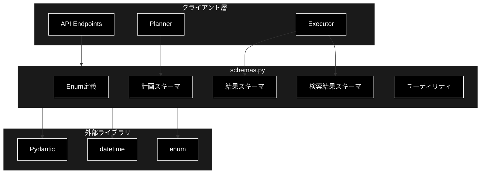
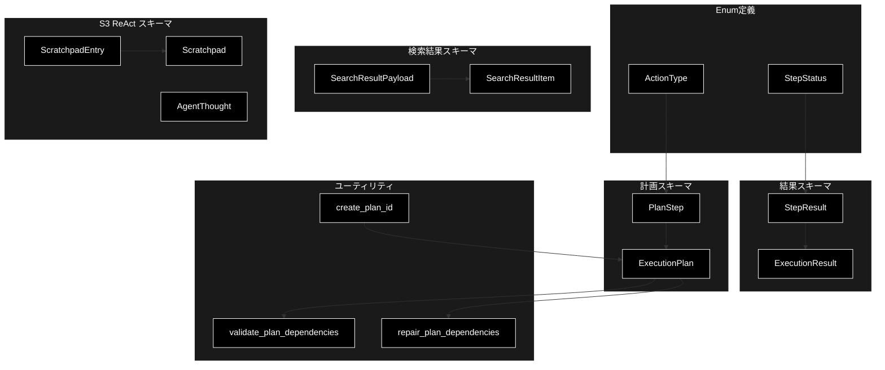
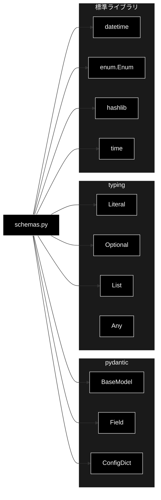
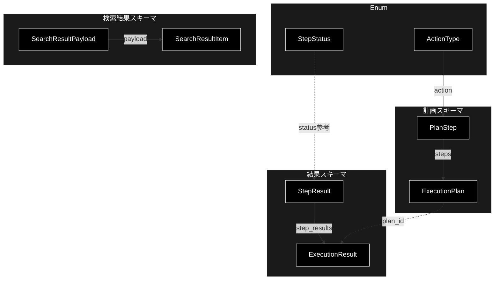

# schemas.py - GRACE Pydanticスキーマ定義 ドキュメント

**Version 2.6** | 最終更新: 2026-10-30

---

## 目次

1. [概要](#概要)
2. [アーキテクチャ構成図](#1-アーキテクチャ構成図)
3. [モジュール構成図](#2-モジュール構成図)
4. [クラス・関数一覧表](#3-クラス関数一覧表)
5. [クラス・関数 IPO詳細](#4-クラス関数-ipo詳細)
6. [設定・定数](#5-設定定数)
7. [エクスポート](#6-エクスポート)
8. [変更履歴](#7-変更履歴)
9. [付録: 依存関係図](#付録-依存関係図)

---

## 概要

`schemas.py`は、GRACEシステムの計画生成・実行に使用するPydanticデータモデルを定義するモジュールです。実行計画（ExecutionPlan）、ステップ（PlanStep）、実行結果（ExecutionResult, StepResult）のスキーマを提供し、型安全なデータ操作を実現します。

### 主な責務

- アクション種別（ActionType）とステップ状態（StepStatus）のEnum定義
- 計画スキーマ（PlanStep, ExecutionPlan）の定義
- 実行結果スキーマ（StepResult, ExecutionResult）の定義
- 検索結果スキーマ（SearchResultPayload, SearchResultItem）の定義（RAG/Web共通）
- 計画ID生成と依存関係検証のユーティリティ提供
- ReAct ループの思考・履歴スキーマ（Scratchpad, AgentThought）の定義

### 各責務対応のモジュール

| # | 責務 | 対応モジュール | 説明 |
|---|------|--------------|------|
| 1 | Enum 定義 | `grace/schemas.py` | `ActionType` / `StepStatus` |
| 2 | 計画スキーマ | `grace/schemas.py` | `PlanStep` / `ExecutionPlan` |
| 3 | 実行結果スキーマ | `grace/schemas.py` | `StepResult` / `ExecutionResult` |
| 4 | 検索結果スキーマ | `grace/schemas.py` | `SearchResultPayload` / `SearchResultItem`（RAG / Web 共通） |
| 5 | 計画 ID と依存関係のユーティリティ | `grace/schemas.py` | `create_plan_id()` / `validate_plan_dependencies()` / `repair_plan_dependencies()` |
| 6 | ReAct の思考・履歴スキーマ | `grace/schemas.py` | `ScratchpadEntry` / `Scratchpad` / `AgentThought` |

### 主要機能一覧

| 機能 | 説明 |
|------|------|
| `ActionType` | 実行可能なアクション種別のEnum |
| `StepStatus` | ステップ実行状態のEnum |
| `PlanStep` | 計画の1ステップを表現するPydanticモデル |
| `ExecutionPlan` | 実行計画全体を表現するPydanticモデル |
| `StepResult` | ステップ実行結果のPydanticモデル |
| `ExecutionResult` | 計画全体の実行結果のPydanticモデル |
| `SearchResultPayload` | 検索結果ペイロード（RAG/Web共通）のPydanticモデル |
| `SearchResultItem` | 検索結果1件（RAG/Web共通フォーマット）のPydanticモデル |
| `create_plan_id()` | 一意の計画IDを生成するユーティリティ関数 |
| `validate_plan_dependencies()` | 計画の依存関係を検証するユーティリティ関数 |

---

## 1. アーキテクチャ構成図

### 1.1 システム全体構成



### 1.2 データフロー

1. Plannerが`ExecutionPlan`と`PlanStep`を使用して計画を生成
2. Executorが計画を受け取り、各ステップを実行
3. 実行結果を`StepResult`として記録
4. 全体の実行結果を`ExecutionResult`として返却

---

## 2. モジュール構成図

### 2.1 内部モジュール構成



### 2.2 外部依存関係

| ライブラリ | バージョン | 用途 |
|-----------|-----------|------|
| `pydantic` | >= 2.0 | データモデル定義、バリデーション |

### 2.3 内部依存モジュール

| モジュール | 用途 |
|-----------|------|
| `typing` | 型ヒント（Literal, Optional, List, Any） |
| `datetime` | 日時処理 |
| `enum` | Enum基底クラス |
| `hashlib` | 計画ID生成用ハッシュ |

---

## 3. クラス・関数一覧表

### 3.1 Enumクラス一覧

#### ActionType

| 値 | 説明 |
|-----|------|
| `RAG_SEARCH` | RAGベクトル検索 |
| `WEB_SEARCH` | Web検索 |
| `REASONING` | 推論処理 |
| `ASK_USER` | ユーザーへの質問 |
| `CODE_EXECUTE` | コード実行 |

#### StepStatus

| 値 | 説明 |
|-----|------|
| `PENDING` | 待機中 |
| `RUNNING` | 実行中 |
| `SUCCESS` | 成功 |
| `PARTIAL` | 部分成功 |
| `FAILED` | 失敗 |
| `SKIPPED` | スキップ |

### 3.2 Pydanticモデル一覧

#### PlanStep

| フィールド | 型 | 説明 |
|-----------|-----|------|
| `step_id` | `int` | ステップ番号（1から開始） |
| `action` | `Literal["rag_search", "web_search", "reasoning", "ask_user", "code_execute"]` | 実行するアクション種別 |
| `description` | `str` | ステップの説明 |
| `query` | `Optional[str]` | 検索クエリ |
| `collection` | `Optional[str]` | 検索対象コレクション |
| `depends_on` | `List[int]` | 依存する先行ステップID |
| `expected_output` | `str` | 期待される出力の説明 |
| `dynamic` | `bool` | 計画に無かったフォールバックとして**実行時に挿入された**ステップか（RAG スコア不足時の `web_search` / `ask_user`）。**成否の集計から外すために使う** — 補助の空振りを、実際に成功した RAG コレクションの失敗として記録しないため（`Executor._record_memory`） |
| `fallback` | `Optional[str]` | 失敗時の代替アクション |
| `web_query` | `Optional[str]` | rag_search に持たせる Web 検索語（0-(A) の `Aspect.web_query`）。差し込む web_search・代替の web_search は `query` ではなくこれを使う。None なら `query` |
| `required` | `bool` | 利用者が求めたステップか（0-(A) で最新情報を求めた観点の web_search）。社内検索が十分でも飛ばさない |
| `timeout_seconds` | `Optional[int]` | タイムアウト秒数 |

#### ExecutionPlan

| フィールド | 型 | 説明 |
|-----------|-----|------|
| `original_query` | `str` | ユーザーの元の質問 |
| `complexity` | `float` | 推定複雑度（0.0-1.0） |
| `estimated_steps` | `int` | 推定ステップ数 |
| `requires_confirmation` | `bool` | 実行前確認の要否 |
| `steps` | `List[PlanStep]` | 実行ステップのリスト |
| `success_criteria` | `str` | 計画成功の判定基準 |
| `created_at` | `Optional[datetime]` | 計画作成日時 |
| `plan_id` | `Optional[str]` | 計画ID |

#### StepResult

| フィールド | 型 | 説明 |
|-----------|-----|------|
| `step_id` | `int` | ステップID |
| `status` | `Literal[...]` | 実行結果ステータス |
| `output` | `Optional[str]` | 出力内容 |
| `confidence` | `float` | 信頼度スコア（0.0-1.0） |
| `sources` | `List[str]` | 引用ソース（**表示用の識別子**。ファイル名等） |
| `source_texts` | `List[str]` | **根拠検証用の出典本文**（P-01b）。`GroundednessVerifier` へ渡す。本文を取得できない経路（legacy agent 等）では空 |
| `error` | `Optional[str]` | エラーメッセージ |
| `execution_time_ms` | `Optional[int]` | 実行時間（ミリ秒） |
| `token_usage` | `Optional[dict]` | トークン使用量 |
| `created_at` | `Optional[datetime]` | 結果作成日時 |

#### ExecutionResult

| フィールド | 型 | 説明 |
|-----------|-----|------|
| `plan_id` | `str` | 計画ID |
| `original_query` | `str` | 元のクエリ |
| `final_answer` | `Optional[str]` | 最終回答 |
| `step_results` | `List[StepResult]` | 各ステップの結果 |
| `overall_confidence` | `float` | 全体の信頼度 |
| `overall_status` | `Literal[...]` | 全体のステータス |
| `replan_count` | `int` | リプラン回数 |
| `total_execution_time_ms` | `Optional[int]` | 総実行時間（ミリ秒） |
| `total_token_usage` | `Optional[dict]` | 総トークン使用量 |
| `total_cost_usd` | `Optional[float]` | 総コスト（USD）。ローカル LLM は 0 で、実質 Embedding 分のみ |
| `rag_max_score` | `Optional[float]` | RAG 検索ステップの最高類似度スコア（**ベンチマーク計測用**。検索未実行なら `None`） |
| `rag_search_count` | `int` | 実行された `rag_search` ステップ数（ベンチマーク計測用） |
| `web_search_used` | `bool` | `web_search` ステップが実際に実行されたか（ベンチマーク計測用） |
| `web_searches` | `List[dict]` | 実行した web_search（`step_id` / `query` / `reason`）。`reason` は Web を見た理由で、GRACE-Support が画面のログにそのまま出す |
| `created_at` | `Optional[datetime]` | 結果作成日時 |

#### ScratchpadEntry

ReAct ループ 1 ターン分の観測履歴。

| フィールド | 型 | 説明 |
|-----------|-----|------|
| `action` | `str` | 実行したアクション |
| `query` | `Optional[str]` | アクションのクエリ |
| `observation` | `str` | 観測（ツール出力の要約） |
| `confidence` | `float` | このターンの信頼度（0.0-1.0） |

#### Scratchpad

ReAct の観測履歴そのもの。Reason ステップへ渡す「思考の足場」。

| フィールド | 型 | 説明 |
|-----------|-----|------|
| `entries` | `List[ScratchpadEntry]` | 観測履歴（追記順） |

| メソッド | 概要 |
|---|---|
| `add(action, observation, confidence, query=None)` | 1 ターン分を追記。**observation が 600 文字を超えると切り詰める**（`…(省略)` を付与） |
| `as_prompt()` | LLM プロンプト用に整形。空なら `"(まだ何も実行していません)"` |
| `last_confidence()` | 最後のターンの信頼度。空なら `0.0` |

#### AgentThought

ReAct の Reason 出力＝「次の 1 手と停止判定」。

| フィールド | 型 | 説明 |
|-----------|-----|------|
| `reasoning` | `str` | 現在の状況と次手の根拠（簡潔に） |
| `next_action` | `Literal["rag_search", "web_search", "reasoning", "ask_user", "finish"]` | 次に実行するアクション。十分なら `finish` |
| `query` | `Optional[str]` | 検索/推論のためのクエリ |
| `collection` | `Optional[str]` | RAG 検索対象コレクション |
| `is_final` | `bool` | このアクションで回答が確定し、ループを終了してよいか |

> 📝 `next_action` の候補に **`code_execute` は含まれない**（`ActionType` にはある）。ReAct ループから
> サンドボックス実行を選ぶ経路は用意されていない。

#### SearchResultPayload

| フィールド | 型 | 説明 |
|-----------|-----|------|
| `question` | `str` | 関連質問文（RAG検索時） |
| `answer` | `str` | 回答・スニペット文 |
| `content` | `str` | 本文コンテンツ（question/answerがない場合） |
| `source` | `str` | 出典URLまたはファイル名 |
| `title` | `str` | ドキュメント・ページタイトル |

#### SearchResultItem

| フィールド | 型 | 説明 |
|-----------|-----|------|
| `score` | `float` | 関連度スコア（0.0-1.0） |
| `payload` | `SearchResultPayload` | 検索結果の詳細情報 |
| `collection` | `str` | 検索元コレクション名 |

### 3.3 ユーティリティ関数一覧

| 関数名 | 概要 |
|-------|------|
| `create_plan_id()` | 一意の計画IDを生成 |
| `validate_plan_dependencies(plan)` | 計画の依存関係を検証し、エラーメッセージのリストを返す（**計画は変更しない**） |
| `repair_plan_dependencies(plan)` | 実行不能な依存を**取り除く（破壊的）**。除去した依存の説明リストを返す |

---

## 4. クラス・関数 IPO詳細

### 4.1 使用例

`schemas.py` は段のあいだで受け渡す**型（データ契約）**だけを持つ（すべて Pydantic。LLM・外部は使わない）。使い方は次の 4 通り。

| 処理パターン | 呼び方 | 向いている場面 | 例 |
|---|---|---|---|
| 計画を組み立てて検証する | `ExecutionPlan(steps=[PlanStep(...)])` → `validate_plan_dependencies(plan)` | 計画を手で作る・テストする | 4.1.1 |
| 壊れた依存を直す | `repair_plan_dependencies(plan)` | LLM が作った計画の依存 ID の取り違えを直す（planner が LLM 計画の後に呼ぶ） | 4.1.2 |
| 結果を記録する | `StepResult` / `ExecutionResult` | 実行結果をまとめる・JSON にして返す | 4.1.3 |
| ReAct の観測を積む | `Scratchpad.add` → `as_prompt()`・`AgentThought` | ReAct ループの「これまでの観測」と「次の 1 手」 | 4.1.4 |

> 📝 4 本とも**そのまま実行し**、出力を確かめてある（2026-10-10。外部は使わない）。
>
> 📝 `SearchResultItem` / `SearchResultPayload` は公開 API にあるが、2026-10-10 時点で使っている箇所は無い
> （`rag_search` の `ToolResult.output` は辞書のリストのまま。形は [`grace_data_flow.md` §2](./grace_data_flow.md#2-データ項目と形式)）。

#### 4.1.1 基本的なワークフロー（計画を組み立てて検証する）

```python
from grace.schemas import ExecutionPlan, PlanStep, create_plan_id, validate_plan_dependencies

plan = ExecutionPlan(
    original_query="退職手続きについて教えて",
    complexity=0.5,
    estimated_steps=2,
    requires_confirmation=False,
    success_criteria="手続きの流れが分かる",
    plan_id=create_plan_id(),          # 12 桁の 16 進（省略しても自動で振られる）
    steps=[
        PlanStep(step_id=1, action="rag_search", description="社内規程を検索",
                 query="退職手続きについて教えて",      # 質問文をそのまま検索クエリにする
                 expected_output="関連する規程", fallback="web_search"),
        PlanStep(step_id=2, action="reasoning", description="回答を生成",
                 depends_on=[1], expected_output="回答"),
    ],
)

print(validate_plan_dependencies(plan))           # 空なら問題なし
print(plan.steps[0].timeout_seconds, plan.steps[0].dynamic)   # 既定値（None＝設定に従う）
print(plan.model_dump_json(include={"original_query", "complexity"}))
```

```
# 出力例:
# []
# None False
# {"original_query":"退職手続きについて教えて","complexity":0.5}
```

> ⚠️ **`timeout_seconds` の既定は None**（Executor が `planner.step_timeout_seconds`、既定 240 秒へ落とす）。以前は既定 30 秒で、
> リプランで作り直したステップが引き継ぎを忘れると 30 秒に戻り、ローカル LLM の reasoning（1 呼び出し 90〜250 秒）が必ずタイムアウトしていた。
>
> ⚠️ `action` に使えるのは `rag_search` / `web_search` / `reasoning` / `ask_user` / `code_execute` の 5 つだけ（`Literal`）。
> それ以外は `ValidationError` になる。

#### 4.1.2 壊れた依存を直す（`repair_plan_dependencies`）

```python
from grace.schemas import ExecutionPlan, PlanStep, repair_plan_dependencies, validate_plan_dependencies

plan = ExecutionPlan(
    original_query="退職手続きについて教えて",
    complexity=0.8,
    estimated_steps=2,
    requires_confirmation=False,
    success_criteria="手続きの流れが分かる",
    steps=[
        PlanStep(step_id=1, action="rag_search", description="検索", query="退職手続き", expected_output="規程"),
        PlanStep(step_id=2, action="reasoning", description="回答", depends_on=[1, 3], expected_output="回答"),   # 3 は存在しない
    ],
)

print(validate_plan_dependencies(plan))   # 何が壊れているか（直さない）
print(repair_plan_dependencies(plan))     # 実行できない依存だけを落とす（plan を書き換える）
print(plan.steps[1].depends_on)
```

```
# 出力例:
# ['Step 2: 存在しない依存先 3', 'Step 2: 循環依存または後方依存 3']
# ['Step 2: 存在しない依存先 3 を除去']
# [1]
```

> ⚠️ **警告だけで済ませない理由。** ローカル LLM は計画 JSON の精度が低い。executor は依存先の結果が揃うまでステップを実行しないので、存在しない ID に依存した
> `reasoning` は**永久に実行されず、回答が無いまま計画が「完走」する**（実測で `Step 4: 存在しない依存先 3` が出たまま採用されていた）。
> 落とすのは依存だけで、ステップ自体は残す。

#### 4.1.3 結果を記録する（`StepResult` / `ExecutionResult`）

```python
from grace.schemas import ExecutionResult, StepResult

steps = [
    StepResult(step_id=1, status="success", output="関連文書を 1 件取得", confidence=0.82,
               sources=["hr_rules.csv"], source_texts=["退職は 1 か月前までに届け出る"], execution_time_ms=1200),
    StepResult(step_id=2, status="success", output="退職の 1 か月前までに届け出てください。", confidence=0.88,
               execution_time_ms=3000),
]

result = ExecutionResult(
    plan_id="abc123def456",
    original_query="退職手続きについて教えて",
    final_answer=steps[-1].output,
    step_results=steps,
    overall_confidence=0.86,
    overall_status="success",
)
print(result.overall_status, result.replan_count, len(result.step_results))
print(result.model_dump(include={"final_answer", "overall_confidence"}))
```

```
# 出力例:
# success 0 2
# {'final_answer': '退職の 1 か月前までに届け出てください。', 'overall_confidence': 0.86}
```

> 📝 `sources` は表示用の識別子、`source_texts` は**根拠検証に渡す本文**。識別子だけを渡すと、根拠検証で全主張が neutral になる。

#### 4.1.4 ReAct の観測を積む（`Scratchpad` / `AgentThought`）

```python
from grace.schemas import AgentThought, Scratchpad

pad = Scratchpad()
print(pad.as_prompt())   # まだ何もしていないとき

pad.add(action="rag_search", query="退職手続き", observation="規程が 1 件見つかった", confidence=0.82)
pad.add(action="reasoning", observation="退職の 1 か月前までに届け出る旨を回答", confidence=0.88)
print(pad.as_prompt())
print(pad.last_confidence())

# Reason の出力（executor は LLM に AgentThought の形で返させる）
thought = AgentThought(reasoning="回答が確定した", next_action="finish", is_final=True)
print(thought.next_action, thought.is_final)
```

```
# 出力例:
# (まだ何も実行していません)
# [1] action=rag_search query='退職手続き' confidence=0.82
#     observation: 規程が 1 件見つかった
# [2] action=reasoning confidence=0.88
#     observation: 退職の 1 か月前までに届け出る旨を回答
# 0.88
# finish True
```

> 📝 観測は 600 字を超えると切り詰めて「…(省略)」を付ける（プロンプトが長くなりすぎないように）。

---

### 4.2 ActionType Enum

**概要**: 実行可能なアクション種別を定義するEnum。文字列ベースで、JSONシリアライズに対応。

```python
class ActionType(str, Enum):
    RAG_SEARCH = "rag_search"
    WEB_SEARCH = "web_search"
    REASONING = "reasoning"
    ASK_USER = "ask_user"
    CODE_EXECUTE = "code_execute"
```

| 値 | 文字列値 | 用途 |
|-----|---------|------|
| `RAG_SEARCH` | `"rag_search"` | Qdrantベクトルデータベースでの検索 |
| `WEB_SEARCH` | `"web_search"` | インターネット検索 |
| `REASONING` | `"reasoning"` | LLMによる推論処理 |
| `ASK_USER` | `"ask_user"` | ユーザーへの確認・質問 |
| `CODE_EXECUTE` | `"code_execute"` | Pythonコードの実行 |

```python
# 使用例
from schemas import ActionType

action = ActionType.RAG_SEARCH
print(action.value)  # 出力: "rag_search"
print(action == "rag_search")  # 出力: True
```

---

### 4.3 StepStatus Enum

**概要**: ステップの実行状態を定義するEnum。状態遷移の管理に使用。

```python
class StepStatus(str, Enum):
    PENDING = "pending"
    RUNNING = "running"
    SUCCESS = "success"
    PARTIAL = "partial"
    FAILED = "failed"
    SKIPPED = "skipped"
```

| 値 | 文字列値 | 説明 |
|-----|---------|------|
| `PENDING` | `"pending"` | 実行待ち |
| `RUNNING` | `"running"` | 実行中 |
| `SUCCESS` | `"success"` | 正常完了 |
| `PARTIAL` | `"partial"` | 部分的に成功 |
| `FAILED` | `"failed"` | 失敗 |
| `SKIPPED` | `"skipped"` | スキップされた |

```python
# 使用例
from schemas import StepStatus

status = StepStatus.SUCCESS
print(status.value)  # 出力: "success"
```

---

### 4.4 PlanStep クラス

**概要**: 計画の1ステップを表現するPydanticモデル。アクション、依存関係、タイムアウト等を含む。

```python
class PlanStep(BaseModel):
    step_id: int = Field(..., description="ステップ番号（1から開始）", ge=1)
    action: Literal["rag_search", "web_search", "reasoning", "ask_user", "code_execute"]
    description: str = Field(..., description="このステップで何をするか", min_length=1)
    query: Optional[str] = Field(None, description="検索クエリ（検索系アクションの場合）")
    collection: Optional[str] = Field(None, description="検索対象コレクション（RAG検索の場合）")
    depends_on: List[int] = Field(default_factory=list, description="依存する先行ステップのID")
    expected_output: str = Field(..., description="期待される出力の説明")
    dynamic: bool = Field(False, description="実行時に挿入されたフォールバックステップか")
    fallback: Optional[str] = Field(None, description="失敗時の代替アクション")
    web_query: Optional[str] = Field(None, description="rag_search に持たせる Web 検索語")
    required: bool = Field(False, description="利用者が求めたステップか")
    timeout_seconds: Optional[int] = Field(30, description="タイムアウト秒数", ge=1, le=300)
```

| 項目 | 内容 |
|------|------|
| **Input** | 各フィールドの値（`step_id`, `action`, `description`等） |
| **Process** | Pydanticによるバリデーション（型チェック、範囲チェック） |
| **Output** | `PlanStep`インスタンス |

**フィールド詳細**:

| フィールド | 型 | 必須 | デフォルト | 制約 |
|-----------|-----|:----:|-----------|------|
| `step_id` | `int` | ✅ | - | >= 1 |
| `action` | `Literal` | ✅ | - | 指定値のみ |
| `description` | `str` | ✅ | - | 1文字以上 |
| `query` | `Optional[str]` | - | `None` | - |
| `collection` | `Optional[str]` | - | `None` | - |
| `depends_on` | `List[int]` | - | `[]` | - |
| `expected_output` | `str` | ✅ | - | - |
| `dynamic` | `bool` | - | `False` | - |
| `fallback` | `Optional[str]` | - | `None` | - |
| `web_query` | `Optional[str]` | - | `None` | - |
| `required` | `bool` | - | `False` | - |
| `timeout_seconds` | `Optional[int]` | - | `30` | 1-300 |

**戻り値例**:

```python
{
    "step_id": 1,
    "action": "rag_search",
    "description": "関連ドキュメントを検索",
    "query": "Pythonの非同期処理について",
    "collection": "tech_docs",
    "depends_on": [],
    "expected_output": "非同期処理に関する技術文書",
    "dynamic": false,
    "fallback": "web_search",
    "timeout_seconds": 30
}
```

```python
# 使用例
from schemas import PlanStep

step = PlanStep(
    step_id=1,
    action="rag_search",
    description="関連ドキュメントを検索",
    query="Pythonの非同期処理",
    collection="tech_docs",
    expected_output="非同期処理に関する技術文書"
)
print(step.model_dump())
```

---

### 4.5 ExecutionPlan クラス

**概要**: 実行計画全体を表現するPydanticモデル。複数のステップ、複雑度、成功基準等を含む。

```python
class ExecutionPlan(BaseModel):
    original_query: str = Field(..., description="ユーザーの元の質問", min_length=1)
    complexity: float = Field(..., ge=0.0, le=1.0, description="推定複雑度（0.0-1.0）")
    estimated_steps: int = Field(..., description="推定ステップ数", ge=1, le=20)
    requires_confirmation: bool = Field(..., description="実行前に確認が必要か")
    steps: List[PlanStep] = Field(..., description="実行ステップのリスト", min_length=1)
    success_criteria: str = Field(..., description="計画成功の判定基準")
    created_at: Optional[datetime] = Field(default_factory=datetime.now, description="計画作成日時")
    plan_id: Optional[str] = Field(None, description="計画ID（自動生成）")
```

| 項目 | 内容 |
|------|------|
| **Input** | 各フィールドの値（`original_query`, `complexity`, `steps`等） |
| **Process** | 1. Pydanticによるバリデーション<br>2. ネストされたPlanStepの検証<br>3. 範囲チェック（complexity: 0.0-1.0, estimated_steps: 1-20） |
| **Output** | `ExecutionPlan`インスタンス |

**フィールド詳細**:

| フィールド | 型 | 必須 | デフォルト | 制約 |
|-----------|-----|:----:|-----------|------|
| `original_query` | `str` | ✅ | - | 1文字以上 |
| `complexity` | `float` | ✅ | - | 0.0-1.0 |
| `estimated_steps` | `int` | ✅ | - | 1-20 |
| `requires_confirmation` | `bool` | ✅ | - | - |
| `steps` | `List[PlanStep]` | ✅ | - | 1要素以上 |
| `success_criteria` | `str` | ✅ | - | - |
| `created_at` | `Optional[datetime]` | - | `datetime.now()` | - |
| `plan_id` | `Optional[str]` | - | `None` | - |

**戻り値例**:

```python
{
    "original_query": "Pythonの非同期処理について教えて",
    "complexity": 0.6,
    "estimated_steps": 3,
    "requires_confirmation": False,
    "steps": [
        {
            "step_id": 1,
            "action": "rag_search",
            "description": "技術文書を検索",
            "query": "Python async await",
            "collection": "tech_docs",
            "depends_on": [],
            "expected_output": "非同期処理の解説文書",
            "fallback": None,
            "timeout_seconds": 30
        },
        {
            "step_id": 2,
            "action": "reasoning",
            "description": "検索結果を統合して回答を生成",
            "query": None,
            "collection": None,
            "depends_on": [1],
            "expected_output": "ユーザーへの回答文",
            "fallback": None,
            "timeout_seconds": 60
        }
    ],
    "success_criteria": "非同期処理の概念と使用方法が説明できている",
    "created_at": "2025-01-29T10:30:00",
    "plan_id": "abc123def456"
}
```

```python
# 使用例
from schemas import ExecutionPlan, PlanStep, create_plan_id

plan = ExecutionPlan(
    original_query="Pythonの非同期処理について教えて",
    complexity=0.6,
    estimated_steps=2,
    requires_confirmation=False,
    steps=[
        PlanStep(
            step_id=1,
            action="rag_search",
            description="技術文書を検索",
            query="Python async await",
            expected_output="非同期処理の解説文書"
        ),
        PlanStep(
            step_id=2,
            action="reasoning",
            description="回答を生成",
            depends_on=[1],
            expected_output="ユーザーへの回答文"
        )
    ],
    success_criteria="非同期処理の概念が説明できている",
    plan_id=create_plan_id()
)
print(plan.model_dump_json(indent=2))
```

---

### 4.6 StepResult クラス

**概要**: ステップ実行結果を表現するPydanticモデル。出力、信頼度、エラー情報等を含む。

```python
class StepResult(BaseModel):
    step_id: int = Field(..., description="ステップID")
    status: Literal["success", "partial", "failed"] = Field(..., description="実行結果ステータス")
    output: Optional[str] = Field(None, description="出力内容")
    confidence: float = Field(..., ge=0.0, le=1.0, description="信頼度スコア（0.0-1.0）")
    sources: List[str] = Field(default_factory=list, description="引用ソース")
    source_texts: List[str] = Field(default_factory=list, description="根拠検証用の出典本文")
    error: Optional[str] = Field(None, description="エラーメッセージ（失敗時）")
    execution_time_ms: Optional[int] = Field(None, description="実行時間（ミリ秒）")
    token_usage: Optional[dict] = Field(None, description="トークン使用量")
    created_at: Optional[datetime] = Field(default_factory=datetime.now, description="結果作成日時")
```

| 項目 | 内容 |
|------|------|
| **Input** | 各フィールドの値（`step_id`, `status`, `output`等） |
| **Process** | Pydanticによるバリデーション（型チェック、範囲チェック） |
| **Output** | `StepResult`インスタンス |

> ⚠️ **`sources` と `source_texts` は用途が違う。** `sources` は**表示用の識別子**
> （ファイル名等）、`source_texts` は**根拠検証用の本文**です。識別子を
> `GroundednessVerifier` へ渡すとどの主張も検証できず全て neutral になり、
> `support_rate = supported / (supported + contradicted)` の**分母が 0** になります。
> 収集は `executor.py::_extract_source_texts` / `ExecutionState.get_completed_source_texts`。

**戻り値例**:

```python
{
    "step_id": 1,
    "status": "success",
    "output": "Pythonの非同期処理は、asyncioモジュールを使用して...",
    "confidence": 0.85,
    "sources": ["tech_docs/async_guide.md", "tech_docs/python_concurrent.md"],
    "error": None,
    "execution_time_ms": 1250,
    "token_usage": {"input": 150, "output": 320},
    "created_at": "2025-01-29T10:30:05"
}
```

```python
# 使用例
from schemas import StepResult

result = StepResult(
    step_id=1,
    status="success",
    output="Pythonの非同期処理は...",
    confidence=0.85,
    sources=["tech_docs/async_guide.md"],
    execution_time_ms=1250
)
print(result.model_dump())
```

---

### 4.7 ExecutionResult クラス

**概要**: 計画全体の実行結果を表現するPydanticモデル。最終回答、全ステップ結果、コスト情報等を含む。

```python
class ExecutionResult(BaseModel):
    plan_id: str = Field(..., description="計画ID")
    original_query: str = Field(..., description="元のクエリ")
    final_answer: Optional[str] = Field(None, description="最終回答")
    step_results: List[StepResult] = Field(default_factory=list, description="各ステップの結果")
    overall_confidence: float = Field(..., ge=0.0, le=1.0, description="全体の信頼度")
    overall_status: Literal["success", "partial", "failed", "cancelled"] = Field(..., description="全体のステータス")
    replan_count: int = Field(0, description="リプラン回数")
    total_execution_time_ms: Optional[int] = Field(None, description="総実行時間（ミリ秒）")
    total_token_usage: Optional[dict] = Field(None, description="総トークン使用量")
    total_cost_usd: Optional[float] = Field(None, description="総コスト（USD）")
    web_searches: List[dict] = Field(default_factory=list, description="実行した web_search（step_id / query / reason）")
    created_at: Optional[datetime] = Field(default_factory=datetime.now, description="結果作成日時")
```

| 項目 | 内容 |
|------|------|
| **Input** | 各フィールドの値（`plan_id`, `original_query`, `step_results`等） |
| **Process** | 1. Pydanticによるバリデーション<br>2. ネストされたStepResultの検証 |
| **Output** | `ExecutionResult`インスタンス |

**戻り値例**:

```python
{
    "plan_id": "abc123def456",
    "original_query": "Pythonの非同期処理について教えて",
    "final_answer": "Pythonの非同期処理は、asyncioモジュールを使用して...",
    "step_results": [
        {
            "step_id": 1,
            "status": "success",
            "output": "関連文書を3件取得",
            "confidence": 0.9,
            "sources": ["doc1.md", "doc2.md"],
            "error": None,
            "execution_time_ms": 800,
            "token_usage": None,
            "created_at": "2025-01-29T10:30:05"
        }
    ],
    "overall_confidence": 0.85,
    "overall_status": "success",
    "replan_count": 0,
    "total_execution_time_ms": 2500,
    "total_token_usage": {"input": 500, "output": 800},
    "total_cost_usd": 0.0023,
    "created_at": "2025-01-29T10:30:10"
}
```

```python
# 使用例
from schemas import ExecutionResult, StepResult

result = ExecutionResult(
    plan_id="abc123def456",
    original_query="Pythonの非同期処理について教えて",
    final_answer="Pythonの非同期処理は...",
    step_results=[
        StepResult(
            step_id=1,
            status="success",
            output="関連文書を3件取得",
            confidence=0.9
        )
    ],
    overall_confidence=0.85,
    overall_status="success",
    total_execution_time_ms=2500
)
print(result.model_dump_json(indent=2))
```

---

### 4.8 SearchResultPayload クラス

**概要**: RAG検索・Web検索で共通利用する検索結果ペイロードのPydanticモデル。全フィールドが空文字デフォルトを持つ。

```python
class SearchResultPayload(BaseModel):
    question: str = Field("", description="関連質問文（RAG検索時）")
    answer: str = Field("", description="回答・スニペット文")
    content: str = Field("", description="本文コンテンツ（question/answerがない場合）")
    source: str = Field("", description="出典URLまたはファイル名")
    title: str = Field("", description="ドキュメント・ページタイトル")
```

| 項目 | 内容 |
|------|------|
| **Input** | 各フィールドの値（すべて任意、デフォルトは空文字） |
| **Process** | Pydanticによるバリデーション（型チェック） |
| **Output** | `SearchResultPayload`インスタンス |

**フィールド詳細**:

| フィールド | 型 | 必須 | デフォルト | 説明 |
|-----------|-----|:----:|-----------|------|
| `question` | `str` | - | `""` | 関連質問文（RAG検索時） |
| `answer` | `str` | - | `""` | 回答・スニペット文 |
| `content` | `str` | - | `""` | 本文コンテンツ（question/answerがない場合） |
| `source` | `str` | - | `""` | 出典URLまたはファイル名 |
| `title` | `str` | - | `""` | ドキュメント・ページタイトル |

**戻り値例**:

```python
{
    "question": "Pythonの非同期処理とは？",
    "answer": "asyncioを用いた並行処理の仕組みです。",
    "content": "",
    "source": "tech_docs/async_guide.md",
    "title": "非同期処理ガイド"
}
```

```python
# 使用例
from schemas import SearchResultPayload

payload = SearchResultPayload(
    answer="asyncioを用いた並行処理の仕組みです。",
    source="tech_docs/async_guide.md",
    title="非同期処理ガイド"
)
print(payload.model_dump())
```

---

### 4.9 SearchResultItem クラス

**概要**: RAG検索・Web検索で共通フォーマットの検索結果1件を表現するPydanticモデル。スコアとペイロード、検索元コレクション名を保持する。

```python
class SearchResultItem(BaseModel):
    score: float = Field(..., ge=0.0, le=1.0, description="関連度スコア（0.0-1.0）")
    payload: SearchResultPayload = Field(default_factory=SearchResultPayload, description="検索結果の詳細情報")
    collection: str = Field("", description="検索元コレクション名（例: 'wikipedia_ja', 'web_search'）")
```

| 項目 | 内容 |
|------|------|
| **Input** | `score`（必須）, `payload`, `collection` |
| **Process** | 1. Pydanticによるバリデーション<br>2. `score` の範囲チェック（0.0-1.0）<br>3. ネストされた `SearchResultPayload` の検証 |
| **Output** | `SearchResultItem`インスタンス |

**フィールド詳細**:

| フィールド | 型 | 必須 | デフォルト | 制約 |
|-----------|-----|:----:|-----------|------|
| `score` | `float` | ✅ | - | 0.0-1.0 |
| `payload` | `SearchResultPayload` | - | `SearchResultPayload()` | - |
| `collection` | `str` | - | `""` | - |

**戻り値例**:

```python
{
    "score": 0.82,
    "payload": {
        "question": "",
        "answer": "asyncioを用いた並行処理の仕組みです。",
        "content": "",
        "source": "tech_docs/async_guide.md",
        "title": "非同期処理ガイド"
    },
    "collection": "wikipedia_ja"
}
```

```python
# 使用例
from schemas import SearchResultItem, SearchResultPayload

item = SearchResultItem(
    score=0.82,
    payload=SearchResultPayload(answer="asyncioを用いた並行処理の仕組みです。"),
    collection="wikipedia_ja"
)
print(item.model_dump())
```

---

### 4.10 ユーティリティ関数

#### `create_plan_id`

**概要**: 一意の計画IDを生成する。MD5ハッシュを使用して12文字のIDを生成。

```python
def create_plan_id() -> str
```

| 項目 | 内容 |
|------|------|
| **Input** | なし |
| **Process** | 1. 現在時刻とオブジェクトIDから一意の文字列を生成<br>2. MD5ハッシュを計算<br>3. 先頭12文字を抽出 |
| **Output** | `str`: 12文字の計画ID |

**戻り値例**:

```python
"abc123def456"
```

```python
# 使用例
from schemas import create_plan_id

plan_id = create_plan_id()
print(plan_id)  # 出力: "abc123def456" (例)
```

---

#### `validate_plan_dependencies`

**概要**: 計画の依存関係を検証する。存在しない依存先や循環依存をチェック。

```python
def validate_plan_dependencies(plan: ExecutionPlan) -> List[str]
```

| パラメータ | 型 | デフォルト | 説明 |
|------------|------|-----------|------|
| `plan` | `ExecutionPlan` | - | 検証対象の計画 |

| 項目 | 内容 |
|------|------|
| **Input** | `plan: ExecutionPlan` |
| **Process** | 1. 全ステップIDの集合を作成<br>2. 各ステップの依存先をチェック<br>3. 存在しない依存先をエラーとして記録<br>4. 後方依存（循環依存）をエラーとして記録 |
| **Output** | `List[str]`: エラーメッセージのリスト（空なら問題なし） |

**戻り値例**:

```python
# 問題なしの場合
[]

# エラーがある場合
[
    "Step 2: 存在しない依存先 5",
    "Step 3: 循環依存または後方依存 4"
]
```

```python
# 使用例
from schemas import ExecutionPlan, PlanStep, validate_plan_dependencies

plan = ExecutionPlan(
    original_query="テスト",
    complexity=0.5,
    estimated_steps=2,
    requires_confirmation=False,
    steps=[
        PlanStep(step_id=1, action="reasoning", description="ステップ1", expected_output="出力1"),
        PlanStep(step_id=2, action="reasoning", description="ステップ2", depends_on=[1], expected_output="出力2"),
    ],
    success_criteria="完了"
)

errors = validate_plan_dependencies(plan)
if errors:
    print("依存関係エラー:", errors)
else:
    print("依存関係は正常です")
```

---

## 5. 設定・定数

本モジュールには外部から参照可能な設定・定数はありません。

Enumの値は以下の通りです：

### 5.1 ActionType の値

| 定数名 | 値 |
|-------|-----|
| `ActionType.RAG_SEARCH` | `"rag_search"` |
| `ActionType.WEB_SEARCH` | `"web_search"` |
| `ActionType.REASONING` | `"reasoning"` |
| `ActionType.ASK_USER` | `"ask_user"` |
| `ActionType.CODE_EXECUTE` | `"code_execute"` |

### 5.2 StepStatus の値

| 定数名 | 値 |
|-------|-----|
| `StepStatus.PENDING` | `"pending"` |
| `StepStatus.RUNNING` | `"running"` |
| `StepStatus.SUCCESS` | `"success"` |
| `StepStatus.PARTIAL` | `"partial"` |
| `StepStatus.FAILED` | `"failed"` |
| `StepStatus.SKIPPED` | `"skipped"` |


---

## 6. エクスポート

`__all__`でエクスポートされる要素：

```python
__all__ = [
    # Enums
    "ActionType",
    "StepStatus",

    # Plan schemas
    "PlanStep",
    "ExecutionPlan",

    # Result schemas
    "StepResult",
    "ExecutionResult",

    # S3: ReAct schemas
    "ScratchpadEntry",
    "Scratchpad",
    "AgentThought",

    # Search result schemas (RAG/Web common)
    "SearchResultPayload",
    "SearchResultItem",

    # Utilities
    "create_plan_id",
    "validate_plan_dependencies",
    "repair_plan_dependencies",
]
```

> 📝 `grace/__init__.py` が再エクスポートするのは `ExecutionPlan` / `PlanStep` / `StepResult` /
> `ExecutionResult` / `ActionType` / `StepStatus` / `SearchResultPayload` / `SearchResultItem` /
> `create_plan_id` / `validate_plan_dependencies` まで。**ReAct スキーマ 3 種と
> `repair_plan_dependencies` はパッケージ直下には出ていない**ので、`from grace.schemas import ...`
> で取る（`executor.py` と `tests/test_replan_query_hygiene.py` がそうしている）。

---

## 7. 変更履歴

| バージョン | 日付 | 変更内容 |
|---|---|---|
| 1.0 | 2025-01-29 | 初版作成 |
| 1.1 | 2026-06-16 | 検索結果スキーマ（`SearchResultPayload`/`SearchResultItem`）を追加、全Mermaid図に黒背景・白文字スタイルを適用 |
| 1.2 | 2026-08-01 | 実装（07-26）へ追随。`StepResult.source_texts`（P-01b・**根拠検証用の出典本文**）をフィールド表と定義ブロックへ追加。表示用の `sources`（識別子）との用途の違いと、識別子を検証器へ渡すと全 neutral 化して支持率の分母が 0 になることを明記 |
| 2.0 | 2026-09-04 | 実装との突き合わせで**未記載の公開シンボル 4 件**を追加。(1) S3 ReAct スキーマ `ScratchpadEntry` / `Scratchpad` / `AgentThought`（`Scratchpad.add` の 600 文字切り詰め・`as_prompt` の空時文言・`AgentThought.next_action` に `code_execute` が無い点を含む）。(2) `repair_plan_dependencies`（`validate_*` が検証だけなのに対し**破壊的に依存を除去**する）。加えて `PlanStep.dynamic` と `ExecutionResult` の計測 3 フィールド（`rag_max_score` / `rag_search_count` / `web_search_used`）を追加し、`PlanStep.action` の `Literal` 6 値を明示。§2.1 構成図・§7 エクスポートも追随させ、`grace/__init__.py` が再エクスポートしない範囲を注記 |
| 2.1 | 2026-09-24 | 使用例を IPO 詳細の冒頭（`### 4.1 使用例`）へ移し、末尾の「## 6. 使用例」章を削除（基本フォーマット `a_class_method_md_format.md` v1.6〜 §6.1 に準拠。2026-09-24）。IPO の小節を 4.2 以降へ繰り下げ、後続の章番号を 1 つ繰り上げた。文書内の `§4.x` 参照も追随 |
| 2.2 | 2026-09-24 | 概要に「各責務対応のモジュール」を追加した（基本フォーマット §2.4。2026-09-24）。主な責務に無かった ReAct 用スキーマ（`Scratchpad` / `AgentThought`）を責務に加え、1:1 に揃えた |
| 2.3 | 2026-10-10 | Legacy ReAct 経路（`services/agent_service.py`・`agent_parallel_search.py`・`agent_cache.py`・`executor._execute_legacy_agent_step`・`run_legacy_agent` アクション）を 2026-10-10 に削除したのに追随 |
| 2.4 | 2026-10-10 | テストの所在を `backend/tests/` からリポジトリ直下の `tests/` へ移したのに追随（パス・コマンド・import の表記） |
| 2.5 | 2026-10-10 | §4.1 使用例を処理パターン別（計画の組み立てと検証／依存の修復／結果の記録／ReAct の観測）の 4 本に書き直した（2026-10-10。`executor.md` §4.1 を手本に、処理パターンの表 → パターンごとの例 → 落とし穴の注記の形にし、外部をスタブにして全例を実行して出力を確かめた）。`PlanStep.timeout_seconds` の既定が None であることを明記 |
| 2.6 | 2026-10-30 | `PlanStep.web_query` / `required`（0-(A) の観点ごとの計画）と `ExecutionResult.web_searches`（Web 検索の語と理由）を追記（grace_v2 の schemas.md v2.5 と同じ） |

---

## 付録: 依存関係図



---

## 付録: スキーマ関係図


