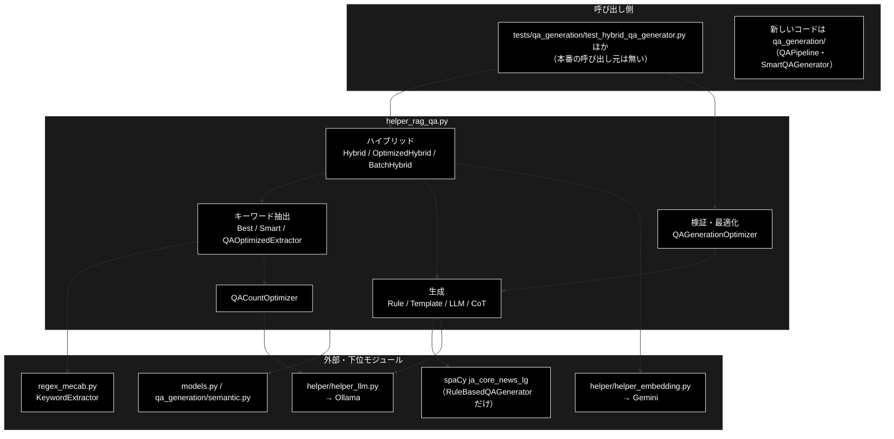
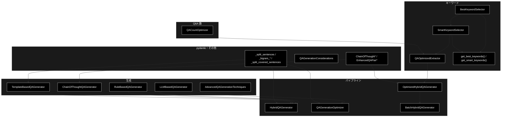
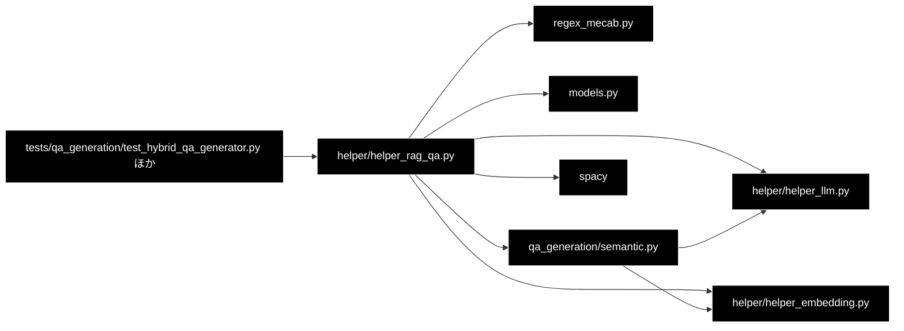

# helper_rag_qa.py - RAG Q&A 生成ユーティリティ（後方互換）ドキュメント

**Version 1.0** | 最終更新: 2026-10-11

> 🗄️ **`helper/helper_rag_qa.py` は 2026-10-11 に削除した**（本番の呼び出し元が無かった）。本書は削除時点の内容で凍結しており、実装は git 履歴に残る。

---

## 目次

1. [概要](#概要)
2. [アーキテクチャ構成図](#1-アーキテクチャ構成図)
3. [モジュール構成図](#2-モジュール構成図)
4. [クラス・関数一覧表](#3-クラス関数一覧表)
5. [クラス・関数 IPO詳細](#4-クラス関数-ipo詳細)
6. [設定・定数](#5-設定定数)
7. [エクスポート](#6-エクスポート)
8. [変更履歴](#7-変更履歴)
9. [付録: 依存関係図](#付録-依存関係図)

---

## 概要

`helper_rag_qa.py`（約 3,500 行）は、文書から Q&A ペアを作るためのクラス群である。キーワード抽出（MeCab / 正規表現）・
Q&A 数の見積もり・ルール／テンプレート／LLM による生成・品質検証・Embedding によるカバレッジ計算・複数文書のまとめ処理を持つ。
ファイル冒頭の docstring が「後方互換レイヤー」と名乗るとおり、**新しいコードは `qa_generation/` を使う**。

> 📌 **本番から使われていない**（2026-10-11 に grep で確認）。画面の「② Q/A 作成」と CLI（`qa_qdrant/make_qa_register_qdrant.py`）の
> Q/A 生成は `qa_generation.QAPipeline` → `SmartQAGenerator` で、本モジュールを import しない。
> import しているのはテストだけ（`tests/qa_generation/test_hybrid_qa_generator.py` ほか 3 本。§5.3）。
>
> ⚠️ **import には spaCy と `regex_mecab.py` が要る**。本リポジトリの CI は `spacy` を入れる（`pip install` 行）ので import できるが、
> 日本語モデル `ja_core_news_lg` は入れていない。`spacy.load("ja_core_news_lg")` を呼ぶのは `RuleBasedQAGenerator.__init__`（＝`HybridQAGenerator.__init__`）だけで、
> ほかのクラスはモデルが無くても動く。

### 主な責務

- 日本語テキストからのキーワード抽出と、手法（MeCab / 正規表現 / 統合）の自動選択
- 文書の長さ・情報密度からの Q&A 数の見積もり
- Q&A 向けのキーワードの絞り込み・難易度分類・文脈付与・質問テンプレートの提案
- ルール（正規表現・spaCy）／テンプレート／LLM（Ollama）による Q&A 生成
- 生成した Q&A の品質検証（原文の根拠・質問の形・重複と矛盾・長さ）とカバレッジ分析
- ルール＋LLM＋Embedding を組み合わせたハイブリッド生成と、複数文書のまとめ処理
- 構造化出力の pydantic モデルと、`models.py` / `qa_generation` からの再エクスポート

### 各責務対応のモジュール

| # | 責務 | 対応モジュール | 説明 |
|---|------|--------------|------|
| 1 | キーワード抽出と手法の選択 | `helper_rag_qa.py`（抽出本体は `regex_mecab.py::KeywordExtractor`） | `BestKeywordSelector` / `SmartKeywordSelector` / `get_best_keywords()` / `get_smart_keywords()` |
| 2 | Q&A 数の見積もり | `helper_rag_qa.py` | `QACountOptimizer` / `BatchHybridQAGenerator.calculate_optimal_qa_count()` |
| 3 | Q&A 向けのキーワード処理 | `helper_rag_qa.py` | `QAOptimizedExtractor` |
| 4 | Q&A 生成 | `helper_rag_qa.py`（LLM は `helper_llm.py`） | `RuleBasedQAGenerator` / `TemplateBasedQAGenerator` / `LLMBasedQAGenerator` / `ChainOfThoughtQAGenerator` / `AdvancedQAGenerationTechniques` |
| 5 | 品質検証とカバレッジ分析 | `helper_rag_qa.py` | `HybridQAGenerator`（Phase 4）/ `QAGenerationOptimizer` / `QAGenerationConsiderations` |
| 6 | ハイブリッド生成とまとめ処理 | `helper_rag_qa.py`（Embedding は `helper_embedding.py`） | `HybridQAGenerator` / `OptimizedHybridQAGenerator` / `BatchHybridQAGenerator` |
| 7 | モデルと再エクスポート | `helper_rag_qa.py`・`models.py`・`qa_generation/semantic.py` | `ChainOfThought*` / `EnhancedQAPair*`・`QAPair` / `QAPairsList` / `SemanticCoverage` |

### 主要機能一覧

| 機能 | 説明 |
|------|------|
| `get_best_keywords(text, top_n=10)` | 3 手法で抽出し、評価点の最も高い手法のキーワードを返す |
| `QAOptimizedExtractor().extract_for_qa_generation(text, ...)` | Q&A 数を決め、キーワード・難易度・質問テンプレートを返す（LLM 不要） |
| `LLMBasedQAGenerator().generate_basic_qa(text, num_pairs=5)` | LLM の構造化出力で Q&A を作る（失敗は `[]`） |
| `OptimizedHybridQAGenerator().generate_hybrid_qa(text, ...)` | ルール抽出 →（任意で LLM）→ Embedding のカバレッジ、を 1 回で |
| `BatchHybridQAGenerator().generate_batch_hybrid_qa(texts, ...)` | 複数文書を LLM・Embedding のまとめ呼び出しで処理 |
| `HybridQAGenerator().generate_comprehensive_qa(text, ...)` | ルール → テンプレート → LLM → 品質検証の 4 段（spaCy の日本語モデルが要る） |
| `QAGenerationOptimizer().analyze_coverage(text, qa_pairs)` | どの文がまだ Q&A で扱われていないか（文字 bigram で判定） |

---

## 1. アーキテクチャ構成図

### 1.1 システム全体構成



### 1.2 データフロー

1. `QAOptimizedExtractor.extract_for_qa_generation` が Q&A 数を決め（`QACountOptimizer`）、キーワードを抽出・絞り込み、難易度と文脈を付けて質問テンプレートを作る
2. `OptimizedHybridQAGenerator.generate_hybrid_qa` は、1. の結果をそのまま Q&A にする（`use_llm=False`）か、テンプレートを LLM に渡して Q&A を作り直す（`use_llm=True`）
3. `calculate_coverage=True` なら、文書を意味のまとまりに分けて Embedding し、Q&A の Embedding との類似度からカバレッジを出す
4. `HybridQAGenerator` は spaCy の固有表現からのテンプレート Q&A と LLM の Q&A を集め、原文の根拠・質問の形・重複で検証して品質スコア順に返す

---

## 2. モジュール構成図

### 2.1 内部モジュール構成



### 2.2 外部依存関係

| ライブラリ | バージョン | 用途 |
|-----------|-----------|------|
| `spacy` | CI の `pip install` 行・`requirements.txt`（日本語モデルは入れない） | import に必須。`RuleBasedQAGenerator` が `ja_core_news_lg` を読む |
| `numpy` | CI の `pip install` 行・`requirements.txt` | コサイン類似度・統計 |
| `tiktoken` | 同上 | `OptimizedHybridQAGenerator` のトークン数 |
| `pydantic` | 同上 | 構造化出力のモデル |
| `tqdm` | 任意 | `BatchHybridQAGenerator` の進捗表示（関数の中で import） |
| `python-dotenv` | 同上 | import 時に `load_dotenv()` |

### 2.3 内部依存モジュール

| モジュール | 用途 |
|-----------|------|
| `regex_mecab.py` | `KeywordExtractor`（MeCab の複合名詞 / 正規表現 / 統合の 3 手法。MeCab が無ければ正規表現だけ） |
| `helper/helper_llm.py` | `create_llm_client("ollama")`（生成・`count_tokens`） |
| `helper/helper_embedding.py` | `create_embedding_client("gemini")` / `get_embedding_dimensions` |
| `models.py` | `QAPair` / `QAPairsList`（構造化出力の型。再エクスポート） |
| `qa_generation/semantic.py` | `SemanticCoverage`（再エクスポート） |
| `config.py::get_default_ollama_model()` | 生成器の既定モデル（**関数の既定引数なので import 時に 1 回だけ評価される**。Embedding の既定は `"gemini-embedding-001"` の直書き） |

> ⚠️ **import しただけでログが INFO になる。** `qa_generation` を import する過程で `helper/helper_rag.py` が読まれ、
> その `logging.basicConfig(level=logging.INFO)` が効く（`helper_rag.md` §2.3）。

---

## 3. クラス・関数一覧表

### 3.1 クラス一覧

| クラス | 継承 | 公開メソッド | 外部 API |
|-------|------|------------|---------|
| `BestKeywordSelector` | — | `evaluate_keywords` / `calculate_total_score` / `extract_best` | なし |
| `SmartKeywordSelector` | `BestKeywordSelector` | `calculate_auto_top_n` / `find_optimal_by_coverage` / `find_optimal_by_diminishing_returns` / `extract_best_auto` | なし |
| `QACountOptimizer` | — | `calculate_optimal_qa_count` / `determine_by_coverage_improvement` | なし（LLM クライアントは `count_tokens` だけ） |
| `QAOptimizedExtractor` | `SmartKeywordSelector` | `filter_for_qa` / `remove_redundant_keywords` / `classify_difficulty` / `categorize_keyword` / `extract_keyword_relations` / `extract_with_context` / `suggest_qa_templates` / `extract_for_qa_generation` / `calculate_qa_quality_score` / `detect_duplicate_qa` / `generate_qa_pairs` | なし |
| `QAGenerationConsiderations` | — | `analyze_document_characteristics`（**必ず失敗**。§5.2）/ `define_qa_requirements` | なし |
| `ChainOfThoughtAnalysis` / `ChainOfThoughtQAPair` / `ChainOfThoughtResponse` | `BaseModel` | — | — |
| `EnhancedQAPair` / `EnhancedQAPairsList` | `BaseModel` | — | — |
| `LLMBasedQAGenerator` | — | `generate_basic_qa` / `generate_diverse_qa` / `generate_typed_qa`・定数 `QA_TYPES` | Ollama |
| `ChainOfThoughtQAGenerator` | — | `generate_with_reasoning` | Ollama |
| `RuleBasedQAGenerator` | — | `extract_definition_qa` / `extract_fact_qa` / `extract_list_qa` | spaCy |
| `TemplateBasedQAGenerator` | — | `generate_from_entities` / `find_answer_in_text` | なし |
| `HybridQAGenerator` | — | `generate_comprehensive_qa` / `validate_and_improve_qa` / `extract_entities` / `remove_duplicates` / `identify_uncovered_sections` / `verify_answer_in_text` / `check_question_clarity` / `check_no_contradiction` / `check_length_appropriateness` / `calculate_quality_score` | spaCy・Ollama |
| `AdvancedQAGenerationTechniques` | — | `generate_adversarial_qa` / `generate_multi_hop_qa`（空を返す）/ `generate_counterfactual_qa`（空を返す） | なし |
| `QAGenerationOptimizer` | — | `optimize_for_coverage` / `adaptive_generation` / `analyze_coverage` / `identify_missing_question_types` / `generate_specific_type` | Ollama（`adaptive_generation` / `generate_specific_type` だけ） |
| `OptimizedHybridQAGenerator` | — | `generate_hybrid_qa` | Ollama・Gemini Embedding |
| `BatchHybridQAGenerator` | `OptimizedHybridQAGenerator` | `calculate_optimal_qa_count` / `generate_hierarchical_qa` / `generate_with_coverage_feedback` / `generate_batch_hybrid_qa` | Ollama・Gemini Embedding |

### 3.2 関数一覧（カテゴリ別）

| 関数名 | 概要 |
|-------|------|
| `get_best_keywords(text, top_n=10, prefer_mecab=True)` | `BestKeywordSelector(...).extract_best(text, top_n)["keywords"]` |
| `get_smart_keywords(text, mode="auto", prefer_mecab=True)` | `SmartKeywordSelector(...).extract_best_auto(text, mode=mode)` |
| `_split_sentences` / `_char_bigrams` / `_bigram_jaccard` / `_bigram_recall` / `_split_covered_sentences`（内部） | 文分割と文字 bigram による決定的な一致判定（`HybridQAGenerator` / `TemplateBasedQAGenerator` / `QAGenerationOptimizer` が使う） |

モジュール定数 `_SENTENCE_SPLIT_RE`（文末記号か改行で文を分ける）/ `_MATCH_IGNORE_RE`（bigram を作る前に空白・句読点・括弧を除く）は上の内部関数が使う。

#### 内部メソッド（クラスごと・docstring の要約）

| クラス | 内部メソッド |
|-------|------------|
| `BestKeywordSelector` | `_generate_reason`（選んだ手法の理由の文） |
| `QACountOptimizer` | `_analyze_document_metrics`（`metrics` の計算）/ `_calculate_complexity_score`（0〜1）/ `_calculate_by_document_length`（文書長からの基本数）/ `_adjust_by_information_density` / `_adjust_by_coverage_target` / `_generate_reasoning`（決定理由の文） |
| `QAOptimizedExtractor` | `_are_synonyms` / `_calculate_sentence_importance` / `_select_by_difficulty_distribution` / `_progressive_qa_generation`（段階的に生成し、収穫逓減で止める）/ `_remove_duplicate_keywords` / `_calculate_coverage` / `_check_length_compliance` / `_are_similar_questions` |
| `TemplateBasedQAGenerator` | `_load_templates`（`comparison` / `process` / `cause_effect` / `characteristics` の質問テンプレート） |
| `HybridQAGenerator` | `_is_same_question`（bigram Jaccard ≥ `SIMILAR_QUESTION_THRESHOLD`） |
| `QAGenerationOptimizer` | `_get_llm_generator`（初回だけ `LLMBasedQAGenerator` を作る）/ `_count_question_types`（`question_type`、無ければ `type` で数える） |
| `OptimizedHybridQAGenerator` | `_enhance_with_llm` / `_template_to_qa` / `_calculate_semantic_coverage`（多段のしきい値でカバレッジ）/ `_calculate_coverage_quality_score` / `_create_semantic_chunks`（段落優先で分割）/ `_get_embeddings` / `_cosine_similarity` / `_calculate_cost` |
| `BatchHybridQAGenerator` | `_identify_uncovered_chunks` / `_generate_targeted_qa` / `_batch_enhance_with_llm` / `_create_batch_prompt` / `_extract_key_entities` / `_parse_batch_response_gemini`（名前に反して Ollama の応答の JSON を読む）/ `_batch_calculate_coverage` / `_batch_get_embeddings` / `_print_batch_statistics` |

---

## 4. クラス・関数 IPO詳細

### 4.1 使用例

LLM・Embedding・spaCy の要る・要らないで、呼び方が分かれる。

| 処理パターン | 呼び方 | LLM / Embedding / spaCy | 例 |
|---|---|---|---|
| キーワードを抽出する | `get_best_keywords` / `get_smart_keywords` | 不要 / 不要 / 不要 | 4.1.1 |
| Q&A 数と質問テンプレートを決める | `QAOptimizedExtractor().extract_for_qa_generation` | 不要 / 不要 / 不要 | 4.1.2 |
| LLM で Q&A を作る | `LLMBasedQAGenerator().generate_basic_qa` | 要 / 不要 / 不要 | 4.1.3 |
| ルール＋LLM＋カバレッジを 1 回で | `OptimizedHybridQAGenerator().generate_hybrid_qa(use_llm=...)` | `use_llm` 次第 / 要 / 不要 | 4.1.4 |
| 既存の Q&A の穴を調べる | `QAGenerationOptimizer().analyze_coverage` / `identify_missing_question_types` | 不要 / 不要 / 不要 | 4.1.5 |

> 📝 5 本とも**別プロセスでそのまま実行し**、出力を確かめてある（2026-10-11・リポジトリ直下で実行）。この VM には MeCab が無いので、
> キーワード抽出は正規表現モードで動いた（MeCab がある環境では結果が変わる）。LLM は **Ollama の代わりの小さな HTTP サーバ**（`OLLAMA_BASE_URL` で向けた）、
> Gemini Embedding（`google.genai.Client`）はスタブに差し替えたので、**4.1.3 / 4.1.4 の Q&A の文はスタブのもの**。
> spaCy の日本語モデルが要る `HybridQAGenerator` / `RuleBasedQAGenerator` の例は動かしていない（パイプライン全体は `tests/qa_generation/test_hybrid_qa_generator.py` が偽物の `nlp` で通している）。

#### 4.1.1 基本的なワークフロー（キーワードを抽出する）

```python
from helper.helper_rag_qa import get_best_keywords, get_smart_keywords

text = ("住民票の写しは市役所の窓口で取得できます。本人確認書類としてマイナンバーカードか運転免許証が必要です。"
        "手数料は1通300円です。コンビニエンスストアのマルチコピー機でも取得できます。")
print(get_best_keywords(text, top_n=5))
r = get_smart_keywords(text)                 # 文字数から top_n を自動で決める
print(r["method"], r["top_n"], r["mode"], r["reason"], r["keywords"][:5])
```

```
# 出力例（MeCab が無い環境。正規表現モード）:
# ['マイナンバーカード', 'コンビニエンスストア', '本人確認書類', 'マルチコピー', '運転免許証']
# 正規表現 3 auto 超短文（91文字） ['マイナンバーカード', 'コンビニエンスストア', '本人確認書類']
# （標準エラーに WARNING:regex_mecab:⚠️ MeCabが利用できません（正規表現モード））
```

> 📝 `prefer_mecab=True`（既定）でも MeCab が無ければ正規表現に落ちる。3 手法の評価点（網羅率・多様性・専門性・一貫性・長さ）の重み付き和で最良の手法を選ぶ。

#### 4.1.2 Q&A 数と質問テンプレートを決める（LLM 不要）

```python
from helper.helper_rag_qa import QAOptimizedExtractor

text = ("住民票の写しは市役所の窓口で取得できます。本人確認書類としてマイナンバーカードか運転免許証が必要です。"
        "手数料は1通300円です。コンビニエンスストアのマルチコピー機でも取得できます。")
r = QAOptimizedExtractor().extract_for_qa_generation(text, return_details=False)
print(r["qa_count"], r["mode"], r["keywords"])
for t in r["qa_templates"][:3]:
    print(t)
```

```
# 出力例（正規表現モード）:
# 3 auto ['本人確認書類', 'マイナンバーカード', 'コンビニエンスストア']
# {'keyword': '本人確認書類', 'question': '本人確認書類の応用例を挙げてください。', 'difficulty': 'advanced'}
# {'keyword': 'マイナンバーカード', 'question': 'マイナンバーカードの技術的な詳細を説明してください。', 'difficulty': 'advanced'}
# {'keyword': 'コンビニエンスストア', 'question': 'コンビニエンスストアの技術的な詳細を説明してください。', 'difficulty': 'advanced'}
```

> ⚠️ 難易度は出現回数と長さによる簡易な判定で、**原文に 1 回しか出ない語・8 文字以上の語は `advanced`** になる（§4.4 `classify_difficulty`）。
> そのため行政手続きの文でも「技術的な詳細を説明してください」のようなテンプレートが選ばれる。`return_details=True`（既定）なら
> 関係・難易度の対応・メタデータ（`optimization_info` に Q&A 数の決定根拠）も返る。

#### 4.1.3 LLM で Q&A を作る

```python
from helper.helper_rag_qa import LLMBasedQAGenerator

text = "住民票の写しは市役所の窓口で取得できます。手数料は1通300円です。"
gen = LLMBasedQAGenerator()                       # create_llm_client("ollama")・既定モデルは get_default_ollama_model()
for qa in gen.generate_basic_qa(text, num_pairs=2):
    print(qa["question"], "->", qa["answer"], qa["question_type"], qa["difficulty_level"])
```

```
# 出力例（Q&A の文はスタブの値。question_type / difficulty_level は QAPair の既定値）:
# 住民票の写しはどこで取得できますか？ -> 市役所の窓口で取得できます。 fact medium
# 住民票の写しの手数料はいくらですか？ -> 1通300円です。 fact medium
```

> ⚠️ **失敗しても例外を出さず `[]` を返す**（`print(f"Q/A生成エラー: {e}")` を標準出力に出すだけ）。Ollama が落ちていても「0 件生成」に見える。
> 入力は先頭 3,000 文字で切る（`generate_typed_qa` は 2,000 文字）。`generate_diverse_qa` は `QA_TYPES` の 6 タイプ × 2 件で、LLM を 6 回呼ぶ。

#### 4.1.4 ルール＋LLM＋カバレッジを 1 回で（`OptimizedHybridQAGenerator`）

```python
from helper.helper_rag_qa import OptimizedHybridQAGenerator

text = ("住民票の写しは市役所の窓口で取得できます。本人確認書類としてマイナンバーカードか運転免許証が必要です。"
        "手数料は1通300円です。コンビニエンスストアのマルチコピー機でも取得できます。")
gen = OptimizedHybridQAGenerator()                 # LLM は Ollama、Embedding は Gemini
for use_llm in (False, True):
    r = gen.generate_hybrid_qa(text, qa_count=3, use_llm=use_llm)
    print(r["metadata"]["model_used"], len(r["qa_pairs"]), sorted(r["coverage"])[:4], r["api_usage"])
```

```
# 出力例（Q&A の件数は Ollama の代わりのサーバが 2 件返すため）:
# rule-based 3 ['average_similarity', 'coverage_distribution', 'coverage_percentage', 'covered_chunks'] {'calls': 2, 'tokens': 0, 'cost': 0.0}
# gemma4:26b-a4b-it-qat 2 ['average_similarity', 'coverage_distribution', 'coverage_percentage', 'covered_chunks'] {'calls': 3, 'tokens': 0, 'cost': 0.0}
```

> ⚠️ **`api_usage` の `tokens` と `cost` は常に 0**（`generate_structured` 経由でトークン数を集計していない）。`calls` は LLM 1 回＋Embedding のまとめ呼び出しの回数。
> `use_llm=False` の回答は「キーワード＋の＋文脈の先頭」をつないだ文（例: `住民票の住民票の写しは市役所の…`）で、品質は低い。
> `coverage` の全キーは `average_similarity` / `coverage_distribution` / `coverage_percentage` / `covered_chunks` / `embedding_calls` / `is_rule_based` /
> `max_similarity` / `median_similarity` / `min_similarity` / `multi_threshold_coverage` / `quality_score` / `total_chunks`。
> LLM の失敗は `print` して `use_llm=False` と同じ結果に落ちる（例外にならない）。

#### 4.1.5 既存の Q&A の穴を調べる（`QAGenerationOptimizer`）

```python
from helper.helper_rag_qa import QAGenerationOptimizer

text = "住民票の写しは市役所の窓口で取得できます。手数料は1通300円です。郵送でも請求できます。"
qa = [{"question": "住民票の写しはどこで取れますか？", "answer": "市役所の窓口で取得できます。", "question_type": "factual"}]
opt = QAGenerationOptimizer()                      # LLM は adaptive_generation で初めて作る
cov = opt.analyze_coverage(text, qa)
print(cov["total_sentences"], cov["covered_sentences"], round(cov["coverage_rate"], 2), cov["uncovered_sentences"])
print(opt.identify_missing_question_types(qa))
```

```
# 出力例:
# 3 1 0.33 ['手数料は1通300円です。', '郵送でも請求できます。']
# ['causal', 'comparative', 'inferential', 'summary', 'application']
```

> 📝 判定は**文字 bigram の決定的な計算**（LLM・Embedding を使わない）。文の bigram の 50% 以上が既存の Q&A（質問＋回答）に現れれば「カバー済み」。
> `adaptive_generation(text, qa)` は、これで見つかった未カバーの文から、不足タイプごとに LLM で 3 件ずつ作る。

---

### 4.2 キーワード抽出（`BestKeywordSelector` / `SmartKeywordSelector` / 関数）

#### `BestKeywordSelector`

**概要**: `regex_mecab.KeywordExtractor` の 3 手法で抽出し、5 つの指標の重み付き和が最も高い手法の結果を返す。

| メソッド | Input | Process | Output |
|---------|-------|---------|--------|
| `__init__(prefer_mecab=True)` | MeCab を優先するか | `KeywordExtractor(prefer_mecab)` と重み（coverage 0.25 / diversity 0.15 / technicality 0.25 / coherence 0.20 / length_balance 0.15） | インスタンス |
| `evaluate_keywords(keywords, text)` | キーワード・原文 | 5 指標を 0〜1 で計算 | `Dict[str, float]` |
| `calculate_total_score(metrics)` | 指標 | 重み付き和 | `float` |
| `extract_best(text, top_n=10, return_details=False)` | 原文・件数 | 3 手法を評価して最良を選ぶ | `{"best_method", "keywords", "total_score", "reason"}`（`return_details` なら `all_evaluations` も） |

#### `SmartKeywordSelector`（`BestKeywordSelector` を継承）

| メソッド | Input | Process | Output |
|---------|-------|---------|--------|
| `calculate_auto_top_n(text)` | 原文 | 文字数の区分で決める（100 未満 3・300 未満 5・500 未満 7〔専門用語が多ければ 9〕・1,000 未満 10〔10 文超なら 12〕・2,000 未満 15・それ以上 20〜30） | `(top_n, 理由)` |
| `find_optimal_by_coverage(text, target_coverage=0.7, min_n=3, max_n=20)` | 原文・目標 | 件数を `min_n` から増やし、「キーワードの文字数 × 出現回数 ÷ 原文の文字数」が目標に届く最小の件数を探す（届かなければ `max_n`） | `(top_n, 達成率)` |
| `find_optimal_by_diminishing_returns(text, min_n=3, max_n=20, threshold=0.05)` | 原文 | 評価点の伸び率が `threshold` 以下になった件数 | `(top_n, 最終スコア, 推移)` |
| `extract_best_auto(text, mode="auto", min_keywords=3, max_keywords=20, target_coverage=0.7, return_analysis=False)` | 原文・モード（`auto` / `summary` / `standard` / `detailed` / `coverage` / `diminishing`） | モードで件数を決めて `extract_best` | `{"keywords", "method", "top_n", "mode", "reason"}`（`return_analysis` なら詳細） |

#### `get_best_keywords` / `get_smart_keywords`

| 関数 | Input | Output |
|------|-------|--------|
| `get_best_keywords(text, top_n=10, prefer_mecab=True)` | 原文・件数 | `List[str]` |
| `get_smart_keywords(text, mode="auto", prefer_mecab=True)` | 原文・モード | `extract_best_auto` の戻り値 |

```python
# 使用例は §4.1.1
```

---

### 4.3 `QACountOptimizer`

**概要**: 文書の文数・キーワード数・トークン数・情報密度から Q&A 数を決める。LLM クライアントはトークン数を数えるためだけに作る（API は呼ばない）。

```python
def __init__(self, llm_model: str = get_default_ollama_model())
def calculate_optimal_qa_count(self, document: str, mode: str = "auto") -> Dict[str, Any]
```

| 項目 | 内容 |
|------|------|
| **Input** | `document`・`mode`（`auto` / `evaluation` / `00_learning.md` / `search_test` / `faq`） |
| **Process** | 1. `metrics`（`doc_length` / `token_count`〔`cl100k_base` の近似〕/ `sentence_count` / `paragraph_count` / `avg_sentence_length` / `keyword_count` / `keyword_density` / `complexity_score`）を計算<br>2. モードで基本数を決める（`auto` は文書長の区分）<br>3. 情報密度・カバレッジ目標で調整 |
| **Output** | `{"optimal_count", "base_count", "adjusted_count", "metrics", "mode", "reasoning"}` |

> ⚠️ モード名 `"00_learning.md"` はファイル名がそのまま入った誤り（本来は `"learning"`）。`"learning"` を渡すと `auto` と同じ扱いになる。

```python
# 使用例
from helper.helper_rag_qa import QACountOptimizer
print(QACountOptimizer().calculate_optimal_qa_count("住民票の写しは市役所の窓口で取得できます。手数料は1通300円です。")["optimal_count"])
# 3
```

`determine_by_coverage_improvement(text, existing_qa=None)` は、既存の Q&A 数から現在のカバレッジを「件数 × 2.5 ÷ (文字数 ÷ 200)」で概算し、目標 0.7 までに要る追加数を返す（`{"additional_count", "current_coverage", "target_coverage", "total_count"}`。原文の中身は見ない）。

---

### 4.4 `QAOptimizedExtractor`（`SmartKeywordSelector` を継承）

**概要**: Q&A 生成向けにキーワードを絞り込み、難易度・カテゴリ・文脈を付け、質問テンプレートを提案する。

#### メソッド: `extract_for_qa_generation`

```python
def extract_for_qa_generation(
    self, text: str, qa_count: Optional[int] = None, mode: str = "auto",
    difficulty_distribution: Optional[Dict[str, float]] = None,
    return_details: bool = True, use_progressive: bool = False
) -> Dict
```

| パラメータ | 型 | デフォルト | 説明 |
|------------|------|-----------|------|
| `text` | `str` | 必須 | 原文 |
| `qa_count` | `Optional[int]` | `None` | `None` なら `QACountOptimizer` で決める |
| `mode` | `str` | `"auto"` | Q&A 数の決め方（`QACountOptimizer` と同じ） |
| `difficulty_distribution` | `Optional[Dict]` | `None` | 既定は basic 0.3 / intermediate 0.5 / advanced 0.2 |
| `return_details` | `bool` | `True` | `False` なら簡潔版 |
| `use_progressive` | `bool` | `False` | 段階的生成（`_progressive_qa_generation`）に切り替える |

| 項目 | 内容 |
|------|------|
| **Input** | 上の 6 つ |
| **Process** | 1. Q&A 数を決める → 2. `extract_best_auto` で多めに抽出 → 3. `filter_for_qa`・`remove_redundant_keywords` → 4. `extract_keyword_relations` → 5. `extract_with_context` で難易度・文脈 → 6. 難易度分布で選ぶ → 7. `suggest_qa_templates` |
| **Output** | 詳細版: `{"keywords", "relations", "difficulty_map", "suggested_qa_pairs", "metadata"}`／簡潔版: `{"keywords", "qa_templates", "qa_count", "mode"}` |

#### そのほかのメソッド

| メソッド | 概要 |
|---------|------|
| `filter_for_qa(keywords)` | Q&A 用の停止語・抽出器の停止語・1 文字・数字だけ・「第」で始まる・「等」「的」で終わる語を除く |
| `remove_redundant_keywords(keywords)` | 長い順に見て、残した語に含まれる語と、同義語の組（AI / 人工知能 など 5 組。`_are_synonyms`）を除く |
| `classify_difficulty(keyword, text)` | 説明（「〜とは」など）があり 3 回以上 → `basic`、説明の無い英略語・8 文字以上・出現 1 回 → `advanced`、5 回以上 → `basic`、それ以外 `intermediate` |
| `categorize_keyword(keyword)` | `specific_name` / `technical_term` / `core_concept` / `general_term` / `other`（`category_patterns` との照合） |
| `extract_keyword_relations(text, keywords)` | 同じ文に 2 語以上あれば、`relation_patterns` に合う文はその関係の種類、合わなければ `co_occurs` として語の組を返す（重複は除く） |
| `extract_with_context(text, keyword)` | `{"keyword", "contexts", "best_context", "difficulty", "category", "frequency"}`（`best_context` は重要度〔位置・共起・説明的な表現・文の長さ〕が最大の文） |
| `suggest_qa_templates(keywords_with_context)` | 難易度とカテゴリで 2 つずつ質問テンプレートを選び、`answer_hint`（`best_context`）と推奨の回答の長さを付ける |
| `calculate_qa_quality_score(qa_pair)` | 疑問詞・回答の長さ・難易度・キーワード・カテゴリ・推奨の長さとの一致から 0〜1 |
| `detect_duplicate_qa(qa_pairs)` | 質問が完全一致するか、空白で区切った語の Jaccard が 0.7 を超える組の `(i, j)`（日本語は空白が無いので、実質は完全一致だけ） |
| `generate_qa_pairs(extraction_output)` | 詳細版の戻り値のテンプレートを、`answer_hint` と関連語で回答を組み立てた Q&A に展開する（LLM を使わない） |

```python
# 使用例は §4.1.2
```

---

### 4.5 生成器（LLM / ルール / テンプレート / その他）

#### `LLMBasedQAGenerator`

```python
def __init__(self, model=get_default_ollama_model())
```

| メソッド | Input | Process | Output |
|---------|-------|---------|--------|
| `generate_basic_qa(text, num_pairs=5)` | 原文（先頭 3,000 文字）・件数 | `generate_structured(response_schema=QAPairsList)` | `List[Dict]`（`QAPair.model_dump()`）。失敗は `[]` |
| `generate_diverse_qa(text)` | 原文 | `QA_TYPES` の 6 タイプについて `generate_typed_qa(count=2)` | `List[Dict]` |
| `generate_typed_qa(text, qa_type, count)` | 原文（先頭 2,000 文字）・タイプ・件数 | タイプの説明をプロンプトに入れて生成し、`question_type` を上書き | `List[Dict]`。失敗は `[]` |

`QA_TYPES` は `factual` / `causal` / `comparative` / `inferential` / `summary` / `application` の 6 つ（キー → プロンプトの説明）。

#### `ChainOfThoughtQAGenerator`

| メソッド | Input | Process | Output |
|---------|-------|---------|--------|
| `generate_with_reasoning(text)` | 原文（切り詰めない） | 5 ステップの思考を指示し `ChainOfThoughtResponse` で受ける | `{"analysis": {...}, "qa_pairs": [{"question", "answer", "reasoning", "confidence"}]}`。失敗は空 |

#### `RuleBasedQAGenerator`（spaCy の `ja_core_news_lg` が要る）

| メソッド | パターン | 出力の `type` / `confidence` |
|---------|---------|---------------------------|
| `extract_definition_qa(text)` | 「〜とは〜である／です」「〜は〜と呼ばれ」 | `definition` 0.9 / `terminology` 0.85 |
| `extract_fact_qa(text)` | spaCy の固有表現（日付・場所）を含む文 | `temporal` / `location` 0.7 |
| `extract_list_qa(text)` | 「〜には、A、B、C がある」 | `enumeration` 0.8 |

#### `TemplateBasedQAGenerator`

| メソッド | Input | Process | Output |
|---------|-------|---------|--------|
| `generate_from_entities(text, entities)` | 原文・`[{"text", "type"}]` | 種類（PERSON / ORG / PRODUCT / それ以外）ごとの質問 3 つに、`find_answer_in_text` で回答を付ける | `List[Dict]`（`type="entity_based"`・`confidence=0.75`） |
| `find_answer_in_text(text, entity_text, question)` | 原文・エンティティ・質問 | エンティティを含む文のうち、質問の残りと文字 bigram が最も重なる文 | `Optional[str]` |

```python
# 使用例（spaCy 不要）
from helper.helper_rag_qa import TemplateBasedQAGenerator
qa = TemplateBasedQAGenerator().generate_from_entities(
    "葛飾北斎は江戸時代の浮世絵師である。北斎は富士山を描いた。", [{"text": "葛飾北斎", "type": "PERSON"}])
print(qa[0]["question"], qa[0]["answer"])
# 葛飾北斎は誰ですか？ 葛飾北斎は江戸時代の浮世絵師である。
```

#### `AdvancedQAGenerationTechniques`

| メソッド | Output |
|---------|--------|
| `generate_adversarial_qa(text, existing_qa)` | 既存の先頭 5 件の否定形＋文脈外・曖昧参照の Q&A（決まった文） |
| `generate_multi_hop_qa(text)` / `generate_counterfactual_qa(text)` | 常に `[]`（未実装） |

---

### 4.6 パイプライン

#### `HybridQAGenerator`

**概要**: Phase 1 ルール → Phase 2 テンプレート（spaCy の固有表現）→ Phase 3 LLM（未カバーの文から）→ Phase 4 品質検証。`__init__` が `spacy.load("ja_core_news_lg")` を呼ぶ。

```python
def generate_comprehensive_qa(self, text: str, target_count: int = 20, quality_threshold: float = 0.7) -> List[Dict]
```

| 項目 | 内容 |
|------|------|
| **Input** | 原文・目標件数・ルールの信頼度のしきい値 |
| **Process** | 1. ルールの Q&A のうち `confidence >= quality_threshold` を採用<br>2. 固有表現からテンプレート Q&A を作り、同じ問い（bigram Jaccard ≥ 0.7）を除く<br>3. 足りなければ未カバーの文を `generate_diverse_qa` に渡し、不足分だけ採る<br>4. `validate_and_improve_qa` で検証し、品質スコア順に並べる |
| **Output** | `List[Dict]`（各要素に `validations` と `quality_score` が付く）。各 Phase の件数を `print` する |

`validate_and_improve_qa` の検証項目（すべて通ったものだけ残す）:

| 検証 | 条件（クラス属性） |
|------|------------------|
| `verify_answer_in_text` | 回答の bigram の 50% 以上が原文にある（`ANSWER_GROUNDING_THRESHOLD`） |
| `check_question_clarity` | 5〜200 文字・指示語（それ・この 等）で始まらない・「？ / か / ください」で終わる |
| `check_no_contradiction` | 採用済みに同じ問いが無い（先に来た方を残す） |
| `check_length_appropriateness` | 質問 5〜200 文字・回答 2〜1,000 文字 |

ほかに `extract_entities(text)`（spaCy の固有表現を重複なく）/ `remove_duplicates(new_qa, existing_qa)`（同じ問いを除く）/ `identify_uncovered_sections(text, qa_pairs)`（未カバーの文をつなぐ。無ければ原文）/ `calculate_quality_score(qa, source_text)`（確信度〔無ければ 0.7〕と回答の根拠率の平均）。

#### `QAGenerationOptimizer`

```python
def __init__(self, llm_generator: Optional["LLMBasedQAGenerator"] = None)   # 省略時は必要になったときに作る
```

| メソッド | Input | Output |
|---------|-------|--------|
| `optimize_for_coverage(text, budget)` | 原文・予算 | 5 段の戦略の辞書（決まった内容。`text` は使わない） |
| `analyze_coverage(text, qa_pairs)` | 原文・Q&A | `{"total_sentences", "covered_sentences", "coverage_rate", "uncovered_sentences", "type_counts"}` |
| `identify_missing_question_types(qa_pairs)` | Q&A | `QA_TYPES` のうち 0 件のタイプ（`QA_TYPES` の順） |
| `generate_specific_type(text, qa_type, count=3)` | 原文・タイプ | LLM で生成（`LLMBasedQAGenerator.generate_typed_qa`） |
| `adaptive_generation(text, initial_qa)` | 原文・既存 Q&A | 不足タイプごとに 3 件ずつ、未カバーの文から生成 |

#### `OptimizedHybridQAGenerator`

```python
def __init__(self, model: str = get_default_ollama_model(), embedding_model: str = "gemini-embedding-001")
def generate_hybrid_qa(self, text: str, qa_count: int = None, use_llm: bool = True,
                       calculate_coverage: bool = True, document_type: str = "auto") -> Dict
```

| 項目 | 内容 |
|------|------|
| **Input** | 原文・Q&A 数（`None` は自動）・LLM を使うか・カバレッジを計算するか・文書タイプ（`news` / `technical` / `academic` / `auto`） |
| **Process** | 1. `QAOptimizedExtractor.extract_for_qa_generation`<br>2. `use_llm` なら上位 10 件のテンプレートを渡して `EnhancedQAPairsList` で受ける（失敗はテンプレート展開へ）／しないなら `_template_to_qa`（最大 5 件）<br>3. `calculate_coverage` なら文書を意味のまとまりに分け、Embedding の類似度でカバレッジ |
| **Output** | `{"qa_pairs", "metadata", "coverage", "api_usage"}`（§4.1.4） |

> 📝 `__init__` は未検証のモデル名で警告を `print` するだけで、拒否はしない。

#### `BatchHybridQAGenerator`（`OptimizedHybridQAGenerator` を継承）

```python
def __init__(self, model=get_default_ollama_model(), embedding_model="gemini-embedding-001",
             batch_size: int = 10, embedding_batch_size: int = 100, quality_mode: bool = False, target_coverage: float = 0.95)
```

| メソッド | Input | Output |
|---------|-------|--------|
| `generate_batch_hybrid_qa(texts, qa_count=None, use_llm=True, calculate_coverage=True, document_type="auto", show_progress=True, lang="en")` | 文書のリスト | 文書ごとの `generate_hybrid_qa` と同じ形の辞書のリスト（LLM は `batch_size` 件ずつ 1 回、Embedding は `embedding_batch_size` 件ずつ） |
| `calculate_optimal_qa_count(text, target_coverage=0.95)` | 原文 | `int`（情報密度とチャンク数から。上限 15） |
| `generate_hierarchical_qa(text, lang="en")` | 原文 | 第 1 層: 文書全体の要約の問い（回答は原文の先頭 500 文字）、第 2 層: 段落ごとの詳細、第 3 層: キーワード・エンティティの問い、の 3 層の Q&A（各要素に `layer`） |
| `generate_with_coverage_feedback(text, target_coverage=0.95, max_iterations=3, lang="en")` | 原文 | カバレッジが目標に届くか `max_iterations` 回まで、未カバーのチャンク向けに追加生成する。`{"qa_pairs", "final_coverage", "iterations", "total_qa"}` |

> 📝 `quality_mode=True` で LLM のまとめ件数を最大 5 に下げ、Q&A 数を 1.5 倍にする。`lang` の既定は `"en"`（日本語の文書なら `"ja"` を渡す）。

---

### 4.7 pydantic モデルと `QAGenerationConsiderations`

| モデル | フィールド |
|-------|-----------|
| `ChainOfThoughtAnalysis` | `main_topics: List[str]` / `key_concepts: List[str]` / `information_density: str` |
| `ChainOfThoughtQAPair` | `question` / `answer` / `reasoning: str` / `confidence: float` |
| `ChainOfThoughtResponse` | `analysis: ChainOfThoughtAnalysis` / `qa_pairs: List[ChainOfThoughtQAPair]` |
| `EnhancedQAPair` | `question` / `answer` |
| `EnhancedQAPairsList` | `qa_pairs: List[EnhancedQAPair]` |

`QAGenerationConsiderations.define_qa_requirements()` は Q&A 生成の要件（目的・質問の種類・難易度・回答形式・カバレッジ目標）の決まった辞書を返す
（キーに桁合わせの空白が入っている。例 `"purpose          "`）。`analyze_document_characteristics(document)` は**必ず `AttributeError`**（§5.2）。

---

## 5. 設定・定数

### 5.1 クラス属性

| クラス | 属性 | 値 |
|-------|------|----|
| `HybridQAGenerator` | `SIMILAR_QUESTION_THRESHOLD` / `ANSWER_GROUNDING_THRESHOLD` / `SENTENCE_COVERED_THRESHOLD` | 0.7 / 0.5 / 0.5 |
| `HybridQAGenerator` | `QUESTION_LENGTH_RANGE` / `ANSWER_LENGTH_RANGE` / `DEFAULT_CONFIDENCE` | (5, 200) / (2, 1000) / 0.7 |
| `QAGenerationOptimizer` | `SENTENCE_COVERED_THRESHOLD` / `QA_PER_MISSING_TYPE` | 0.5（Hybrid と同じ）/ 3 |
| `LLMBasedQAGenerator` | `QA_TYPES` | 6 タイプ |

### 5.2 既知の制約

| # | 制約 | 状態 |
|---|------|------|
| 1 | `QAGenerationConsiderations.analyze_document_characteristics` は定義されていないメソッドを 7 つ呼び（`detect_document_type` ほか）、必ず `AttributeError` になる | 2026-10-11 に `ast` と実行で確認。`tests/qa_generation/test_hybrid_qa_generator.py` の静的検査の対象外 |
| 2 | LLM・Embedding の失敗を `print` して空や代わりの結果を返し、例外を出さない（`LLMBasedQAGenerator` / `ChainOfThoughtQAGenerator` / `_enhance_with_llm`） | 実装どおり（§4.1.3） |
| 3 | `api_usage` の `tokens` / `cost` は常に 0 | 実装どおり（§4.1.4） |
| 4 | import に spaCy が要り、`HybridQAGenerator` / `RuleBasedQAGenerator` は `ja_core_news_lg` も要る | CI は spaCy 本体だけ入れる（モデルは無い） |
| 5 | `QACountOptimizer` のモード名 `"00_learning.md"` | 誤記のまま（§4.3） |
| 6 | 本番の呼び出し元が無い（`qa_generation/` が後継） | 2026-10-11 時点 |
| 7 | 生成器の既定モデル（`get_default_ollama_model()`）は関数の既定引数なので import 時に決まり、その後 `OLLAMA_DEFAULT_MODEL` を変えても追随しない | 実装どおり |
| 8 | `OptimizedHybridQAGenerator.supported_models` と `_calculate_cost` の料金表が古いモデル名（`qwen3.5:9b` / `gemma4:e4b` / `qwen2.5:7b` / `llama3.1:8b` / `llama3.2`）のまま。既定の `gemma4:26b-a4b-it-qat` は入っているが、`helper_llm.LLM_MODELS` の `gemma4:12b-mlx` などを渡すと「未検証」の警告を出す | 2026-10-11 時点（コストはどのみち 0） |

### 5.3 テスト

| テスト | 件数 | 対象 |
|-------|------|------|
| `tests/qa_generation/test_hybrid_qa_generator.py` | 29 | `HybridQAGenerator` / `QAGenerationOptimizer` の全 Phase と静的検査 |
| `tests/qa_generation/test_keyword_extraction.py` | 8 | `BestKeywordSelector` / `SmartKeywordSelector` / `get_best_keywords`（`KeywordExtractor` を差し替え） |
| `tests/qa_generation/test_qa_pair_definitions.py` | 6 | `QAPair` / `QAPairsList` を書き戻していないこと（`ast`） |
| `tests/qa_generation/test_import_side_effects.py` | 3（うち 1） | `helper/*.py` の裸 import が無いこと |

件数は 2026-10-11 の実測（`env -u OLLAMA_DEFAULT_MODEL PYTHONPATH=. .venv/bin/python -m pytest <file> -q`）。

---

## 6. エクスポート

`__all__` は定義していない。後方互換のために import している `QAPair` / `QAPairsList`（`models.py`）・`SemanticCoverage`（`qa_generation/semantic.py`）も
`from helper.helper_rag_qa import ...` で取れる。

---

## 7. 変更履歴

| バージョン | 日付 | 変更内容 |
|-----------|------|---------|
| 1.0 | 2026-10-11 | 初版。`helper/docs/` の新設にあわせて作成（`a_class_method_md_format.md` 準拠）。§4.1 の使用例 5 本（キーワード・テンプレート・LLM・ハイブリッド・カバレッジ分析）を LLM（Ollama の代わりの HTTP サーバ）/ Embedding のスタブで実行して出力を確かめ、`QAGenerationConsiderations.analyze_document_characteristics` が必ず失敗すること・`api_usage` が常に 0 であることを §5.2 に記録した |

---

## 付録: 依存関係図


