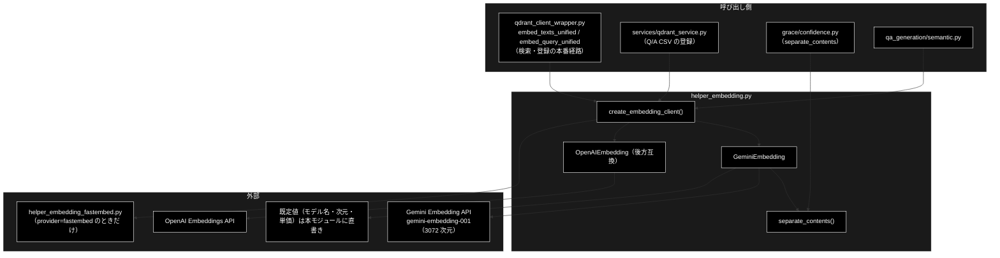
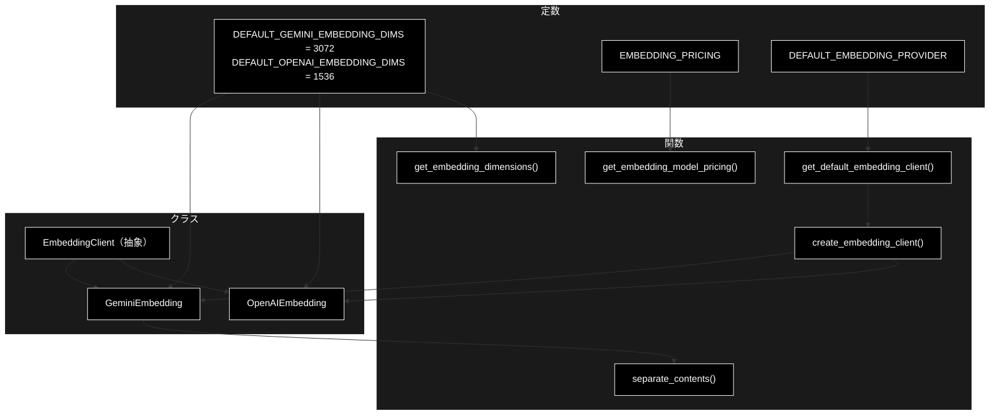
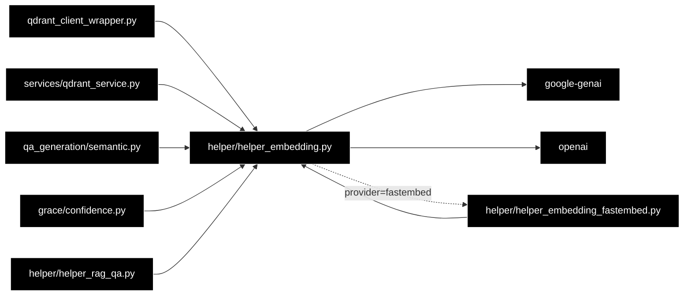

# helper_embedding.py - Embedding クライアント抽象化レイヤー ドキュメント

**Version 1.0** | 最終更新: 2026-10-11

---

## 目次

1. [概要](#概要)
2. [アーキテクチャ構成図](#1-アーキテクチャ構成図)
3. [モジュール構成図](#2-モジュール構成図)
4. [クラス・関数一覧表](#3-クラス関数一覧表)
5. [クラス・関数 IPO詳細](#4-クラス関数-ipo詳細)
6. [設定・定数](#5-設定定数)
7. [エクスポート](#6-エクスポート)
8. [変更履歴](#7-変更履歴)
9. [付録: 依存関係図](#付録-依存関係図)

---

## 概要

`helper_embedding.py` は、テキストを Embedding（密ベクトル）に変える**クライアントの抽象化レイヤー**である。
抽象基底クラス `EmbeddingClient` と、Gemini（既定・3072 次元）/ OpenAI（1536 次元）の実装、
プロバイダ名から実装を選ぶファクトリ `create_embedding_client()` を持つ。ローカルの FastEmbed は別モジュール
（`helper_embedding_fastembed.py`）にあり、`provider="fastembed"` のときだけ遅延 import する。

本プロジェクトの LLM は Ollama だが、Embedding は **Gemini `gemini-embedding-001`（3072 次元）だけ**を使う（既存の Qdrant コレクションを grace_v2 と共用するため。CLAUDE.md §3）。
モデル名・次元・単価は本モジュールに**文字列で直書き**している（grace_v2 は `config.py::ModelConfig` を参照する。§5.2）。
OpenAI / FastEmbed の分岐は後方互換のために残っており、本番では選ばれない（既定は環境変数 `EMBEDDING_PROVIDER`、無ければ `gemini`）。

### 主な責務

- Embedding クライアントの共通インターフェース（次元・1 件・まとめて）の定義
- Gemini Embedding API の呼び出し（1 件 / 100 件ずつのまとめ・`task_type`・出力次元）
- OpenAI Embeddings API の呼び出し（後方互換）
- プロバイダ名からのクライアント生成と、プロバイダごとの既定次元
- まとめて送るときに 1 件 = 1 Content に包む（`gemini-embedding-2` で 1 本しか返らない問題の対策）
- Embedding モデルの単価の参照

### 各責務対応のモジュール

| # | 責務 | 対応モジュール | 説明 |
|---|------|--------------|------|
| 1 | 共通インターフェース | `helper_embedding.py` | `EmbeddingClient`（`dimensions` / `embed_text` / `embed_texts`） |
| 2 | Gemini Embedding | `helper_embedding.py` | `GeminiEmbedding` |
| 3 | OpenAI Embeddings（後方互換） | `helper_embedding.py` | `OpenAIEmbedding` |
| 4 | ファクトリと既定次元 | `helper_embedding.py`（FastEmbed は `helper_embedding_fastembed.py`） | `create_embedding_client()` / `get_default_embedding_client()` / `get_embedding_dimensions()` |
| 5 | 1 件 = 1 Content に包む | `helper_embedding.py` | `separate_contents()`（`grace/confidence.py` も使う） |
| 6 | 単価の参照 | `helper_embedding.py`（表を直書き） | `EMBEDDING_PRICING` / `get_embedding_model_pricing()` |

### 主要機能一覧

| 機能 | 説明 |
|------|------|
| `create_embedding_client(provider="gemini", **kwargs)` | `"gemini"` / `"openai"` / `"fastembed"` から実装を作る（毎回新しいインスタンス） |
| `GeminiEmbedding.embed_text(text, task_type=None)` | 1 件を埋め込む（検索クエリは `task_type="retrieval_query"`） |
| `GeminiEmbedding.embed_texts(texts, batch_size=100)` | 100 件ずつ `task_type="retrieval_document"` で埋め込む。失敗したまとまりは**ゼロベクトル** |
| `separate_contents(texts)` | 文字列を 1 件ずつ `types.Content` に包む |
| `get_embedding_dimensions(provider)` | プロバイダの既定次元（3072 / 1536 / 384） |
| `get_embedding_model_pricing(model_name)` | 1K トークンあたりの USD（表に無ければ 0.0） |

---

## 1. アーキテクチャ構成図

### 1.1 システム全体構成



### 1.2 データフロー

1. 呼び出し側が `create_embedding_client("gemini")` でクライアントを作る（`qdrant_client_wrapper.get_embedding_client` はプロバイダごとにキャッシュする）
2. 検索クエリは `embed_text(text, task_type="retrieval_query")` で 1 本のベクトルにする
3. 登録する文書は `embed_texts(texts)` が 100 件ずつ `separate_contents` で包み、`task_type="retrieval_document"` で送る
4. 応答の件数が入力と合わない・API が失敗したまとまりは、件数分の**ゼロベクトル**で埋めて並びを保つ（例外は出さない）

---

## 2. モジュール構成図

### 2.1 内部モジュール構成



### 2.2 外部依存関係

| ライブラリ | バージョン | 用途 |
|-----------|-----------|------|
| `google-genai` | CI の `pip install` 行・`requirements.txt` | `genai.Client` / `types.Content`（Gemini Embedding API） |
| `openai` | 同上 | `OpenAI`（後方互換。import はモジュールの先頭で行う） |
| `python-dotenv` | 同上 | import 時に `load_dotenv()` で `.env` を読む |

### 2.3 内部依存モジュール

| モジュール | 用途 |
|-----------|------|
| `helper/helper_embedding_fastembed.py` | `provider="fastembed"` のときだけ遅延 import（2026-10-11 まで裸 import で、必ず失敗していた。§5.2） |

---

## 3. クラス・関数一覧表

### 3.1 クラス一覧

#### EmbeddingClient（抽象基底クラス）

| メンバー | 種別 | 概要 |
|---------|------|------|
| `dimensions` | 抽象プロパティ | 次元数 |
| `embed_text(text, task_type=None)` | 抽象メソッド | 1 件のベクトル |
| `embed_texts(texts, batch_size=100)` | 抽象メソッド | ベクトルのリスト |

#### GeminiEmbedding（`EmbeddingClient` を継承）

| メソッド | 概要 |
|---------|------|
| `__init__(api_key=None, model="gemini-embedding-001", dims=3072)` | `GOOGLE_API_KEY` / `GEMINI_API_KEY` で `genai.Client` を作る |
| `dimensions` | `dims` を返す |
| `embed_text(text, task_type=None)` | 1 件を `embed_content` で埋め込む |
| `embed_texts(texts, batch_size=100)` | 100 件ずつ埋め込む（失敗はゼロ埋め） |
| `embed_texts_batch(texts)` | `embed_texts(texts)` と同じ（Batch API は未実装） |

#### OpenAIEmbedding（`EmbeddingClient` を継承・後方互換）

| メソッド | 概要 |
|---------|------|
| `__init__(api_key=None, model="text-embedding-3-small", dims=1536)` | `OPENAI_API_KEY` で `OpenAI` を作る |
| `dimensions` | `dims` を返す |
| `embed_text(text, task_type=None)` | `task_type` は無視 |
| `embed_texts(texts, batch_size=100)` | `index` 順に並べ直して返す |

### 3.2 関数一覧（カテゴリ別）

| 関数名 | 概要 |
|-------|------|
| `separate_contents(texts)` | 1 件 = 1 `types.Content` のリスト |
| `create_embedding_client(provider="gemini", **kwargs)` | プロバイダ名からクライアントを作る |
| `get_default_embedding_client(**kwargs)` | `DEFAULT_EMBEDDING_PROVIDER` で作る |
| `get_embedding_model_pricing(model_name)` | 1K トークンあたりの USD |
| `get_embedding_dimensions(provider="gemini")` | プロバイダの既定次元 |

---

## 4. クラス・関数 IPO詳細

### 4.1 使用例

呼び方は、直接クライアントを使うか、本番と同じ `qdrant_client_wrapper` の関数を通すかで分かれる。

| 処理パターン | 呼び方 | 向いている場面 | 例 |
|---|---|---|---|
| クライアントを直接使う | `create_embedding_client("gemini")` → `embed_text` / `embed_texts` | スクリプト・評価で数件を埋め込む | 4.1.1 |
| 本番の経路を通す | `qdrant_client_wrapper.embed_texts_unified` / `embed_query_unified` | 登録・検索と同じ組み立て方（空文字の扱い・クライアントのキャッシュ込み） | 4.1.2 |
| 失敗のときの振る舞い | API エラー・件数の合わない応答 | 登録したベクトルがゼロになっていないかを疑うとき | 4.1.3 |
| プロバイダと次元・単価 | `get_embedding_dimensions` / `get_embedding_model_pricing` / ほかのプロバイダ | Qdrant コレクションの次元を決める・費用を見積もる | 4.1.4 |

> 📝 4 本とも**別プロセスでそのまま実行し**、出力を確かめてある（2026-10-11・リポジトリ直下で実行）。
> 4.1.1 / 4.1.2 は `google.genai.Client` をスタブに差し替えた（入力の件数どおりに 3072 次元のベクトルを返す。値は API と違う）。
> 4.1.3 は例の中で `emb.client` を差し替えているのでスタブ不要、4.1.4 は API を呼ばない。
> 本番の入口は `qdrant_client_wrapper.py::embed_texts_unified`（登録）/ `embed_query_unified`（検索）で、どちらも `get_embedding_client()` がキャッシュした `GeminiEmbedding` を使う。

#### 4.1.1 基本的なワークフロー（クライアントを直接使う）

```python
from helper.helper_embedding import create_embedding_client

emb = create_embedding_client("gemini")              # GOOGLE_API_KEY（または GEMINI_API_KEY）が要る
print(emb.model, emb.dimensions)
q = emb.embed_text("住民票の写しはどこで取れますか", task_type="retrieval_query")
docs = emb.embed_texts(["住民票の写しは市役所の窓口で取れます。", "粗大ごみは予約制です。", "返品は30日以内です。"])
print(len(q), len(docs), [len(v) for v in docs])
```

```
# 出力例:
# gemini-embedding-001 3072
# 3072 3 [3072, 3072, 3072]
```

> ⚠️ **検索クエリと文書で `task_type` を変える。** `embed_texts` は常に `retrieval_document` で送り、`embed_text` は `task_type` を
> 渡したときだけ付ける。クエリを `task_type` なしで埋め込むと、登録時と違う空間のベクトルになり検索の精度が落ちる
> （本番の `embed_query_unified` は `retrieval_query` を付けている）。
> `embed_texts` はまとまりごとに 0.5 秒待つ（レート制限への配慮）ので、1 万件なら待ち時間だけで約 50 秒かかる。

#### 4.1.2 本番の経路を通す（`qdrant_client_wrapper`）

```python
from qdrant_client_wrapper import embed_query_unified, embed_texts_unified, get_embedding_client

vecs = embed_texts_unified(["住民票の写しは市役所の窓口で取れます。", "", "返品は30日以内です。"])
print(len(vecs), [sum(abs(x) for x in v) > 0 for v in vecs])   # 空文字はゼロベクトル
q = embed_query_unified("住民票の写しはどこで取れますか")         # task_type="retrieval_query"
print(len(q), get_embedding_client() is get_embedding_client("gemini"))
```

```
# 出力例:
# 3 [True, False, True]
# 3072 True
```

> 📝 `embed_texts_unified` は空文字・空白だけのテキストを API に送らず、その位置にゼロベクトルを入れて並びを保つ。
> `get_embedding_client()` はプロバイダごとに 1 つのクライアントをキャッシュする（`create_embedding_client` は呼ぶたびに新しく作る）。

#### 4.1.3 失敗のときの振る舞い（ゼロベクトルで埋める）

```python
from types import SimpleNamespace
from helper.helper_embedding import create_embedding_client

emb = create_embedding_client("gemini", api_key="dummy")   # 作るだけなら通信しない


class Failing:   # API が落ちている
    def embed_content(self, **kw):
        raise RuntimeError("503 UNAVAILABLE")


class Short:     # 3 件送って 1 本しか返らない（gemini-embedding-2 に文字列のリストを渡したときと同じ）
    def embed_content(self, **kw):
        return SimpleNamespace(embeddings=[SimpleNamespace(values=[1.0] * 3072)])


for models in [Failing(), Short()]:
    emb.client = SimpleNamespace(models=models)
    vecs = emb.embed_texts(["a", "b", "c"])
    print(type(models).__name__, len(vecs), all(x == 0.0 for v in vecs for x in v))
```

```
# 出力例（標準出力）:
# Failing 3 True
# Short 3 True
# 出力例（標準エラー。ログ）:
# [Embedding] Batch error at index 0: 503 UNAVAILABLE
# Error batch filled with zero vectors to maintain alignment.
# [Embedding] Batch error at index 0: Embedding の件数が入力と一致しません（3 件送って 1 件）
# Error batch filled with zero vectors to maintain alignment.
```

> ⚠️ **`embed_texts` は失敗しても例外を出さず、そのまとまりをゼロベクトルで埋める**（並びを保つため。`tests/test_gemini_embedding_batch.py` が固定）。
> そのまま Qdrant に登録すると**登録は成功したように見え、そのテキストは検索で当たらない**（ゼロベクトルとのコサイン類似度は計算できない）。
> ログの `Batch error` を見落とさないこと。失敗のたびに 2 秒待つ。
> 1 件の `embed_text` は失敗をそのまま例外にする（ゼロ埋めはしない）。

#### 4.1.4 プロバイダと次元・単価

```python
from helper.helper_embedding import (
    create_embedding_client, get_embedding_dimensions, get_embedding_model_pricing, EMBEDDING_PRICING,
)
print(get_embedding_dimensions("gemini"), get_embedding_dimensions("openai"), get_embedding_dimensions("fastembed"))
print(get_embedding_model_pricing("gemini-embedding-001"), get_embedding_model_pricing("unknown"), EMBEDDING_PRICING)
for provider in ["openai", "fastembed", "voyage"]:
    try:
        create_embedding_client(provider)
    except Exception as e:
        print(provider, type(e).__name__, e)
```

```
# 出力例（OPENAI_API_KEY 無し・fastembed 未導入の環境）:
# 3072 1536 384
# 0.0001 0.0 {'gemini-embedding-001': 0.0001, 'text-embedding-3-small': 2e-05, 'text-embedding-3-large': 0.00013}
# openai ValueError OPENAI_API_KEY が設定されていません
# fastembed ImportError FastEmbed module load failed: FastEmbed library is missing.. Check if 'fastembed' is installed.
# voyage ValueError Unknown provider: voyage. Use 'openai', 'gemini', or 'fastembed'
```

> ⚠️ **Embedding のモデルを変えると既存の Qdrant コレクションは使えない**（次元が同じでもベクトルの意味が合わず、エラーにならずに検索結果だけが壊れる。CLAUDE.md §3）。
> `get_embedding_dimensions("fastembed")` の 384 は既定モデル（`BAAI/bge-small-en-v1.5`）の値で、モデルを変えると合わなくなる。

---

### 4.2 EmbeddingClient クラス（抽象基底クラス）

**概要**: Embedding クライアントの共通インターフェース。実装は `GeminiEmbedding` / `OpenAIEmbedding` / `FastEmbedEmbedding`（別モジュール）。

```python
class EmbeddingClient(ABC):
    @property
    @abstractmethod
    def dimensions(self) -> int: ...
    @abstractmethod
    def embed_text(self, text: str, task_type: Optional[str] = None) -> List[float]: ...
    @abstractmethod
    def embed_texts(self, texts: List[str], batch_size: int = 100) -> List[List[float]]: ...
```

| 項目 | 内容 |
|------|------|
| **Input** | なし（継承して実装する） |
| **Process** | 3 つの抽象メンバーを定める |
| **Output** | 実装クラスの型としての役割（`qdrant_client_wrapper.get_embedding_client` の戻り値の型） |

```python
# 使用例（型としての利用）
from helper.helper_embedding import EmbeddingClient, create_embedding_client
print(isinstance(create_embedding_client("gemini", api_key="dummy"), EmbeddingClient))
# True
```

---

### 4.3 GeminiEmbedding クラス

**概要**: Gemini Embedding API（`genai.Client.models.embed_content`）を呼ぶ実装。既定は `gemini-embedding-001`・3072 次元。

#### メソッド: `__init__`

```python
def __init__(
    self,
    api_key: Optional[str] = None,
    model: str = "gemini-embedding-001",
    dims: int = DEFAULT_GEMINI_EMBEDDING_DIMS
)
```

| パラメータ | 型 | デフォルト | 説明 |
|------------|------|-----------|------|
| `api_key` | `Optional[str]` | `None` | 省略時は `GOOGLE_API_KEY`、無ければ `GEMINI_API_KEY` |
| `model` | `str` | `"gemini-embedding-001"` | Embedding モデル名 |
| `dims` | `int` | `3072` | 出力次元（`output_dimensionality`） |

| 項目 | 内容 |
|------|------|
| **Input** | `api_key`・`model`・`dims` |
| **Process** | 1. API キーを解決し、無ければ `ValueError`<br>2. `genai.Client(api_key=...)` を作る（この時点では通信しない） |
| **Output** | インスタンス（`client` / `model` / `_dims`） |

```python
# 使用例
from helper.helper_embedding import GeminiEmbedding
print(GeminiEmbedding(api_key="dummy").model)
# gemini-embedding-001
```

#### メソッド: `embed_text`

**概要**: 1 件のテキストを埋め込む。

```python
def embed_text(self, text: str, task_type: Optional[str] = None) -> List[float]
```

| パラメータ | 型 | デフォルト | 説明 |
|------------|------|-----------|------|
| `text` | `str` | 必須 | 埋め込むテキスト |
| `task_type` | `Optional[str]` | `None` | `retrieval_query` / `retrieval_document` など。`None` なら送らない |

| 項目 | 内容 |
|------|------|
| **Input** | `text`・`task_type` |
| **Process** | `embed_content(model=..., contents=text, config={"output_dimensionality": dims, "task_type": ...})` |
| **Output** | `List[float]`（`dims` 次元）。API の失敗は**例外のまま**送出 |

**戻り値例**:

```python
[0.0123, -0.0045, ...]   # 3072 個
```

```python
# 使用例（実際の API を呼ぶ）
from helper.helper_embedding import create_embedding_client
vec = create_embedding_client("gemini").embed_text("住民票", task_type="retrieval_query")
print(len(vec))
# 3072
```

#### メソッド: `embed_texts`

**概要**: テキストのリストを最大 100 件ずつまとめて埋め込む。まとまりごとに `separate_contents` で包み、`task_type="retrieval_document"` で送る。

```python
def embed_texts(self, texts: List[str], batch_size: int = 100) -> List[List[float]]
```

| パラメータ | 型 | デフォルト | 説明 |
|------------|------|-----------|------|
| `texts` | `List[str]` | 必須 | 埋め込むテキスト（空文字の除外はしない。呼び出し側の責任） |
| `batch_size` | `int` | `100` | 1 回に送る件数。100 を超えると 100 に丸める（Gemini の上限） |

| 項目 | 内容 |
|------|------|
| **Input** | `texts`・`batch_size` |
| **Process** | 1. `batch_size` を 100 以下にする<br>2. まとまりごとに `embed_content(contents=separate_contents(batch), config={"output_dimensionality", "task_type": "retrieval_document"})`<br>3. 応答の件数が入力と違えば `ValueError`、応答が空なら `ValueError`（どちらも下で捕まる）<br>4. 成功したら足して 0.5 秒待つ。例外なら件数分のゼロベクトルを足して 2 秒待つ |
| **Output** | `List[List[float]]`: 入力と同じ件数・同じ並び（失敗したまとまりはゼロベクトル） |

**戻り値例**:

```python
[[0.0123, ...], [0.0, 0.0, ...], ...]   # 失敗したまとまりは全要素 0.0
```

```python
# 使用例は §4.1.1・§4.1.3
```

#### メソッド: `embed_texts_batch` / プロパティ: `dimensions`

| メンバー | Input | Process | Output |
|---------|-------|---------|--------|
| `embed_texts_batch(texts)` | `texts` | `embed_texts(texts)` を呼ぶだけ（Gemini Batch API は未実装） | `List[List[float]]` |
| `dimensions` | なし | `_dims` を返す | `int` |

---

### 4.4 OpenAIEmbedding クラス（後方互換）

**概要**: OpenAI Embeddings API（`client.embeddings.create`）を呼ぶ実装。本番では使わない（Embedding は Gemini。CLAUDE.md §3）。

```python
def __init__(self, api_key: Optional[str] = None, model: str = "text-embedding-3-small", dims: int = 1536)
```

| メソッド | Input | Process | Output |
|---------|-------|---------|--------|
| `__init__` | `api_key`（省略時 `OPENAI_API_KEY`）・`model`・`dims` | キーが無ければ `ValueError`、`OpenAI(api_key=...)` を作る | インスタンス |
| `embed_text(text, task_type=None)` | `text` | `embeddings.create(model, input=text, dimensions=dims)`。`task_type` は無視 | `List[float]` |
| `embed_texts(texts, batch_size=100)` | `texts` | `batch_size` 件ずつ送り、`index` 順に並べ直す。まとまりの間は 0.1 秒待つ。失敗は例外のまま | `List[List[float]]` |

```python
# 使用例（キーが無いとき）
from helper.helper_embedding import OpenAIEmbedding
try:
    OpenAIEmbedding()
except ValueError as e:
    print(e)
# OPENAI_API_KEY が設定されていません
```

---

### 4.5 関数

#### `separate_contents`

**概要**: 文字列のリストを、1 件ずつ `types.Content(parts=[types.Part(text=t)])` に包んだリストにする。

```python
def separate_contents(texts: List[str]) -> List[types.Content]
```

| 項目 | 内容 |
|------|------|
| **Input** | `texts`: 文字列のリスト |
| **Process** | 1 件 = 1 Content に包む |
| **Output** | `List[types.Content]`（各 Content のパーツは 1 つ） |

> ⚠️ **`embed_content` に文字列のリストをそのまま渡さない**（CLAUDE.md §3）。`gemini-embedding-2` は文字列のリストを
> 1 つの Content の複数パーツとして扱い、N 件送っても 1 本しか返さない（2026-09-26 実測）。Content に包めば 001 / 2 のどちらでも件数どおり返る。

```python
# 使用例
from helper.helper_embedding import separate_contents
print([c.parts[0].text for c in separate_contents(["x", "y"])])
# ['x', 'y']
```

#### `create_embedding_client`

**概要**: プロバイダ名からクライアントを作るファクトリ。呼ぶたびに新しいインスタンスを返す。

```python
def create_embedding_client(provider: str = "gemini", **kwargs) -> EmbeddingClient
```

| パラメータ | 型 | デフォルト | 説明 |
|------------|------|-----------|------|
| `provider` | `str` | `"gemini"` | `"gemini"` / `"openai"` / `"fastembed"`（大文字小文字は区別しない）。`None` は警告して `"gemini"` |
| `**kwargs` | — | — | 実装クラスの `__init__` に渡す（`api_key` / `model` / `dims` など） |

| 項目 | 内容 |
|------|------|
| **Input** | `provider`・`kwargs` |
| **Process** | `openai` → `OpenAIEmbedding`、`gemini` → `GeminiEmbedding`、`fastembed` → `helper.helper_embedding_fastembed.FastEmbedEmbedding` を遅延 import（失敗は `ImportError` にまとめ直す）、それ以外は `ValueError` |
| **Output** | `EmbeddingClient` |

```python
# 使用例は §4.1.1・§4.1.4
```

#### `get_default_embedding_client` / `get_embedding_dimensions` / `get_embedding_model_pricing`

| 関数 | Input | Process | Output |
|------|-------|---------|--------|
| `get_default_embedding_client(**kwargs)` | `kwargs` | `create_embedding_client(DEFAULT_EMBEDDING_PROVIDER, **kwargs)` | `EmbeddingClient` |
| `get_embedding_dimensions(provider="gemini")` | `provider`（`None` は `gemini`） | `gemini` → 3072、`openai` → 1536、`fastembed` → 384、それ以外 `ValueError` | `int` |
| `get_embedding_model_pricing(model_name)` | `model_name` | `EMBEDDING_PRICING.get(model_name, 0.0)` | `float`（1K トークンあたりの USD） |

```python
# 使用例
from helper.helper_embedding import get_default_embedding_client
print(type(get_default_embedding_client(api_key="dummy")).__name__)
# GeminiEmbedding
```

---

## 5. 設定・定数

### 5.1 定数

| 定数 | 値 | 説明 |
|------|----|------|
| `DEFAULT_GEMINI_EMBEDDING_DIMS` | `3072`（直書き） | Gemini の出力次元 |
| `DEFAULT_OPENAI_EMBEDDING_DIMS` | `1536` | OpenAI の出力次元 |
| `EMBEDDING_PRICING` | 直書きの辞書 | 1K トークンあたりの USD（3 モデル） |
| `DEFAULT_EMBEDDING_PROVIDER` | 環境変数 `EMBEDDING_PROVIDER`、無ければ `"gemini"` | `get_default_embedding_client` が使う |

> 📝 import 時に `load_dotenv()` を呼ぶので、カレントの `.env` が環境変数に入る。

### 5.2 既知の制約

| # | 制約 | 状態 |
|---|------|------|
| 1 | `GeminiEmbedding.embed_texts` は API エラー・件数の合わない応答をゼロベクトルで埋め、例外を出さない | 並びを保つための設計（§4.1.3。`tests/test_gemini_embedding_batch.py`） |
| 2 | `helper_embedding_fastembed.FastEmbedEmbedding.embed_text` は `task_type` を受け取らないので、`EMBEDDING_PROVIDER=fastembed` で `qdrant_client_wrapper.embed_query_unified`（`task_type=` を渡す）を呼ぶと `TypeError` になる | 本番では fastembed を選ばない（`helper_embedding_fastembed.md` §5） |
| 3 | `embed_texts_batch` は名前に反して Batch API を使わない | 未実装 |
| 4 | `OpenAIEmbedding` と `provider="fastembed"` は本番から使われない | 後方互換として残置 |
| 5 | `provider="fastembed"` は、2026-10-11 まで裸 import（`from helper_embedding_fastembed import ...`）のせいで必ず `ImportError`（「fastembed が未導入」という誤ったメッセージ）になっていた | 2026-10-11 に `from helper.helper_embedding_fastembed import ...` へ直した（grace_v2 は 2026-09-25 に修正済み。`tests/qa_generation/test_import_side_effects.py` が検査） |
| 6 | モデル名・次元・単価を本モジュールに直書きしている（grace_v2 は `config.py::ModelConfig` の 1 箇所を参照） | 2026-10-11 時点。Embedding モデルを変えるときは本モジュールと `config.py::GeminiConfig` の両方を確かめる |

---

## 6. エクスポート

`__all__` は定義していない。外から使われている名前は `create_embedding_client` / `get_embedding_dimensions`（`services/qdrant_service.py`・`qa_generation/semantic.py`・`helper_rag_qa.py`）、
`separate_contents`（`grace/confidence.py`）、`EmbeddingClient` / `DEFAULT_*_EMBEDDING_DIMS` ほか（`qdrant_client_wrapper.py`）、`EmbeddingClient`（`helper_embedding_fastembed.py`）。

---

## 7. 変更履歴

| バージョン | 日付 | 変更内容 |
|-----------|------|---------|
| 1.0 | 2026-10-11 | 初版。`helper/docs/` の新設にあわせて作成（`a_class_method_md_format.md` 準拠）。§4.1 の使用例 4 本（直接・本番の経路・失敗時のゼロ埋め・プロバイダと次元）を別プロセスで実行して出力を確かめた（Gemini API はスタブ）。同日、`provider="fastembed"` の裸 import を直した（§5.2 #5） |

---

## 付録: 依存関係図


