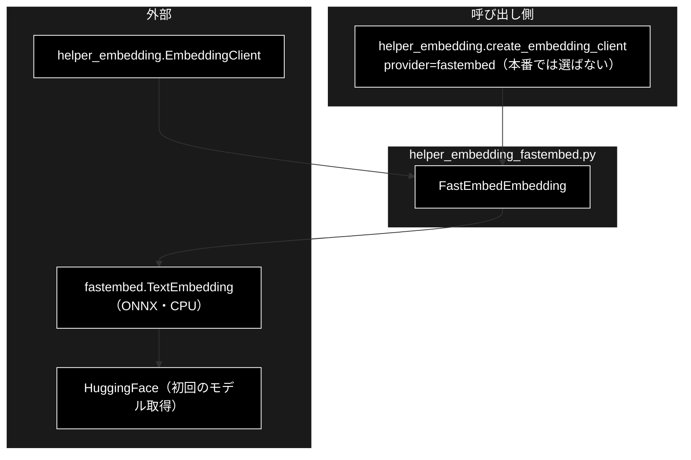
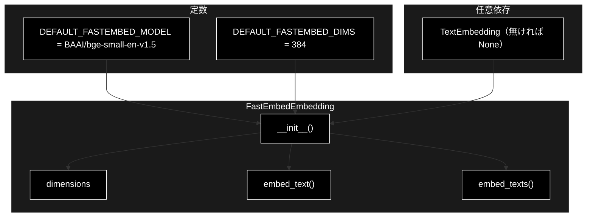
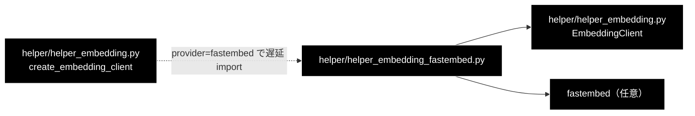

# helper_embedding_fastembed.py - FastEmbed（ローカル Embedding）実装 ドキュメント

**Version 1.0** | 最終更新: 2026-10-11

---

## 目次

1. [概要](#概要)
2. [アーキテクチャ構成図](#1-アーキテクチャ構成図)
3. [モジュール構成図](#2-モジュール構成図)
4. [クラス・関数一覧表](#3-クラス関数一覧表)
5. [クラス・関数 IPO詳細](#4-クラス関数-ipo詳細)
6. [設定・定数](#5-設定定数)
7. [エクスポート](#6-エクスポート)
8. [変更履歴](#7-変更履歴)
9. [付録: 依存関係図](#付録-依存関係図)

---

## 概要

`helper_embedding_fastembed.py` は、`helper_embedding.EmbeddingClient` を FastEmbed ライブラリ（ローカルの CPU で動く ONNX モデル）で
実装した `FastEmbedEmbedding` だけを持つモジュールである。`helper_embedding.create_embedding_client("fastembed")` が遅延 import して使う。

> 📌 **本番では使わない。** Embedding は Gemini `gemini-embedding-001`（3072 次元）に固定しており（CLAUDE.md §3）、
> 本クラスの既定モデル `BAAI/bge-small-en-v1.5` は **384 次元・英語向け**なので、既存の Qdrant コレクションとは次元も意味も合わない。
> `fastembed` は CI の `pip install` 行に入っておらず、CI では import しても `TextEmbedding = None` のまま（使うと `ImportError`）。
> なお `fastembed` パッケージ自体は hybrid 検索の sparse ベクトル（`helper_embedding_sparse.py`）のために `requirements-e2e.txt` に入っている。

### 主な責務

- FastEmbed の `TextEmbedding` による密ベクトルの生成（1 件・まとめて）
- 初期化時に 1 件埋め込んで次元を調べる
- `fastembed` が無い環境で import だけは通す（使ったときに `ImportError`）

### 各責務対応のモジュール

| # | 責務 | 対応モジュール | 説明 |
|---|------|--------------|------|
| 1 | 密ベクトルの生成 | `helper_embedding_fastembed.py` | `FastEmbedEmbedding.embed_text()` / `embed_texts()` |
| 2 | 次元の検出 | `helper_embedding_fastembed.py` | `FastEmbedEmbedding.__init__()`（失敗したら 384） |
| 3 | 任意依存の扱い | `helper_embedding_fastembed.py` | import 失敗時に `TextEmbedding = None`、`__init__` で `ImportError` |

### 主要機能一覧

| 機能 | 説明 |
|------|------|
| `FastEmbedEmbedding(model_name, threads, cache_dir)` | FastEmbed のモデルを読み込み、ダミー 1 件で次元を調べる |
| `embed_text(text)` | 1 件のベクトル（`list`）。**`task_type` は受け取らない** |
| `embed_texts(texts, batch_size=256)` | ベクトルのリスト |

---

## 1. アーキテクチャ構成図

### 1.1 システム全体構成



### 1.2 データフロー

1. `create_embedding_client("fastembed")` が本モジュールを import し、`FastEmbedEmbedding(**kwargs)` を作る
2. `__init__` が `TextEmbedding(model_name, threads, cache_dir)` を作り（初回は HuggingFace からモデルを取得）、`"test"` を 1 件埋め込んで次元を決める
3. `embed_text` / `embed_texts` は `TextEmbedding.embed()`（numpy 配列のジェネレータ）を `list` に直して返す

---

## 2. モジュール構成図

### 2.1 内部モジュール構成



### 2.2 外部依存関係

| ライブラリ | バージョン | 用途 |
|-----------|-----------|------|
| `fastembed` | `requirements-e2e.txt`（0.7.4）・任意 | `TextEmbedding`（ONNX モデルによる埋め込み） |
| `numpy` | fastembed の依存 | `embed()` が返す配列（`tolist()` で `list` へ） |

### 2.3 内部依存モジュール

| モジュール | 用途 |
|-----------|------|
| `helper/helper_embedding.py` | `EmbeddingClient`（継承元） |

---

## 3. クラス・関数一覧表

### 3.1 クラス一覧

#### FastEmbedEmbedding（`EmbeddingClient` を継承）

| メソッド | 概要 |
|---------|------|
| `__init__(model_name="BAAI/bge-small-en-v1.5", threads=None, cache_dir=None)` | モデルを読み込み、次元を調べる |
| `dimensions` | 検出した次元（失敗時は 384） |
| `embed_text(text)` | 1 件のベクトル |
| `embed_texts(texts, batch_size=256)` | ベクトルのリスト |

### 3.2 関数一覧（カテゴリ別）

本モジュールに関数は無い。

---

## 4. クラス・関数 IPO詳細

### 4.1 使用例

| 処理パターン | 呼び方 | 向いている場面 | 例 |
|---|---|---|---|
| ファクトリから使う | `create_embedding_client("fastembed")` → `embed_text` / `embed_texts` | API キー無しで手元の評価をする（本番の Qdrant とは次元が合わない） | 4.1.1 |
| 本番の検索関数から呼ぶ（動かない） | `embed_text(text, task_type=...)` | `EMBEDDING_PROVIDER=fastembed` にしたときに何が起きるか | 4.1.2 |

> 📝 2 本とも**別プロセスでそのまま実行し**、出力を確かめてある（2026-10-11・リポジトリ直下で実行）。この VM には `fastembed` が無く
> HuggingFace にも届かないため、`fastembed.TextEmbedding` をスタブ（384 次元の決定的なベクトルを返す）に差し替えた。
> スタブ無しでは `ImportError: FastEmbed module load failed: FastEmbed library is missing.. Check if 'fastembed' is installed.` になることも確かめた。

#### 4.1.1 基本的なワークフロー（ファクトリから使う）

```python
from helper.helper_embedding import create_embedding_client

emb = create_embedding_client("fastembed")          # pip install fastembed。初回はモデルをダウンロードする
print(type(emb).__name__, emb.model_name, emb.dimensions)
v = emb.embed_text("住民票の写し")
vs = emb.embed_texts(["住民票の写し", "粗大ごみ"])
print(len(v), len(vs), type(vs[0]).__name__)
```

```
# 出力例:
# FastEmbedEmbedding BAAI/bge-small-en-v1.5 384
# 384 2 list
```

> ⚠️ 既定モデルは**英語向け**。日本語の検索に使うなら多言語モデル（例: `intfloat/multilingual-e5-large`・1024 次元）を
> `create_embedding_client("fastembed", model_name=...)` で指定する。`helper_embedding.get_embedding_dimensions("fastembed")` は
> モデルに関係なく 384 を返すので、モデルを変えたら次元は `emb.dimensions` で確かめる。

#### 4.1.2 本番の検索関数から呼ぶ（`task_type` で失敗する）

```python
from helper.helper_embedding import create_embedding_client

emb = create_embedding_client("fastembed")
try:
    emb.embed_text("住民票の写し", task_type="retrieval_query")   # qdrant_client_wrapper.embed_query_unified と同じ呼び方
except TypeError as e:
    print("TypeError:", e)
```

```
# 出力例:
# TypeError: FastEmbedEmbedding.embed_text() got an unexpected keyword argument 'task_type'
```

> ⚠️ **`embed_text` が `task_type` を受け取らない**（基底クラス `EmbeddingClient.embed_text` の引数と違う）。
> `EMBEDDING_PROVIDER=fastembed` にすると、検索クエリの埋め込み（`qdrant_client_wrapper.embed_query_unified`）が必ずこの `TypeError` になる。
> 本番では fastembed を選ばないので直していない（§5.2）。

---

### 4.2 FastEmbedEmbedding クラス

#### メソッド: `__init__`

```python
def __init__(
    self,
    model_name: str = DEFAULT_FASTEMBED_MODEL,
    threads: Optional[int] = None,
    cache_dir: Optional[str] = None
)
```

| パラメータ | 型 | デフォルト | 説明 |
|------------|------|-----------|------|
| `model_name` | `str` | `"BAAI/bge-small-en-v1.5"` | FastEmbed のモデル名 |
| `threads` | `Optional[int]` | `None` | 推論のスレッド数（`None` は FastEmbed の既定） |
| `cache_dir` | `Optional[str]` | `None` | モデルのキャッシュ先（`None` は FastEmbed の既定） |

| 項目 | 内容 |
|------|------|
| **Input** | 上の 3 つ |
| **Process** | 1. `TextEmbedding` が `None`（未導入）なら `ImportError("FastEmbed library is missing.")`<br>2. `TextEmbedding(model_name, threads, cache_dir)` を作る（初回はダウンロード）<br>3. `list(self._model.embed(["test"]))[0]` の長さを次元にする。失敗したら警告して 384 |
| **Output** | インスタンス（`model_name` / `_model` / `_dims`） |

```python
# 使用例（fastembed が無い環境）
from helper.helper_embedding_fastembed import FastEmbedEmbedding
try:
    FastEmbedEmbedding()
except ImportError as e:
    print(e)
# FastEmbed library is missing.
```

#### メソッド: `embed_text` / `embed_texts` / プロパティ: `dimensions`

| メンバー | Input | Process | Output |
|---------|-------|---------|--------|
| `embed_text(text)` | `text: str`（`task_type` は無い） | `list(self._model.embed([text]))[0].tolist()` | `List[float]` |
| `embed_texts(texts, batch_size=256)` | `texts`・`batch_size` | `self._model.embed(texts, batch_size=batch_size)` の各要素を `tolist()` | `List[List[float]]`（失敗は例外のまま。ゼロ埋めはしない） |
| `dimensions` | なし | `_dims` を返す | `int` |

**戻り値例**:

```python
[0.0123, -0.0456, ...]   # 384 個（既定モデル）
```

```python
# 使用例は §4.1.1
```

---

## 5. 設定・定数

### 5.1 定数

| 定数 | 値 | 説明 |
|------|----|------|
| `DEFAULT_FASTEMBED_MODEL` | `"BAAI/bge-small-en-v1.5"` | 既定モデル（英語向け） |
| `DEFAULT_FASTEMBED_DIMS` | `384` | 次元の検出に失敗したときの値 |
| `TextEmbedding` | `fastembed.TextEmbedding` または `None` | import に失敗すると `None`（debug ログだけ出す） |

### 5.2 既知の制約

| # | 制約 | 状態 |
|---|------|------|
| 1 | `embed_text` が `task_type` を受け取らず、`qdrant_client_wrapper.embed_query_unified` から呼ぶと `TypeError` | 本番では fastembed を選ばないので未修正（§4.1.2） |
| 2 | 既定モデルが英語向け・384 次元で、本番の Qdrant コレクション（Gemini 3072 次元）とは使えない | 設計上（Embedding は Gemini に固定。CLAUDE.md §3） |
| 3 | 本番の呼び出し元もテストも無い | 2026-10-11 時点 |
| 4 | 2026-10-11 まで本モジュール自身も裸 import（`from helper_embedding import EmbeddingClient`）で、`helper/` が `sys.path` に無いと import できなかった | 2026-10-11 に `from helper.helper_embedding import ...` へ直した（`tests/qa_generation/test_import_side_effects.py`） |

---

## 6. エクスポート

`__all__` は定義していない。外から使うのは `FastEmbedEmbedding`（`helper_embedding.create_embedding_client` が遅延 import）だけ。

---

## 7. 変更履歴

| バージョン | 日付 | 変更内容 |
|-----------|------|---------|
| 1.0 | 2026-10-11 | 初版。`helper/docs/` の新設にあわせて作成（`a_class_method_md_format.md` 準拠）。§4.1 の使用例 2 本を `fastembed` のスタブで実行して出力を確かめ、`embed_text` が `task_type` を受け取らず本番の検索関数から呼ぶと `TypeError` になることを §5.2 に記録した。同日、本モジュールと `helper_embedding.py` の裸 import を直し、`create_embedding_client("fastembed")` が `fastembed` 導入済みの環境で使えるようにした |

---

## 付録: 依存関係図


