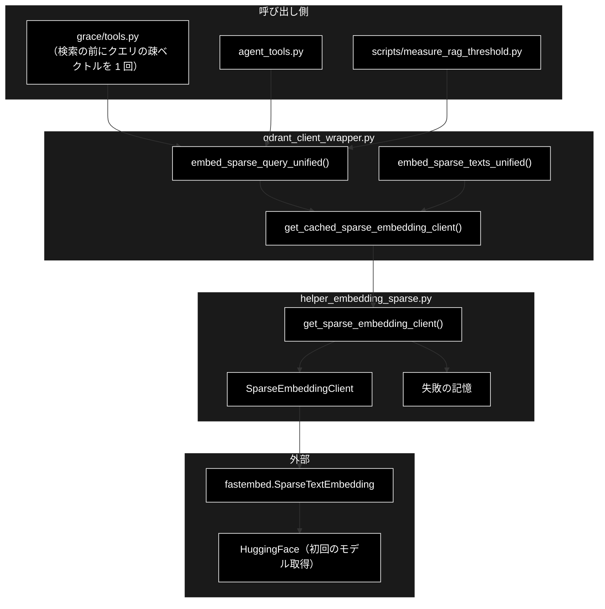
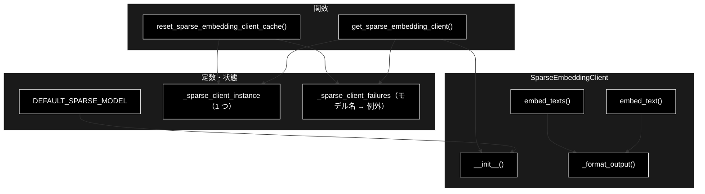
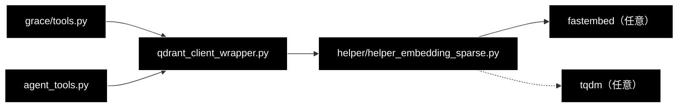

# helper_embedding_sparse.py - Sparse Embedding（SPLADE）クライアント ドキュメント

**Version 1.0** | 最終更新: 2026-10-11

---

## 目次

1. [概要](#概要)
2. [アーキテクチャ構成図](#1-アーキテクチャ構成図)
3. [モジュール構成図](#2-モジュール構成図)
4. [クラス・関数一覧表](#3-クラス関数一覧表)
5. [クラス・関数 IPO詳細](#4-クラス関数-ipo詳細)
6. [設定・定数](#5-設定定数)
7. [エクスポート](#6-エクスポート)
8. [変更履歴](#7-変更履歴)
9. [付録: 依存関係図](#付録-依存関係図)

---

## 概要

`helper_embedding_sparse.py` は、Qdrant の hybrid 検索（dense ＋ sparse）で使う**疎ベクトル**（キーワードの重み）を、
FastEmbed の `SparseTextEmbedding`（既定 `prithivida/Splade_PP_en_v1`）で作るモジュールである。
プロセスで 1 つのクライアントを使い回し（`get_sparse_embedding_client`）、**構築に失敗したモデルはその失敗も覚えて**、
同じプロセスでは再試行しない（negative cache）。

本番では GRACE-Support / GRACE-Review の検索が、`qdrant_client_wrapper.embed_sparse_query_unified()` 経由でクエリの疎ベクトルを作る
（`grace/tools.py` が検索の前に 1 回だけ計算し、全コレクションで使い回す）。**疎ベクトルは任意**で、作れなければ dense 検索だけで続ける。

> 📌 `fastembed` は `requirements-test.txt` に入っておらず、CI とこの VM では `SparseTextEmbedding = None` のまま（使うと `ImportError`）。
> Mac の本番環境・E2E（`requirements-e2e.txt`）で入る。初回は HuggingFace からモデルを取得する（既定のネットワーク設定の VM からは届かない。CLAUDE.md §2）。

### 主な責務

- FastEmbed の `SparseTextEmbedding` による疎ベクトルの生成（1 件・まとめて・進捗コールバック付き）
- FastEmbed の出力を Qdrant の `SparseVector` に渡せる `{"indices", "values"}` に直す
- プロセスで 1 つのクライアントを使い回す（モデル名ごと）
- 構築に失敗したモデルの失敗を覚え、再ダウンロードを繰り返さない（警告に消すべきキャッシュの場所を出す）
- `fastembed` が無い環境で import だけは通す

### 各責務対応のモジュール

| # | 責務 | 対応モジュール | 説明 |
|---|------|--------------|------|
| 1 | 疎ベクトルの生成 | `helper_embedding_sparse.py` | `SparseEmbeddingClient.embed_text()` / `embed_texts()` |
| 2 | Qdrant 向けの形への変換 | `helper_embedding_sparse.py` | `SparseEmbeddingClient._format_output()` |
| 3 | クライアントの使い回し | `helper_embedding_sparse.py`（さらに `qdrant_client_wrapper.get_cached_sparse_embedding_client` がキャッシュ） | `get_sparse_embedding_client()` |
| 4 | 失敗の記憶（negative cache） | `helper_embedding_sparse.py` | `_sparse_client_failures` / `reset_sparse_embedding_client_cache()` / `resolve_cache_dir()` |
| 5 | 任意依存の扱い | `helper_embedding_sparse.py` | import 失敗時に `SparseTextEmbedding = None` |

### 主要機能一覧

| 機能 | 説明 |
|------|------|
| `get_sparse_embedding_client(model_name)` | 使い回しのクライアントを返す。前に失敗したモデルなら同じ例外を即座に送出 |
| `SparseEmbeddingClient.embed_text(text)` | `{"indices": [...], "values": [...]}` |
| `SparseEmbeddingClient.embed_texts(texts, batch_size=32, progress_callback=None)` | 辞書のリスト。コールバックが無ければ tqdm の進捗バーを出す |
| `reset_sparse_embedding_client_cache()` | 成功・失敗の両方のキャッシュを捨てる |
| `resolve_cache_dir(cache_dir=None)` | FastEmbed が実際に使うキャッシュの場所（警告に出す。壊れたキャッシュを消すため） |

---

## 1. アーキテクチャ構成図

### 1.1 システム全体構成



### 1.2 データフロー

1. 検索の前に `grace/tools.py` が `embed_sparse_query_unified(query)` を呼ぶ（失敗は debug ログにして dense だけで続ける）
2. `qdrant_client_wrapper.get_cached_sparse_embedding_client` → `get_sparse_embedding_client` がクライアントを返す（初回は構築・モデル取得）
3. `embed_text` が FastEmbed の `SparseEmbedding`（numpy の `indices` / `values`）を `{"indices": list, "values": list}` にする
4. ラッパーが `qdrant_client.models.SparseVector` に詰め、Qdrant の `text-sparse` ベクトルで検索する

---

## 2. モジュール構成図

### 2.1 内部モジュール構成



### 2.2 外部依存関係

| ライブラリ | バージョン | 用途 |
|-----------|-----------|------|
| `fastembed` | `requirements-e2e.txt`（0.7.4）・任意 | `SparseTextEmbedding` |
| `tqdm` | 任意 | コールバックが無いときの進捗バー（無ければ出さない） |

### 2.3 内部依存モジュール

本モジュールは他のプロジェクト内モジュールに依存しない（`helper_embedding.EmbeddingClient` も継承しない。疎ベクトルは型が違うため）。

---

## 3. クラス・関数一覧表

### 3.1 クラス一覧

#### SparseEmbeddingClient

| メソッド | 概要 |
|---------|------|
| `__init__(model_name="prithivida/Splade_PP_en_v1", threads=None, cache_dir=None)` | `SparseTextEmbedding` を作る（`model_name=None` は既定へ） |
| `embed_text(text)` | 1 件の `{"indices", "values"}` |
| `embed_texts(texts, batch_size=32, progress_callback=None)` | 辞書のリスト |
| `_format_output(sparse_vec)` | numpy の配列を `list` にした辞書 |

### 3.2 関数一覧（カテゴリ別）

| 関数名 | 概要 |
|-------|------|
| `get_sparse_embedding_client(model_name="prithivida/Splade_PP_en_v1")` | 使い回しのクライアント（失敗は覚えて即座に送出） |
| `reset_sparse_embedding_client_cache()` | 成功・失敗の両キャッシュを捨てる |
| `resolve_cache_dir(cache_dir=None)` | `cache_dir` → 環境変数 `FASTEMBED_CACHE_PATH` → `<tempdir>/fastembed_cache` の順で解決した `Path` |

---

## 4. クラス・関数 IPO詳細

### 4.1 使用例

| 処理パターン | 呼び方 | 向いている場面 | 例 |
|---|---|---|---|
| クライアントを直接使う | `get_sparse_embedding_client()` → `embed_text` / `embed_texts` | 疎ベクトルの中身を見る | 4.1.1 |
| 本番の経路を通す | `qdrant_client_wrapper.embed_sparse_query_unified` / `embed_sparse_texts_unified` | 検索・登録と同じ組み立て方（`SparseVector`・空文字の扱い） | 4.1.2 |
| 進捗をコールバックで受け取る | `embed_texts(..., progress_callback=cb)` | 大量の登録の進捗を画面やログへ出す | 4.1.3 |
| 失敗を覚える・忘れる | 失敗するモデル名 → 再呼び出し → `reset_sparse_embedding_client_cache()` | モデルの取得に失敗した環境での振る舞い・テスト | 4.1.4 |

> 📝 4 本とも**別プロセスでそのまま実行し**、出力を確かめてある（2026-10-11・リポジトリ直下で実行）。この VM には `fastembed` が無く
> HuggingFace にも届かないため、`fastembed.SparseTextEmbedding` をスタブ（文字 bigram から決定的な疎ベクトルを作り、既定以外のモデル名では
> 本物と同じく「not supported」で失敗する）に差し替えた。**インデックスの値と個数はスタブのもので、本物の SPLADE とは違う**。

#### 4.1.1 基本的なワークフロー（クライアントを直接使う）

```python
from helper.helper_embedding_sparse import get_sparse_embedding_client

client = get_sparse_embedding_client()               # 既定モデル prithivida/Splade_PP_en_v1
v = client.embed_text("住民票の写し")
print(client.model_name, sorted(v), len(v["indices"]) == len(v["values"]))
vs = client.embed_texts(["住民票の写し", "粗大ごみの出し方"])
print(len(vs), [len(x["indices"]) for x in vs])
print(get_sparse_embedding_client() is client)       # 2 回目は同じインスタンス
```

```
# 出力例（個数はスタブの値）:
# prithivida/Splade_PP_en_v1 ['indices', 'values'] True
# 2 [5, 7]
# True
# （標準エラーに tqdm の進捗バー「Sparse Embedding: 100%|...| 2/2」）
```

> ⚠️ 既定モデルは**英語向け**（SPLADE の語彙は英語の WordPiece）。日本語の文では語彙に無い文字が多く、疎ベクトルの効きは弱い。

#### 4.1.2 本番の経路を通す（`qdrant_client_wrapper`）

```python
from qdrant_client_wrapper import embed_sparse_query_unified, embed_sparse_texts_unified

q = embed_sparse_query_unified("住民票の写しはどこで取れますか")       # grace/tools.py が検索の前に 1 回だけ呼ぶ
print(type(q).__name__, len(q.indices))
docs = embed_sparse_texts_unified(["住民票の写しは市役所の窓口で取れます。", "", "返品は30日以内です。"])
print([len(d.indices) for d in docs])                                # 空文字は空の SparseVector
```

```
# 出力例（個数はスタブの値）:
# SparseVector 14
# [18, 0, 10]
```

> 📝 本番の入口は `grace/tools.py`（`embed_sparse_query_unified` を `try` で囲み、失敗したら dense だけで検索する）。
> `embed_sparse_texts_unified` は本リポジトリのコードからは呼ばれていない（登録側の `services/qdrant_service.py` は `use_sparse=False` が既定）。

#### 4.1.3 進捗をコールバックで受け取る

```python
from helper.helper_embedding_sparse import get_sparse_embedding_client

calls = []
client = get_sparse_embedding_client()
vs = client.embed_texts(["a1", "b2", "c3", "d4", "e5"], batch_size=2,
                        progress_callback=lambda current, total: calls.append((current, total)))
print(len(vs), calls)
```

```
# 出力例:
# 5 [(2, 5), (4, 5), (5, 5)]
```

| コールバック | いつ | 渡る値 | 戻り値 |
|---|---|---|---|
| `progress_callback(current, total)` | `batch_size` 件ごとに埋め込んだ直後 | `current`: ここまでの件数（最後は `total`）・`total`: 全件数 | 使わない |

> 📝 コールバックを渡すと tqdm の進捗バーは出さない（渡さないときだけ、tqdm があれば標準エラーへ出す）。

#### 4.1.4 失敗を覚える・忘れる（negative cache）

```python
from helper.helper_embedding_sparse import get_sparse_embedding_client, reset_sparse_embedding_client_cache

for attempt in range(2):
    try:
        get_sparse_embedding_client("no-such/sparse-model")
    except Exception as e:
        print(attempt, type(e).__name__, e)
reset_sparse_embedding_client_cache()           # 失敗の記録も捨てる（テストと明示的な再試行用）
print(get_sparse_embedding_client().model_name)
```

```
# 出力例（標準出力）:
# 0 ValueError Model no-such/sparse-model is not supported in SparseTextEmbedding.
# 1 ValueError Model no-such/sparse-model is not supported in SparseTextEmbedding.
# prithivida/Splade_PP_en_v1
# 出力例（標準エラー。1 回目だけ）:
# Sparse Embedding の初期化に失敗しました（model=no-such/sparse-model）: Model no-such/sparse-model is not supported in SparseTextEmbedding.
#   → 以降このプロセスでは sparse を試行せず dense 検索のみで動作します（検索は継続します）。
#   → キャッシュ破損が原因の場合は次を削除して再実行してください: rm -rf /tmp/fastembed_cache
```

> 📝 **2 回目は構築を試さず、1 回目と同じ例外オブジェクトをすぐに送出する**（警告も 1 回だけ）。警告の最後の行は `resolve_cache_dir()` が解決した場所で、
> macOS では `/var/folders/…/T/fastembed_cache` のような推測しにくいパスになる（実測の失敗原因は、途中で切れたダウンロードで壊れたキャッシュだった）。以前は成功だけを覚えていたため、
> 壊れたキャッシュでモデルの構築が失敗する環境では、検索のたびに再ダウンロードと失敗を「コレクション数 × リプラン回数」ぶん繰り返し、
> その原因は debug ログに埋もれていた（`tests/test_silent_failures.py` が固定）。失敗の記録はモデル名ごとなので、別のモデル名なら試す。

---

### 4.2 SparseEmbeddingClient クラス

#### メソッド: `__init__`

```python
def __init__(self, model_name: str = DEFAULT_SPARSE_MODEL, threads: int = None, cache_dir: str = None)
```

| パラメータ | 型 | デフォルト | 説明 |
|------------|------|-----------|------|
| `model_name` | `str` | `"prithivida/Splade_PP_en_v1"` | `None` を渡しても既定に直す |
| `threads` | `int` | `None` | 推論のスレッド数 |
| `cache_dir` | `str` | `None` | モデルのキャッシュ先（`None` は FastEmbed の既定。`FASTEMBED_CACHE_PATH` → `<tempdir>/fastembed_cache`） |

| 項目 | 内容 |
|------|------|
| **Input** | 上の 3 つ |
| **Process** | 1. `SparseTextEmbedding` が `None` なら `ImportError("FastEmbed library is missing.")`<br>2. `SparseTextEmbedding(model_name, threads, cache_dir)` を作る（初回はダウンロード） |
| **Output** | インスタンス（`model_name` / `_model`） |

```python
# 使用例（fastembed が無い環境）
from helper.helper_embedding_sparse import SparseEmbeddingClient
try:
    SparseEmbeddingClient()
except ImportError as e:
    print(e)
# FastEmbed library is missing.
```

#### メソッド: `embed_text`

```python
def embed_text(self, text: str) -> Dict[int, float]   # 注釈は Dict[int, float] だが、実際は {"indices": [...], "values": [...]}
```

| 項目 | 内容 |
|------|------|
| **Input** | `text: str` |
| **Process** | `list(self._model.embed([text]))[0]` を `_format_output` に通す |
| **Output** | `{"indices": List[int], "values": List[float]}`（型注釈 `Dict[int, float]` は実装と違う） |

**戻り値例**:

```python
{"indices": [1012, 2054, 7420], "values": [0.83, 0.41, 1.27]}
```

#### メソッド: `embed_texts`

```python
def embed_texts(self, texts: List[str], batch_size: int = 32, progress_callback: Any = None) -> List[Dict[str, List[Any]]]
```

| パラメータ | 型 | デフォルト | 説明 |
|------------|------|-----------|------|
| `texts` | `List[str]` | 必須 | 埋め込むテキスト（空文字の除外はしない） |
| `batch_size` | `int` | `32` | FastEmbed に渡すまとまりの件数 |
| `progress_callback` | `Callable[[int, int], None]` | `None` | 進捗（§4.1.3 の表） |

| 項目 | 内容 |
|------|------|
| **Input** | 上の 3 つ |
| **Process** | コールバックあり: `batch_size` 件ずつ `embed()` → `_format_output` → `progress_callback(current, total)`<br>コールバックなし: `embed(texts, batch_size)` を（tqdm があれば進捗バー付きで）回す |
| **Output** | `List[{"indices", "values"}]`（入力と同じ件数・並び。失敗は例外のまま） |

```python
# 使用例は §4.1.1・§4.1.3
```

#### メソッド: `_format_output`

| 項目 | 内容 |
|------|------|
| **Input** | FastEmbed の `SparseEmbedding`（`indices` / `values` は numpy 配列） |
| **Process** | それぞれ `tolist()` |
| **Output** | `{"indices": list, "values": list}` |

---

### 4.3 関数

#### `get_sparse_embedding_client`

**概要**: プロセスで 1 つの `SparseEmbeddingClient` を返す。前に構築に失敗したモデル名なら、構築を試さずに同じ例外を送出する。

```python
def get_sparse_embedding_client(model_name: str = DEFAULT_SPARSE_MODEL) -> SparseEmbeddingClient
```

| パラメータ | 型 | デフォルト | 説明 |
|------------|------|-----------|------|
| `model_name` | `str` | `"prithivida/Splade_PP_en_v1"` | `None` は既定に直す |

| 項目 | 内容 |
|------|------|
| **Input** | `model_name` |
| **Process** | 1. `_sparse_client_failures` にあれば、その例外を `raise`<br>2. 使い回しのインスタンスが同じモデル名なら返す<br>3. 違えば `SparseEmbeddingClient(model_name)` を作って置き換える。失敗したら例外を記録し、**1 回だけ**（消すべきキャッシュの場所つきの）warning を出して送出（前のインスタンスはそのまま残る） |
| **Output** | `SparseEmbeddingClient` |

> ⚠️ 使い回しは**1 つだけ**で、別のモデル名の構築に成功すると前のインスタンスと置き換わる（モデルを交互に使うと毎回構築する）。grace_v2 と違い、構築に失敗したときは前のインスタンスを捨てない。
> 本番の `qdrant_client_wrapper.get_cached_sparse_embedding_client` はさらにモデル名ごとの辞書でキャッシュするので、検索の経路ではこの問題は起きない。

```python
# 使用例は §4.1.1・§4.1.4
```

#### `reset_sparse_embedding_client_cache`

| 項目 | 内容 |
|------|------|
| **Input** | なし |
| **Process** | `_sparse_client_instance = None`・`_sparse_client_failures.clear()` |
| **Output** | `None` |

> 📝 `qdrant_client_wrapper` 側のキャッシュ（`_sparse_embedding_clients`）は消さない。`tests/test_silent_failures.py` は各テストの前後で本関数だけを呼ぶ。

#### `resolve_cache_dir`

**概要**: FastEmbed が実際に使うキャッシュの場所を、FastEmbed と同じ順で解決して返す。構築に失敗したときの警告に「消せば直る場所」を出すためだけに使う。

```python
def resolve_cache_dir(cache_dir: str = None) -> Path
```

| 項目 | 内容 |
|------|------|
| **Input** | `cache_dir`（省略可） |
| **Process** | `cache_dir` があればそれ、無ければ環境変数 `FASTEMBED_CACHE_PATH`、それも無ければ `Path(tempfile.gettempdir()) / "fastembed_cache"` |
| **Output** | `Path`（作りも消しもしない） |

```python
# 使用例
import os
from helper.helper_embedding_sparse import resolve_cache_dir
print(resolve_cache_dir("/data/fe"), resolve_cache_dir())
os.environ["FASTEMBED_CACHE_PATH"] = "/srv/fastembed"
print(resolve_cache_dir())
# /data/fe /tmp/fastembed_cache      （FASTEMBED_CACHE_PATH が未設定の Linux）
# /srv/fastembed
```

---

## 5. 設定・定数

### 5.1 定数・状態

| 名前 | 値 | 説明 |
|------|----|------|
| `DEFAULT_SPARSE_MODEL` | `"prithivida/Splade_PP_en_v1"` | 既定モデル（英語向け） |
| `SparseTextEmbedding` | `fastembed.SparseTextEmbedding` または `None` | import に失敗すると `None`（debug ログだけ） |
| `_sparse_client_instance` | `SparseEmbeddingClient` または `None` | 使い回しのインスタンス |
| `_sparse_client_failures` | `Dict[str, Exception]` | 構築に失敗したモデル名 → 例外 |

`resolve_cache_dir` は FastEmbed 自身の解決順（`cache_dir` 引数 → `FASTEMBED_CACHE_PATH` → `<tempdir>/fastembed_cache`）をまねて、**ログに出すためだけ**に使う（FastEmbed の設定は変えない）。

### 5.2 既知の制約

| # | 制約 | 状態 |
|---|------|------|
| 1 | `embed_text` の型注釈 `Dict[int, float]` と実際の戻り値（`{"indices", "values"}`）が違う | 実装どおり |
| 2 | 既定モデルが英語向けで、日本語の文には効きが弱い | 設計上（多言語モデルは未検討） |
| 3 | 失敗の記録はプロセスが終わるまで消えない（`reset_sparse_embedding_client_cache` を呼ばない限り） | 意図どおり（§4.1.4） |

---

## 6. エクスポート

`__all__` は定義していない。外から使う名前は `get_sparse_embedding_client`（`qdrant_client_wrapper.py`）と、テストが使う `reset_sparse_embedding_client_cache` / `resolve_cache_dir`（`tests/test_sparse_embedding_cache.py`・`tests/test_silent_failures.py`）。

---

## 7. 変更履歴

| バージョン | 日付 | 変更内容 |
|-----------|------|---------|
| 1.0 | 2026-10-11 | 初版。`helper/docs/` の新設にあわせて作成（`a_class_method_md_format.md` 準拠）。§4.1 の使用例 4 本（直接・本番の経路・進捗コールバック・negative cache）を `fastembed` のスタブで実行して出力を確かめた。grace_v2 との違い（`resolve_cache_dir` と警告のキャッシュの場所、失敗時に前のインスタンスを残すこと）を書いた |

---

## 付録: 依存関係図


