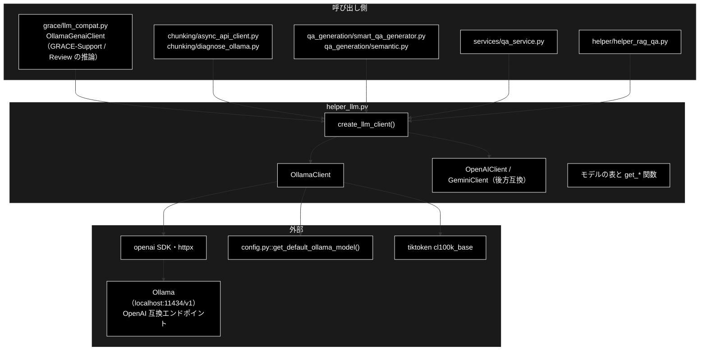
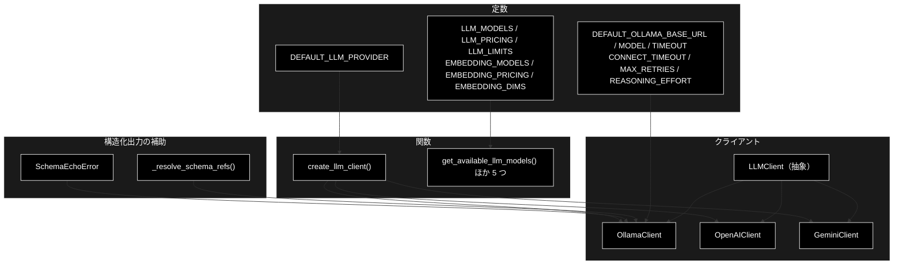
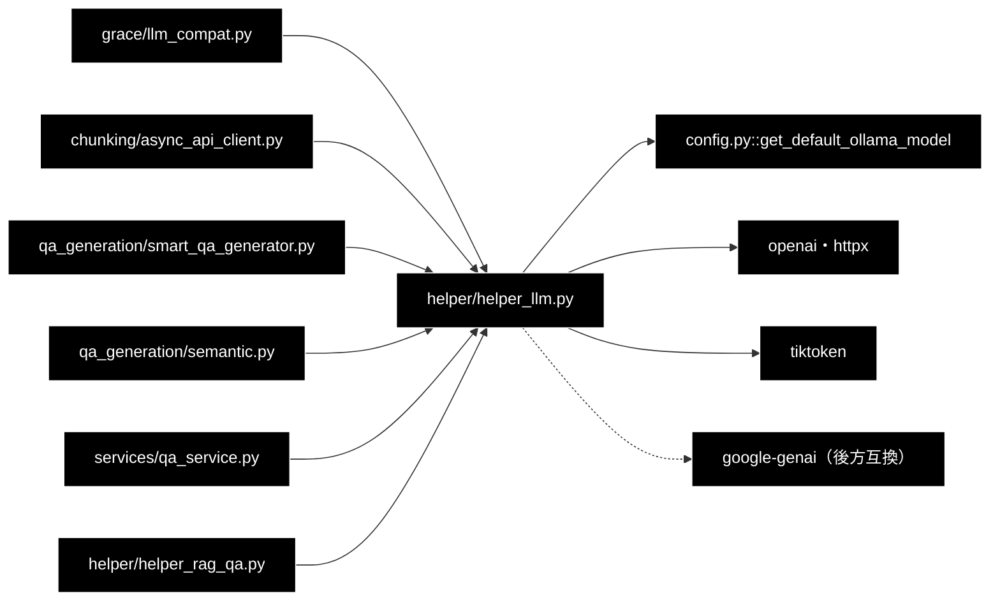

# helper_llm.py - LLM クライアント抽象化レイヤー（Ollama）ドキュメント

**Version 1.0** | 最終更新: 2026-10-11

---

## 目次

1. [概要](#概要)
2. [アーキテクチャ構成図](#1-アーキテクチャ構成図)
3. [モジュール構成図](#2-モジュール構成図)
4. [クラス・関数一覧表](#3-クラス関数一覧表)
5. [クラス・関数 IPO詳細](#4-クラス関数-ipo詳細)
6. [設定・定数](#5-設定定数)
7. [エクスポート](#6-エクスポート)
8. [変更履歴](#7-変更履歴)
9. [付録: 依存関係図](#付録-依存関係図)

---

## 概要

`helper_llm.py` は、本リポジトリの **LLM 呼び出しの土台**である。抽象基底クラス `LLMClient`（テキスト生成・構造化出力・トークン数）と、
**`OllamaClient`（既定）**・`OpenAIClient` / `GeminiClient`（後方互換）、プロバイダ名から実装を選ぶ `create_llm_client()`、モデルの一覧・単価・上限の表を持つ。

`OllamaClient` は `openai` SDK の `base_url` を Ollama の OpenAI 互換エンドポイント（既定 `http://localhost:11434/v1`）に向けて使う。
**宛先は手元の Ollama で、外部 API へは出ない**（`api_key="ollama"` は SDK が空文字を拒否するためのダミー）。

> 📌 **GRACE-Support / GRACE-Review の推論もここを通る**（grace_v2 と違う点）。エージェント側の `grace/llm_compat.py::OllamaGenaiClient` が
> 内部で `create_llm_client("ollama")` を呼び、`OllamaClient.generate_content` に委ねる。データ準備（チャンク化・Q/A 生成）も同じクライアントを使う。
> Anthropic の LLM 経路は 2026-10-08 に削除した（`provider="anthropic"` は未知のプロバイダとして `ValueError`。`tests/test_no_anthropic_path.py`）。

### 主な責務

- LLM クライアントの共通インターフェース（テキスト生成・構造化出力・トークン数）の定義
- Ollama の呼び出し（期限・リトライ・`max_tokens` への統一・使用トークン数の記録）
- 思考モデル対策（`reasoning_effort` の送信と未対応時の自動解除・思考だけで本文が空の検知と診断ログ）
- 構造化出力（スキーマの `$ref` 展開・スキーマ制約付きデコード〔`json_schema`〕と `json_object` への退避・スキーマのオウム返しの検知）
- OpenAI / Gemini の呼び出し（後方互換）とプロバイダ名からのクライアント生成
- LLM・Embedding モデルの一覧・単価（ローカルは 0）・上限・次元の表

### 各責務対応のモジュール

| # | 責務 | 対応モジュール | 説明 |
|---|------|--------------|------|
| 1 | 共通インターフェース | `helper_llm.py` | `LLMClient` |
| 2 | Ollama の呼び出し | `helper_llm.py`（既定モデルは `config.py::get_default_ollama_model()`） | `OllamaClient.__init__` / `generate_content` / `_record_usage`・`DEFAULT_OLLAMA_*` |
| 3 | 思考モデル対策 | `helper_llm.py` | `_create_completion`（`reasoning_effort` の機能検出）/ `last_thinking_only` / `_log_empty_content` |
| 4 | 構造化出力 | `helper_llm.py` | `generate_structured` / `_resolve_schema_refs` / `_structured_response_format` / `SchemaEchoError` |
| 5 | 後方互換とクライアント生成 | `helper_llm.py` | `OpenAIClient` / `GeminiClient` / `create_llm_client()` |
| 6 | モデルの表 | `helper_llm.py` | `LLM_MODELS` / `LLM_PRICING` / `LLM_LIMITS` / `EMBEDDING_*` と `get_*` 関数 6 つ |

### 主要機能一覧

| 機能 | 説明 |
|------|------|
| `create_llm_client(provider=None, **kwargs)` | `ollama`（既定）/ `openai` / `gemini`（`google`）。未知の名前は `ValueError` |
| `OllamaClient.generate_content(prompt, model=None, **kwargs)` | テキストを返す。思考だけで本文が空なら `""` を返し `last_thinking_only=True` |
| `OllamaClient.generate_structured(prompt, response_schema, model=None, **kwargs)` | pydantic のインスタンス。スキーマのオウム返しは `SchemaEchoError` |
| `OllamaClient.last_usage` / `last_thinking_only` / `supports_json_schema` / `reasoning_effort` | 直近の呼び出しの観測と、実行時に検出した Ollama の対応状況 |
| `count_tokens(text, model=None)` | tiktoken `cl100k_base` による**近似**（Ollama にトークン数の API は無い） |
| `get_llm_model_pricing` / `get_llm_model_limits` | ローカルモデルの単価は常に 0 |

---

## 1. アーキテクチャ構成図

### 1.1 システム全体構成



### 1.2 データフロー

1. 呼び出し側が `create_llm_client("ollama", default_model=..., timeout=...)` でクライアントを作る（`openai.OpenAI` を作るが、この時点では通信しない）
2. `generate_content` は `max_completion_tokens` / `max_output_tokens` / `max_tokens` を `max_tokens` に統一し、`_create_completion` が `reasoning_effort` を付けて `chat.completions.create` を呼ぶ（未対応の Ollama なら外して送り直し、以降は送らない）
3. `generate_structured` はスキーマの `$ref` を展開してプロンプトに入れ、`response_format={"type": "json_schema", ...}` で送る（未対応なら `json_object` に落とし、以降は送らない）
4. 応答の `usage` を `last_usage` に記録し、本文が空なら観測値（`finish_reason`・生成トークン数・思考の有無と入っていたキー）をログに出す。構造化出力はオウム返しを検知してから pydantic で検証する

---

## 2. モジュール構成図

### 2.1 内部モジュール構成



### 2.2 外部依存関係

| ライブラリ | バージョン | 用途 |
|-----------|-----------|------|
| `openai` | CI の `pip install` 行・`requirements.txt` | `OllamaClient`（OpenAI 互換エンドポイント）・`OpenAIClient` |
| `httpx` | `openai` の依存 | `httpx.Timeout`（読み取り期限と接続期限を分ける） |
| `google-genai` | 同上 | `GeminiClient`（`__init__` で遅延 import） |
| `tiktoken` | 同上 | `count_tokens` |
| `pydantic` | 同上 | 構造化出力の型と検証 |
| `python-dotenv` | 同上 | import 時に `load_dotenv()` |

### 2.3 内部依存モジュール

| モジュール | 用途 |
|-----------|------|
| `config.py::get_default_ollama_model()` | `DEFAULT_OLLAMA_MODEL`（既定モデル名の唯一の定義。環境変数 `OLLAMA_DEFAULT_MODEL` を最優先） |

> ⚠️ `DEFAULT_OLLAMA_MODEL` は **import 時に 1 回だけ** `get_default_ollama_model()` を呼んで決まる。import した後に `OLLAMA_DEFAULT_MODEL` を変えても既定は変わらない。

---

## 3. クラス・関数一覧表

### 3.1 クラス一覧

#### LLMClient（抽象基底クラス）

| メソッド | 概要 |
|---------|------|
| `generate_content(prompt, model=None, **kwargs)` | テキスト |
| `generate_structured(prompt, response_schema, model=None, **kwargs)` | pydantic のインスタンス |
| `count_tokens(text, model=None)` | トークン数 |

#### OllamaClient（既定）

| メンバー | 概要 |
|---------|------|
| `__init__(base_url=None, default_model=DEFAULT_OLLAMA_MODEL, timeout=None, max_retries=None, **kwargs)` | 期限・リトライを必ず明示して `openai.OpenAI` を作る |
| `base_url` / `timeout` / `max_retries` / `default_model` | 解決済みの接続設定 |
| `last_usage` | 直近 1 回の `{"input_tokens", "output_tokens"}`（`prompt_tokens` / `completion_tokens` から） |
| `last_thinking_only` | 直近 1 回が「思考だけで本文ゼロ」だったか |
| `reasoning_effort` | 送る値（既定 `"none"`）。未対応と分かると `None` |
| `supports_json_schema` | スキーマ制約付きデコードを送るか。未対応と分かると `False` |
| `generate_content(prompt, model=None, **kwargs)` | テキスト生成 |
| `generate_structured(prompt, response_schema, model=None, **kwargs)` | 構造化出力 |
| `count_tokens(text, model=None)` | `cl100k_base` による近似 |
| `_create_completion` / `_looks_like_unsupported_param` / `_names_another_param` | `reasoning_effort` の機能検出（内部） |
| `_record_usage` / `_extract_thinking` / `_message_keys` / `_log_empty_content` | 使用量の記録と空応答の診断（内部） |
| `_structured_response_format` / `_looks_like_schema_echo` | 構造化出力の補助（内部） |
| `_THINKING_KEYS` | 思考が入るキーの候補 `reasoning_content` / `thinking` / `reasoning` |

#### OpenAIClient / GeminiClient（後方互換）

| クラス | 既定モデル | 構造化出力 | トークン数 |
|-------|-----------|-----------|-----------|
| `OpenAIClient(api_key=None, default_model="gpt-4o-mini")` | `gpt-4o-mini` | `beta.chat.completions.parse(response_format=...)` | `tiktoken.encoding_for_model`（無ければ `cl100k_base`） |
| `GeminiClient(api_key=None, default_model="gemini-2.5-flash")` | `gemini-2.5-flash` | `response_mime_type="application/json"`＋`response_schema` | `models.count_tokens`（API を呼ぶ） |

#### SchemaEchoError（`ValueError` を継承）

モデルがデータではなく JSON Schema の定義そのものを返したときの例外。**再試行しても直らない**失敗として、ほかの `ValueError` と区別するための型。

### 3.2 関数一覧（カテゴリ別）

| 関数名 | 概要 |
|-------|------|
| `_resolve_schema_refs(schema)`（内部） | `$ref` / `$defs` を展開し、`title` キーを取り除く（深さ 10 で打ち切り） |
| `create_llm_client(provider=None, **kwargs)` | プロバイダ名からクライアントを作る |
| `get_available_llm_models()` | `LLM_MODELS`（11 件） |
| `get_llm_model_pricing(model_name)` | `{"input", "output"}`（ローカルは 0） |
| `get_llm_model_limits(model_name)` | `{"max_tokens", "max_output"}` |
| `get_available_embedding_models()` | `EMBEDDING_MODELS`（3 件） |
| `get_embedding_model_pricing(model_name)` | 1K トークンあたりの USD |
| `get_embedding_model_dimensions(model_name)` | 次元（表に無ければ 0） |

---

## 4. クラス・関数 IPO詳細

### 4.1 使用例

| 処理パターン | 呼び方 | 向いている場面 | 例 |
|---|---|---|---|
| テキストを生成する | `create_llm_client()` → `generate_content` → `last_usage` / `last_thinking_only` | 1 回の生成（`grace/llm_compat.py` が GRACE の推論で使う形） | 4.1.1 |
| 構造化出力 | `create_llm_client("ollama", timeout=...)` → `generate_structured(prompt, Model)` | チャンク化（`chunking/async_api_client.py`）・Q/A 生成（`qa_generation/smart_qa_generator.py`） | 4.1.2 |
| 送る内容を確かめる | `client` を差し替えて `chat.completions.create` の引数を見る | `max_tokens` / `temperature` / `reasoning_effort` / `response_format` がどう送られるか | 4.1.3 |
| 失敗のときの振る舞い | 思考だけの応答・スキーマのオウム返し・`reasoning_effort` 未対応 | ローカルモデルで本文が空・パースに失敗するときの切り分け | 4.1.4 |
| 表を引く・プロバイダを間違える | `get_llm_model_pricing` / `get_llm_model_limits` / `create_llm_client("anthropic")` | 期限・上限の確認、設定の打ち間違い | 4.1.5 |

> 📝 5 本とも**別プロセスでそのまま実行し**、出力を確かめてある（2026-10-11・リポジトリ直下で実行）。この VM に Ollama は無いので、
> 4.1.1 / 4.1.2 は **Ollama の代わりの小さな HTTP サーバ**（OpenAI 互換の `/v1/chat/completions` に固定の応答を返す。`OLLAMA_BASE_URL` で向けた）を相手にした。
> `openai` SDK から HTTP までは本物で、**生成された文と usage はそのサーバの値**。4.1.3 / 4.1.4 は例の中で `client` を差し替えるので Ollama 不要、4.1.5 は通信しない。

#### 4.1.1 基本的なワークフロー（テキストを生成する）

```python
from helper.helper_llm import create_llm_client

llm = create_llm_client()                    # 既定は環境変数 LLM_PROVIDER、無ければ ollama（API キー不要）
print(type(llm).__name__, llm.default_model, llm.base_url, llm.timeout, llm.max_retries, llm.reasoning_effort)
text = llm.generate_content("住民票の写しはどこで取れますか。1 文で。", max_output_tokens=200)
print(text)
print(llm.last_usage, llm.last_thinking_only, llm.count_tokens(text))
```

```
# 出力例（OLLAMA_BASE_URL を代わりのサーバに向けたとき。文と usage はそのサーバの値）:
# OllamaClient gemma4:26b-a4b-it-qat http://127.0.0.1:18435/v1 180.0 0 none
# 住民票の写しは市役所の窓口で取得できます。
# {'input_tokens': 42, 'output_tokens': 17} False 23
```

> 📝 `base_url` の既定は `http://localhost:11434/v1`（環境変数 `OLLAMA_BASE_URL` で上書き）。期限は 180 秒・接続は 5 秒・SDK の自動リトライは 0（§5.2）。
> ⚠️ `count_tokens` は **OpenAI の符号表（`cl100k_base`）による近似**で、gemma4 の実際のトークン数とは違う（実際の値は `last_usage`）。
> `last_usage` は**インスタンスに 1 つ**なので、同じクライアントを複数スレッドで使う（チャンク化の `asyncio.to_thread`）と上書きし合う。

#### 4.1.2 構造化出力（本番の主な使い方）

```python
from typing import List
from pydantic import BaseModel
from helper.helper_llm import create_llm_client


class Procedure(BaseModel):
    name: str
    steps: List[str]


llm = create_llm_client("ollama", timeout=300)          # chunking/async_api_client.py と同じ作り方（期限だけ延ばす）
obj = llm.generate_structured("住民票の写しの取り方を手順にしてください。", Procedure, max_output_tokens=1024)
print(type(obj).__name__, obj.name, obj.steps, llm.supports_json_schema)
```

```
# 出力例（内容は代わりのサーバの値）:
# Procedure 住民票の写しの取り方 ['窓口へ行く', '本人確認書類を出す'] True
```

> 📝 本番の入口は `chunking/async_api_client.py::AsyncAPIClient`（`generate_structured` を `asyncio.to_thread` で並列に呼ぶ。`SchemaEchoError` は再試行しない）と
> `qa_generation/smart_qa_generator.py::SmartQAGenerator`（呼んだ直後に `last_usage` を取り込む）。
> 構造化出力の既定は `max_tokens=8192`・`temperature=0.1`・システムプロンプト「あなたは厳密な JSON ジェネレーターです…」。

#### 4.1.3 送る内容を確かめる

```python
from types import SimpleNamespace as NS
from pydantic import BaseModel
from helper.helper_llm import OllamaClient


class Doc(BaseModel):
    title: str
    body: str


sent = []
def create(**kw):
    sent.append(kw)
    content = '{"title": "t", "body": "b"}' if "response_format" in kw else "ok"
    return NS(choices=[NS(message=NS(content=content), finish_reason="stop")], usage=NS(prompt_tokens=1, completion_tokens=1))

llm = OllamaClient()                                     # 作るだけなら通信しない
llm.client = NS(chat=NS(completions=NS(create=create)))  # 送る内容だけを見る
llm.generate_content("こんにちは", max_output_tokens=300, temperature=0.2)
llm.generate_structured("要約して", Doc)
for kw in sent:
    print(kw["max_tokens"], kw.get("temperature"), kw.get("reasoning_effort"),
          (kw.get("response_format") or {}).get("type"), [m["role"] for m in kw["messages"]])
schema = sent[1]["response_format"]["json_schema"]["schema"]
print(sorted(schema["properties"]), schema["required"])   # title プロパティが消えている
```

```
# 出力例:
# 300 0.2 none None ['user']
# 8192 0.1 none json_schema ['system', 'user']
# ['body'] ['title', 'body']
```

> ⚠️ **`title` という名前のフィールドがスキーマの `properties` から消える**（`_resolve_schema_refs` が JSON Schema の注釈の `title` を消すつもりで、
> 同じ名前のプロパティまで消している。`required` には残るので、送るスキーマが食い違う）。スキーマ制約付きデコードでは `title` を出力できない、
> または出力の形が崩れるおそれがある。2026-10-11 時点で本番の構造化出力のスキーマ（チャンク化・Q/A 生成）に `title` という名前のフィールドは無いので、表に出ていない（§5.3）。
> `generate_content` は `temperature` を渡したときだけ送り、`generate_structured` は既定で 0.1 を送る。

#### 4.1.4 失敗のときの振る舞い

```python
from types import SimpleNamespace as NS
from pydantic import BaseModel
from helper.helper_llm import OllamaClient, SchemaEchoError


class Answer(BaseModel):
    answer: str


def client_returning(message):
    resp = NS(choices=[NS(message=message, finish_reason="length")], usage=NS(prompt_tokens=10, completion_tokens=4096))
    return NS(chat=NS(completions=NS(create=lambda **kw: resp)))


llm = OllamaClient()
# 1. 思考だけで本文が空（思考モデルが枠を使い切った）
llm.client = client_returning(NS(content=None, reasoning="考え中…" * 100))
print(repr(llm.generate_content("質問", max_output_tokens=4096)), llm.last_thinking_only)
# 2. データではなくスキーマ定義そのものを返した（指示追従の弱いモデル）
llm.client = client_returning(NS(content='{"type": "object", "properties": {"answer": {"type": "string"}}}'))
try:
    llm.generate_structured("答えて", Answer)
except SchemaEchoError as e:
    print("SchemaEchoError:", e)


# 3. この Ollama が reasoning_effort に未対応（400）→ 外して送り直し、以降は送らない
class Unsupported(Exception):
    status_code = 400

calls = []
def create(**kw):
    calls.append("reasoning_effort" in kw)
    if "reasoning_effort" in kw:
        raise Unsupported("unknown field: reasoning_effort")
    return NS(choices=[NS(message=NS(content="ok"), finish_reason="stop")], usage=None)

llm.client = NS(chat=NS(completions=NS(create=create)))
print(llm.generate_content("質問"), calls, llm.reasoning_effort)
```

```
# 出力例（標準出力）:
# '' True
# SchemaEchoError: gemma4:26b-a4b-it-qat がスキーマ定義をオウム返ししました（期待するキー: ['answer']）
# ok [True, False] None
# 出力例（標準エラー。ログ・抜粋）:
# Ollama 応答の本文が空です（model=gemma4:26b-a4b-it-qat, finish_reason=length, max_tokens=4096, completion_tokens=4096, prompt_tokens=10, response_format=なし, thinking=400 chars (key=reasoning), message_keys=['content', 'reasoning']）: 思考（reasoning）だけを返し本文へ到達していません。…
# Ollama がデータではなく**スキーマ定義そのもの**を返しました（model=gemma4:26b-a4b-it-qat, json_schema=有効）。 リトライしても同じ結果になります。…
# この Ollama は reasoning_effort に未対応のため無効化します: unknown field: reasoning_effort. …
```

| 失敗 | 返り方 | 上位の扱い |
|---|---|---|
| 思考だけで本文が空 | `generate_content` は `""`・`last_thinking_only=True`・観測値を warning | 同じプロンプトを投げ直しても同じになる。`last_thinking_only` はそれを上位に知らせるための値だが、**2026-10-11 時点で本番のコードは読んでいない**（テストだけ。§5.3） |
| スキーマのオウム返し | `SchemaEchoError`（`ValueError` の派生） | 再試行しない（チャンク化は機械的分割へ） |
| `reasoning_effort` 未対応 | 外して 1 回だけ送り直し、以降そのインスタンスでは送らない | 何もしなくてよい（警告が 1 回出る） |
| `json_schema` 未対応 | `json_object` に落として送り直し、以降は `supports_json_schema=False` | オウム返しが起きやすくなる（上の行） |
| 期限切れ・接続できない | `openai` の例外のまま（SDK の自動リトライは 0） | 呼び出し側（planner の再試行・executor のフォールバック） |

> ⚠️ 「そのパラメータは知らない」系のエラーでも、**エラー文が `response_format` / `json_schema` / `tools` を名指ししていれば `reasoning_effort` を外さない**
> （無関係な理由で思考の抑止が恒久的に外れるのを防ぐ。`_names_another_param`）。

#### 4.1.5 表を引く・プロバイダを間違える

```python
from helper.helper_llm import (
    DEFAULT_OLLAMA_MAX_RETRIES, DEFAULT_OLLAMA_TIMEOUT, create_llm_client,
    get_available_llm_models, get_embedding_model_dimensions, get_llm_model_limits, get_llm_model_pricing,
)
print(len(get_available_llm_models()), get_available_llm_models()[:4])
print(get_llm_model_pricing("gemma4:26b-a4b-it-qat"), get_llm_model_limits("gemma4:26b-a4b-it-qat"))
print(get_llm_model_limits("qwen3.8:27b-mlx"), get_embedding_model_dimensions("gemini-embedding-001"))
print(DEFAULT_OLLAMA_TIMEOUT, DEFAULT_OLLAMA_MAX_RETRIES)
for provider in ["anthropic", "olama"]:
    try:
        create_llm_client(provider)
    except ValueError as e:
        print(e)
```

```
# 出力例（OLLAMA_TIMEOUT 未設定）:
# 11 ['gemma4:12b-mlx', 'gemma4:e4b-mlx', 'gemma4:26b-mlx', 'gemma4:26b-a4b-it-qat']
# {'input': 0.0, 'output': 0.0} {'max_tokens': 128000, 'max_output': 8192}
# {'max_tokens': 32768, 'max_output': 8192} 3072
# 180.0 0
# 未知の LLM プロバイダです: 'anthropic'（ollama / openai / gemini のいずれか。既定は環境変数 LLM_PROVIDER）
# 未知の LLM プロバイダです: 'olama'（ollama / openai / gemini のいずれか。既定は環境変数 LLM_PROVIDER）
```

> ⚠️ **表に無いモデルは単価も上限も 0**（例外にはならない）。`config.py::ModelConfig` の表とは別の表で、
> 既定モデルが両方に登録されていることを `tests/test_model_info_api.py` が検査する。

---

### 4.2 OllamaClient クラス

#### メソッド: `__init__`

```python
def __init__(
    self,
    base_url: Optional[str] = None,
    default_model: str = DEFAULT_OLLAMA_MODEL,
    timeout: Optional[float] = None,
    max_retries: Optional[int] = None,
    **kwargs,
)
```

| パラメータ | 型 | デフォルト | 説明 |
|------------|------|-----------|------|
| `base_url` | `Optional[str]` | `None` | 省略時は環境変数 `OLLAMA_BASE_URL`、無ければ `http://localhost:11434/v1` |
| `default_model` | `str` | `DEFAULT_OLLAMA_MODEL` | `model` を省いたときのモデル |
| `timeout` | `Optional[float]` | `None` | 読み取り期限（秒）。省略時は `DEFAULT_OLLAMA_TIMEOUT`（180） |
| `max_retries` | `Optional[int]` | `None` | SDK の自動リトライ。省略時は 0 |
| `reasoning_effort`（`kwargs`） | `str` | `DEFAULT_OLLAMA_REASONING_EFFORT` | `"off"` / `"false"` / `"0"` / 空なら送らない |

| 項目 | 内容 |
|------|------|
| **Input** | 上の 5 つ |
| **Process** | 1. `openai` が無ければ `ImportError`<br>2. `OpenAI(base_url, api_key="ollama", timeout=httpx.Timeout(timeout, connect=5.0), max_retries)` を作る（**期限とリトライを必ず明示する**。省略すると SDK 既定の 600 秒 × 3 回で最大 30 分ブロックする）<br>3. `last_usage` / `last_thinking_only` / `supports_json_schema=True` / `reasoning_effort` を初期化し、設定を INFO ログに出す |
| **Output** | インスタンス（通信しない） |

```python
# 使用例
from helper.helper_llm import OllamaClient
llm = OllamaClient(timeout=60)
print(llm.timeout, llm.max_retries)
# 60.0 0
```

#### メソッド: `generate_content`

```python
def generate_content(self, prompt: str, model: Optional[str] = None, **kwargs) -> str
```

| 項目 | 内容 |
|------|------|
| **Input** | `prompt`・`model`・`kwargs`（`system` / `max_completion_tokens` / `max_output_tokens` / `max_tokens`〔既定 4096〕/ `temperature` / `response_format`） |
| **Process** | 1. 上限を `max_tokens` に統一し、`system` があればシステムメッセージにする<br>2. `_create_completion`（`reasoning_effort` の機能検出つき）<br>3. `last_usage` を記録し、本文が空で思考があれば `last_thinking_only=True`<br>4. 本文が空なら `_log_empty_content` で観測値を warning |
| **Output** | `str`（空のことがある。例外にはしない） |

上の `kwargs` 以外は**黙って捨てる**（`chat.completions.create` に渡らない）。

#### メソッド: `generate_structured`

```python
def generate_structured(self, prompt: str, response_schema: Type[BaseModel], model: Optional[str] = None, **kwargs) -> BaseModel
```

| 項目 | 内容 |
|------|------|
| **Input** | `prompt`・`response_schema`（pydantic のクラス）・`model`・`kwargs`（`system` / 上限〔既定 8192〕/ `temperature`〔既定 0.1〕） |
| **Process** | 1. `_resolve_schema_refs(response_schema.model_json_schema())` でフラットにし、プロンプトの末尾にスキーマを足す<br>2. `response_format` は `supports_json_schema` なら `{"type": "json_schema", "json_schema": {"name": クラス名, "schema": ..., "strict": True}}`、そうでなければ `{"type": "json_object"}`<br>3. `json_schema` が「未対応のパラメータ」で拒否されたら `json_object` に落として送り直し、`supports_json_schema=False`<br>4. 本文が空なら観測値を warning<br>5. `_looks_like_schema_echo` が真なら `SchemaEchoError`<br>6. `model_validate_json(raw)`（失敗はログに出して送出） |
| **Output** | `BaseModel` |

**戻り値例**:

```python
Procedure(name='住民票の写しの取り方', steps=['窓口へ行く', '本人確認書類を出す'])
```

#### 内部メソッド

| メソッド | 概要 |
|---------|------|
| `_create_completion(create_kwargs)` | `reasoning_effort` を付けて送る。「未対応のパラメータ」と読める 400 / 404 / 422 で、しかも別のパラメータを名指ししていなければ、外して送り直し `reasoning_effort=None` にする |
| `_looks_like_unsupported_param(exc)` | ステータスとエラー文から「そのパラメータは知らない」系か（通信・期限切れは偽） |
| `_names_another_param(exc)` | エラー文が `response_format` / `json_schema` / `tools` / `tool_choice` を名指ししているか |
| `_record_usage(response)` | `usage.prompt_tokens` / `completion_tokens` を `last_usage` へ（無ければ 0） |
| `_extract_thinking(message)` | `_THINKING_KEYS` の順に思考の文字列とキー名を探す |
| `_message_keys(message)` | 応答の `message` が実際に持つキー（中身が空のものは除く） |
| `_log_empty_content(...)` | 本文が空の理由の観測値を、思考あり / 枠いっぱい / 枠に届かない `length` / それ以外で書き分けて warning |
| `_structured_response_format(flat_schema, name)` | `json_schema` か `json_object` かを決める |
| `_looks_like_schema_echo(raw, flat_schema)` | 期待するトップレベルのキーが 1 つも無く、`properties` / `$schema` / `$defs` を持つ JSON か |

#### メソッド: `count_tokens`

| 項目 | 内容 |
|------|------|
| **Input** | `text`（`model` は使わない） |
| **Process** | `tiktoken.get_encoding("cl100k_base")` で数える |
| **Output** | `int`（近似） |

---

### 4.3 OpenAIClient / GeminiClient（後方互換）

本番では使わない（LLM は Ollama。CLAUDE.md §3）。

| メソッド | `OpenAIClient` | `GeminiClient` |
|---------|---------------|----------------|
| `__init__` | `OPENAI_API_KEY` が無ければ `ValueError`、`openai` が無ければ `ImportError` | `GOOGLE_API_KEY` / `GEMINI_API_KEY` が無ければ `ValueError`。`google.genai` は `__init__` で import |
| `generate_content` | `chat.completions.create(messages=[user], **kwargs)` | `models.generate_content`（自動関数呼び出しは常に無効） |
| `generate_structured` | `beta.chat.completions.parse(response_format=schema)` の `parsed` | `response_mime_type="application/json"` で受けて検証 |
| `count_tokens` | `tiktoken.encoding_for_model`（無ければ `cl100k_base`） | `models.count_tokens`（**API を呼ぶ**） |

> ⚠️ `GOOGLE_API_KEY` は Embedding に必須なので常に設定されている。`create_llm_client("gemini")` は**課金される Gemini の LLM API を呼べてしまう**ので、使わないこと
> （ライブテスト `tests/test_helper_llm_step1.py` は `RUN_GEMINI_LLM_LIVE=1` のときだけ走る）。

```python
# 使用例（キーが無いとき）
from helper.helper_llm import create_llm_client
try:
    create_llm_client("openai")
except ValueError as e:
    print(e)
# OPENAI_API_KEY is not set
```

---

### 4.4 関数

#### `create_llm_client`

```python
def create_llm_client(provider: str = None, **kwargs) -> LLMClient
```

| 項目 | 内容 |
|------|------|
| **Input** | `provider`（`ollama` / `openai` / `gemini` / `google`。`None` は `DEFAULT_LLM_PROVIDER`。大文字小文字は区別しない）・`kwargs`（実装クラスの `__init__` へ） |
| **Process** | 名前で分岐し、どれにも当たらなければ `ValueError`（`anthropic` も未知の名前） |
| **Output** | `LLMClient` |

#### `_resolve_schema_refs`（内部）

| 項目 | 内容 |
|------|------|
| **Input** | `schema`（`model_json_schema()` の辞書） |
| **Process** | `$ref` を `$defs` の定義で置き換え、どの深さでも `$defs` と `title` のキーを取り除く（深さ 10 で打ち切り） |
| **Output** | フラットなスキーマ（**`title` という名前のプロパティも消える**。§4.1.3） |

#### 表を引く関数

| 関数 | Input | Output（表に無いとき） |
|------|-------|----------------------|
| `get_available_llm_models()` | なし | `LLM_MODELS`（同じリストオブジェクト） |
| `get_llm_model_pricing(model_name)` | モデル名 | `{"input", "output"}`（`{0.0, 0.0}`） |
| `get_llm_model_limits(model_name)` | モデル名 | `{"max_tokens", "max_output"}`（`{0, 0}`） |
| `get_available_embedding_models()` | なし | `EMBEDDING_MODELS` |
| `get_embedding_model_pricing(model_name)` | モデル名 | `float`（`0.0`） |
| `get_embedding_model_dimensions(model_name)` | モデル名 | `int`（`0`） |

```python
# 使用例
from helper.helper_llm import get_available_embedding_models, get_embedding_model_pricing
print(get_available_embedding_models(), get_embedding_model_pricing("gemini-embedding-001"))
# ['gemini-embedding-001', 'text-embedding-3-small', 'text-embedding-3-large'] 0.0001
```

---

## 5. 設定・定数

### 5.1 モデルの表

| 定数 | 中身 |
|------|------|
| `LLM_MODELS` | Ollama 6 件（`gemma4:12b-mlx` / `gemma4:e4b-mlx` / `gemma4:26b-mlx` / `gemma4:26b-a4b-it-qat` / `qwen3.8:27b-mlx` / `llama3.2:latest`）＋ Gemini 5 件（後方互換） |
| `LLM_PRICING` | Ollama は全部 0。Gemini は概算 |
| `LLM_LIMITS` | Ollama は 128K / 8192（`qwen3.8:27b-mlx` は 32768 / 8192） |
| `EMBEDDING_MODELS` / `EMBEDDING_PRICING` / `EMBEDDING_DIMS` | `gemini-embedding-001`・`text-embedding-3-small`・`text-embedding-3-large`（文字列の直書き） |
| `DEFAULT_LLM_PROVIDER` | 環境変数 `LLM_PROVIDER`、無ければ `"ollama"` |

### 5.2 Ollama の接続設定

| 定数 | 値 | 説明 |
|------|----|------|
| `DEFAULT_OLLAMA_BASE_URL` | `"http://localhost:11434/v1"` | 環境変数 `OLLAMA_BASE_URL` が優先（`__init__` のたびに読む） |
| `DEFAULT_OLLAMA_MODEL` | `get_default_ollama_model()`（import 時） | 既定 `gemma4:26b-a4b-it-qat`。環境変数 `OLLAMA_DEFAULT_MODEL` が最優先 |
| `DEFAULT_OLLAMA_TIMEOUT` | 環境変数 `OLLAMA_TIMEOUT`、無ければ 180 | 1 リクエストの読み取り期限（秒）。**`planner.step_timeout_seconds` より短く**すること |
| `DEFAULT_OLLAMA_CONNECT_TIMEOUT` | 5.0 | 接続の期限（Ollama 未起動を 5 秒で検出） |
| `DEFAULT_OLLAMA_MAX_RETRIES` | 0 | SDK の自動リトライ。`timeout × (max_retries + 1) < step_timeout_seconds` を `tests/test_timeout_budget.py` が検査 |
| `DEFAULT_OLLAMA_REASONING_EFFORT` | 環境変数 `OLLAMA_REASONING_EFFORT`、無ければ `"none"` | 思考を抑止する。未対応の Ollama では自動で外れる |

### 5.3 既知の制約

| # | 制約 | 状態 |
|---|------|------|
| 1 | `_resolve_schema_refs` が `title` という名前のプロパティまで取り除く（`required` には残る） | 2026-10-11 に確認。本番の構造化出力のスキーマに `title` フィールドは無いので未発現（§4.1.3） |
| 2 | `count_tokens` は OpenAI の符号表による近似 | 実装どおり |
| 3 | `last_usage` / `last_thinking_only` はインスタンスに 1 つで、並列呼び出しでは上書きし合う | 実装どおり |
| 4 | `DEFAULT_OLLAMA_MODEL` は import 時に決まる | 実装どおり（§2.3） |
| 5 | `generate_content` は本文が空でも例外にせず `""` を返す | 意図どおり（観測値をログに出す） |
| 6 | `last_thinking_only` を読む本番のコードが無い（思考だけの応答でも、上位は空の本文として扱い再試行することがある） | 2026-10-11 に grep で確認。読むのは `tests/test_thinking_only_model.py` だけ |

---

## 6. エクスポート

`__all__` は定義していない。外から使われている名前は `create_llm_client`（`grace/llm_compat.py` ほか 7 モジュール）・`SchemaEchoError`（`chunking/async_api_client.py`）と、
テストが参照する `OllamaClient` / `_resolve_schema_refs` / `DEFAULT_OLLAMA_*` / `LLM_*` の表。

---

## 7. 変更履歴

| バージョン | 日付 | 変更内容 |
|-----------|------|---------|
| 1.0 | 2026-10-11 | 初版。`helper/docs/` の新設にあわせて作成（`a_class_method_md_format.md` 準拠）。§4.1 の使用例 5 本（テキスト生成・構造化出力・送る内容・失敗の振る舞い・表とプロバイダ名）を別プロセスで実行して出力を確かめ（Ollama の代わりの HTTP サーバ／差し替えたクライアント）、`_resolve_schema_refs` が `title` という名前のプロパティを消すことを §5.3 に記録した |

---

## 付録: 依存関係図


