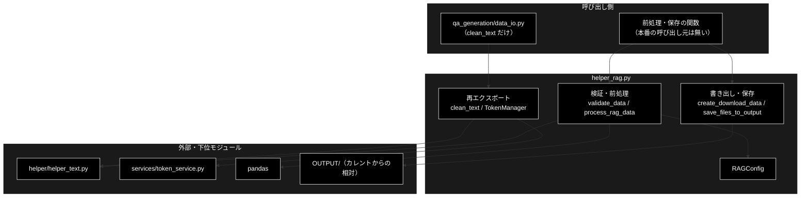
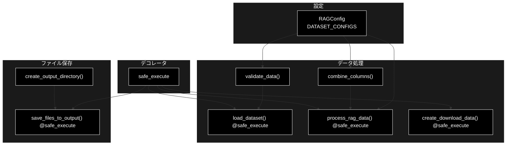
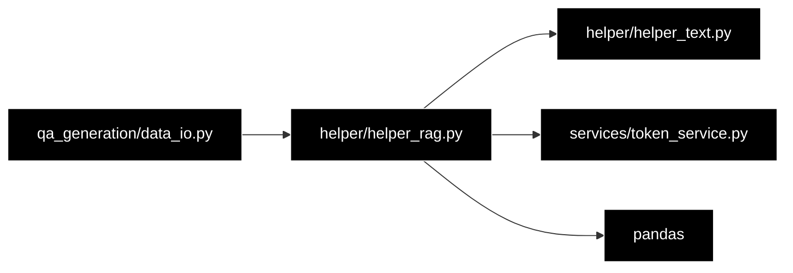

# helper_rag.py - RAG データ前処理の共通機能 ドキュメント

**Version 1.0** | 最終更新: 2026-10-11

---

## 目次

1. [概要](#概要)
2. [アーキテクチャ構成図](#1-アーキテクチャ構成図)
3. [モジュール構成図](#2-モジュール構成図)
4. [クラス・関数一覧表](#3-クラス関数一覧表)
5. [クラス・関数 IPO詳細](#4-クラス関数-ipo詳細)
6. [設定・定数](#5-設定定数)
7. [エクスポート](#6-エクスポート)
8. [変更履歴](#7-変更履歴)
9. [付録: 依存関係図](#付録-依存関係図)

---

## 概要

`helper_rag.py` は、Q&A 形式の CSV（FAQ・医療 QA・SciQ・法律 QA・TriviaQA）を RAG 用に前処理する関数群である。
データセットごとの必須列を `RAGConfig` が持ち、検証・重複除去・列の結合（`Combined_Text`）・CSV / テキストへの書き出し・
`OUTPUT/` への保存を行う。もとは Streamlit 画面の裏側だったロジックを、UI から切り離して残したもの。

> 📌 **本番から使われているのは `clean_text`（`helper/helper_text.py` の再エクスポート）だけ**（2026-10-11 に grep で確認）。
> `qa_generation/data_io.py` が `from helper.helper_rag import clean_text` で使う。
> `RAGConfig` と前処理・保存の関数は呼び出し元もテストも無い（画面〔React〕・CLI のどちらからも呼ばれない）。
> 本番の入力 CSV の読み込みは `qa_generation/data_io.py`、出力は `qa_output/` である。

### 主な責務

- データセットごとの設定（表示名・必須列・結合テンプレート・旧画面のポート）の保持
- データの検証（必須列・空値・重複行）と前処理（重複・空行の除去・セルの整形・列の結合）
- ダウンロード用の CSV 文字列・結合テキストの作成
- `OUTPUT/` への CSV・テキスト・メタデータ JSON の保存
- 例外を握りつぶして `None` を返す `safe_execute` デコレータ
- `clean_text` / `TokenManager` の再エクスポート

### 各責務対応のモジュール

| # | 責務 | 対応モジュール | 説明 |
|---|------|--------------|------|
| 1 | データセットごとの設定 | `helper_rag.py` | `RAGConfig.DATASET_CONFIGS` と 3 つのクラスメソッド |
| 2 | 検証と前処理 | `helper_rag.py` | `validate_data()` / `process_rag_data()` / `combine_columns()` / `load_dataset()` |
| 3 | ダウンロード用データの作成 | `helper_rag.py` | `create_download_data()` |
| 4 | `OUTPUT/` への保存 | `helper_rag.py` | `create_output_directory()` / `save_files_to_output()` |
| 5 | 例外を握りつぶすデコレータ | `helper_rag.py` | `safe_execute()` |
| 6 | 再エクスポート | `helper_text.py` / `services/token_service.py` | `clean_text` / `TokenManager` |

### 主要機能一覧

| 機能 | 説明 |
|------|------|
| `RAGConfig` | 5 データセットの設定表と、設定・一覧・ポートからの逆引き |
| `validate_data(df, dataset_type)` | 行数・列数・必須列・列ごとの空値・重複行を、人が読む文字列のリストで返す |
| `process_rag_data(df, dataset_type, combine_columns_option)` | 重複・全列空の行を除き、必須列のセルを整形し、`Combined_Text` 列を足す |
| `combine_columns(row, dataset_type)` | 1 行の必須列を空白でつなぐ（`medical_qa` は列名の部分一致で拾う） |
| `create_download_data(df, include_combined)` | CSV 文字列と、`Combined_Text` を 1 行 1 件にしたテキスト |
| `save_files_to_output(df, dataset_type, csv_data, text_data)` | `OUTPUT/` に CSV・テキスト・メタデータ JSON を書き、パスの辞書を返す |
| `safe_execute` | 例外をログに出して `None` を返すデコレータ |

---

## 1. アーキテクチャ構成図

### 1.1 システム全体構成



### 1.2 データフロー

1. CSV を `load_dataset()`（`pd.read_csv`）で読み、`validate_data()` の結果と一緒に受け取る
2. `process_rag_data()` が重複行・全列空の行を除き、必須列（列名の部分一致）のセルを `clean_text` で整え、`Combined_Text` を足す
3. `create_download_data()` が CSV 文字列と結合テキスト（1 行 1 件）を作る
4. `save_files_to_output()` が `OUTPUT/preprocessed_<type>.csv`・`OUTPUT/<type>.txt`・`OUTPUT/metadata_<type>.json` を書く

---

## 2. モジュール構成図

### 2.1 内部モジュール構成



### 2.2 外部依存関係

| ライブラリ | バージョン | 用途 |
|-----------|-----------|------|
| `pandas` | CI の `pip install` 行・`requirements.txt` | DataFrame の読み込み・重複除去・列の結合 |
| `io` / `json` / `pathlib` / `datetime` / `functools` / `logging` | 標準 | CSV 文字列・メタデータ JSON・パス・デコレータ・ログ |

### 2.3 内部依存モジュール

| モジュール | 用途 |
|-----------|------|
| `helper/helper_text.py` | `clean_text`（セルの整形・再エクスポート） |
| `services/token_service.py` | `TokenManager`（再エクスポートだけ。本モジュール内では使わない） |

> ⚠️ **import しただけでルートロガーの設定が変わる。** モジュールの先頭で `logging.basicConfig(level=logging.INFO)` を呼ぶため、
> 呼び出し側がまだロガーを設定していなければ、以降すべての INFO ログが標準エラーへ出る（`qa_generation/data_io.py` を import した場合も同じ）。

---

## 3. クラス・関数一覧表

### 3.1 クラス一覧

#### RAGConfig

| メソッド | 種別 | 概要 |
|---------|------|------|
| `get_config(dataset_type)` | classmethod | 設定の辞書。未知の名前なら「未知のデータセット」の既定値 |
| `get_all_datasets()` | classmethod | データセット名のリスト（5 件） |
| `get_dataset_by_port(port)` | classmethod | ポート番号から名前を逆引き（無ければ `None`） |

`TokenManager` は `services/token_service.py` のクラスをそのまま再エクスポートしたもの（`services/docs/token_service.md`）。

### 3.2 関数一覧（カテゴリ別）

#### デコレータ

| 関数名 | 概要 |
|-------|------|
| `safe_execute(func)` | 例外を `logger.error` に出して `None` を返す |

#### データ処理関数

| 関数名 | 概要 |
|-------|------|
| `clean_text(text)` | `helper_text.clean_text` の再エクスポート |
| `combine_columns(row, dataset_type)` | 1 行の必須列を空白でつなぐ |
| `validate_data(df, dataset_type=None)` | 検証結果を文字列のリストで返す |
| `load_dataset(uploaded_file, dataset_type=None)` | CSV を読み、`(df, 検証結果)` を返す（`@safe_execute`） |
| `process_rag_data(df, dataset_type, combine_columns_option=True)` | 前処理済みの DataFrame（`@safe_execute`） |
| `create_download_data(df, include_combined=True, dataset_type=None)` | `(CSV 文字列, 結合テキスト or None)`（`@safe_execute`） |

#### ファイル保存関数

| 関数名 | 概要 |
|-------|------|
| `create_output_directory()` | `OUTPUT/` を作り、書き込めるかを確かめて `Path` を返す |
| `save_files_to_output(df_processed, dataset_type, csv_data, text_data=None)` | 3 ファイルを書いてパスの辞書を返す（`@safe_execute`） |

---

## 4. クラス・関数 IPO詳細

### 4.1 使用例

前処理はメモリ上で完結する部分と、ファイルへ書く部分に分かれる。

| 処理パターン | 呼び方 | 向いている場面 | 例 |
|---|---|---|---|
| メモリ上で検証・前処理する | `validate_data` → `process_rag_data` → `create_download_data` | DataFrame を整えて文字列で受け取る | 4.1.1 |
| `OUTPUT/` へ保存する | `process_rag_data` → `create_download_data` → `save_files_to_output` | 前処理結果をファイルに残す | 4.1.2 |
| 設定を引く・失敗を確かめる | `RAGConfig.*` / `load_dataset` / `@safe_execute` | データセットの必須列を知る・例外が `None` になることを知る | 4.1.3 |

> 📝 3 本とも**別プロセスでそのまま実行し**、出力を確かめてある（2026-10-11・リポジトリ直下で実行。4.1.2 は例の中で一時ディレクトリへ移る）。
> 本番の入力 CSV の整形（`qa_generation/data_io.py`）が使うのは `clean_text` だけで、その例は `helper_text.md` §4.2 にある。

#### 4.1.1 基本的なワークフロー（メモリ上で検証・前処理する）

```python
import pandas as pd
from helper.helper_rag import validate_data, process_rag_data, create_download_data

df = pd.DataFrame({
    "question": ["住民票の写しは？", "住民票の写しは？", "  返品の期限は？\n", None],
    "answer":   ["窓口で取れます。", "窓口で取れます。", "30日以内です。", None],
})
for line in validate_data(df, "customer_support_faq"):
    print(line)
out = process_rag_data(df, "customer_support_faq")        # 重複 1 行・全列空 1 行を除き、Combined_Text を足す
print(out.to_dict("records"))
csv_data, text_data = create_download_data(out)
print(csv_data.splitlines()[0])
print(text_data)
```

```
# 出力例:
# 総行数: 4
# 総列数: 2
# ✅ 必須列確認済み: ['question', 'answer']
# question列: 空値 1個 (25.0%)
# answer列: 空値 1個 (25.0%)
# ⚠️ 重複行: 1個
# [{'question': '住民票の写しは？', 'answer': '窓口で取れます。', 'Combined_Text': '住民票の写しは？ 窓口で取れます。'}, {'question': '返品の期限は？', 'answer': '30日以内です。', 'Combined_Text': '返品の期限は？ 30日以内です。'}]
# question,answer,Combined_Text
# 住民票の写しは？ 窓口で取れます。
# 返品の期限は？ 30日以内です。
```

> ⚠️ 必須列の照合は**列名の部分一致**（大文字小文字を無視・両方向）。`question` の検査に `question_id` のような列が先に当たると、そちらを必須列とみなす（§4.4 `validate_data`）。
> 重複の判定は**整形の前**に行うので、空白や改行だけが違う行は重複として除かれない。

#### 4.1.2 `OUTPUT/` へ保存する

```python
import os, tempfile
import pandas as pd
from helper.helper_rag import process_rag_data, create_download_data, save_files_to_output

os.chdir(tempfile.mkdtemp())   # カレントの OUTPUT/ に書くので、例では空の一時ディレクトリへ移る
df = process_rag_data(pd.DataFrame({"question": ["返品の期限は？"], "answer": ["30日以内です。"]}), "customer_support_faq")
csv_data, text_data = create_download_data(df)
saved = save_files_to_output(df, "customer_support_faq", csv_data, text_data)
print(saved)
print(sorted(os.listdir("OUTPUT")))
```

```
# 出力例:
# {'csv': 'OUTPUT/preprocessed_customer_support_faq.csv', 'txt': 'OUTPUT/customer_support_faq.txt', 'metadata': 'OUTPUT/metadata_customer_support_faq.json'}
# ['customer_support_faq.txt', 'metadata_customer_support_faq.json', 'preprocessed_customer_support_faq.csv']
```

> ⚠️ **保存先はカレントディレクトリの `OUTPUT/`**（`Path("OUTPUT")`）。リポジトリ直下で呼ぶと、チャンク化の入力置き場
> （`OUTPUT/`。CLAUDE.md §8.2）に `preprocessed_<type>.csv` などを書き、**同名のファイルは上書きする**（日時は付かない）。
> メタデータの `processing_info.original_rows` / `removed_rows` は常に 0（UI のセッション状態に頼っていた名残）。

#### 4.1.3 設定を引く・失敗を確かめる

```python
from helper.helper_rag import RAGConfig, load_dataset, safe_execute

print(RAGConfig.get_all_datasets())
print(RAGConfig.get_config("medical_qa")["required_columns"], RAGConfig.get_config("unknown")["name"])
print(RAGConfig.get_dataset_by_port(8505))
print(load_dataset("no_such_file.csv"))   # 例外は握りつぶして None

@safe_execute
def divide(a, b):
    return a / b
print(divide(1, 0))
```

```
# 出力例（標準出力）:
# ['customer_support_faq', 'medical_qa', 'sciq_qa', 'legal_qa', 'trivia_qa']
# ['Question', 'Complex_CoT', 'Response'] 未知のデータセット
# legal_qa
# None
# None
# 出力例（標準エラー。import 時の basicConfig による）:
# ERROR:helper.helper_rag:Error in load_dataset: [Errno 2] No such file or directory: 'no_such_file.csv'
# ERROR:helper.helper_rag:Error in divide: division by zero
```

> ⚠️ **`@safe_execute` の付いた関数（`load_dataset` / `process_rag_data` / `create_download_data` / `save_files_to_output`）は、
> 失敗しても例外を出さず `None` を返す。** `df, issues = load_dataset(...)` のように受けると、失敗時は
> `TypeError: cannot unpack non-iterable NoneType object` になり、本当の原因はログにしか残らない。戻り値が `None` かを先に確かめること。

---

### 4.2 RAGConfig クラス

**概要**: データセットごとの設定（表示名・アイコン・必須列・説明・結合テンプレート・旧 Streamlit 画面のポート）を持つ。インスタンスは作らず、クラスメソッドで引く。

```python
class RAGConfig:
    DATASET_CONFIGS: Dict[str, Dict[str, Any]]
```

#### メソッド: `get_config`

```python
@classmethod
def get_config(cls, dataset_type: str) -> Dict[str, Any]
```

| パラメータ | 型 | デフォルト | 説明 |
|------------|------|-----------|------|
| `dataset_type` | `str` | 必須 | `DATASET_CONFIGS` のキー |

| 項目 | 内容 |
|------|------|
| **Input** | `dataset_type` |
| **Process** | `DATASET_CONFIGS.get(dataset_type, 既定値)` |
| **Output** | `Dict[str, Any]`: `name` / `icon` / `required_columns` / `description` / `combine_template` / `port`。未知の名前は `required_columns=[]`・`port=8500` の既定値 |

**戻り値例**:

```python
{"name": "カスタマーサポート・FAQ", "icon": "💬", "required_columns": ["question", "answer"],
 "description": "カスタマーサポートFAQデータセット", "combine_template": "{question} {answer}", "port": 8501}
```

```python
# 使用例
from helper.helper_rag import RAGConfig
print(RAGConfig.get_config("sciq_qa")["required_columns"])
# ['question', 'correct_answer']
```

#### メソッド: `get_all_datasets` / `get_dataset_by_port`

| メソッド | Input | Process | Output |
|---------|-------|---------|--------|
| `get_all_datasets()` | なし | `list(DATASET_CONFIGS.keys())` | `List[str]`（5 件） |
| `get_dataset_by_port(port)` | `port: int` | 各設定の `port` と比べる | `Optional[str]`（無ければ `None`） |

```python
# 使用例
from helper.helper_rag import RAGConfig
print(len(RAGConfig.get_all_datasets()), RAGConfig.get_dataset_by_port(9999))
# 5 None
```

---

### 4.3 デコレータ

#### `safe_execute`

**概要**: 包んだ関数の例外を捕まえ、`logger.error("Error in <関数名>: <例外>")` を出して `None` を返す。

```python
def safe_execute(func) -> Callable
```

| 項目 | 内容 |
|------|------|
| **Input** | `func`: 包む関数 |
| **Process** | `try: return func(*args, **kwargs)` / `except Exception: logger.error(...); return None`（`functools.wraps` で名前を保つ） |
| **Output** | 包んだ関数。成功時は元の戻り値、失敗時は `None` |

**戻り値例**:

```python
None   # 例外が起きたとき
```

```python
# 使用例
from helper.helper_rag import safe_execute

@safe_execute
def parse(s):
    return int(s)
print(parse("12"), parse("x"))
# 12 None
```

---

### 4.4 データ処理関数

#### `combine_columns`

**概要**: 1 行（`pd.Series`）の必須列の値を `clean_text` で整え、空でないものを空白でつなぐ。`medical_qa` は列名に `question` / `cot` / `response` を含む列を拾ってつなぐ。

```python
def combine_columns(row: pd.Series, dataset_type: str) -> str
```

| パラメータ | 型 | デフォルト | 説明 |
|------------|------|-----------|------|
| `row` | `pd.Series` | 必須 | DataFrame の 1 行 |
| `dataset_type` | `str` | 必須 | `RAGConfig` のキー |

| 項目 | 内容 |
|------|------|
| **Input** | `row`・`dataset_type` |
| **Process** | 1. `required_columns` のうち `row.index` に**完全一致**する列の値を整えて集める<br>2. `medical_qa` なら、列名の部分一致で `question` / `complex_cot`（`cot` を含む）/ `response` を拾い、空でなければそれを返す<br>3. それ以外は 1. の値を空白でつなぐ |
| **Output** | `str`: 結合したテキスト（`combine_template` は使っていない） |

**戻り値例**:

```python
'住民票の写しは？ 窓口で取れます。'
```

```python
# 使用例
import pandas as pd
from helper.helper_rag import combine_columns
print(combine_columns(pd.Series({"question": "Q", "answer": "A"}), "legal_qa"))
# Q A
```

#### `validate_data`

**概要**: 行数・列数・必須列の有無・列ごとの空値・重複行を調べ、人が読む文字列のリストで返す（例外にはしない）。

```python
def validate_data(df: pd.DataFrame, dataset_type: str = None) -> List[str]
```

| パラメータ | 型 | デフォルト | 説明 |
|------------|------|-----------|------|
| `df` | `pd.DataFrame` | 必須 | 検証する DataFrame |
| `dataset_type` | `str` | `None` | 指定すると必須列も調べる |

| 項目 | 内容 |
|------|------|
| **Input** | `df`・`dataset_type` |
| **Process** | 1. 総行数・総列数を足す<br>2. `dataset_type` があれば、必須列ごとに列名の部分一致（大文字小文字を無視。必須列名 ⊂ 列名、または列名 ⊂ 必須列名）で探し、不足なら `⚠️ 必須列が不足`、全部あれば `✅ 必須列確認済み`<br>3. 列ごとに `NaN` と空文字の数を数え、1 以上なら件数と割合<br>4. `df.duplicated()` の数 |
| **Output** | `List[str]`: 検証結果の行 |

**戻り値例**:

```python
['総行数: 4', '総列数: 2', "✅ 必須列確認済み: ['question', 'answer']", 'question列: 空値 1個 (25.0%)', '⚠️ 重複行: 1個']
```

```python
# 使用例
import pandas as pd
from helper.helper_rag import validate_data
print(validate_data(pd.DataFrame({"q": ["x"]}), "legal_qa")[2])
# ⚠️ 必須列が不足: ['answer']
```

> ⚠️ 列 `q` が必須列 `question` を満たしたことになる。部分一致は**両方向**（必須列名が列名に含まれる、**または列名が必須列名に含まれる**）なので、
> 短い列名ほど誤って当たる。

#### `load_dataset`

**概要**: `pd.read_csv(uploaded_file)` で読み、`validate_data` の結果と組にして返す。失敗時は `None`（`@safe_execute`）。

```python
@safe_execute
def load_dataset(uploaded_file, dataset_type: str = None) -> Tuple[pd.DataFrame, List[str]]
```

| パラメータ | 型 | デフォルト | 説明 |
|------------|------|-----------|------|
| `uploaded_file` | パス / ファイルオブジェクト | 必須 | `pd.read_csv` に渡せるもの |
| `dataset_type` | `str` | `None` | `validate_data` に渡す |

| 項目 | 内容 |
|------|------|
| **Input** | `uploaded_file`・`dataset_type` |
| **Process** | `pd.read_csv` → `validate_data` → 件数を INFO ログ |
| **Output** | `Tuple[pd.DataFrame, List[str]]`。失敗時は `None` |

**戻り値例**:

```python
(DataFrame(2 行), ['総行数: 2', '総列数: 2', ...])
```

```python
# 使用例
import io
from helper.helper_rag import load_dataset
df, issues = load_dataset(io.StringIO("question,answer\nQ,A\n"), "legal_qa")
print(len(df), issues[0])
# 1 総行数: 1
```

#### `process_rag_data`

**概要**: 重複行と全列が空の行を除き、必須列（列名の部分一致）のセルを `clean_text` で整え、`combine_columns_option` が真なら `Combined_Text` 列を足して空のものを除く。

```python
@safe_execute
def process_rag_data(df: pd.DataFrame, dataset_type: str, combine_columns_option: bool = True) -> pd.DataFrame
```

| パラメータ | 型 | デフォルト | 説明 |
|------------|------|-----------|------|
| `df` | `pd.DataFrame` | 必須 | 入力（書き換えない。コピーして処理する） |
| `dataset_type` | `str` | 必須 | `RAGConfig` のキー |
| `combine_columns_option` | `bool` | `True` | `Combined_Text` 列を足すか |

| 項目 | 内容 |
|------|------|
| **Input** | `df`・`dataset_type`・`combine_columns_option` |
| **Process** | 1. `drop_duplicates()` → `dropna(how='all')` → `reset_index(drop=True)`<br>2. 列名が必須列と部分一致する列に `clean_text` を適用<br>3. 必要なら `combine_columns` で `Combined_Text` を作り、空白だけの行を除く |
| **Output** | `pd.DataFrame`。失敗時は `None` |

**戻り値例**:

```python
#            question         answer          Combined_Text
# 0  住民票の写しは？  窓口で取れます。  住民票の写しは？ 窓口で取れます。
```

```python
# 使用例
import pandas as pd
from helper.helper_rag import process_rag_data
print(list(process_rag_data(pd.DataFrame({"question": ["Q"], "answer": ["A"]}), "legal_qa", False).columns))
# ['question', 'answer']
```

#### `create_download_data`

**概要**: DataFrame を CSV 文字列にし、`Combined_Text` 列があれば空でない値を改行でつないだテキストも作る。

```python
@safe_execute
def create_download_data(df: pd.DataFrame, include_combined: bool = True, dataset_type: str = None) -> Tuple[str, Optional[str]]
```

| パラメータ | 型 | デフォルト | 説明 |
|------------|------|-----------|------|
| `df` | `pd.DataFrame` | 必須 | 書き出す DataFrame |
| `include_combined` | `bool` | `True` | 結合テキストを作るか |
| `dataset_type` | `str` | `None` | 使っていない（互換のための引数） |

| 項目 | 内容 |
|------|------|
| **Input** | `df`・`include_combined` |
| **Process** | 1. `df.to_csv(index=False)` を文字列で受ける<br>2. `include_combined` かつ `Combined_Text` 列があれば、空でない値を `\n` でつなぐ |
| **Output** | `Tuple[str, Optional[str]]`。結合テキストが無ければ 2 つ目は `None`。失敗時は全体が `None` |

**戻り値例**:

```python
('question,answer,Combined_Text\n...', '住民票の写しは？ 窓口で取れます。\n返品の期限は？ 30日以内です。')
```

```python
# 使用例
import pandas as pd
from helper.helper_rag import create_download_data
print(create_download_data(pd.DataFrame({"q": [1]})))
# ('q\n1\n', None)
```

---

### 4.5 ファイル保存関数

#### `create_output_directory`

**概要**: カレントに `OUTPUT/` を作り、試しにファイルを書いて消すことで書き込めるかを確かめる。

```python
def create_output_directory() -> Path
```

| 項目 | 内容 |
|------|------|
| **Input** | なし（カレントディレクトリ） |
| **Process** | 1. `Path("OUTPUT").mkdir(exist_ok=True)`<br>2. `OUTPUT/.test_write` を書いて消す。失敗したら `PermissionError`<br>3. 例外はログに出して**そのまま送出**（`@safe_execute` は付いていない） |
| **Output** | `Path("OUTPUT")` |

**戻り値例**:

```python
PosixPath('OUTPUT')
```

```python
# 使用例
import os, tempfile
from helper.helper_rag import create_output_directory
os.chdir(tempfile.mkdtemp())
print(create_output_directory())
# OUTPUT
```

#### `save_files_to_output`

**概要**: `OUTPUT/` に前処理済み CSV・結合テキスト・メタデータ JSON を書き、書いたファイルのパスを辞書で返す。

```python
@safe_execute
def save_files_to_output(df_processed, dataset_type: str, csv_data: str, text_data: str = None) -> Dict[str, str]
```

| パラメータ | 型 | デフォルト | 説明 |
|------------|------|-----------|------|
| `df_processed` | `pd.DataFrame` | 必須 | 行数をメタデータに書くために使う |
| `dataset_type` | `str` | 必須 | ファイル名に入る |
| `csv_data` | `str` | 必須 | `create_download_data` の 1 つ目 |
| `text_data` | `str` | `None` | `create_download_data` の 2 つ目（空なら書かない） |

| 項目 | 内容 |
|------|------|
| **Input** | 上の 4 つ |
| **Process** | 1. `create_output_directory()`<br>2. `OUTPUT/preprocessed_<type>.csv` に `csv_data`<br>3. `text_data` が空でなければ `OUTPUT/<type>.txt`<br>4. `OUTPUT/metadata_<type>.json`（`dataset_type` / `processed_rows` / `processing_timestamp` / `created_at` / `files_created` / `processing_info`） |
| **Output** | `Dict[str, str]`: `csv` / `txt` / `metadata` → パス。失敗時は `None` |

**戻り値例**:

```python
{'csv': 'OUTPUT/preprocessed_customer_support_faq.csv', 'txt': 'OUTPUT/customer_support_faq.txt', 'metadata': 'OUTPUT/metadata_customer_support_faq.json'}
```

```python
# 使用例は §4.1.2（同名ファイルは上書きされる）
```

---

## 5. 設定・定数

### 5.1 DATASET_CONFIGS

| キー | 表示名 | 必須列 | ポート |
|------|-------|-------|-------|
| `customer_support_faq` | カスタマーサポート・FAQ | `question` / `answer` | 8501 |
| `medical_qa` | 医療QAデータ | `Question` / `Complex_CoT` / `Response` | 8503 |
| `sciq_qa` | 科学・技術QA（SciQ） | `question` / `correct_answer` | 8504 |
| `legal_qa` | 法律・判例QA | `question` / `answer` | 8505 |
| `trivia_qa` | 雑学QA（TriviaQA） | `question` / `answer` | 8506 |

> 📝 `port` は廃止した Streamlit 画面ごとのポート番号の名残で、今は何も起動しない（本リポジトリに Streamlit は無い）。
> `combine_template` は定義されているが、どの関数も使っていない（結合は `combine_columns` が空白でつなぐ）。

### 5.2 既知の制約

| # | 制約 | 状態 |
|---|------|------|
| 1 | import 時に `logging.basicConfig(level=logging.INFO)` を呼び、ルートロガーの設定を変える | 実装どおり（§2.3） |
| 2 | `@safe_execute` の付いた 4 関数は失敗を `None` で返し、例外を出さない | 実装どおり（§4.1.3） |
| 3 | 保存先はカレントの `OUTPUT/` で、同名ファイルを上書きする | 実装どおり（§4.1.2） |
| 4 | `clean_text` 以外は呼び出し元もテストも無い | 2026-10-11 時点 |

---

## 6. エクスポート

```python
__all__ = [
    'RAGConfig', 'TokenManager',
    'safe_execute',
    'clean_text', 'combine_columns', 'validate_data', 'load_dataset', 'process_rag_data', 'create_download_data',
    'create_output_directory', 'save_files_to_output',
]
```

---

## 7. 変更履歴

| バージョン | 日付 | 変更内容 |
|-----------|------|---------|
| 1.0 | 2026-10-11 | 初版。`helper/docs/` の新設にあわせて作成（`a_class_method_md_format.md` 準拠）。§4.1 の使用例 3 本を別プロセスで実行して出力を確かめ、import 時の `basicConfig`・`@safe_execute` が失敗を `None` にすること・`OUTPUT/` の上書きを §5.2 に記録した |

---

## 付録: 依存関係図


