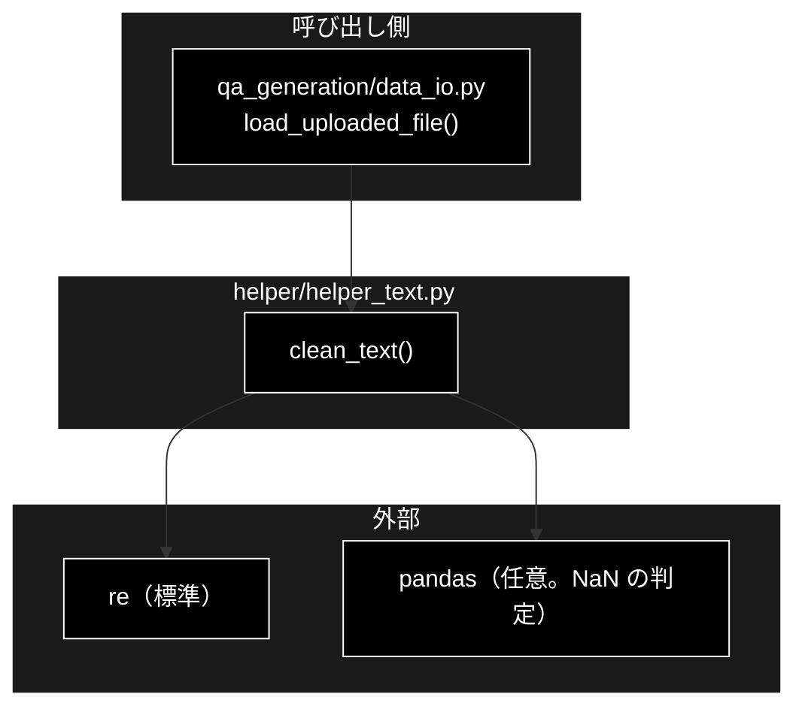
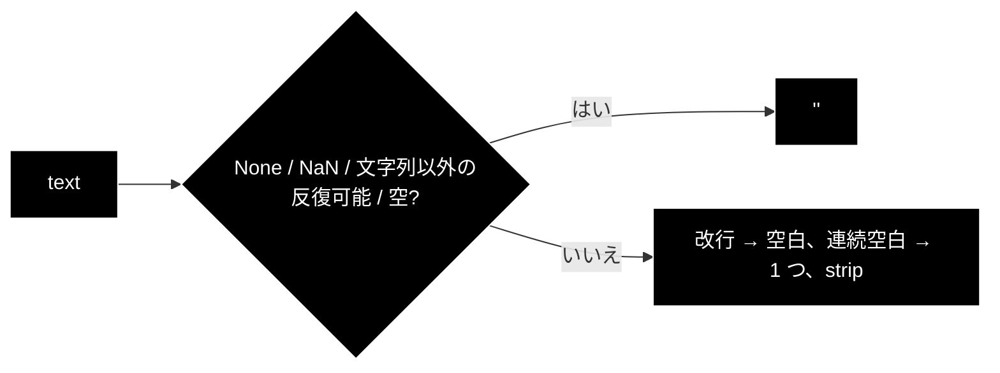
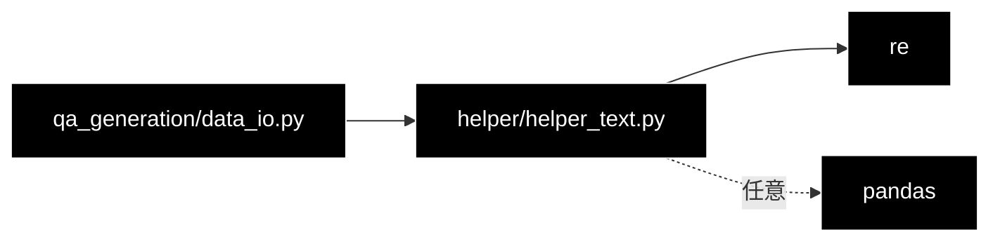

# helper_text.py - テキストのクレンジング ドキュメント

**Version 2.1** | 最終更新: 2026-10-13

---

## 目次

1. [概要](#概要)
2. [アーキテクチャ構成図](#1-アーキテクチャ構成図)
3. [モジュール構成図](#2-モジュール構成図)
4. [クラス・関数一覧表](#3-クラス関数一覧表)
5. [クラス・関数 IPO詳細](#4-クラス関数-ipo詳細)
6. [既知の制約](#5-既知の制約)
7. [エクスポート](#6-エクスポート)
8. [変更履歴](#7-変更履歴)
9. [付録: 依存関係図](#付録-依存関係図)

---

## 概要

`helper_text.py` は、セルや入力文の改行・空白を整える **`clean_text()` 1 関数だけのモジュール**である。
`qa_generation/data_io.py` が、Q/A 生成の入力 CSV（`load_uploaded_file()`）の本文を整えるのに使う。

> 📌 **2026-10-11 に、呼び出し元の無かった関数を削除した**（日本語の正規化・文分割・トークン数でのチャンク分割・小さいチャンクの結合・
> 複雑さの分析・キーワード抽出・切り詰め・統計・`count_tokens_tiktoken` などの互換エイリアス）。あわせて、`clean_text` を再エクスポートしていただけの
> `helper/helper_rag.py` を削除し、`qa_generation/data_io.py` は本モジュールから直接 import するようにした。
> 削除前の内容は git 履歴（旧 `archive/helper_rag.md`・本書 v1.0）に残る。本番のチャンク分割は `chunking/` が担当する。

### 主な責務

- 入力テキストのクレンジング（改行・連続空白・前後の空白、欠損値の空文字化）

### 各責務対応のモジュール

| # | 責務 | 対応モジュール | 説明 |
|---|------|--------------|------|
| 1 | 入力テキストのクレンジング | `helper_text.py` | `clean_text()` |

### 主要機能一覧

| 機能 | 説明 |
|------|------|
| `clean_text(text)` | 改行を空白に、連続空白を 1 つにし、前後を削る。`None` / `NaN` / 文字列以外の反復可能オブジェクトは `""` |

---

## 1. アーキテクチャ構成図

### 1.1 システム全体構成



### 1.2 データフロー

1. `qa_generation/data_io.py` が入力 CSV の各セルを、欠損でなければ `clean_text(str(x))` で整える
2. 整えた本文が Q/A 生成の入力になる

---

## 2. モジュール構成図

### 2.1 内部モジュール構成



### 2.2 外部依存関係

| ライブラリ | 必須 | 用途 |
|-----------|:---:|------|
| `re`（標準） | ✅ | 連続空白の正規化 |
| `pandas` | 任意 | `NaN` の判定（関数の中で import。無ければ判定を飛ばす） |

---

## 3. クラス・関数一覧表

| 関数 | 概要 |
|------|------|
| `clean_text(text: str) -> str` | 改行・連続空白・前後空白の除去。`None` / `NaN` / リスト等は `""` |

---

## 4. クラス・関数 IPO詳細

### 4.1 使用例

| # | パターン | いつ使うか | 例 |
|---|---------|-----------|----|
| 1 | **基本**: 1 つの文字列を整える | 入力文・セルの改行と空白を整える | 4.1.1 |
| 2 | 本番と同じ使い方: DataFrame の列を整える | CSV の本文列（欠損を含む） | 4.1.2 |

> 📝 **確かめ方（2026-10-11）**: 4.1.1・4.1.2 を実行した（外部サービス不要）。

#### 4.1.1 基本: 1 つの文字列を整える

```python
from helper.helper_text import clean_text

print(repr(clean_text("  住民票の\n写し  \r\n手数料は　300円です。  ")))
print(repr(clean_text("“引用”と‘単引用’")))
print(repr(clean_text(None)), repr(clean_text(float("nan"))), repr(clean_text(["a"])), repr(clean_text(123)))

# 実行結果:
# '住民票の 写し 手数料は 300円です。'
# '“引用”と‘単引用’'
# '' '' '' '123'
```

> 📌 全角スペース（U+3000）も `\s` に含まれるので、半角の空白 1 つになる。引用符は変わらない（§5 の 1）。数値などは `str()` にしてから整える。

#### 4.1.2 本番と同じ使い方: DataFrame の列を整える

```python
import pandas as pd
from helper.helper_text import clean_text

df = pd.DataFrame({"question": ["  Q1\n続き ", None]})
print(df["question"].map(clean_text).tolist())

# 実行結果:
# ['Q1 続き', '']
```

> 📌 `qa_generation/data_io.py` は、欠損を自前の `_is_missing()` で先に `""` にしてから `clean_text(str(x))` を呼ぶ。

### 4.2 `clean_text`

```python
def clean_text(text: str) -> str
```

| パラメータ | 型 | デフォルト | 説明 |
|------------|------|-----------|------|
| `text` | `str`（実際は任意） | 必須 | 整える値。CSV のセル（`NaN` を含む）を想定 |

| 項目 | 内容 |
|------|------|
| **Input** | `text`: 文字列・`None`・`NaN`・その他 |
| **Process** | 1. `None` か、文字列以外で `__iter__` を持つ値（リスト等）なら `""`<br>2. pandas が import できれば `pd.isna(text)` が真のとき `""`<br>3. `""` ならそのまま `""`<br>4. `str()` にして `\n` / `\r` を空白へ、`\s+` を 1 つの空白へ、前後を `strip()`<br>5. 引用符の置換（実質は何もしない。§5 の 1） |
| **Output** | `str`: 整えた文字列 |

使用例は 4.1.1・4.1.2。

---

## 5. 既知の制約

| # | 内容 | 状態 |
|---|------|------|
| 1 | 「引用符の正規化」は何もしない。1 行目は `'"'` を `'"'` に置き換えており（全角の引用符が失われている）、2 行目は `'''` が三重引用符として読まれ、`, "'").replace(` という文字列を置き換えている | 実装どおり（2026-10-11 に確認）。呼び出し元（`qa_generation/data_io.py`）は引用符の変換を当てにしていない |
| 2 | 直接のテストは無い | 2026-10-11 時点（`qa_generation` の読み込みのテストが間接的に通る） |

---

## 6. エクスポート

`__all__` は定義していない。公開している名前は `clean_text` だけ（ほかに `re` が入る）。

```python
from helper.helper_text import clean_text
```

---

## 7. 変更履歴

| バージョン | 日付 | 変更内容 |
|---|---|---|
| 1.0 | 2026-10-11 | 初版。`helper/docs/` の新設にあわせて作成（`a_class_method_md_format.md` 準拠）。§4.1 の使用例 4 本を本物の `cl100k_base` で実行して出力を確かめ、`clean_text` の引用符の正規化が効いていないこと・`overlap >= chunk_size` の無限ループ・`truncate_text` の文字化けを §5.3 に記録した |
| 2.0 | 2026-10-11 | 呼び出し元の無かった関数・互換エイリアスと、`clean_text` の再エクスポート元だった `helper/helper_rag.py` を削除したのに合わせて書き直した。`clean_text()` だけの文書にし、§4.1 の使用例 2 本を実行して確かめた |
| 2.1 | 2026-10-13 | docs/archive/ を削除したのに追随（旧文書への参照を「2026-10-13 に削除。git 履歴に残る」へ） |

---

## 付録: 依存関係図


