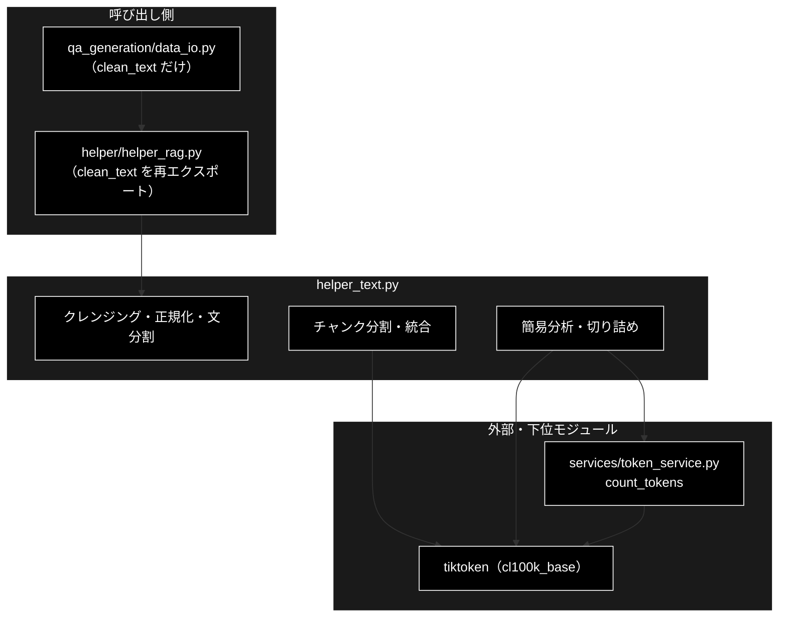
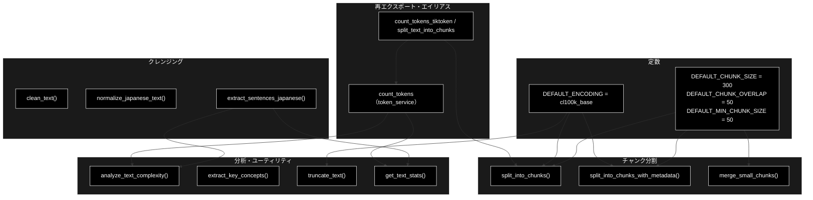

# helper_text.py - テキスト処理ユーティリティ ドキュメント

**Version 1.0** | 最終更新: 2026-10-11

---

## 目次

1. [概要](#概要)
2. [アーキテクチャ構成図](#1-アーキテクチャ構成図)
3. [モジュール構成図](#2-モジュール構成図)
4. [クラス・関数一覧表](#3-クラス関数一覧表)
5. [クラス・関数 IPO詳細](#4-クラス関数-ipo詳細)
6. [設定・定数](#5-設定定数)
7. [エクスポート](#6-エクスポート)
8. [変更履歴](#7-変更履歴)
9. [付録: 依存関係図](#付録-依存関係図)

---

## 概要

`helper_text.py` は、テキストのクレンジング・日本語の正規化と文分割・トークン数でのチャンク分割・簡易な統計を
まとめた**関数だけのモジュール**である。トークン数は tiktoken の `cl100k_base` で数える。

> 📌 **本番から使われているのは `clean_text()` だけ**（2026-10-11 に grep で確認）。
> `helper/helper_rag.py` が import し、`qa_generation/data_io.py` が `from helper.helper_rag import clean_text` で使う
> （Q/A 生成の入力 CSV の整形）。ほかの関数は本番の呼び出し元が無い（テストは `tests/qa_generation/test_structure.py` が `merge_small_chunks` を使うだけ）。
> 本番のチャンク分割は `chunking/`（LLM による意味単位の分割）が担当し、本モジュールの `split_into_chunks*` は使っていない。

### 主な責務

- 入力テキストのクレンジング（改行・連続空白・`None` / `NaN` の吸収）
- 日本語テキストの正規化と文分割
- トークン数（`cl100k_base`）での固定長チャンク分割と、小さいチャンクの統合
- テキストの簡易分析（複雑度・キーコンセプト・統計）とトークン数での切り詰め
- 旧名称の互換エイリアスとトークン数の再エクスポート

### 各責務対応のモジュール

| # | 責務 | 対応モジュール | 説明 |
|---|------|--------------|------|
| 1 | 入力テキストのクレンジング | `helper_text.py` | `clean_text()` |
| 2 | 日本語の正規化と文分割 | `helper_text.py` | `normalize_japanese_text()` / `extract_sentences_japanese()` |
| 3 | トークン数でのチャンク分割と統合 | `helper_text.py` | `split_into_chunks()` / `split_into_chunks_with_metadata()` / `merge_small_chunks()` |
| 4 | 簡易分析と切り詰め | `helper_text.py` | `analyze_text_complexity()` / `extract_key_concepts()` / `get_text_stats()` / `truncate_text()` |
| 5 | 互換エイリアスと再エクスポート | `helper_text.py`（`services/token_service.py` を再エクスポート） | `count_tokens` / `count_tokens_tiktoken` / `split_text_into_chunks` |

### 主要機能一覧

| 機能 | 説明 |
|------|------|
| `clean_text(text)` | 改行を空白に、連続空白を 1 つにし、前後を削る。`None` / `NaN` / 文字列以外の反復可能オブジェクトは `""` |
| `normalize_japanese_text(text)` | 全角英数記号（U+FF01〜U+FF5E）と全角スペースを半角に、連続する「。」「、」を 1 つに |
| `extract_sentences_japanese(text)` | 「。！？!?」で文に分け、文末記号を前の文に付ける |
| `split_into_chunks(text, chunk_size, overlap)` | トークン数で固定長に分け、`overlap` トークンずつ重ねる |
| `split_into_chunks_with_metadata(text, doc_id, ...)` | 上と同じ分け方で、`id` / `tokens` / `position` 付きの辞書を返す |
| `merge_small_chunks(chunks, min_tokens, max_tokens)` | `min_tokens` 未満のチャンクを、同じ `doc_id` の次のチャンクと結合する |
| `analyze_text_complexity(text)` | 文数・平均文長・トークン数から `low` / `medium` / `high` を判定 |
| `extract_key_concepts(text, max_concepts)` | 漢字・かなの 2 文字以上の連なりを先頭から拾う（形態素解析はしない） |
| `truncate_text(text, max_tokens, add_ellipsis)` | 先頭 `max_tokens` トークンで切り詰める |
| `get_text_stats(text)` | 文字数・トークン数・語数（空白と句読点で分けた数）・文数 |

---

## 1. アーキテクチャ構成図

### 1.1 システム全体構成



### 1.2 データフロー

1. `qa_generation/data_io.py` が入力 CSV の各セルを `clean_text()`（`helper_rag` 経由）で整形する
2. チャンク分割・切り詰めは、テキストを `cl100k_base` でトークン列にし、位置で切ってから文字列へ戻す
3. 分析系（`analyze_text_complexity` / `get_text_stats`）は `services.token_service.count_tokens` でトークン数を数える
4. どの関数もファイルや外部 API には触れない（tiktoken の符号表を初回に取りに行くことを除く。§5.2）

---

## 2. モジュール構成図

### 2.1 内部モジュール構成



### 2.2 外部依存関係

| ライブラリ | バージョン | 用途 |
|-----------|-----------|------|
| `tiktoken` | CI の `pip install` 行・`requirements.txt` | `cl100k_base` でのトークン化（チャンク分割・切り詰め） |
| `pandas` | 任意 | `clean_text()` の `NaN` 判定（import できなければ判定を飛ばす） |
| `re` / `logging` | 標準 | 正規表現・ロガー |

### 2.3 内部依存モジュール

| モジュール | 用途 |
|-----------|------|
| `services/token_service.py` | `count_tokens`（再エクスポート。分析系の関数が使う） |

> ⚠️ `services` を import すると `services/config_service.py` がカレントの `config.yml` を読む
> （無ければ「設定ファイルが見つかりません: config.yml」と表示して既定値で動く）。
> 本モジュールを import しただけでもこの表示が出るのはこのため（`services/docs/README_services.md` §2.3）。

---

## 3. クラス・関数一覧表

### 3.1 クラス一覧

本モジュールにクラスは無い（関数だけのモジュール）。

### 3.2 関数一覧（カテゴリ別）

#### クレンジング関数

| 関数名 | 概要 |
|-------|------|
| `clean_text(text)` | 改行・連続空白・前後空白の除去。`None` / `NaN` / リスト等は `""` |
| `normalize_japanese_text(text)` | 全角英数記号・全角スペースを半角に、連続する句読点を 1 つに |
| `extract_sentences_japanese(text)` | 日本語の文末記号で文に分ける |

#### チャンク分割関数

| 関数名 | 概要 |
|-------|------|
| `split_into_chunks(text, chunk_size=300, overlap=50, encoding_name="cl100k_base")` | トークン数で固定長に分ける（文字列のリスト） |
| `split_into_chunks_with_metadata(text, doc_id, chunk_size=300, overlap=50, encoding_name="cl100k_base")` | 同じ分け方で、メタデータ付きの辞書のリスト |
| `merge_small_chunks(chunks, min_tokens=50, max_tokens=600)` | 小さいチャンクを次のチャンクと結合する |

#### 分析・ユーティリティ関数

| 関数名 | 概要 |
|-------|------|
| `analyze_text_complexity(text)` | 複雑度（`low` / `medium` / `high`）と文数・平均文長・トークン数 |
| `extract_key_concepts(text, max_concepts=5)` | 漢字・かなの連なりを先頭から最大 `max_concepts` 個 |
| `truncate_text(text, max_tokens=1000, add_ellipsis=True)` | 先頭 `max_tokens` トークンで切り詰める |
| `get_text_stats(text)` | 文字数・トークン数・語数・文数・平均語長 |

#### 再エクスポート・互換エイリアス

| 名前 | 実体 |
|-------|------|
| `count_tokens` | `services.token_service.count_tokens`（同じ関数オブジェクト） |
| `count_tokens_tiktoken` | `count_tokens` の別名 |
| `split_text_into_chunks` | `split_into_chunks` の別名 |

---

## 4. クラス・関数 IPO詳細

### 4.1 使用例

`helper_text` の関数はどれも**副作用の無い純関数**（入力の文字列を受けて、新しい値を返す）。使い方は目的で分かれる。

| 処理パターン | 呼び方 | 向いている場面 | 例 |
|---|---|---|---|
| 整える・文に分ける | `clean_text` → `normalize_japanese_text` → `extract_sentences_japanese` | CSV のセルや入力文を整える（本番は `clean_text` だけ） | 4.1.1 |
| トークン数で分ける | `split_into_chunks` / `split_into_chunks_with_metadata` → `merge_small_chunks` | 固定長のチャンクが欲しい（本番のチャンク化は `chunking/`） | 4.1.2 |
| 測る・切り詰める | `analyze_text_complexity` / `extract_key_concepts` / `truncate_text` | プロンプトに入れる前の見積もり | 4.1.3 |
| 落とし穴の確認 | `clean_text` の引用符・型、互換エイリアス | 既存コードを読むとき | 4.1.4 |

> 📝 4 本とも**別プロセスでそのまま実行し**、出力を確かめてある（2026-10-11・リポジトリ直下で実行）。
> トークン数は本物の `cl100k_base` の値（この VM はプロキシで符号表の配布元に届かないため、npm の `js-tiktoken@1.0.12` に同梱の
> 同じ表から作り直し、tiktoken が持つ SHA-256 と一致することを確かめてから使った）。

#### 4.1.1 基本的なワークフロー（整える・文に分ける）

```python
from helper.helper_text import clean_text, normalize_japanese_text, extract_sentences_japanese, get_text_stats

raw = "  ＧＲＡＣＥは\n日本語ＲＡＧです。。根拠を検証します！  対象は？  "
text = normalize_japanese_text(clean_text(raw))   # 改行・空白を整えてから、全角英数記号を半角へ
print(repr(text))
print(extract_sentences_japanese(text))
print(get_text_stats(text))
```

```
# 出力例:
# 'GRACEは 日本語RAGです。根拠を検証します! 対象は?'
# ['GRACEは 日本語RAGです。', '根拠を検証します!', '対象は?']
# {'char_count': 30, 'token_count': 28, 'word_count': 4, 'sentence_count': 3, 'avg_word_length': 7.5}
```

> ⚠️ `normalize_japanese_text` は「！」「？」も半角にする（U+FF01〜U+FF5E をまとめて変換するため）。
> `get_text_stats` の `word_count` は**空白と句読点で区切った数**で、日本語の単語数ではない（形態素解析はしない）。

#### 4.1.2 トークン数で分ける

```python
from helper.helper_text import split_into_chunks, split_into_chunks_with_metadata, merge_small_chunks

text = "住民票の写しは市役所の窓口で取得できます。" * 30
chunks = split_into_chunks(text, chunk_size=100, overlap=20)
print(len(chunks), [len(c) for c in chunks])                 # 文字数（トークン数ではない）

meta = split_into_chunks_with_metadata(text, doc_id="doc1", chunk_size=100, overlap=20)
print([(c["id"], c["tokens"], c["position"]) for c in meta])

merged = merge_small_chunks(meta, min_tokens=120, max_tokens=250)
print([(c["id"], c["tokens"]) for c in merged])
```

```
# 出力例:
# 9 [91, 91, 91, 91, 92, 90, 92, 90, 47]
# [('doc1_chunk_0', 100, 'start'), ('doc1_chunk_1', 100, 'middle'), ..., ('doc1_chunk_7', 100, 'middle'), ('doc1_chunk_8', 50, 'end')]
# [('doc1_merged_0_1', 200), ('doc1_merged_2_3', 200), ('doc1_merged_4_5', 200), ('doc1_merged_6_7', 200), ('doc1_chunk_8', 50)]
```

> ⚠️ **切れ目は文の境界ではなくトークンの位置**なので、チャンクが文の途中で始まり・終わる。
> `overlap` を `chunk_size` 以上にすると開始位置が進まず**無限ループする**（引数の検査は無い）。
> `merge_small_chunks` の結合後の `tokens` は**足し算**で、重なり（`overlap`）の分を引かない。
> 結合するのは「今のチャンクが `min_tokens` 未満」のときだけで、最後の小さいチャンク（上の `doc1_chunk_8`）は前のチャンクとは結合しない。

#### 4.1.3 測る・切り詰める

```python
from helper.helper_text import analyze_text_complexity, extract_key_concepts, truncate_text

text = "住民票の写しは市役所の窓口で取得できます。本人確認書類が必要です。手数料は300円です。"
print(analyze_text_complexity(text))
print(extract_key_concepts(text, max_concepts=3))
print(truncate_text(text, max_tokens=10))
print(truncate_text(text, max_tokens=10, add_ellipsis=False))
```

```
# 出力例:
# {'complexity_level': 'low', 'sentence_count': 3, 'avg_sentence_length': 15.33, 'token_count': 46, 'technical_terms': []}
# ['住民票の写しは市役所の窓口で取得できます', '本人確認書類が必要です', '手数料は']
# 住民票の写しは市�...
# 住民票の写しは市�
```

> ⚠️ **`truncate_text` はトークンの途中で切るので、日本語では文字化けする**（上の `�` は 1 文字のバイト列が途中で切れたもの）。
> 1 文字が複数トークンになる漢字が多いため。表示用に切るなら文字数で切る方が安全。
> `extract_key_concepts` は句読点・数字・英字で区切った**連なりそのもの**を返し、キーワードを選んではいない
> （「手数料は」は直後の数字で切れた）。`technical_terms` は常に空（未実装）。

#### 4.1.4 落とし穴の確認（引用符・型・互換エイリアス）

```python
from helper.helper_text import clean_text, count_tokens, count_tokens_tiktoken, split_text_into_chunks, split_into_chunks

print(repr(clean_text("“引用”と‘単引用’")))          # 引用符は変わらない
print(clean_text(None), clean_text(float("nan")), repr(clean_text(["a"])))
print(count_tokens_tiktoken is count_tokens, split_text_into_chunks is split_into_chunks)
print(count_tokens("住民票の写し"))
```

```
# 出力例:
# '“引用”と‘単引用’'
#   ''
# True True
# 7
```

> 📝 2 行目は `clean_text(None)` と `clean_text(nan)` の空文字（`print` が空白区切りで並べる）と、`clean_text(["a"])` の `''`
> （文字列以外の反復可能オブジェクトは捨てる）。
>
> ⚠️ **`clean_text` の「引用符の正規化」は何もしていない**（§5.3）。全角の引用符を半角にしたいなら呼び出し側で置き換える。

---

### 4.2 クレンジング関数

#### `clean_text`

**概要**: 改行を空白に置き換え、連続する空白を 1 つにまとめ、前後の空白を削る。`None` / `NaN` / 文字列以外の反復可能オブジェクトは `""` を返す。

```python
def clean_text(text: str) -> str
```

| パラメータ | 型 | デフォルト | 説明 |
|------------|------|-----------|------|
| `text` | `str`（実際は任意） | 必須 | 整える値。CSV のセル（`NaN` を含む）を想定 |

| 項目 | 内容 |
|------|------|
| **Input** | `text`: 文字列・`None`・`NaN`・その他 |
| **Process** | 1. `None` か、文字列以外で `__iter__` を持つ値（リスト等）なら `""`<br>2. pandas が import できれば `pd.isna(text)` が真のとき `""`<br>3. `""` ならそのまま `""`<br>4. `str()` にして `\n` / `\r` を空白へ、`\s+` を 1 つの空白へ、前後を `strip()`<br>5. 引用符の置換（実質は何もしない。§5.3） |
| **Output** | `str`: 整えた文字列 |

**戻り値例**:

```python
'GRACEは 日本語RAGです。'
```

```python
# 使用例（qa_generation/data_io.py と同じ import 元）
from helper.helper_rag import clean_text
print(clean_text("  住民票の\n写し  "))
# 住民票の 写し
```

#### `normalize_japanese_text`

**概要**: 全角の英数字・記号（U+FF01〜U+FF5E）と全角スペース（U+3000）を半角へ変換し、連続する「。」「、」を 1 つにする。

```python
def normalize_japanese_text(text: str) -> str
```

| パラメータ | 型 | デフォルト | 説明 |
|------------|------|-----------|------|
| `text` | `str` | 必須 | 正規化する文字列 |

| 項目 | 内容 |
|------|------|
| **Input** | `text`: 文字列（空なら `""` を返す） |
| **Process** | 1. 1 文字ずつ見て、U+FF01〜U+FF5E は `- 0xFEE0` で半角へ、U+3000 は半角スペースへ<br>2. `。{2,}` → `。`、`、{2,}` → `、` |
| **Output** | `str`: 正規化した文字列（カタカナの全角・半角は変えない） |

**戻り値例**:

```python
'GRACEは日本語RAGです。'
```

```python
# 使用例
from helper.helper_text import normalize_japanese_text
print(normalize_japanese_text("ＲＡＧ　です。。"))
# RAG です。
```

#### `extract_sentences_japanese`

**概要**: 「。」「！」「？」「!」「?」で文に分け、文末記号を前の文に付けたリストを返す。

```python
def extract_sentences_japanese(text: str) -> List[str]
```

| パラメータ | 型 | デフォルト | 説明 |
|------------|------|-----------|------|
| `text` | `str` | 必須 | 分割する文字列 |

| 項目 | 内容 |
|------|------|
| **Input** | `text`: 文字列（空なら `[]`） |
| **Process** | 1. `re.split(r'([。！？\!\?])', text)` で文末記号を残して分割<br>2. 文末記号を直前の部分に付けて 1 文にし、前後を `strip()`<br>3. 最後に記号で終わらない残りがあれば 1 文として足す |
| **Output** | `List[str]`: 文のリスト（空の文は含まない） |

**戻り値例**:

```python
['住民票は窓口で取れます。', '手数料は？']
```

```python
# 使用例
from helper.helper_text import extract_sentences_japanese
print(extract_sentences_japanese("住民票は窓口で取れます。手数料は？"))
# ['住民票は窓口で取れます。', '手数料は？']
```

---

### 4.3 チャンク分割関数

#### `split_into_chunks`

**概要**: テキストを `encoding_name` のトークン列にし、`chunk_size` トークンずつ、`overlap` トークン重ねて切り出す。

```python
def split_into_chunks(
    text: str,
    chunk_size: int = DEFAULT_CHUNK_SIZE,
    overlap: int = DEFAULT_CHUNK_OVERLAP,
    encoding_name: str = DEFAULT_ENCODING
) -> List[str]
```

| パラメータ | 型 | デフォルト | 説明 |
|------------|------|-----------|------|
| `text` | `str` | 必須 | 分割する文字列 |
| `chunk_size` | `int` | `300` | 1 チャンクのトークン数 |
| `overlap` | `int` | `50` | 隣のチャンクと重ねるトークン数（`chunk_size` 未満にすること） |
| `encoding_name` | `str` | `"cl100k_base"` | tiktoken の符号表の名前 |

| 項目 | 内容 |
|------|------|
| **Input** | `text`・`chunk_size`・`overlap`・`encoding_name` |
| **Process** | 1. 空なら `[]`<br>2. `tiktoken.get_encoding(encoding_name).encode(text)`<br>3. トークン数が `chunk_size` 以下なら `[text]`<br>4. `start=0` から `tokens[start:start+chunk_size]` を `decode` して足し、`start = end - overlap` で進める。`end` が末尾に達したら終了 |
| **Output** | `List[str]`: チャンクの文字列（境界でマルチバイト文字が割れることがある） |

**戻り値例**:

```python
['住民票の写しは市役所の窓口で取得できます。住民票の写しは市役所の…', '…']
```

```python
# 使用例
from helper.helper_text import split_into_chunks
print(len(split_into_chunks("あ" * 1000, chunk_size=300, overlap=50)))
# 4
```

#### `split_into_chunks_with_metadata`

**概要**: `split_into_chunks` と同じ切り方で、各チャンクを `id` / `text` / `tokens` / `doc_id` / `chunk_idx` / `position` の辞書にして返す。

```python
def split_into_chunks_with_metadata(
    text: str,
    doc_id: str,
    chunk_size: int = DEFAULT_CHUNK_SIZE,
    overlap: int = DEFAULT_CHUNK_OVERLAP,
    encoding_name: str = DEFAULT_ENCODING
) -> List[dict]
```

| パラメータ | 型 | デフォルト | 説明 |
|------------|------|-----------|------|
| `text` | `str` | 必須 | 分割する文字列 |
| `doc_id` | `str` | 必須 | 文書 ID（`id` の接頭辞と `doc_id` に入る） |
| `chunk_size` / `overlap` / `encoding_name` | — | `300` / `50` / `"cl100k_base"` | `split_into_chunks` と同じ |

| 項目 | 内容 |
|------|------|
| **Input** | `text`・`doc_id`・分割の設定 |
| **Process** | 1. 空なら `[]`<br>2. トークン数が `chunk_size` 以下なら `position="full"` の 1 件<br>3. それ以外は `split_into_chunks` と同じ位置で切り、1 件目を `start`、末尾に達した件を `end`、ほかを `middle` にする |
| **Output** | `List[dict]`: `{"id": "<doc_id>_chunk_<n>", "text", "tokens", "doc_id", "chunk_idx", "position"}` |

**戻り値例**:

```python
[{"id": "doc1_chunk_0", "text": "…", "tokens": 100, "doc_id": "doc1", "chunk_idx": 0, "position": "start"}, ...]
```

```python
# 使用例
from helper.helper_text import split_into_chunks_with_metadata
print(split_into_chunks_with_metadata("短い文です。", doc_id="d")[0]["position"])
# full
```

#### `merge_small_chunks`

**概要**: 先頭から順に見て、今のチャンクが `min_tokens` 未満で、次のチャンクと足しても `max_tokens` 以下、かつ同じ `doc_id` なら、空白でつないで 1 件にする。

```python
def merge_small_chunks(
    chunks: List[dict],
    min_tokens: int = DEFAULT_MIN_CHUNK_SIZE,
    max_tokens: int = DEFAULT_CHUNK_SIZE * 2
) -> List[dict]
```

| パラメータ | 型 | デフォルト | 説明 |
|------------|------|-----------|------|
| `chunks` | `List[dict]` | 必須 | `split_into_chunks_with_metadata` の戻り値の形（`tokens` / `doc_id` / `chunk_idx` / `text` / `id` が要る） |
| `min_tokens` | `int` | `50` | これ未満のチャンクを結合の対象にする |
| `max_tokens` | `int` | `600` | 結合後のトークン数の上限 |

| 項目 | 内容 |
|------|------|
| **Input** | `chunks`・`min_tokens`・`max_tokens` |
| **Process** | 1. 先頭を `current` にする<br>2. 次のチャンクごとに、`current["tokens"] < min_tokens` かつ合計が `max_tokens` 以下かつ同じ `doc_id` なら、`text` を空白でつなぎ `tokens` を足し、`id` を `<doc_id>_merged_<最初のidx>_<次のidx>` にする<br>3. 結合しないときは `current` を出力に足して次へ |
| **Output** | `List[dict]`: 結合後のチャンク（入力の辞書は書き換えず、コピーを返す） |

**戻り値例**:

```python
[{"id": "doc1_merged_0_1", "tokens": 200, ...}, {"id": "doc1_chunk_8", "tokens": 50, ...}]
```

```python
# 使用例
from helper.helper_text import merge_small_chunks
small = [{"id": "d_chunk_0", "text": "a", "tokens": 10, "doc_id": "d", "chunk_idx": 0},
         {"id": "d_chunk_1", "text": "b", "tokens": 10, "doc_id": "d", "chunk_idx": 1}]
print(merge_small_chunks(small)[0]["id"])
# d_merged_0_1
```

---

### 4.4 分析・ユーティリティ関数

#### `analyze_text_complexity`

**概要**: 文数・平均文長（トークン数 ÷ 文数）・トークン数から、テキストの複雑度を 3 段階で返す。

```python
def analyze_text_complexity(text: str) -> dict
```

| パラメータ | 型 | デフォルト | 説明 |
|------------|------|-----------|------|
| `text` | `str` | 必須 | 分析する文字列 |

| 項目 | 内容 |
|------|------|
| **Input** | `text`（空なら全部 0 の `low`） |
| **Process** | 1. `extract_sentences_japanese` で文数<br>2. `count_tokens` でトークン数、平均文長を計算<br>3. 平均文長 > 50 またはトークン数 > 500 → `high`、平均文長 > 25 またはトークン数 > 200 → `medium`、それ以外 `low` |
| **Output** | `dict`: `complexity_level` / `sentence_count` / `avg_sentence_length`（小数 2 桁）/ `token_count` / `technical_terms`（常に `[]`） |

**戻り値例**:

```python
{'complexity_level': 'low', 'sentence_count': 3, 'avg_sentence_length': 15.33, 'token_count': 46, 'technical_terms': []}
```

```python
# 使用例
from helper.helper_text import analyze_text_complexity
print(analyze_text_complexity("")["complexity_level"])
# low
```

#### `extract_key_concepts`

**概要**: 正規表現 `[一-龯々ぁ-んァ-ン]{2,}` に合う連なりを、重複を除いて先頭から最大 `max_concepts` 個返す。

```python
def extract_key_concepts(text: str, max_concepts: int = 5) -> List[str]
```

| パラメータ | 型 | デフォルト | 説明 |
|------------|------|-----------|------|
| `text` | `str` | 必須 | 対象の文字列 |
| `max_concepts` | `int` | `5` | 返す最大数 |

| 項目 | 内容 |
|------|------|
| **Input** | `text`・`max_concepts` |
| **Process** | 1. 空なら `[]`<br>2. 正規表現の一致を先頭から順に、未出のものだけ足す<br>3. `max_concepts` 個で打ち切る |
| **Output** | `List[str]`: 句読点・英数字で区切られた漢字・かなの連なり（キーワードの選別はしない） |

**戻り値例**:

```python
['住民票の写しは市役所の窓口で取得できます', '本人確認書類が必要です', '手数料は']
```

```python
# 使用例
from helper.helper_text import extract_key_concepts
print(extract_key_concepts("RAG と 検索 と 生成", max_concepts=2))
# ['検索', '生成']
```

#### `truncate_text`

**概要**: テキストを `cl100k_base` のトークン列にし、`max_tokens` を超えるなら先頭 `max_tokens` トークンで切る。

```python
def truncate_text(text: str, max_tokens: int = 1000, add_ellipsis: bool = True) -> str
```

| パラメータ | 型 | デフォルト | 説明 |
|------------|------|-----------|------|
| `text` | `str` | 必須 | 切り詰める文字列 |
| `max_tokens` | `int` | `1000` | 残すトークン数 |
| `add_ellipsis` | `bool` | `True` | 切ったときに `...` を付ける |

| 項目 | 内容 |
|------|------|
| **Input** | `text`・`max_tokens`・`add_ellipsis` |
| **Process** | 1. 空なら `""`<br>2. トークン数が `max_tokens` 以下ならそのまま<br>3. 先頭 `max_tokens` トークンを `decode`（文字の途中で切れると `�` になる）し、必要なら `...` を付ける |
| **Output** | `str`: 切り詰めた文字列 |

**戻り値例**:

```python
'住民票の写しは市�...'
```

```python
# 使用例
from helper.helper_text import truncate_text
print(truncate_text("hello world", max_tokens=1))
# hello...
```

> 📝 `services/token_service.py` にも同名の `truncate_text`（と `TokenManager.truncate_text`）がある。本モジュールのものとは別の関数である。

#### `get_text_stats`

**概要**: 文字数・トークン数・語数・文数・平均語長を返す。

```python
def get_text_stats(text: str) -> dict
```

| パラメータ | 型 | デフォルト | 説明 |
|------------|------|-----------|------|
| `text` | `str` | 必須 | 対象の文字列 |

| 項目 | 内容 |
|------|------|
| **Input** | `text`（空なら全部 0） |
| **Process** | 1. `len(text)` で文字数、`count_tokens` でトークン数、`extract_sentences_japanese` で文数<br>2. `re.split(r'[\s、。！？\!\?]+', text)` の空でない要素数を語数とし、文字数 ÷ 語数を平均語長にする |
| **Output** | `dict`: `char_count` / `token_count` / `word_count` / `sentence_count` / `avg_word_length`（小数 2 桁） |

**戻り値例**:

```python
{'char_count': 30, 'token_count': 28, 'word_count': 4, 'sentence_count': 3, 'avg_word_length': 7.5}
```

```python
# 使用例
from helper.helper_text import get_text_stats
print(get_text_stats("")["char_count"])
# 0
```

---

## 5. 設定・定数

### 5.1 チャンク分割の既定値

```python
DEFAULT_CHUNK_SIZE = 300      # トークン数
DEFAULT_CHUNK_OVERLAP = 50    # 重ねるトークン数
DEFAULT_MIN_CHUNK_SIZE = 50   # merge_small_chunks の min_tokens
DEFAULT_ENCODING = "cl100k_base"
```

`merge_small_chunks` の `max_tokens` の既定は `DEFAULT_CHUNK_SIZE * 2`（600）。

### 5.2 tiktoken の符号表

`split_into_chunks*` / `truncate_text` は `tiktoken.get_encoding("cl100k_base")` を**直接**呼ぶ。
符号表は初回にインターネット（`openaipublic.blob.core.windows.net`）から取得し、tiktoken のキャッシュに置く。
取れないと**例外になる**（`services/token_service.py` の `count_tokens` は簡易推定に切り替わるが、本モジュールの分割・切り詰めにその逃げ道は無い）。
ネットワークの無い環境で使うなら、`TIKTOKEN_CACHE_DIR` に符号表を置いておく。

### 5.3 既知の制約

| # | 制約 | 状態 |
|---|------|------|
| 1 | `clean_text` の「引用符の正規化」は何もしない。1 行目は `'"'` を `'"'` に置き換えており（全角の引用符が失われている）、2 行目は `'''` が三重引用符として読まれ、`, "'").replace(` という文字列を置き換えている | 実装どおり（2026-10-11 に確認）。呼び出し元（`qa_generation/data_io.py`）は引用符の変換を当てにしていない |
| 2 | `split_into_chunks*` は `overlap >= chunk_size` で無限ループする | 引数の検査は無い |
| 3 | `truncate_text` / チャンクの境界で、日本語の 1 文字が割れて `�` になる | トークン単位で切る実装のため |
| 4 | `clean_text` 以外の関数は本番の呼び出し元が無い（テストは `tests/qa_generation/test_structure.py` の `merge_small_chunks` だけ） | 2026-10-11 時点 |

---

## 6. エクスポート

`__all__` は定義していない。`from helper.helper_text import *` では、`_` で始まらない名前（定数・関数・`count_tokens`・互換エイリアスのほか、
`List` / `logging` / `re` / `tiktoken` / `logger` も）がすべて入る。明示的に名前を指定して import すること。

---

## 7. 変更履歴

| バージョン | 日付 | 変更内容 |
|-----------|------|---------|
| 1.0 | 2026-10-11 | 初版。`helper/docs/` の新設にあわせて作成（`a_class_method_md_format.md` 準拠）。§4.1 の使用例 4 本を本物の `cl100k_base` で実行して出力を確かめ、`clean_text` の引用符の正規化が効いていないこと・`overlap >= chunk_size` の無限ループ・`truncate_text` の文字化けを §5.3 に記録した |

---

## 付録: 依存関係図


