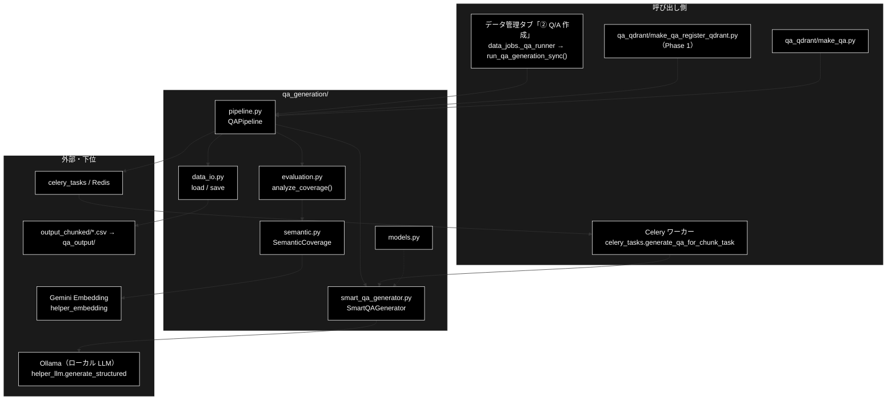

# README_qa_generation.md - qa_generation/ ディレクトリ概要

**Version 2.2** | 最終更新: 2026-10-11

`qa_generation/` の入口となる文書。ディレクトリの役割・モジュール索引・組み合わせ方・公開 API・既知の制約をまとめる。
各クラス・関数の引数と戻り値は各モジュールの文書（IPO）に置き、ここには書かない。

> 📌 **データ準備 3 工程のうち ② にあたる。** ① チャンク化は [`chunking/`](../../chunking/docs/README_chunking.md)、
> ③ Qdrant 登録は [`qa_qdrant/`](../../qa_qdrant/docs/README_qa_qdrant.md)。運用手順の入口は [`README_DATA.md`](../../README_DATA.md)。
>
> ⚠️ **本リポジトリは Ollama 版。** LLM はローカル LLM（既定は `config.py::get_default_ollama_model()`・`create_llm_client("ollama")`。API キー不要）、
> Embedding のみ Gemini `gemini-embedding-001`（3072 次元・`GOOGLE_API_KEY`）。姉妹リポジトリ `grace_v2` は
> Anthropic 版で、`qa_generation/` の構成は同じだが LLM の呼び先が違う。文書をコピーで持ち込まないこと（CLAUDE.md §5）。

---

## 目次

- [概要](#概要)
- [1. モジュール一覧（索引）](#1-モジュール一覧索引)
- [2. 使い方（代表的なワークフロー）](#2-使い方代表的なワークフロー)
- [3. 公開 API（__init__.py）](#3-公開-api__init__py)
- [4. 処理フロー・データフロー](#4-処理フローデータフロー)
- [5. 既知の制約・残課題](#5-既知の制約残課題)
- [6. 変更履歴](#6-変更履歴)

---

## 概要

① で作ったチャンク済み CSV を読み、**チャンク 1 件ごとに LLM の構造化出力 1 回で Q/A を生成**し（何問作るかも LLM が 0〜5 で決める）、
生成した Q/A がチャンクをどれだけ網羅しているか（カバレージ）を Embedding で測って、結果を 4 ファイルへ保存する。
データ管理タブの「② Q/A 作成」と CLI（`qa_qdrant/make_qa_register_qdrant.py` の Phase 1・`qa_qdrant/make_qa.py`）は、どちらも
**同じ `QAPipeline.run()`** を呼ぶので結果は変わらない。

### 主な責務

- チャンク済み CSV（または事前定義データセット）を読み込み、本文の列を `Combined_Text` にそろえる
- チャンク 1 件ごとに、LLM の構造化出力 1 回で Q/A 数の判断と Q/A の生成を行う
- 生成全体を制御する（同期／Celery 並列・チャンク単位の逐次保存と再開・4 ファイルの保存）
- チャンクと Q/A を Embedding し、類似度を求める
- 多段階の閾値・チャンクの長さと位置ごとにカバレージを数える
- Q/A のデータモデル（Pydantic）を定義する

### 各責務対応のモジュール

| # | 責務 | 対応モジュール | 説明 |
|---|------|--------------|------|
| 1 | 読み込み（と結果 4 ファイルの書き出し） | `data_io.py` | `load_uploaded_file()` / `load_preprocessed_data()` / `save_results()` |
| 2 | 1 チャンク = LLM 1 回の Q/A 生成 | `smart_qa_generator.py` | `SmartQAGenerator.process_chunk()`（構造化出力 `SmartQAResult`） |
| 3 | 全体の制御 | `pipeline.py` | `QAPipeline.run()`（読み込み → 変換 → 生成 → カバレージ → 保存。途中経過は `qa_progress_<種別>.jsonl`） |
| 4 | Embedding と類似度 | `semantic.py` | `SemanticCoverage`（Gemini Embedding・L2 正規化・コサイン類似度） |
| 5 | カバレージの集計 | `evaluation.py` | `analyze_coverage()`（strict / standard / lenient・長さ別・位置別） |
| 6 | データモデル | `models.py` | `QAPair` / `QAPairsList`（直下 `models.py` の正本を再エクスポート）ほか |

### アーキテクチャ構成図



**データの流れ（要点）**: チャンク CSV → `load_uploaded_file()`（`Combined_Text` を補う）→ `{id, text, type, tokens, dataset_type}` のリスト →
チャンクごとに `process_chunk()`（結果は 1 件ずつ `qa_progress_<種別>.jsonl` へ追記）→ `analyze_coverage()` →
`save_results()` が `qa_pairs_*.json` / `.csv`・`coverage_*.json`・`summary_*.json` を書き、逐次保存ファイルを消す。詳細は §4。

---

## 1. モジュール一覧（索引）

| モジュール | 文書 | 種別 | 行数 | Ver | 概要 |
|---|---|---|---:|---|---|
| `pipeline.py`（637 行） | [`pipeline.md`](pipeline.md) | E | 1009 | 1.11 | `QAPipeline`（Web / CLI 共通の実体）。同期／Celery・逐次保存と再開 |
| `smart_qa_generator.py`（299 行） | [`smart_qa_generator.md`](smart_qa_generator.md) | E | 624 | 1.6 | `SmartQAGenerator`（構造化出力 1 回）・`analyze_qa_statistics()` |
| `semantic.py`（542 行） | [`semantic.md`](semantic.md) | E | 801 | 1.5 | `SemanticCoverage`（Embedding・類似度・簡易なチャンク分割） |
| `evaluation.py`（328 行） | [`evaluation.md`](evaluation.md) | E | 891 | 1.4 | `analyze_coverage()` ほか（多段階閾値・チャンク特性別） |
| `data_io.py`（179 行） | [`data_io.md`](data_io.md) | E | 547 | 1.8 | 入力の読み込みと結果 4 ファイルの保存 |
| `models.py`（148 行） | [`models.md`](models.md) | E | 441 | 1.8 | Pydantic モデル 8 クラス（`QAPair` / `QAPairsList` は直下 `models.py` を再エクスポート） |
| （処理フロー） | [`qa_generation_process_flow.md`](qa_generation_process_flow.md) | A | 230 | 2.3 | 3 つの入口から `QAPipeline.run()` の各段・同期と Celery の違い・失敗と再開 |

> `__init__.py` の文書は作らない（公開 API は §3）。2026-10-11 までの `__init__.md` は §3 に、`make_qa_qapipeline.md`（`QAPipeline` と
> `SmartQAGenerator` の連携）は `qa_generation_process_flow.md` と各モジュールの文書に統合した。データフローは §4 で足りるので別文書にしていない。

---

## 2. 使い方（代表的なワークフロー）

> 📝 **確かめ方（2026-10-11）**: §2.2 は実行した。LLM（Ollama）は OpenAI 互換のスタブサーバ（チャンク本文の先頭 1 文から Q/A を 1 件作る）、
> Embedding（Gemini）は文字の 2-gram をハッシュした 3072 次元のスタブに差し替えた。入力は 4 行のチャンク CSV `output_chunked/document_chunks.csv`。
> 各モジュール単独の使い方は、それぞれの文書の使用例（`pipeline.md` §4.1 など）にある。

### 2.1 入口の早見表

| やりたいこと | 入口 | 使用例 |
|---|---|---|
| チャンク CSV から Q/A を作り、そのまま Qdrant へ登録する | `python qa_qdrant/make_qa_register_qdrant.py --input-file output_chunked/<名前>_chunks.csv --collection <名前>` | [`make_qa_register_qdrant.md`](../../qa_qdrant/docs/make_qa_register_qdrant.md) §5.1 |
| Q/A を作るだけ | `python qa_qdrant/make_qa.py --input-file output_chunked/<名前>_chunks.csv` | [`make_qa.md`](../../qa_qdrant/docs/make_qa.md) §4.1 |
| 画面から作る | データ管理タブ「② Q/A 作成」（`POST /api/qa/generate`） | [`backend/docs/data_pipeline.md`](../../backend/docs/data_pipeline.md) |
| Python から作る（同期・再開・Celery・本文列の指定・データセット） | `QAPipeline(...).run(...)` | [`pipeline.md`](pipeline.md) §4.1 |
| 1 チャンクだけ作って中身を見る | `SmartQAGenerator().process_chunk(text)` | [`smart_qa_generator.md`](smart_qa_generator.md) §6.1 |
| Celery で並列に作る | `./start_celery.sh start -w <数>` → `run(use_celery=True)` | [`docs/celery_quick_start.md`](../../docs/celery_quick_start.md)・[`pipeline.md`](pipeline.md) §4.1.4 |

### 2.2 生成とカバレージを分けて行う（`pipeline` → `evaluation`）

Q/A を作ってから、カバレージの下限を変えて測り直す。`run(analyze_coverage=False)` で生成と保存だけを行い、
`evaluation.analyze_coverage()` を自分で呼ぶ（Q/A を作り直さないので LLM を呼び直さない）。

```python
import pandas as pd
from qa_generation import QAPipeline
from qa_generation.evaluation import analyze_coverage

# 1. Q/A だけ先に作る（カバレージは後で測る）
result = QAPipeline(input_file="output_chunked/document_chunks.csv", output_dir="qa_output/two_step").run(analyze_coverage=False)
qa_pairs = pd.read_csv(result["saved_files"]["qa_csv"]).to_dict("records")

# 2. チャンクを QAPipeline と同じ形（id・text）にし、Q/A を 1 件減らして、下限を変えながらカバレージを測る
df = pd.read_csv("output_chunked/document_chunks.csv")
chunks = [{"id": r.chunk_id, "text": r.text} for r in df.itertuples()]
for t in (0.6, 0.7, 0.8):
    r = analyze_coverage(chunks, qa_pairs[:3], custom_threshold=t)
    print(t, r["covered_chunks"], [u["chunk"]["id"] for u in r["uncovered_chunks"]])

# 実行結果:
# 0.6 3 ['document_chunk_3']
# 0.7 3 ['document_chunk_3']
# 0.8 3 ['document_chunk_3']
```

> 📌 `QAPipeline` が内部で作るチャンクは `{id, text, type, tokens, dataset_type}` だが、`analyze_coverage()` が見るのは `id`（未カバーの報告）と
> `text`（Embedding）と、長さ別の集計に使う本文だけなので、上の 2 キーで足りる。

---

## 3. 公開 API（__init__.py）

`qa_generation/__init__.py` は次の 11 件を `__all__` で再エクスポートする（`from qa_generation import QAPipeline` のように使う）。

| 名前 | 定義元 | 用途 |
|---|---|---|
| `QAPipeline` | `pipeline.py` | Q/A 生成パイプライン |
| `SmartQAGenerator` | `smart_qa_generator.py` | 1 チャンクの Q/A 生成 |
| `SemanticCoverage` | `semantic.py` | Embedding・類似度 |
| `QAPair` / `QAPairsList` | 直下 `models.py`（`qa_generation/models.py` が import して再エクスポート。`QAPairsList` は `QAPairsResponse` の別名） | Q/A のデータモデル |
| `ChainOfThoughtAnalysis` / `ChainOfThoughtQAPair` / `ChainOfThoughtResponse` | `models.py` | Chain-of-Thought 用のモデル |
| `EnhancedQAPair` / `EnhancedQAPairsList` | `models.py` | 質問・回答だけの簡易版 |
| `QAGenerationConsiderations` | `models.py` | 生成前のチェックリスト |

- `data_io` / `evaluation` の関数と `analyze_qa_statistics()` は再エクスポートしない。`from qa_generation.data_io import save_results` のようにモジュールから import する。
- **`import qa_generation` で Celery は読み込まれない**（`pipeline.py` が `celery_tasks` を `_generate_with_celery()` の中で遅延 import する。2026-09-21 に修正し、
  それまでは Celery まで読まれていた〔当時の実測で 1,799 → 1,689 モジュール〕。回帰は `tests/qa_generation/test_import_side_effects.py`）。
  `pipeline.py` のモジュール先頭へ `celery_tasks` の import を戻さないこと。
- **`import qa_generation` でログの設定は変わらない**（2026-10-11 まではルートロガーが INFO になっていた）。ログを見るときは呼び出し側で
  `logging.basicConfig(level=logging.INFO)` などを設定する（CLI・Celery ワーカー・バックエンドは自前で設定している）。
- `__init__.py` を空にすると `from qa_generation import QAPipeline` が壊れる。空にした `qa_qdrant/__init__.py`（中身は docstring だけ）とは役目が違う。

---

## 4. 処理フロー・データフロー

処理の流れ（入口 → 読み込み → 変換 → 生成〔同期／Celery〕→ カバレージ → 保存、失敗と再開の扱い）は
[`qa_generation_process_flow.md`](qa_generation_process_flow.md)。データの形と置き場所は次のとおり。

| データ | 形式 | 作る側 | 使う側 | 置き場所 |
|---|---|---|---|---|
| チャンク CSV | 列 `chunk_id`（無ければ `id` / `chunk_idx`）・本文（`text_column` 指定 → `text` → `Combined_Text` → `content` → `chunk_text`） | `chunking/` | `QAPipeline.load_data()` | `output_chunked/<入力名>_chunks.csv` |
| チャンクのリスト | `{id, text, type, tokens, dataset_type}`（`id` が無ければ `<種別>_chunk_<行番号>`） | `QAPipeline._load_chunks_from_csv()` | 生成・カバレージ | メモリ |
| 途中経過 | JSONL。1 行 = `{chunk_id, qa_pairs, text_sha256}`（0 件のチャンクも記録。失敗したチャンクは記録しない。再開時は本文のハッシュが一致するチャンクだけを復元する） | `QAPipeline._append_progress()` | 再開時の `_load_progress()` | `<output_dir>/qa_progress_<種別>.jsonl`（保存が成功したら消す） |
| Q/A | `{question, answer, chunk_id, topic, dataset_type}` | `SmartQAGenerator` → `QAPipeline` | `save_results()` | `<output_dir>/qa_pairs_<種別>_<日時>.json` / `.csv` |
| カバレージ | `coverage_rate` / `covered_chunks` / `uncovered_chunks`（id・類似度・差・本文の先頭 200 字）/ `multi_threshold` / `chunk_analysis` ほか | `analyze_coverage()` | `save_results()` | `<output_dir>/coverage_<種別>_<日時>.json` |
| サマリー | `dataset_type` / `dataset_name` / `total_qa_pairs` / `coverage_rate` / `files` | `save_results()` | 人・後段 | `<output_dir>/summary_<種別>_<日時>.json` |

> `<種別>` は `input_file` なら入力ファイルの stem、`dataset_name` ならデータセット名。`<output_dir>` の既定は `qa_output/pipeline`
> （CLI の `make_qa.py` はリポジトリ直下の `qa_output/pipeline/`。[`qa_qdrant/docs/qa_qdrant_data_flow.md`](../../qa_qdrant/docs/qa_qdrant_data_flow.md)）。
> 登録（③）は Q/A CSV を読み、`question` ＋改行＋`answer` を Embedding する。

---

## 5. 既知の制約・残課題

2026-10-11 に、各モジュールの使用例を実行して確かめたもの。1・2 は同日に直し（v2.1）、3〜7 も同日に直した（v2.2）。**未対処のものは無い。**

| # | 内容 | 影響 | 詳細 |
|---|------|------|------|
| 1 | ~~`dataset_name` では `max_docs` が効かない~~ → **修正済み**（2026-10-11）。`load_data()` が入力ファイル・データセットのどちらにも `head(max_docs)` をかける | — | [`pipeline.md`](pipeline.md) §4.1.6 |
| 2 | ~~Celery では、LLM が失敗したチャンクが「0 件で処理済み」として記録され、再試行も効かない~~ → **修正済み**（2026-10-11）。ワーカーのタスクが `success=False` を例外に変えて最大 3 回再試行し、それでも失敗ならそのチャンクを記録しない（同期と同じく再開で作り直す） | — | [`pipeline.md`](pipeline.md) §4.1.4 |
| 3 | ~~LLM が全チャンクで失敗しても `run()` は `success=True`・`qa_count=0` で終わる~~ → **修正済み**（2026-10-11）。全チャンクで失敗したら `RuntimeError`（Q/A のファイルは書かない）。一部だけなら `failed_chunks` に ID を返し、逐次保存ファイルを残して、再実行で失敗したチャンクだけを作り直す | — | [`pipeline.md`](pipeline.md) §4.1.7 |
| 4 | ~~Embedding が失敗するとゼロベクトルになり、カバレージが「0%」として黙って出る~~ → **修正済み**（2026-10-11）。`analyze_coverage()` がゼロベクトルを見つけたら `RuntimeError` で止める | — | [`evaluation.md`](evaluation.md) §5.1.4 |
| 5 | ~~逐次保存ファイルは入力の中身を照合しない~~ → **修正済み**（2026-10-11）。本文の SHA-256 を記録し、今回の入力にあって本文も同じチャンクだけを復元する（記録の無い古いファイルは `chunk_id` で再開し、警告を出す） | — | [`pipeline.md`](pipeline.md) §4.1.3 |
| 6 | ~~本文の列名が候補に無い CSV は、全列をつないだ文で Q/A を作る~~ → **修正済み**（2026-10-11）。本文の列が無ければ `ValueError`（LLM を呼ぶ前に止まる）。`text_column` で指定できる | — | [`pipeline.md`](pipeline.md) §4.1.5・[`data_io.md`](data_io.md) §3 |
| 7 | ~~`import qa_generation` でルートロガーが INFO になる~~ → **修正済み**（2026-10-11）。`smart_qa_generator.py` のモジュール先頭の `logging.basicConfig()` を外した | — | §3 |

> いずれも、修正前のコードで fail するテストを先に書いてから直した（1・2 は `tests/qa_generation/test_failure_paths.py`、3〜7 は `tests/qa_generation/test_known_limits.py`）。
> 2026-09-20〜10-09 の棚卸しで見つけたもの（文書に残っていた Anthropic 前提の記述・死んだ `provider` 引数・`QAPair` の 3 重定義・
> Celery の import 副作用・`"nan"` 混入・効かない `client` / `batch_chunks` 引数・中核の直接テスト不足）はすべて対処済み（本書 v1.19 までの §3.1・§4・§6）。

### 5.1 文書を保守するときの約束とテスト件数

| 置き場所 | 書くもの | 書かないもの |
|---|---|---|
| `<module>.md` | IPO（入出力・副作用・使用例） | 運用手順・ほかのモジュールの仕様 |
| 本書 | モジュールを組み合わせる流れ・公開 API・データの形・既知の制約 | 1 モジュールの IPO |
| `qa_generation_process_flow.md` | 入口から保存までの順序・分岐・失敗時の扱い | 関数の引数・戻り値 |
| `qa_qdrant/docs/`・直下 `docs/data_prep_install.md` / `docs/celery_quick_start.md` | CLI の使い方・環境構築と Celery の起動 | `qa_generation/` 内部の実装 |

- 使用例は**動かして確かめてから**載せる（`a_class_method_md_format.md` §9.5）。LLM・Embedding はスタブでよい
- 文書を足したら §1 に行を足す

テスト件数（2026-10-11 に `pytest --collect-only` で数えた値。いずれも Ollama・API キー・Qdrant 不要）:

| テストファイル | 件数 | 対象 |
|---|---:|---|
| `tests/qa_generation/test_qa_generation_core.py` | 12 | **中核 3 つを直接実行する**: `QAPipeline.run()`（4 ファイル保存・逐次保存ファイルの削除・再開・失敗チャンクを記録しない・閾値の受け渡し・CSV 以外の拒否）、`process_chunk()`（詰め替え・例外と空応答で `success=False`）、`analyze_coverage()` |
| `tests/qa_generation/test_pipeline_persistence.py` | 4 | 逐次保存（チャンクごとの追記・再開で済んだチャンクを飛ばす・壊れた行を飛ばす・削除） |
| `tests/qa_generation/test_smart_qa_usage.py` | 4 | `process_chunk()` の `usage`（`OllamaClient.last_usage` 由来・失敗時は 0） |
| `tests/qa_generation/test_semantic.py` | 10 | `SemanticCoverage`（段落・文への分割・類似度・Embedding・`create_semantic_chunks()`） |
| `tests/qa_generation/test_evaluation.py` | 1 | `analyze_coverage()` |
| `tests/qa_generation/test_qa_pair_definitions.py` | 5 | `QAPair` / `QAPairsList` が直下 `models.py` の正本そのものであること |
| `tests/qa_generation/test_import_side_effects.py` | 3 | `import qa_generation.data_io` で Celery が載らないこと・`helper/` に裸 import が無いこと |
| `tests/qa_generation/test_data_io_missing_text.py` | 3 | 欠損セルが `"nan"` にならないこと |
| `tests/qa_generation/test_failure_paths.py` | 7 | §5 の 1・2 の回帰: `dataset_name` でも `max_docs` で絞ること、Celery のタスクが LLM の失敗で再試行して失敗になり、そのチャンクを逐次保存ファイルに記録しないこと（`apply()` でその場で実行し、`_generate_with_celery()` も通す） |
| `tests/qa_generation/test_known_limits.py` | 14 | §5 の 3〜7 の回帰: 全滅で例外・一部の失敗を `failed_chunks` で返して失敗分だけ作り直す、Embedding のゼロベクトルで止める、逐次保存ファイルの本文照合、本文の列が無ければ `ValueError`、import でルートロガーを触らない |
| `tests/test_qa_pipeline_text_column.py` | 6 | `text_column` の優先・指定列が無ければ `ValueError`・CLI からの受け渡し |
| `tests/test_qa_pipeline_dataset_type.py` | 6 | `dataset_name` の種別がデータセット名になること |
| `tests/test_celery_worker_init.py` | 3 | ワーカー起動時の import 確認が `qa_generation.smart_qa_generator` を見ること（**間接**） |
| `tests/test_data_jobs.py` | 57 | データ管理タブのジョブ全体（`run_qa_generation_sync` はスタブ・**間接**） |

> `tests/qa_generation/test_content.py`（2 件）は同じディレクトリにあるが、対象は直下の `regex_mecab.py`（`KeywordExtractor`）で `qa_generation/` ではない。

```bash
PYTHONPATH=. .venv/bin/python -m pytest tests/qa_generation tests/test_qa_pipeline_text_column.py tests/test_qa_pipeline_dataset_type.py -q
# 2026-10-11 実測: 77 passed（test_content.py の 2 件を含む）
```

> 実 Redis と Celery ワーカーを通すテストは `tests/integration/test_celery_redis_live.py`（Redis が無ければ skip）。

---

## 6. 変更履歴

| バージョン | 日付 | 変更内容 |
|---|---|---|
| 1.0 | 2026-09-20 | 新規作成。`qa_generation/docs/` だけ棚卸し索引が無かった。文書一覧・実装カバレッジ（**欠落 3 件**）・テスト件数（実測）・残タスク 4 件を記載。あわせて **文書に Anthropic 表記が残る一方で実装は Ollama 済み**であることを grep で確認し §4 に記録した |
| 1.1 | 2026-09-21 | 残タスク 2 を完了（3 文書の Anthropic 表記を Ollama へ是正）。残タスク 4 も 3/4 完了（`evaluation.md` のみ残る） |
| 1.2 | 2026-09-21 | 残タスク 1 を完了（`data_io.md` / `models.md` / `__init__.md` を新規作成し、実装 7 件との 1:1 対応が揃った）。文書化の過程で判明した 4 点を §3.1 に記録し、うち 2 点を残タスク 5・6 として新規登録した。§2 の行数を再実測（`smart_qa_generator.py` 301 → 296） |
| 1.3 | 2026-09-21 | 残タスク 5・6 を決着（6 は `pipeline.py` の遅延 import 化で解消、5 は「統合しない」判断＋テストで固定）。§3.1 に 5 件目（`helper_rag_qa.py` の裸 import が `celery_tasks` の `sys.path` 挿入に依存していた件）を追記。§7 のテスト件数を再実測 |
| 1.4 | 2026-09-21 | 残タスク 3・4 を完了（死んだ `provider` 引数の削除、`evaluation.md` の Version ヘッダー）。**残タスク 0 件** |
| 1.5 | 2026-09-24 | 7 文書を基本フォーマットの章構成（概要＋責務 1:1＋3 層構成図＋番号付き章＋使用例は IPO 冒頭）へ組み替えたのにあわせ、§2 の Ver・行数を再実測し、文書種別（E／本索引は C）を明記。H2 が 8 個のため目次を追加。実装行数も再実測（`pipeline.py` 549 → 553、`models.py` 155 → 166） |
| 1.6 | 2026-09-24 | `pipeline.md` の `QAPipeline` 引数の記述を実装に合わせたのに追随し、§2 の版・行数を更新（v1.4・804 行） |
| 1.7 | 2026-09-24 | `data_io.py` の `"nan"` 混入を修正したのに追随（grace_v2 と同じ修正）。§2・§3 の実装行数（162 → 168）と文書の版・行数、§7 のテスト一覧（`test_data_io_missing_text.py` 3 件を追加）と件数（`qa_generation/` 40 件・全体 1921 passed）を再実測で更新 |
| 1.8 | 2026-09-25 | 残タスク 5（`QAPair` の 3 重定義）の決着を「統合しない」から**「直下 `models.py` へ一本化」**へ変更（grace_v2 と同じ変更）。§2・§3・§3.1・§6・§7 を更新 |
| 1.9 | 2026-09-25 | `helper/helper_rag_qa.py` の旧 `QAPair` も削除し、`QAPair` の定義は直下 `models.py` の 1 つだけになった（grace_v2 と同じ変更）。§2・§3.1・§6・§7 を更新 |
| 1.10 | 2026-09-25 | `QAPairsList` も直下 `models.py` の定義（`QAPairsResponse` の別名）へ一本化（grace_v2 と同じ変更）。`qa_generation/models.py` と `helper/helper_rag_qa.py` の同名クラスを削除し、`test_qa_pair_definitions.py` に 2 件を追加（計 6 件）。§2 の行数・版を更新 |
| 1.11 | 2026-09-26 | `pipeline.md` v1.5（`QAPipeline(text_column=...)` の追加）に追随して §2 の行数・版を更新 |
| 1.12 | 2026-09-26 | `pipeline.md` v1.6（`--dataset` の種別の補完）に追随して §2 の行数・版を更新 |
| 1.13 | 2026-10-08 | §4 の見出し「文書に Anthropic 前提の記述が残っている」が §6 の残タスク 2（2026-09-21 完了）と食い違っていたので、是正済みの記録である旨を見出しと注記で明示した。`pipeline.md` v1.7・`smart_qa_generator.md` v1.3（既定モデルの記載の是正）に追随して §2 の行数・版を更新 |
| 1.14 | 2026-10-09 | `QAPipeline` の処理に効いていなかった引数 `client` / `batch_chunks` を、`QAPipeline`・`run_qa_generation_sync`・API・画面・CLI（`--batch-chunks`）から削除したのに追随（grace_v2 と同じ対処）。§2 の `pipeline` 行（実装 555 行・文書 v1.8）を再実測し、§7 に `test_qa_generation_core.py`（12 件・`QAPipeline.run()` の直接テスト）を追加。件数を再実測 |
| 1.15 | 2026-10-10 | テストの所在を `backend/tests/` からリポジトリ直下の `tests/` へ移したのに追随（パス・コマンド・import の表記） |
| 1.16 | 2026-10-10 | `services/docs/` の構成整理（`README.md` → `README_services.md`、`__init__.md` を統合）に合わせてリンクを直した |
| 1.17 | 2026-10-11 | `qa_qdrant/docs/` の構成整理に追随。`make_qa_qapipeline.md` を本ディレクトリへ移して文書一覧に足し、`qa_qdrant/docs/README.md` → `README_qa_qdrant.md`・`01_install.md` → 直下 `docs/data_prep_install.md` の移動に合わせてリンクと書き分けの表を直した |
| 1.18 | 2026-10-11 | `chunking/docs/` の構成整理（`README.md` → `README_chunking.md`）に合わせてリンクを直した |
| 1.19 | 2026-10-11 | 未使用だった `helper/helper_rag.py` / `helper/helper_rag_qa.py` を 2026-10-11 に削除したのに追随（`clean_text` の import 元・関連モジュール・構成図・テスト件数） |
| 2.0 | 2026-10-11 | **`a_cross_doc_md_format.md` §1.1〜§1.4 に合わせて `README.md` から `README_qa_generation.md` へ改名し、棚卸し索引からディレクトリ概要の構成（主な責務・各責務対応のモジュール・3 層構成図・モジュール索引・使い方・公開 API・処理フローとデータフロー・既知の制約）に書き直した**（grace_v2 と同じ整理。LLM の記述は Ollama のまま）。`__init__.md` を §3 に、`make_qa_qapipeline.md` を `qa_generation_process_flow.md`（新設）と各モジュールの文書に統合した。棚卸しの記録（旧 §3.1・§4・§6。いずれも対処済み）は §5 の注記に要約した。各モジュールの使用例を処理パターン別に書き直し、OpenAI 互換のスタブサーバ（Ollama の代わり）で実行して、そこで見つけた制約 7 件を §5 に記録した（`dataset_name` で `max_docs` が効かない・Celery で失敗チャンクが処理済みになる など。grace_v2 と同じ結果）。§2.2 を実行して確かめ、§5.1 のテスト件数を数え直した（`test_import_side_effects.py` 2 → 3 件・`test_data_jobs.py` 56 件ほか） |
| 2.1 | 2026-10-11 | §5 の 1（`dataset_name` で `max_docs` が効かない）と 2（Celery で失敗チャンクが処理済みになる）を直した（grace_v2 と同じ修正。修正前のコードで fail する `tests/qa_generation/test_failure_paths.py` 7 件を先に書いた）。§5.1 のテスト一覧に足し、件数を数え直した（63 passed） |
| 2.2 | 2026-10-11 | §5 の 3〜7 を直した（grace_v2 と同じ修正。使用例は Ollama の代わりのスタブサーバで実行した）。修正前のコードで fail する `tests/qa_generation/test_known_limits.py` 14 件を先に書いた。§3 のログの記述、§4 の途中経過の形、§5 の表、§5.1 のテスト一覧（77 passed・`test_data_jobs.py` 57 件）を更新した。これで §5 に未対処のものは無い |
