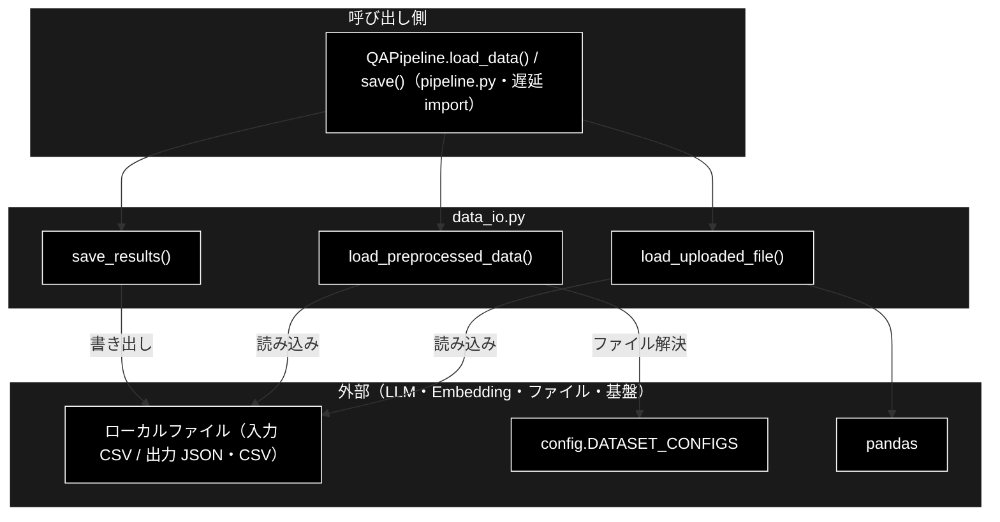
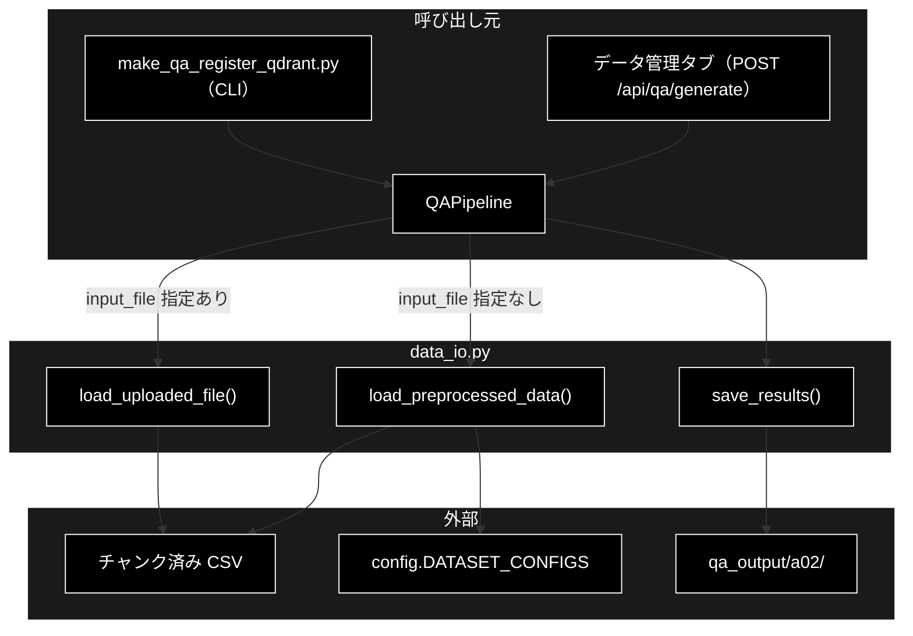
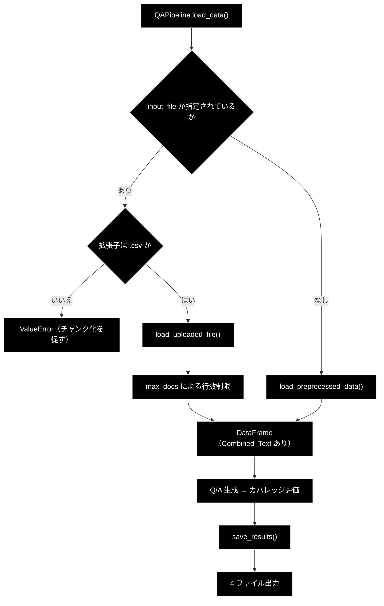
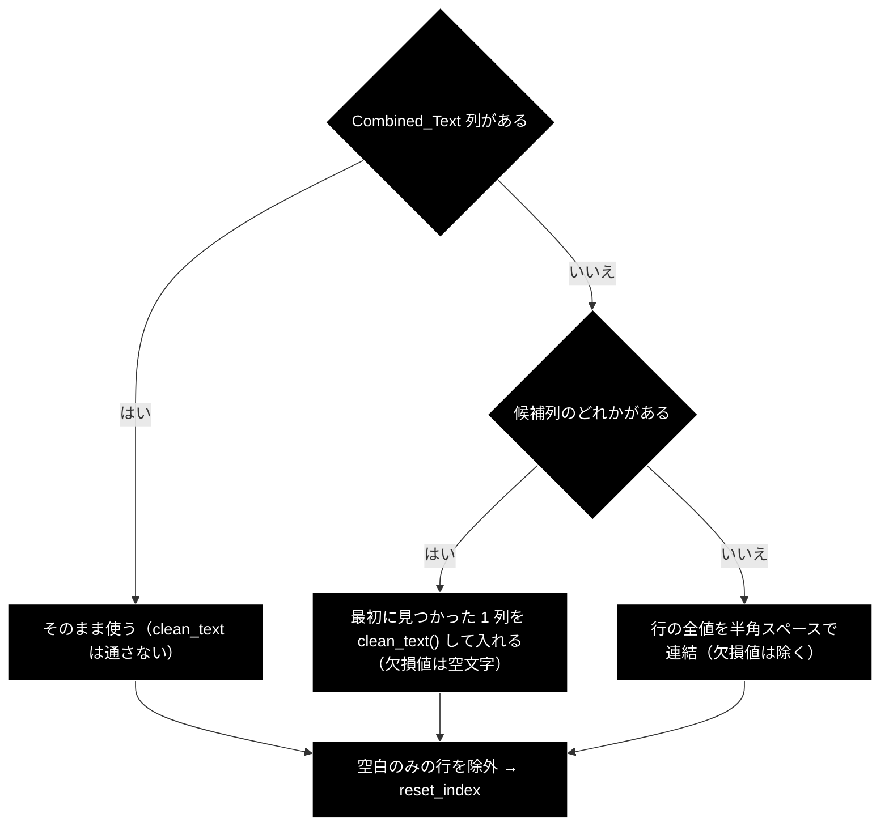

# data_io.py - 入力読み込み・結果保存 ドキュメント

**Version 1.7** | 最終更新: 2026-10-11

---

## 目次

1. [概要](#概要)
2. [アーキテクチャ構成図](#1-アーキテクチャ構成図)
3. [モジュール構成図](#2-モジュール構成図)
4. [Combined_Text 列の解決規則](#3-combined_text-列の解決規則)
5. [タイムスタンプ付きファイルの自動選択](#4-タイムスタンプ付きファイルの自動選択)
6. [クラス・関数一覧表](#5-クラス関数一覧表)
7. [クラス・関数 IPO詳細](#6-クラス関数-ipo詳細)
8. [出力ファイルの仕様](#7-出力ファイルの仕様)
9. [注意点](#8-注意点)
10. [関連モジュール](#9-関連モジュール)
11. [変更履歴](#10-変更履歴)

---

## 概要

`qa_generation/data_io.py` は、**Q/A 生成パイプラインの入口（データ読み込み）と出口（結果保存）を担うモジュール**です。LLM も Embedding も呼ばず、ファイル I/O と `pandas.DataFrame` の整形だけを行います。

`QAPipeline`（`qa_generation/pipeline.py`）から**遅延 import** で呼ばれる現役経路です。CLI（`qa_qdrant/make_qa_register_qdrant.py`）と「データ管理」タブの Q/A 作成は、どちらも `QAPipeline` を経由してこのモジュールに到達します。

### 主な責務

- 任意形式のローカルファイル（CSV / TXT / JSON / JSONL）を `DataFrame` へ読み込む
- 読み込んだ `DataFrame` に **`Combined_Text` 列**を保証する（無ければ候補列から生成する）
- データセット名（`DATASET_CONFIGS` のキー）から前処理済み CSV を解決して読み込む
- 実ファイルが無いときに**タイムスタンプ付きファイルを自動選択**する
- Q/A ペア・カバレッジ結果・サマリーを 4 ファイルへ保存する

### 各責務対応のモジュール

| # | 責務 | 対応モジュール | 説明 |
|---|---|---|---|
| 1 | 任意形式のローカルファイル（CSV / TXT / JSON / JSONL）を `DataFrame` へ読み込む | `load_uploaded_file()` | 拡張子で読み分ける |
| 2 | 読み込んだ `DataFrame` に **`Combined_Text` 列**を保証する（無ければ候補列から生成する） | `load_uploaded_file()`（内部処理） | §3 の解決規則 |
| 3 | データセット名（`DATASET_CONFIGS` のキー）から前処理済み CSV を解決して読み込む | `load_preprocessed_data()` | `config.DATASET_CONFIGS` を参照 |
| 4 | 実ファイルが無いときに**タイムスタンプ付きファイルを自動選択**する | `load_preprocessed_data()`（内部処理） | §4 の選択規則 |
| 5 | Q/A ペア・カバレッジ結果・サマリーを 4 ファイルへ保存する | `save_results()` | §7 の出力仕様 |

### 主要機能一覧

| 機能 | 説明 |
|---|---|
| `load_uploaded_file(file_path)` | ローカルファイルを読み、`Combined_Text` 列を持つ `DataFrame` を返す |
| `load_preprocessed_data(dataset_type)` | `DATASET_CONFIGS` からファイルを解決して読む |
| `save_results(qa_pairs, coverage_results, dataset_type, output_dir)` | JSON / CSV / カバレッジ / サマリーの 4 ファイルを書き出す |

---

## 1. アーキテクチャ構成図

### 1.1 システム全体構成



### 1.2 データフロー

1. `QAPipeline.load_data()` が入力ファイル指定なら `load_uploaded_file()`、データセット名なら `load_preprocessed_data()` を呼ぶ
2. 読み込んだ `DataFrame` に `Combined_Text` 列を保証して返す
3. （Q/A 生成・カバレッジ分析は呼び出し側が行う）
4. `QAPipeline.save()` が `save_results()` を呼び、4 ファイルを `output_dir` へ書き出してパスを返す

---

## 2. モジュール構成図

### 2.1 パイプライン内の位置づけ



### 2.2 処理フロー概要



> 📌 **`max_docs` による行数制限は `QAPipeline` 側**（`pipeline.py:148`）で行う。
> `load_uploaded_file()` 自体に上限の概念は無い。

---

## 3. Combined_Text 列の解決規則

`load_uploaded_file()` は、下流（`QAPipeline._load_chunks_from_csv()` など）が
`Combined_Text` を前提にしているため、**無ければ必ず作る**。



**候補列の探索順（先に見つかったものを採用）**

| 順 | 列名 |
|---:|---|
| 1 | `text` |
| 2 | `content` |
| 3 | `body` |
| 4 | `document` |
| 5 | `answer` |
| 6 | `question` |

`clean_text()`（`helper.helper_text`。2026-10-11 までは再エクスポート元の `helper.helper_rag` から import していた）は、
`None` / pandas NA を空文字にし、改行を半角スペースへ置換したうえで連続空白を 1 つに畳み、
前後の空白を除去する。

> 📌 **欠損値（`None` / `NaN` / `pd.NA`）は `str()` をかける前に `_is_missing()` で判定し、空文字にする。**
> 以前は `clean_text(str(x))` と先に `str()` をかけていたため、`NaN` が文字列 `"nan"` として残っていた（§8 の 7）。

> ⚠️ **全列連結のフォールバックだけ `clean_text()` を通らない。**
> 候補列が 1 つも無かった場合は素の `str(v)` を連結するだけなので、改行がそのまま残る。

---

## 4. タイムスタンプ付きファイルの自動選択

`load_preprocessed_data()` は、設定の `file` が存在しないとき諦めずに探す。

| 手順 | 内容 |
|---|---|
| 1 | `file` を `stem` と `suffix` に分解する |
| 2 | 同じディレクトリで `{stem}_*{suffix}` を `glob` する |
| 3 | 1 件も無ければ `FileNotFoundError` |
| 4 | **ファイル名で昇順ソートし、最後の 1 件**を採用してログに出す |

例: `OUTPUT/preprocessed_wikipedia_ja.csv` が無い場合、
`OUTPUT/preprocessed_wikipedia_ja_20260920_101500.csv` が拾われる。

> 📌 **名前順であって更新日時順ではない。** タイムスタンプが
> `YYYYmmdd_HHMMSS` 形式なら名前順＝時刻順になるので実用上は「最新」になるが、
> 別形式のサフィックスを付けると直感と食い違う。
> なお、チャンク化 CLI は常に固定ファイル名で出力し、日時サフィックスを付けるオプションは無い
> （CLAUDE.md §8.2。以前ここに書いていた `--timestamp` は存在しない）。日時付きのファイルは、
> 手で名前を変えたときや別の経路で作ったときにだけ現れる。

---

## 5. クラス・関数一覧表

| 関数 | 行 | 戻り値 | 例外 |
|---|---:|---|---|
| `load_uploaded_file()` | 24 | `pd.DataFrame` | `FileNotFoundError` / `ValueError` |
| `load_preprocessed_data()` | 83 | `pd.DataFrame` | `ValueError` / `FileNotFoundError` |
| `save_results()` | 113 | `Dict[str, str]` | （握りつぶさず伝播） |

いずれもモジュールレベルの関数で、クラスは持たない。ほかに内部ヘルパー `_is_missing()`（20 行・スカラーの欠損値判定）がある。`__all__` は定義していない。

---

## 6. クラス・関数 IPO詳細

### 6.1 使用例

| # | パターン | いつ使うか | 例 |
|---|---------|-----------|----|
| 1 | **基本**: チャンク済み CSV を読む（`load_uploaded_file()`） | `QAPipeline(input_file=...)` と同じ読み方を確かめる | 6.1.1 |
| 2 | CSV 以外（`.txt` / `.json` / `.jsonl`）と欠損値 | 手元のデータを試しに読む | 6.1.2 |
| 3 | 事前定義データセットを読む（`load_preprocessed_data()`） | `QAPipeline(dataset_name=...)` と同じ読み方 | 6.1.3 |
| 4 | 結果を 4 ファイルに保存する（`save_results()`） | 自前で作った Q/A を同じ形式で残す | 6.1.4 |

> 📝 **確かめ方（2026-10-11）**: 6.1.1〜6.1.4 はすべて実行した（外部 API は使わない）。入力は 4 行のチャンク CSV
> `output_chunked/document_chunks.csv` と、3 行の `OUTPUT/preprocessed_cc_news.csv`（`Combined_Text` 列）。
> パイプライン全体からの使い方は [`pipeline.md`](pipeline.md) §4.1。

#### 6.1.1 基本: チャンク済み CSV を読む

```python
from qa_generation.data_io import load_uploaded_file

# チャンク済み CSV（列 chunk_id / text ほか）を読む。Combined_Text 列が無ければ必ず作る
df = load_uploaded_file("output_chunked/document_chunks.csv")
print(len(df), df.columns.tolist()[-2:])
print(df.loc[0, "Combined_Text"])

# 実行結果:
# 4 ['source_file', 'Combined_Text']
# 住民票の写しは市役所の窓口で取得できます。
```

#### 6.1.2 CSV 以外の形式と欠損値

```python
import json
from qa_generation.data_io import load_uploaded_file

# .txt は空でない 1 行 = 1 行（text 列）
with open("notes.txt", "w", encoding="utf-8") as f:
    f.write("手数料は1通300円です。\n\n利用時間は23時までです。\n")
print(load_uploaded_file("notes.txt")["Combined_Text"].tolist())

# .jsonl は 1 行 = 1 レコード。本文が欠損・空白だけの行は落とす（"nan" という文字列にはならない）
with open("faq.jsonl", "w", encoding="utf-8") as f:
    for rec in [{"question": "Q1", "answer": "窓口で取れます。"}, {"question": "Q2", "answer": None}, {"question": "Q3", "answer": "  "}]:
        f.write(json.dumps(rec, ensure_ascii=False) + "\n")
df = load_uploaded_file("faq.jsonl")
print(len(df), df["Combined_Text"].tolist())

# 実行結果:
# ['手数料は1通300円です。', '利用時間は23時までです。']
# 1 ['窓口で取れます。']
```

> ⚠️ `question` / `answer` 列だけのデータでは、`Combined_Text` は **`answer` だけ**になる（候補列の順が `text` → `content` → `body` → `document` → `answer` → `question` のため・§3）。
> `QAPipeline` は CSV しか受け付けない（`.txt` / `.json` / `.jsonl` を渡すと `ValueError`）ので、CSV 以外を読むのはこの関数を直接呼ぶときだけ。

#### 6.1.3 事前定義データセットを読む

```python
from qa_generation.data_io import load_preprocessed_data

# 事前定義データセット（config.py::DATASET_CONFIGS）。cc_news → OUTPUT/preprocessed_cc_news.csv の Combined_Text 列
df = load_preprocessed_data("cc_news")
print(len(df), df.columns.tolist())

try:
    load_preprocessed_data("no_such_dataset")
except ValueError as e:
    print("ValueError:", e)

# 実行結果:
# 3 ['Combined_Text']
# ValueError: 未対応のデータセット: no_such_dataset
```

> 📌 設定のファイルが無ければ、同じ場所の `<名前>_*<拡張子>`（例: `preprocessed_cc_news_*.csv`）のうち**名前が最後**のものを読む（§4）。
> 本文列（`DATASET_CONFIGS[...]["text_column"]`）が無ければ `ValueError`。行数の制限（`max_docs`）はここでも `QAPipeline` でもかからない（[`pipeline.md`](pipeline.md) §4.1.6）。

#### 6.1.4 結果を 4 ファイルに保存する

```python
import json
from qa_generation.data_io import save_results

qa_pairs = [{"question": "手数料は？", "answer": "1通300円です。", "chunk_id": "c0", "topic": "料金", "dataset_type": "faq"}]
coverage = {"coverage_rate": 1.0, "covered_chunks": 1, "total_chunks": 1, "uncovered_chunks": []}

paths = save_results(qa_pairs, coverage, dataset_type="faq", output_dir="qa_output/demo")
print(sorted(paths))
summary = json.load(open(paths["summary"], encoding="utf-8"))
print({k: summary[k] for k in ("dataset_type", "dataset_name", "total_qa_pairs", "coverage_rate")})
print(open(paths["qa_csv"], encoding="utf-8").read().strip())

# 実行結果:
# ['coverage', 'qa_csv', 'qa_json', 'summary']
# {'dataset_type': 'faq', 'dataset_name': 'faq', 'total_qa_pairs': 1, 'coverage_rate': 1.0}
# question,answer,chunk_id,topic,dataset_type
# 手数料は？,1通300円です。,c0,料金,faq
```

> 📌 **`save_results()` へ渡る `dataset_type` は `QAPipeline` の `config["type"]`。**
> `dataset_name` 指定なら データセット名（サマリーの `dataset_name` は `DATASET_CONFIGS` の表示名）、`input_file` 指定なら
> **入力ファイルの stem**（例: `document_chunks`。`DATASET_CONFIGS` に無いので、サマリーの `dataset_name` も同じ値）になる。
> `coverage_results["uncovered_chunks"]` の各要素は `{"chunk": {...}, "similarity", "gap"}` の形（`evaluation.analyze_coverage()` の戻り値）を前提に、
> `chunk_id` と本文の先頭 200 文字へ詰め替えて書く（§7）。

### 6.2 load_uploaded_file()

任意形式のローカルファイルを読み込み、**`Combined_Text` 列を必ず持つ** `DataFrame` を返す。

```python
def load_uploaded_file(file_path: str) -> pd.DataFrame
```

| 区分 | 項目 | 内容 |
|---|---|---|
| **Input** | `file_path` | 読み込むファイルのパス（`str`） |
| | 対応拡張子 | `csv` / `txt` / `text` / `json` / `jsonl` |
| **Process** | 1 | `Path.exists()` を確認。無ければ `FileNotFoundError` |
| | 2 | 拡張子（小文字・先頭のドット除去）で分岐して読み込む |
| | 3 | `Combined_Text` 列が無ければ候補列から生成する（[次章](#3-combined_text-列の解決規則)） |
| | 4 | `Combined_Text` が空白のみの行を除外 |
| | 5 | `reset_index(drop=True)` で連番を振り直す |
| **Output** | 戻り値 | `Combined_Text` 列を持つ `pd.DataFrame` |
| | 例外 | 未対応拡張子 / 不正な JSON 構造 → `ValueError`（ログ出力後に再 raise） |

**形式別の読み込み方法**

| 拡張子 | 読み込み | 備考 |
|---|---|---|
| `csv` | `pd.read_csv()` | 区切り文字・エンコーディングは pandas 既定 |
| `txt` / `text` | 1 行 1 レコード | 空行を除外し `text` 列へ入れる |
| `json` | `json.load()` | `list` → そのまま、`dict` → 1 行の `DataFrame`。それ以外は `ValueError` |
| `jsonl` | 1 行 1 JSON | 空行はスキップ |

### 6.3 load_preprocessed_data()

データセット名から前処理済み CSV を解決して読み込む。

```python
def load_preprocessed_data(dataset_type: str) -> pd.DataFrame
```

| 区分 | 項目 | 内容 |
|---|---|---|
| **Input** | `dataset_type` | `config.DATASET_CONFIGS` のキー（例: `wikipedia_ja_5per`） |
| **Process** | 1 | `DATASET_CONFIGS.get()` で設定を取得。無ければ `ValueError` |
| | 2 | `config["file"]` のパスを確認。無ければタイムスタンプ付きを探す（[後述](#4-タイムスタンプ付きファイルの自動選択)） |
| | 3 | `pd.read_csv()` で読み込む |
| | 4 | `config["text_column"]` の存在を確認。無ければ `ValueError` |
| | 5 | そのカラムが `NaN` / 空白のみの行を除外 |
| **Output** | 戻り値 | `pd.DataFrame`（**`reset_index()` はしない**） |

> ⚠️ **`Combined_Text` 列は作らない。** 参照するのは `config["text_column"]` であり、
> データセットによって `Combined_Text` だったり `text` だったりする
> （`config.py::DatasetConfig.DATASETS`）。`load_uploaded_file()` と戻り値の形が
> 揃っていない点に注意。

### 6.4 save_results()

Q/A ペアとカバレッジ結果を 4 ファイルへ保存する。

```python
def save_results(
    qa_pairs: List[Dict],
    coverage_results: Dict,
    dataset_type: str,
    output_dir: str = "qa_output/a02",
) -> Dict[str, str]
```

| 区分 | 項目 | 内容 |
|---|---|---|
| **Input** | `qa_pairs` | Q/A ペアの `dict` リスト |
| | `coverage_results` | カバレッジ評価の結果（`evaluation.analyze_coverage()` の戻り値） |
| | `dataset_type` | ファイル名に埋め込むデータセット識別子 |
| | `output_dir` | 出力先（既定 `qa_output/a02`。`QAPipeline` は自身の `output_dir` を渡す） |
| **Process** | 1 | `mkdir(parents=True, exist_ok=True)` で出力先を作成 |
| | 2 | `datetime.now()` から `YYYYmmdd_HHMMSS` のタイムスタンプを作る |
| | 3 | Q/A を JSON（`ensure_ascii=False, indent=2`）と CSV の 2 形式で書く |
| | 4 | カバレッジを**浅いコピー**し、`uncovered_chunks` を軽量な要約へ置き換えて書く |
| | 5 | 件数・カバレッジ率・出力先を含むサマリー JSON を書く |
| **Output** | 戻り値 | `{"qa_json", "qa_csv", "coverage", "summary"}` の 4 パス（`str`） |

**戻り値例**

```python
{
    "qa_json": "qa_output/a02/qa_pairs_cc_news_20260921_041500.json",
    "qa_csv":  "qa_output/a02/qa_pairs_cc_news_20260921_041500.csv",
    "coverage": "qa_output/a02/coverage_cc_news_20260921_041500.json",
    "summary":  "qa_output/a02/summary_cc_news_20260921_041500.json",
}
```

---

## 7. 出力ファイルの仕様

| ファイル | 内容 |
|---|---|
| `qa_pairs_{dataset}_{ts}.json` | Q/A ペア全件（`ensure_ascii=False`・インデント 2） |
| `qa_pairs_{dataset}_{ts}.csv` | 同じ内容を `DataFrame` 化した CSV（`index=False`） |
| `coverage_{dataset}_{ts}.json` | カバレッジ結果。`uncovered_chunks` のみ要約へ置換 |
| `summary_{dataset}_{ts}.json` | 件数・カバレッジ率・上 3 ファイルのパス |

**`uncovered_chunks` の要約**

元のカバレッジ結果は未カバーチャンクの本文を丸ごと抱えているため、そのままでは
巨大な JSON になる。保存時に次の 4 キーへ畳む。

| キー | 由来 |
|---|---|
| `chunk_id` | `uc["chunk"].get("id", "")` |
| `similarity` | `uc["similarity"]` |
| `gap` | `uc["gap"]` |
| `text_preview` | `uc["chunk"]["text"]` の**先頭 200 文字 + `...`** |

> 📌 置き換えは `coverage_results.copy()`（浅いコピー）に対するキーの差し替えなので、
> **呼び出し元が持っている元の辞書は書き換わらない**。

**サマリー JSON の構造**

```json
{
  "dataset_type": "cc_news",
  "dataset_name": "CC-News（英語ニュース）",
  "generated_at": "20260921_041500",
  "total_qa_pairs": 1240,
  "coverage_rate": 0.72,
  "files": {
    "qa_json": "qa_output/a02/qa_pairs_cc_news_20260921_041500.json",
    "qa_csv": "qa_output/a02/qa_pairs_cc_news_20260921_041500.csv",
    "coverage": "qa_output/a02/coverage_cc_news_20260921_041500.json"
  }
}
```

`dataset_name` は `DATASET_CONFIGS` に無い識別子だと `dataset_type` と同じ値になる。

---

## 8. 注意点

| # | 内容 |
|---|---|
| 1 | **`QAPipeline` からは CSV しか渡ってこない。** `pipeline.py:135` が `.csv` 以外を `ValueError` で弾くため、`txt` / `json` / `jsonl` の分岐は直接呼び出したときだけ通る |
| 2 | **2 つのローダで戻り値の形が違う。** `load_uploaded_file()` は `Combined_Text` を保証するが、`load_preprocessed_data()` は `config["text_column"]` を見るだけで `Combined_Text` を作らない |
| 3 | **`reset_index()` の有無も違う。** 前者はする、後者はしない |
| 4 | **例外は握りつぶさない。** `load_uploaded_file()` は読み込み中の例外をログに出してから再 raise する（ファイル不在の `FileNotFoundError` は `try` の外で送出）。`load_preprocessed_data()` / `save_results()` はログを出さずにそのまま送出する。いずれも呼び出し元は失敗を検知できる |
| 5 | **`save_results()` は上書きしない。** ファイル名に秒までのタイムスタンプが入るため、同一秒内の再実行以外で衝突しない |
| 6 | **LLM・Embedding を呼ばない。** プロバイダ（Ollama / Gemini）に依存しないので、`ollama serve` も `GOOGLE_API_KEY` も不要 |
| 7 | ~~候補列の空セルが文字列 `"nan"` として残る~~ → **修正済み**（2026-09-24）。以前は `clean_text(str(x))` と先に `str()` をかけていたため、`NaN` が `clean_text()` の欠損判定に届かず `"nan"` として残り、空白行の除外もすり抜けていた（実測: `['hello', 'nan', 'world']`）。候補列が無いときの全列連結も `'B nan'` / `'nan nan'` を作っていた。いずれも `_is_missing()` で欠損を先に判定するよう直し、`tests/qa_generation/test_data_io_missing_text.py`（3 件）で固定した（grace_v2 と同じ修正） |

---

## 9. 関連モジュール

| モジュール | 関係 |
|---|---|
| `qa_generation/pipeline.py` | 唯一の本番呼び出し元。`load_data()` と `save()` から**遅延 import** する |
| `config.py` | `DATASET_CONFIGS`（`DatasetConfig.DATASETS` から生成される後方互換の辞書）を提供 |
| `helper/helper_text.py` | `clean_text` の実体（`re` だけに依存する 1 関数のモジュール）。2026-10-11 までは `helper/helper_rag.py` 経由で import しており、`services` パッケージ全体まで芋づるで読み込まれていた（`helper_rag.py` は同日に削除） |
| `qa_generation/evaluation.py` | `save_results()` が受け取るカバレッジ結果の生成元 |
| `services/__init__.py` | 「データセット読み込みの現役経路は `qa_generation/data_io.py`」と明記している（旧 `dataset_service.py` は削除済み） |

---

## 10. 変更履歴

| バージョン | 日付 | 変更内容 |
|---|---|---|
| 1.0 | 2026-09-21 | 初版作成。実装（162 行）を読み起こして IPO・`Combined_Text` の解決規則・タイムスタンプ自動選択・出力 4 ファイルの仕様を記述。索引 `qa_generation/docs/README.md` §6 の残タスク 1（文書欠落）に対応 |
| 1.1 | 2026-09-24 | 基本フォーマット `a_class_method_md_format.md` の章構成へ組み替え。概要に「主な責務」と「各責務対応のモジュール」（1:1）を置き、`## 1. アーキテクチャ構成図`（3 層＋データフロー）を新設。既存の構成図は `## 2. モジュール構成図` へ、使用方法は IPO 詳細の冒頭（`### 6.1 使用例`）へ移した。固有の解説章（「Combined_Text 列の解決規則」・「タイムスタンプ付きファイルの自動選択」）は §1.3 に従い一覧表の前に置き、章・小節に番号を振った。本文の内容は変えていない |
| 1.2 | 2026-09-24 | **`"nan"` 混入を修正**（grace_v2 と同じ修正）。`load_uploaded_file()` が候補列の欠損値（`NaN`）を文字列 `"nan"` として残していた不具合と、全列連結のフォールバックが `"nan"` を連結していた不具合を、欠損判定ヘルパー `_is_missing()` で直した。§3 の図・注記、§5 の行番号（実装 162 → 168 行。`load_preprocessed_data()` は元から 76 と誤っていた）、§8 の 4（例外の扱いを関数ごとに正確化）・7 を更新 |
| 1.3 | 2026-09-25 | §4 の注記を訂正。チャンク化 CLI に `--timestamp` オプションは存在しない（CLI の引数定義と git 履歴で確認）ので、「`--timestamp` を付けたときだけ日時サフィックスが付く」という記述を削除した |
| 1.4 | 2026-10-10 | テストの所在を `backend/tests/` からリポジトリ直下の `tests/` へ移したのに追随（パス・コマンド・import の表記） |
| 1.5 | 2026-10-11 | 未使用だった `helper/helper_rag.py` / `helper/helper_rag_qa.py` を 2026-10-11 に削除したのに追随（`clean_text` の import 元・関連モジュール・構成図・テスト件数） |
| 1.7 | 2026-10-11 | §6.1 使用例を 4 パターン（CSV・TXT/JSONL・データセット名・`save_results`）に書き直し、各例を動かした出力を載せた（grace_v2 と同じ整理） |
