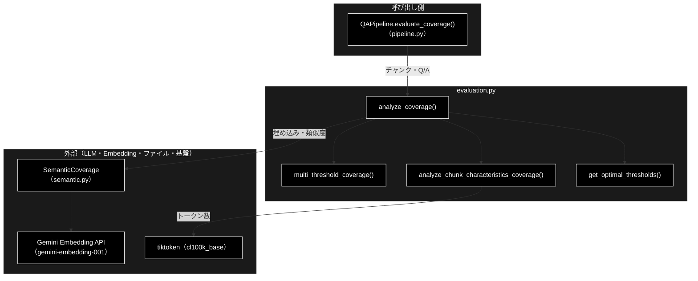
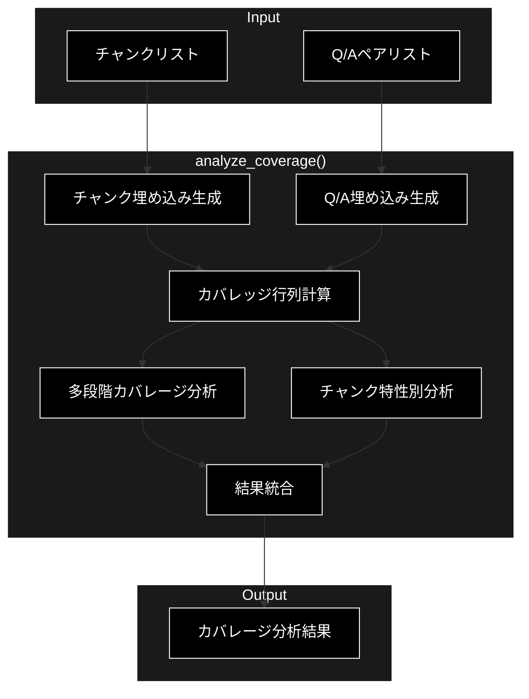
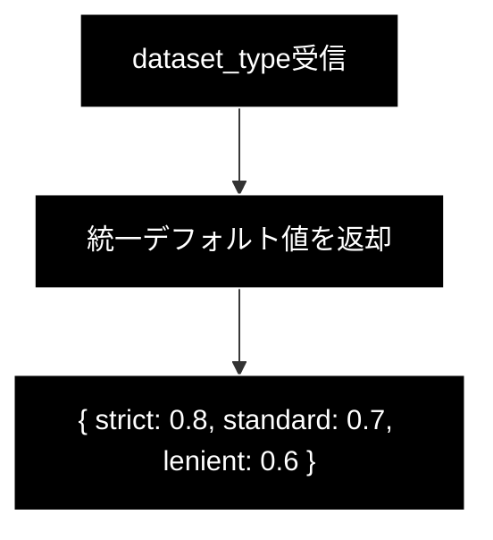
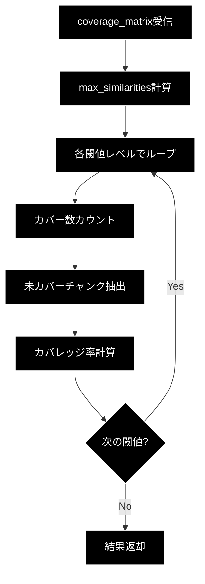
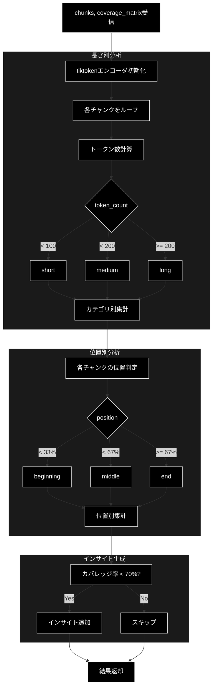
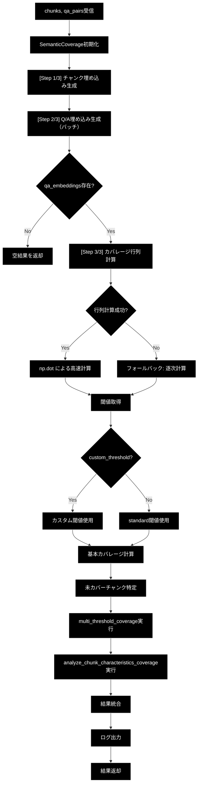
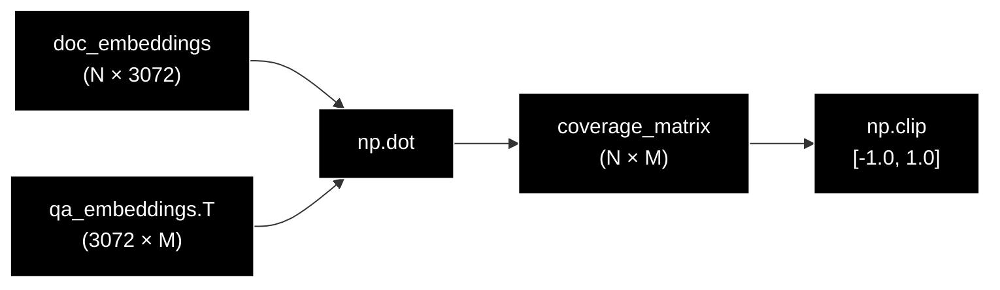

# evaluation.py - カバレッジ分析 ドキュメント

**Version 1.3** | 最終更新: 2026-10-11

---

## 目次

1. [概要](#概要)
2. [アーキテクチャ構成図](#1-アーキテクチャ構成図)
3. [モジュール構成図](#2-モジュール構成図)
4. [カバレッジ分析の仕組み](#3-カバレッジ分析の仕組み)
5. [クラス・関数一覧表](#4-クラス関数一覧表)
6. [クラス・関数 IPO詳細](#5-クラス関数-ipo詳細)
7. [設定・定数（閾値と評価基準）](#6-設定定数閾値と評価基準)
8. [出力データ構造](#7-出力データ構造)
9. [関連モジュール](#8-関連モジュール)
10. [ベストプラクティス](#9-ベストプラクティス)
11. [v3.0 の変更点](#10-v30-の変更点)
12. [変更履歴](#11-変更履歴)

---

## 概要

`qa_generation/evaluation.py` は、**生成されたQ/Aペアがチャンクをどれだけカバーしているかを分析するカバレッジ分析モジュール**です。セマンティック類似度に基づく評価を行い、多段階閾値評価とチャンク特性別分析により、Q/A品質の詳細な把握を可能にします。

### 主な責務

- 評価閾値（strict / standard / lenient）を決める
- 複数の閾値でカバレッジを測る
- チャンクの特性別にカバレッジを分析する
- Q/A 群のカバレッジ分析を一括で実行する

### 各責務対応のモジュール

| # | 責務 | 対応モジュール | 説明 |
|---|---|---|---|
| 1 | 評価閾値（strict / standard / lenient）を決める | `get_optimal_thresholds()` | 3 段階の既定閾値（0.8 / 0.7 / 0.6）を返す |
| 2 | 複数の閾値でカバレッジを測る | `multi_threshold_coverage()` | カバレッジ行列から閾値ごとのカバー率・未カバー数を算出 |
| 3 | チャンクの特性別にカバレッジを分析する | `analyze_chunk_characteristics_coverage()` | 長さ別・位置別の集計とインサイト生成（tiktoken でトークン数を数える） |
| 4 | Q/A 群のカバレッジ分析を一括で実行する | `analyze_coverage()` | 埋め込み生成 → カバレッジ行列 → 多段階評価 → 特性別分析を統合 |

### 主要機能一覧

| 機能 | 説明 |
|---|---|
| `analyze_coverage(chunks, qa_pairs, dataset_type)` | メイン関数。カバレッジ分析結果の辞書を返す |
| `multi_threshold_coverage(...)` | strict / standard / lenient の 3 段階でカバー率を返す |
| `analyze_chunk_characteristics_coverage(...)` | 長さ別・位置別のカバレッジとインサイト |
| `get_optimal_thresholds(dataset_type)` | 閾値辞書を返す |

---

## 1. アーキテクチャ構成図

### 1.1 システム全体構成



### 1.2 データフロー

1. `QAPipeline.evaluate_coverage()` がチャンクと Q/A ペアを渡して `analyze_coverage()` を呼ぶ
2. `SemanticCoverage` がチャンクと Q/A の埋め込みを Gemini Embedding で生成する
3. チャンク × Q/A のコサイン類似度から**カバレッジ行列**を作る
4. `get_optimal_thresholds()` の 3 段階閾値で `multi_threshold_coverage()` がカバー率を算出する
5. `analyze_chunk_characteristics_coverage()` が長さ別・位置別に集計し、インサイトを付ける
6. 結果を 1 つの辞書にまとめて返す（`QAPipeline.save()` がファイルへ保存）

---

## 2. モジュール構成図

### 2.1 全体構成

```
┌─────────────────────────────────────────────────────────────┐
│                     evaluation.py                           │
├─────────────────────────────────────────────────────────────┤
│                                                             │
│  ┌─────────────────────────────────────────────────────┐    │
│  │              公開関数                                 │   │
│  ├─────────────────────────────────────────────────────┤    │
│  │  get_optimal_thresholds()     # 閾値取得             │   │
│  │  multi_threshold_coverage()   # 多段階カバレージ       │   │
│  │  analyze_chunk_characteristics_coverage()           │   │
│  │                               # チャンク特性分析       │   │
│  │  analyze_coverage()           # メイン分析関数         │   │
│  └─────────────────────────────────────────────────────┘    │
│                                                             │
└─────────────────────────────────────────────────────────────┘
                              │
                              ▼
┌─────────────────────────────────────────────────────────────┐
│                   SemanticCoverage                          │
│  (qa_generation/semantic.py)                                │
│  ├─ generate_embeddings()        # チャンク埋め込み            │
│  ├─ generate_embeddings_batch()  # Q/A埋め込み（バッチ）       │
│  └─ cosine_similarity()          # 類似度計算                 │
└─────────────────────────────────────────────────────────────┘
```

### 2.2 処理フロー



---

## 3. カバレッジ分析の仕組み

### 3.1 セマンティックカバレッジとは

Q/Aペアが元のチャンクの内容をどれだけ「意味的に」カバーしているかを測定します。

```
チャンク: "AES-256は256ビットの鍵長を持つ対称鍵暗号です"
    ↓ 埋め込みベクトル化
Q/A: "AES-256の鍵長は何ビット？" → "256ビット"
    ↓ 埋め込みベクトル化
コサイン類似度計算 → 0.85（カバーしている）
```

### 3.2 カバレッジ行列

```
              Q/A_0   Q/A_1   Q/A_2   ... Q/A_M
Chunk_0   [   0.92    0.45    0.30   ...  0.55  ]
Chunk_1   [   0.35    0.88    0.42   ...  0.60  ]
Chunk_2   [   0.40    0.50    0.75   ...  0.65  ]
  ...
Chunk_N   [   0.55    0.60    0.45   ...  0.70  ]
```

各チャンクの**最大類似度**（max_similarities）を閾値と比較してカバー判定を行います。

### 3.3 カバー判定

```python
max_similarity = coverage_matrix[i].max()  # チャンクiの最大類似度
is_covered = max_similarity >= threshold   # 閾値以上ならカバー
```

---

## 4. クラス・関数一覧表

| 関数名 | 機能概要 |
|-------|---------|
| `get_optimal_thresholds` | カバレッジ分析用の閾値（strict/standard/lenient）を取得 |
| `multi_threshold_coverage` | 複数の閾値でカバレッジを評価し、各レベルの結果を返す |
| `analyze_chunk_characteristics_coverage` | チャンクの長さ別・位置別にカバレッジを分析 |
| `analyze_coverage` | カバレッジ分析のメイン関数。全機能を統合して実行 |

---

## 5. クラス・関数 IPO詳細

### 5.1 使用例

| # | パターン | いつ使うか | 例 |
|---|---------|-----------|----|
| 1 | **基本**: チャンクと Q/A からカバレージを測る（`analyze_coverage()`） | 生成した Q/A がチャンクをどれだけ網羅したかを見る | 5.1.1 |
| 2 | 判定の下限を変える（`custom_threshold`）・Q/A が 0 件のとき | 厳しめ／緩めに数える | 5.1.2 |
| 3 | 類似度行列から多段階で数える（`multi_threshold_coverage()`） | 類似度が手元にあり、Embedding を呼ばずに数え直す | 5.1.3 |

> 📝 **確かめ方（2026-10-11）**: 5.1.1〜5.1.3 はすべて実行した。Embedding（Gemini）は文字の 2-gram をハッシュした 3072 次元のスタブに差し替えた
> （文字の重なりが多いほど類似度が高い）。類似度の値はスタブのもので、実 Embedding では変わる（数え方は同じ）。
> `analyze_coverage()` はパイプラインの中では [`pipeline.md`](pipeline.md) の `evaluate_coverage()` から呼ばれる。

#### 5.1.1 基本: チャンクと Q/A からカバレージを測る

```python
from qa_generation.evaluation import analyze_coverage

# QAPipeline が渡すのと同じ形（id・text を持つ辞書のリスト）
chunks = [
    {"id": "c0", "text": "住民票の写しは市役所の窓口で取得できます。"},
    {"id": "c1", "text": "手数料は1通300円です。"},
    {"id": "c2", "text": "マイナンバーカードがあればコンビニでも取得できます。"},
    {"id": "c3", "text": "利用時間は6時30分から23時までです。"},
]
qa_pairs = [   # c3（利用時間）に対応する Q/A が無い
    {"question": "住民票の写しはどこで取れますか？", "answer": "市役所の窓口で取得できます。"},
    {"question": "手数料はいくらですか？", "answer": "1通300円です。"},
    {"question": "コンビニでも取れますか？", "answer": "マイナンバーカードがあればコンビニでも取得できます。"},
]

result = analyze_coverage(chunks, qa_pairs)

print(f"{result['coverage_rate']:.0%}", result["covered_chunks"], result["total_chunks"], result["threshold"])
print([round(s, 2) for s in result["max_similarities"]])           # チャンクごとの、いちばん近い Q/A との類似度
for item in result["uncovered_chunks"]:                             # threshold 未満のチャンク
    print(item["chunk"]["id"], round(item["similarity"], 2), round(item["gap"], 2))
print({level: r["covered_chunks"] for level, r in result["multi_threshold"].items()})

# 実行結果:
# 75% 3 4 0.7
# [0.81, 0.74, 0.89, 0.2]
# c3 0.2 0.5
# {'strict': 2, 'standard': 3, 'lenient': 3}
```

> 📌 Q/A は `"{question} {answer}"`（空白でつないだ文）を Embedding する。チャンクは `text`。チャンク i と Q/A j のコサイン類似度の行列を作り、
> 各チャンクの最大値が下限（既定は standard の 0.7）以上なら「カバーした」と数える。戻り値には `chunk_analysis`（長さ別・位置別）と
> `optimal_thresholds` も入る（§7）。多段階・特性別の集計は INFO ログにも複数行で出る。
> 呼ぶたびに `WARNING ... [Embedding] Batch size 2048 exceeds Gemini limit (100). Clamping to 100.` が出る（Q/A を 2048 件ずつ頼み、
> Embedding 側が 100 件ずつに直している。結果には影響しない）。

#### 5.1.2 判定の下限を変える・Q/A が 0 件のとき

```python
from qa_generation.evaluation import analyze_coverage

chunks = [{"id": "c0", "text": "手数料は1通300円です。"}, {"id": "c1", "text": "利用時間は6時30分から23時までです。"}]
qa_pairs = [{"question": "手数料は？", "answer": "1通300円です。"}]

# custom_threshold で「カバーした」とみなす下限を変える（既定は standard の 0.7）
for t in (None, 0.5, 0.9):
    r = analyze_coverage(chunks, qa_pairs, custom_threshold=t)
    print(t, r["threshold"], r["covered_chunks"])

# Q/A が 0 件のときは 0 を返す（チャンクの Embedding は作る）
print(analyze_coverage(chunks, [])["coverage_rate"])

# 実行結果:
# None 0.7 1
# 0.5 0.5 1
# 0.9 0.9 0
# 0.0
```

> 📌 `custom_threshold` が変えるのは基本の判定（`coverage_rate` / `uncovered_chunks`）と特性別の集計だけで、`multi_threshold` は常に 0.8 / 0.7 / 0.6 で数える。
> `QAPipeline.run(coverage_threshold=...)` がここへ渡る。

#### 5.1.3 類似度行列から多段階で数える

```python
import numpy as np
from qa_generation.evaluation import get_optimal_thresholds, multi_threshold_coverage

# 類似度行列（行 = チャンク、列 = Q/A）が手元にあるとき。Embedding を呼ばない
coverage_matrix = np.array([
    [0.85, 0.20],
    [0.30, 0.72],
    [0.10, 0.65],
])
chunks = [{"id": "c0"}, {"id": "c1"}, {"id": "c2"}]

thresholds = get_optimal_thresholds()
print(thresholds)
result = multi_threshold_coverage(coverage_matrix, chunks, [{}, {}], thresholds)
for level, r in result.items():
    print(level, r["covered_chunks"], [u["chunk_id"] for u in r["uncovered_chunks"]])

# 実行結果:
# {'strict': 0.8, 'standard': 0.7, 'lenient': 0.6}
# strict 1 ['c1', 'c2']
# standard 2 ['c2']
# lenient 3 []
```

> 📌 `get_optimal_thresholds()` は引数（`dataset_type`）を見ず、常に同じ 3 段を返す（データセット別の値は廃止）。
> `multi_threshold_coverage()` は `qa_pairs` の中身を使わない（列数は `coverage_matrix` から決まる）。

### 5.2 get_optimal_thresholds()

#### IPO

| 区分 | 内容 |
|-----|------|
| **Input** | `dataset_type`: str（データセットタイプ、現在は未使用） |
| **Process** | 統一デフォルト値を返す |
| **Output** | `Dict[str, float]`: {strict, standard, lenient} |

#### プロセスフロー



#### 出力構造

```python
{
    "strict": 0.8,    # 厳格な評価
    "standard": 0.7,  # 標準評価
    "lenient": 0.6    # 緩やかな評価
}
```

### 5.3 multi_threshold_coverage()

#### IPO

| 区分 | 内容 |
|-----|------|
| **Input** | `coverage_matrix`: np.ndarray（カバレッジ行列）<br>`chunks`: List[Dict]（チャンクリスト）<br>`qa_pairs`: List[Dict]（Q/Aペアリスト）<br>`thresholds`: Dict[str, float]（閾値辞書） |
| **Process** | 1. 各チャンクの最大類似度を取得<br>2. 各閾値レベルでカバー数をカウント<br>3. 未カバーチャンク情報を収集 |
| **Output** | `Dict`: 各閾値レベルのカバレッジ結果 |

#### プロセスフロー



#### 出力構造

```python
{
    "strict": {
        "threshold": 0.8,
        "covered_chunks": 72,
        "coverage_rate": 0.72,
        "uncovered_count": 28,
        "uncovered_chunks": [
            {"chunk_id": "chunk_0", "similarity": 0.75, "gap": 0.05},
            ...
        ]
    },
    "standard": { ... },
    "lenient": { ... }
}
```

### 5.4 analyze_chunk_characteristics_coverage()

#### IPO

| 区分 | 内容 |
|-----|------|
| **Input** | `chunks`: List[Dict]（チャンクリスト）<br>`coverage_matrix`: np.ndarray（カバレッジ行列）<br>`qa_pairs`: List[Dict]（Q/Aペアリスト）<br>`threshold`: float（判定閾値、デフォルト0.7） |
| **Process** | 1. 長さ別分析（short/medium/long）<br>2. 位置別分析（beginning/middle/end）<br>3. インサイト生成 |
| **Output** | `Dict`: チャンク特性別カバレッジ結果 |

#### プロセスフロー



#### 長さカテゴリの基準

| カテゴリ | トークン数 |
|---------|----------|
| short | < 100 |
| medium | 100 〜 199 |
| long | >= 200 |

#### 位置カテゴリの基準

| カテゴリ | チャンクインデックス |
|---------|-------------------|
| beginning | < 全体の33% |
| middle | 33% 〜 66% |
| end | >= 67% |

#### 出力構造

```python
{
    "by_length": {
        "short": {
            "count": 25,
            "covered": 20,
            "avg_similarity": 0.75,
            "coverage_rate": 0.80
        },
        "medium": { ... },
        "long": { ... }
    },
    "by_position": {
        "beginning": {
            "count": 33,
            "covered": 28,
            "avg_similarity": 0.78,
            "coverage_rate": 0.85
        },
        "middle": { ... },
        "end": { ... }
    },
    "summary": {
        "total_chunks": 100,
        "total_qa_pairs": 250,
        "threshold_used": 0.7,
        "insights": [
            "shortチャンクのカバレージが低い（65.0%）",
            "文書end部分のカバレージが低い（60.0%）"
        ]
    }
}
```

### 5.5 analyze_coverage()

#### IPO

| 区分 | 内容 |
|-----|------|
| **Input** | `chunks`: List[Dict]（チャンクリスト）<br>`qa_pairs`: List[Dict]（Q/Aペアリスト）<br>`dataset_type`: str（データセットタイプ、デフォルト"wikipedia_ja"）<br>`custom_threshold`: Optional[float]（カスタム閾値） |
| **Process** | 1. SemanticCoverage初期化<br>2. チャンク埋め込み生成<br>3. Q/A埋め込み生成（バッチ）<br>4. カバレッジ行列計算<br>5. 基本カバレッジ計算<br>6. 多段階カバレージ分析<br>7. チャンク特性別分析<br>8. 結果統合・ログ出力 |
| **Output** | `Dict`: 総合カバレッジ分析結果 |

#### プロセスフロー



#### カバレッジ行列計算の詳細



- **N**: チャンク数
- **M**: Q/Aペア数
- **3072**: Gemini埋め込み次元数

#### 出力構造

```python
{
    # 基本メトリクス
    "coverage_rate": 0.85,
    "covered_chunks": 85,
    "total_chunks": 100,
    "uncovered_chunks": [
        {
            "chunk": {"id": "chunk_0", "text": "..."},
            "similarity": 0.65,
            "gap": 0.05
        },
        ...
    ],
    "max_similarities": [0.92, 0.78, 0.65, ...],
    "threshold": 0.7,

    # 多段階カバレージ
    "multi_threshold": {
        "strict": { ... },
        "standard": { ... },
        "lenient": { ... }
    },

    # チャンク特性別分析
    "chunk_analysis": {
        "by_length": { ... },
        "by_position": { ... },
        "summary": { ... }
    },

    # データセット情報
    "dataset_type": "wikipedia_ja",
    "optimal_thresholds": {
        "strict": 0.8,
        "standard": 0.7,
        "lenient": 0.6
    }
}
```

---

## 6. 設定・定数（閾値と評価基準）

### 6.1 3段階閾値

| レベル | 閾値 | 意味 | 用途 |
|-------|:----:|------|------|
| **strict** | 0.8 | 高い類似度を要求 | 厳密な品質評価 |
| **standard** | 0.7 | 標準的な類似度 | 通常の評価（デフォルト） |
| **lenient** | 0.6 | 緩やかな類似度 | 最低限のカバー確認 |

### 6.2 閾値の解釈

```
類似度 0.9〜1.0: ほぼ同一の内容
類似度 0.8〜0.9: 非常に関連性が高い
類似度 0.7〜0.8: 関連性が高い
類似度 0.6〜0.7: ある程度関連
類似度 0.5〜0.6: 弱い関連
類似度 < 0.5:    ほとんど無関連
```

### 6.3 カスタム閾値

```python
# 標準の閾値を使用
result = analyze_coverage(chunks, qa_pairs)

# カスタム閾値を指定
result = analyze_coverage(chunks, qa_pairs, custom_threshold=0.75)
```

---

## 7. 出力データ構造

### 7.1 完全な出力例

```python
{
    # ========== 基本メトリクス ==========
    "coverage_rate": 0.85,           # カバレッジ率（0.0〜1.0）
    "covered_chunks": 85,            # カバー済みチャンク数
    "total_chunks": 100,             # 総チャンク数
    "threshold": 0.7,                # 使用した閾値
    "max_similarities": [            # 各チャンクの最大類似度
        0.92, 0.78, 0.65, ...
    ],
    "uncovered_chunks": [            # 未カバーチャンク詳細
        {
            "chunk": {
                "id": "chunk_15",
                "text": "補足情報..."
            },
            "similarity": 0.65,
            "gap": 0.05
        },
        ...
    ],

    # ========== 多段階カバレージ ==========
    "multi_threshold": {
        "strict": {
            "threshold": 0.8,
            "covered_chunks": 72,
            "coverage_rate": 0.72,
            "uncovered_count": 28,
            "uncovered_chunks": [...]
        },
        "standard": {
            "threshold": 0.7,
            "covered_chunks": 85,
            "coverage_rate": 0.85,
            "uncovered_count": 15,
            "uncovered_chunks": [...]
        },
        "lenient": {
            "threshold": 0.6,
            "covered_chunks": 93,
            "coverage_rate": 0.93,
            "uncovered_count": 7,
            "uncovered_chunks": [...]
        }
    },

    # ========== チャンク特性別分析 ==========
    "chunk_analysis": {
        "by_length": {
            "short": {
                "count": 25,
                "covered": 20,
                "avg_similarity": 0.75,
                "coverage_rate": 0.80
            },
            "medium": {
                "count": 50,
                "covered": 45,
                "avg_similarity": 0.78,
                "coverage_rate": 0.90
            },
            "long": {
                "count": 25,
                "covered": 20,
                "avg_similarity": 0.72,
                "coverage_rate": 0.80
            }
        },
        "by_position": {
            "beginning": {
                "count": 33,
                "covered": 30,
                "avg_similarity": 0.80,
                "coverage_rate": 0.91
            },
            "middle": {
                "count": 34,
                "covered": 30,
                "avg_similarity": 0.77,
                "coverage_rate": 0.88
            },
            "end": {
                "count": 33,
                "covered": 25,
                "avg_similarity": 0.72,
                "coverage_rate": 0.76
            }
        },
        "summary": {
            "total_chunks": 100,
            "total_qa_pairs": 250,
            "threshold_used": 0.7,
            "insights": [
                "文書end部分のカバレージが低い（76.0%）"
            ]
        }
    },

    # ========== データセット情報 ==========
    "dataset_type": "wikipedia_ja",
    "optimal_thresholds": {
        "strict": 0.8,
        "standard": 0.7,
        "lenient": 0.6
    }
}
```

---

## 8. 関連モジュール

| モジュール | 関係 |
|-----------|------|
| `qa_generation/semantic.py` | SemanticCoverageクラスを使用して埋め込み生成・類似度計算 |
| `qa_generation/pipeline.py` | evaluate_coverage()からanalyze_coverage()を呼び出し |
| `qa_generation/data_io.py` | カバレッジ結果をJSONファイルとして保存 |

### 8.1 SemanticCoverageの使用

```python
# evaluation.py内部での使用
analyzer = SemanticCoverage()

# チャンク埋め込み
doc_embeddings = analyzer.generate_embeddings(chunks)

# Q/A埋め込み（バッチ処理）
qa_embeddings = analyzer.generate_embeddings_batch(qa_texts, batch_size=2048)

# コサイン類似度（フォールバック時）
similarity = analyzer.cosine_similarity(doc_emb, qa_emb)
```

---

## 9. ベストプラクティス

### 9.1 カバレッジ率の目安

| カバレッジ率 | 評価 | 対応 |
|:-----------:|------|------|
| 90%以上 | 優秀 | 維持 |
| 80〜90% | 良好 | 必要に応じて改善 |
| 70〜80% | 普通 | 未カバー箇所の確認推奨 |
| 70%未満 | 要改善 | Q/A追加生成を検討 |

### 9.2 インサイトの活用

```python
insights = result['chunk_analysis']['summary']['insights']

if insights:
    print("改善が必要な箇所:")
    for insight in insights:
        print(f"  - {insight}")
```

### 9.3 未カバーチャンクの優先対応

```python
# ギャップが小さい順（あと少しでカバーできる）
sorted_uncovered = sorted(
    result['uncovered_chunks'],
    key=lambda x: x['gap']
)

print("優先対応すべきチャンク（ギャップ小）:")
for item in sorted_uncovered[:5]:
    print(f"  {item['chunk']['id']}: gap={item['gap']:.3f}")
```

---

**作成日**: 2025-01-27
**対象ファイル**: `qa_generation/evaluation.py`
**バージョン**: v3.0（config.py依存削除版）

---

## 10. v3.0 の変更点

| 項目 | v2.x | v3.0 |
|-----|------|------|
| config.py依存 | あり | **削除** |
| データセット別閾値 | 個別設定 | **統一デフォルト値** |
| 閾値設定 | DATASET_CONFIGSから取得 | 固定値（strict:0.8, standard:0.7, lenient:0.6） |

### 10.1 削除された依存

```python
# v2.x（削除）
from qa_generation.config import DATASET_CONFIGS

# v3.0（現在）
# config.pyへの依存なし
```

---

## 11. 変更履歴

| バージョン | 日付 | 変更内容 |
|---|---|---|
| 1.0 | 2026-09-03 | 初版（2026-09-03） |
| 1.1 | 2026-09-13 | Mermaid 図に黒背景スタイルを適用（2026-09-13）。**Version ヘッダーと本表を追加**（2026-09-21・版と日付は git 履歴からの実測値） |
| 1.2 | 2026-09-24 | 基本フォーマット `a_class_method_md_format.md` の章構成へ組み替え（2026-09-24）。概要に「主な責務」と「各責務対応のモジュール」（1:1）を置き、`## 1. アーキテクチャ構成図`（3 層＋データフロー）を新設。既存の構成図は `## 2. モジュール構成図` へ、使用方法は IPO 詳細の冒頭（`### 5.1 使用例`）へ移した。固有の解説章（「カバレッジ分析の仕組み」）は §1.3 に従い一覧表の前に置き、章・小節に番号を振った。本文の内容は変えていない |
| 1.3 | 2026-10-11 | §5.1 使用例を 3 パターン（`analyze_coverage` の基本・`custom_threshold`・`multi_threshold_coverage` に行列を渡す）に書き直し、スタブの Embedding で動かした出力を載せた（grace_v2 と同じ整理） |
