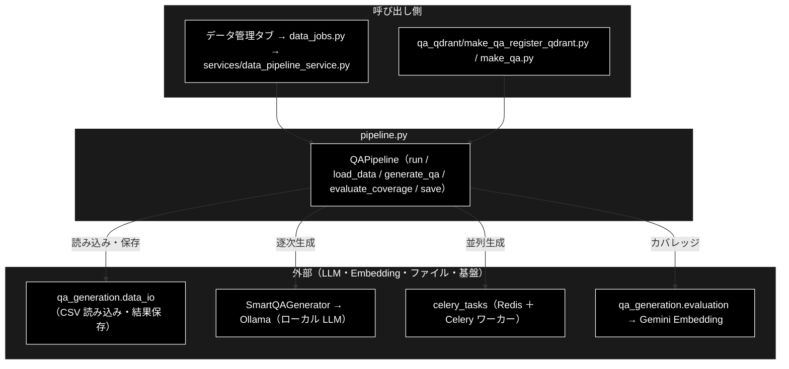

# pipeline.py - Q/A 生成パイプライン ドキュメント

**Version 1.11** | 最終更新: 2026-10-11

---

## 目次

1. [概要](#概要)
2. [アーキテクチャ構成図](#1-アーキテクチャ構成図)
3. [モジュール構成図](#2-モジュール構成図)
4. [クラス・関数一覧表](#3-クラス関数一覧表)
5. [クラス・関数 IPO詳細](#4-クラス関数-ipo詳細)
6. [設定・定数（パラメータリファレンス）](#5-設定定数パラメータリファレンス)
7. [使用例（応用ワークフロー）](#6-使用例応用ワークフロー)
8. [出力ファイル](#7-出力ファイル)
9. [トラブルシューティング](#8-トラブルシューティング)
10. [関連モジュール](#9-関連モジュール)
11. [ベストプラクティス](#10-ベストプラクティス)
12. [v3.0 の変更点](#11-v30-の変更点)
13. [変更履歴](#12-変更履歴)

---

## 概要

`qa_generation/pipeline.py` は、**チャンク済みCSVからQ/A生成、カバレッジ分析、結果保存までを一貫して実行するパイプライン制御モジュール**です。

### 主な責務

- 入力を検証し設定を解決する
- チャンク済み CSV を読み込みチャンクリストへ変換する
- Q/A を生成する（逐次 / Celery 並列）
- 中断時の再開に備えて進捗を記録する
- カバレッジを分析する
- 結果を保存する
- 一連の工程を 1 回で実行する

### 各責務対応のモジュール

| # | 責務 | 対応モジュール | 説明 |
|---|---|---|---|
| 1 | 入力を検証し設定を解決する | `QAPipeline.__init__()` / `_validate_inputs()` / `_load_config()` | データセット名と入力ファイルの排他チェック、`DATASET_CONFIGS` からの設定取得。種別 `type` は入力ファイル名（拡張子なし）かデータセット名（`DATASET_CONFIGS` に `type` キーが無いため補う。出力名・チャンク ID・途中経過ファイル `qa_progress_<種別>.jsonl` に使う） |
| 2 | チャンク済み CSV を読み込みチャンクリストへ変換する | `load_data()` / `_load_chunks_from_csv()` | `data_io` で読み込み、`text` / `Combined_Text` 列からチャンク辞書を作る |
| 3 | Q/A を生成する（逐次 / Celery 並列） | `generate_qa()` / `_generate_sync()` / `_generate_with_celery()` | `SmartQAGenerator`（Ollama（ローカル LLM））を直接、または Celery ワーカー経由で呼ぶ |
| 4 | 中断時の再開に備えて進捗を記録する | `_load_progress()` / `_load_progress_records()` / `_append_progress()` / `_clear_progress()` / `_text_hash()` | チャンク単位の生成結果を本文のハッシュとともに進捗ファイルへ追記し、本文が同じチャンクだけを復元する |
| 5 | カバレッジを分析する | `evaluate_coverage()` | `evaluation.analyze_coverage()` へ委譲 |
| 6 | 結果を保存する | `save()` | `data_io.save_results()` へ委譲（Q/A・カバレッジ・サマリー） |
| 7 | 一連の工程を 1 回で実行する | `run()` | 読み込み → 生成 → 分析 → 保存を順に実行し、結果辞書を返す |

### 主要機能一覧

| 機能 | 説明 |
|---|---|
| `QAPipeline(dataset_name=..., input_file=..., model=..., output_dir=...)` | パイプラインを構成する |
| `run(use_celery=..., celery_workers=..., concurrency=..., analyze_coverage=...)` | 全工程を実行するメイン API |
| `generate_qa(chunks, ...)` | Q/A 生成のみを行う |
| `evaluate_coverage(chunks, qa_pairs, ...)` | カバレッジ分析のみを行う |

### 主な特徴

- **チャンク済みCSV専用**: 前段処理（`csv_text_to_chunks_text_csv.py`）で作成されたチャンクCSVを入力として使用
- **SmartQAGenerator統合**: コンテンツを分析し、適切なQ/A数を動的に決定
- **Celery並列処理対応**: 大規模データセットの高速処理
- **多段階カバレッジ分析**: Strict/Standard/Lenientの3段階で評価
- **チャンク特性分析**: 長さ別・位置別のカバレッジ分析

### 前提条件

- 入力CSVは既にチャンク済み（`csv_text_to_chunks_text_csv.py`で処理済み）
- チャンクCSVには `text` または `Combined_Text` カラムが必要

---

## 1. アーキテクチャ構成図

### 1.1 システム全体構成



### 1.2 データフロー

1. Web（データ管理タブ）または CLI が `QAPipeline` を構成し `run()` を呼ぶ
2. `load_data()` が `data_io` でチャンク済み CSV を読み、`_load_chunks_from_csv()` がチャンクリストへ変換する
3. `generate_qa()` が逐次なら `SmartQAGenerator`（Ollama（ローカル LLM））、並列なら Celery ワーカーへ投入して Q/A を集める
4. `evaluate_coverage()` が `evaluation.analyze_coverage()` でカバレッジを測る（任意）
5. `save()` が `data_io.save_results()` で Q/A・カバレッジ・サマリーを書き出し、結果辞書を返す

---

## 2. モジュール構成図

### 2.1 アーキテクチャ概要

```
csv_text_to_chunks_text_csv.py（前段処理）
              ↓
        チャンク済みCSV
              ↓
┌───────────────────────────────────────┐
│        pipeline.py (v3.0)             │
├───────────────────────────────────────┤
│ [1/3] load_data()                     │  ← CSV読み込み
│ [2/3] _load_chunks_from_csv()         │  ← チャンクリストに変換
│ [3/3] generate_qa()                   │  ← Q/A生成（SmartQAGenerator）
│       evaluate_coverage()             │  ← カバレッジ分析
│       save()                          │  ← 結果保存
└───────────────────────────────────────┘
```

### 2.2 システムアーキテクチャ

#### 依存関係

```
QAPipeline
├── qa_generation.data_io
│   ├── load_uploaded_file()         # ローカルファイル読み込み
│   ├── load_preprocessed_data()     # 前処理済みデータ読み込み
│   └── save_results()               # 結果保存
│
├── qa_generation.smart_qa_generator
│   └── SmartQAGenerator             # インテリジェントQ/A生成
│
├── qa_generation.evaluation
│   └── analyze_coverage()           # カバレッジ分析
│
├── celery_tasks                      # ★ 遅延 import（_generate_with_celery 内）
│   ├── submit_unified_qa_generation() # Celeryタスク投入
│   ├── collect_results()              # 結果収集
│   └── check_celery_workers()         # ワーカー確認
│
├── helper.helper_llm
    └── LLMClient                    # LLM操作

```

#### レイヤー構成

```
┌──────────────────────────────────────────┐
│  Application Layer (QAPipeline)          │  ← パイプライン制御
│  - run()                                 │
├──────────────────────────────────────────┤
│  Business Logic Layer                    │
│  ├─ データ読み込み (data_io)               │
│  ├─ Q/A生成 (smart_qa_generator)         │
│  ├─ カバレッジ分析 (evaluation)            │
│  └─ 結果保存 (data_io)                    │
├──────────────────────────────────────────┤
│  Infrastructure Layer                    │
│  ├─ Celery (並列処理)                     │
│  ├─ LLMClient (Ollama / OpenAI 互換 API)  │
│  └─ SemanticCoverage (埋め込み生成)        │
└──────────────────────────────────────────┘
```

---

## 3. クラス・関数一覧表

| メソッド | 種別 | 概要 |
|---|---|---|
| `__init__()` | 公開 | 初期化・入力検証 |
| `load_data()` | 公開 | データセット名 / 入力ファイルから `DataFrame` を読む |
| `generate_qa()` | 公開 | Q/A 生成（逐次 / Celery） |
| `evaluate_coverage()` | 公開 | カバレッジ分析 |
| `save()` | 公開 | 結果保存 |
| `run()` | 公開 | 全工程の実行（メイン） |
| `_validate_inputs()` / `_load_config()` | 内部 | 入力の排他制御・設定解決 |
| `_load_chunks_from_csv()` | 内部 | チャンク CSV → チャンクリスト |
| `_generate_sync()` / `_generate_with_celery()` | 内部 | 逐次生成 / Celery 並列生成 |
| `_progress_path()` / `_load_progress()` / `_load_progress_records()` / `_append_progress()` / `_clear_progress()` / `_text_hash()` | 内部 | 進捗ファイルの管理（再開用。`_append_progress(chunk_id, qa_pairs, text=None)` は `text` を渡すと本文の SHA-256 も記録する） |

```
QAPipeline
├── __init__()                    # 初期化、入力検証
├── _validate_inputs()            # 入力の排他制御
├── _load_config()                # 設定ロード
│
├── load_data()                   # データ読み込み（データセット/ファイル）
├── _load_chunks_from_csv()       # チャンクCSV→チャンクリスト変換
│
├── generate_qa()                 # Q/A生成（Celery/逐次）
│   ├── _generate_with_celery()   # Celery並列処理
│   └── _generate_sync()          # 逐次処理（SmartQAGenerator使用）
│
├── evaluate_coverage()           # カバレッジ分析
├── save()                        # 結果保存（JSON/CSV）
│
└── run()                         # パイプライン実行 ⭐メイン
```

---

## 4. クラス・関数 IPO詳細

### 4.1 使用例

| # | パターン | いつ使うか | 例 |
|---|---------|-----------|----|
| 1 | **基本**: チャンク済み CSV → 同期で生成（カバレージつき） | 小〜中規模のデータを 1 プロセスで処理する | 4.1.1 |
| 2 | 本番の入口と同じ組み立て方（データ管理タブ） | 画面と同じ結果を Python から得る | 4.1.2 |
| 3 | 中断したジョブを続きから再開する | 途中で落ちた・止めた | 4.1.3 |
| 4 | Celery 並列で生成する | チャンク数が多い | 4.1.4 |
| 5 | 本文の列を指定する（`text_column`） | 本文の列名が自動検出の候補に無い CSV | 4.1.5 |
| 6 | 事前定義データセットを読む（`dataset_name`） | `config.py::DATASET_CONFIGS` のデータを使う | 4.1.6 |
| 7 | 失敗したとき（一部のチャンク・全チャンク・Embedding） | 結果がおかしい・例外が出たときの切り分け | 4.1.7 |

> 📝 **確かめ方（2026-10-11）**: 4.1.1〜4.1.7 はすべて実行した。LLM（Ollama）は OpenAI 互換のスタブサーバに差し替え
> （チャンク本文の先頭 1 文から Q/A を 1 件作る）、Embedding（Gemini）は文字の 2-gram をハッシュした 3072 次元のスタブ、
> 4.1.4 の Redis と Celery ワーカーは実物（ワーカーにも同じスタブを当てた）。入力は 4 行のチャンク CSV
> `output_chunked/document_chunks.csv`（列 `chunk_id` / `text` ほか。住民票・手数料・コンビニ・利用時間の 4 文）。
> 実 LLM では Q/A の数（チャンクあたり 0〜5 件）と文面、カバレージが変わる。
> 文中の「ログに … と出る」は INFO ログで、**呼び出し側でログを設定したときだけ出る**（`logging.basicConfig(level=logging.INFO)` など。
> `qa_generation` は import でルートロガーを設定しない。2026-10-11 までは `smart_qa_generator.py` が設定していた）。WARNING 以上は設定しなくても出る。

#### 4.1.1 基本: チャンク済み CSV → 同期で生成（カバレージつき）

```python
from qa_generation import QAPipeline

# 1. チャンク済み CSV を指定してパイプラインを作る（model を省くと config.py::get_default_ollama_model()）
pipeline = QAPipeline(
    input_file="output_chunked/document_chunks.csv",
    output_dir="qa_output/pipeline",
)

# 2. 同期で実行（読み込み → チャンク変換 → Q/A 生成 → カバレージ → 4 ファイル保存）
result = pipeline.run(use_celery=False, analyze_coverage=True)

# 3. 結果を確かめる
print(result["success"], result["qa_count"])
print(f"カバレージ: {result['coverage_results']['coverage_rate']:.1%}")
print(sorted(result["saved_files"]))
print(result["saved_files"]["qa_csv"])

# 実行結果:
# True 4
# カバレージ: 100.0%
# ['coverage', 'qa_csv', 'qa_json', 'summary']
# qa_output/pipeline/qa_pairs_document_chunks_20261011_130842.csv
```

> 📌 戻り値には `failed_chunks`（LLM が失敗したチャンクの ID。無ければ `[]`）も入る。全チャンクで失敗すると `RuntimeError`、
> 一部だけなら `success=True` のまま `failed_chunks` に載る（4.1.7）。

#### 4.1.2 本番の入口と同じ組み立て方（データ管理タブ）

```python
from services.data_pipeline_service import run_qa_generation_sync

# データ管理タブの「② Q/A 作成」（backend/app/core/data_jobs.py::_qa_runner）と同じ呼び方
result = run_qa_generation_sync(
    "output_chunked/document_chunks.csv",
    model="gemma4:26b-a4b-it-qat",   # 画面のヘッダーで選んだモデル（ollama pull 済みのもの）
    output_dir="qa_output/web",
    max_docs=2,                 # 先頭 2 チャンクだけ（None なら全件）
    use_celery=False,
    analyze_coverage=False,     # カバレージを飛ばす（0 のダミーが入る）
)
print(result["qa_count"], result["coverage_results"]["coverage_rate"])

# 実行結果:
# 2 0
```

> 📌 `run_qa_generation_sync()` は引数を詰め替えて `QAPipeline(...).run(...)` を呼ぶだけ（[`services/docs/data_pipeline_service.md`](../../services/docs/data_pipeline_service.md)）。
> CLI の `qa_qdrant/make_qa_register_qdrant.py`（Phase 1）・`qa_qdrant/make_qa.py` も同じ `QAPipeline.run()` を呼ぶ。

#### 4.1.3 中断したジョブを続きから再開する

```python
import json
from pathlib import Path

from qa_generation import QAPipeline

args = dict(input_file="output_chunked/document_chunks.csv", output_dir="qa_output/resume")
progress = Path("qa_output/resume/qa_progress_document_chunks.jsonl")

# 1 回目: 3 チャンク目で落ちたとする（ここでは割り込みを起こして止める）
pipeline = QAPipeline(**args)
process_chunk = pipeline.smart_generator.process_chunk
def stop_at_third(text):
    if text.startswith("マイナンバー"):
        raise KeyboardInterrupt
    return process_chunk(text)
pipeline.smart_generator.process_chunk = stop_at_third
try:
    pipeline.run(analyze_coverage=False)
except KeyboardInterrupt:
    pass
print([json.loads(line)["chunk_id"] for line in progress.read_text(encoding="utf-8").splitlines()])

# 2 回目: 同じ引数で作り直して run() すると、記録済みの 2 チャンクは飛ばして続きから生成する
result = QAPipeline(**args).run(analyze_coverage=False)
print(result["qa_count"], progress.exists())   # 最終保存が成功すると逐次保存ファイルは消える

# 実行結果:
# ['document_chunk_0', 'document_chunk_1']
# 4 False
```

> 📌 再開に使うのは `<output_dir>/qa_progress_<種別>.jsonl`（1 行 = `{chunk_id, qa_pairs, text_sha256}`）。2 回目のログに
> `📂 逐次保存ファイルから再開: 処理済み 2 チャンクをスキップ（復元Q/A: 2件, 残り: 2チャンク）` と出る。
>
> 📌 **復元するのは、今回の入力にあって本文も同じ（`text_sha256` が一致する）チャンクだけ。** 同じ入力名・同じ `output_dir` で
> 本文を書き換えた CSV を流すと、そのチャンクだけを作り直す（2026-10-11 までは `chunk_id` だけで照合し、前回の Q/A が使われ、
> 今回の入力に無いチャンクの Q/A まで混ざっていた）。次の例は、全チャンクを生成して保存の前に落ちたあと、`document_chunk_0` の本文だけを書き換えて再実行したもの。

```python
import json
import logging
from pathlib import Path
import pandas as pd
from qa_generation import QAPipeline

logging.basicConfig(level=logging.INFO, format="%(levelname)s %(message)s")   # 再開のログを見る

args = dict(input_file="output_chunked/document_chunks.csv", output_dir="qa_output/changed")
progress = Path("qa_output/changed/qa_progress_document_chunks.jsonl")

# 1 回目: 全チャンクを生成したところで、保存の前に落ちたとする
p = QAPipeline(**args)
p.save = lambda *a, **k: (_ for _ in ()).throw(KeyboardInterrupt)
try:
    p.run(analyze_coverage=False)
except KeyboardInterrupt:
    pass
print(sorted(json.loads(progress.read_text().splitlines()[0])))   # 本文のハッシュも記録する

# 入力 CSV の document_chunk_0 の本文だけを書き換えてから、同じ引数で再実行する
df = pd.read_csv(args["input_file"])
df.loc[0, "text"] = "住民票の写しはオンラインでも申請できます。"
df.to_csv(args["input_file"], index=False)
result = QAPipeline(**args).run(analyze_coverage=False)
qa = json.loads(Path(result["saved_files"]["qa_json"]).read_text(encoding="utf-8"))
print(result["qa_count"], [q["answer"] for q in qa if q["chunk_id"] == "document_chunk_0"])

# 実行結果:
# ['chunk_id', 'qa_pairs', 'text_sha256']
# 4 ['住民票の写しはオンラインでも申請できます。']
# （ログ）INFO   📂 逐次保存ファイルから再開: 処理済み 3 チャンクをスキップ （復元Q/A: 3件, 残り: 1チャンク）
# （ログ）WARNING   ⚠️ 前回から本文が変わった 1 チャンクは作り直します
```

> `text_sha256` の無い記録（2026-10-11 より前に書かれた逐次保存ファイル）は照合できないので、従来どおり `chunk_id` だけで再開し、警告を出す。

#### 4.1.4 Celery 並列で生成する

```python
from qa_generation import QAPipeline

# 前提: Redis と Celery ワーカーを起動済み（./start_celery.sh start -w 2。手順は docs/celery_quick_start.md）
pipeline = QAPipeline(input_file="output_chunked/document_chunks.csv", output_dir="qa_output/celery")

# チャンクごとのタスクを全件まとめて投入し、ワーカーが -c 個ずつ処理する。
# celery_workers は「ワーカーが立っているか」の確認用、concurrency はログの表示用（実際の並列数はワーカーの -c）
result = pipeline.run(use_celery=True, celery_workers=1, concurrency=2, analyze_coverage=False)
print(result["qa_count"])

# 実行結果:
# 4
```

> ⚠️ ワーカーが立っていないと `RuntimeError: Celery workers are not running` で止まる（ログに `❌ Celeryワーカーが応答しません（stats=None）`）。
> Q/A を作るのはワーカー側の `SmartQAGenerator`（`celery_tasks._get_generator()`）なので、**ワーカーのプロセスからも Ollama に届く必要がある**（`OLLAMA_BASE_URL`）。
> 結果の収集は `min(max(タスク数 × 10, 600), 1800)` 秒で打ち切る。
>
> 📌 **LLM が失敗したチャンクは、タスクを再試行したうえで失敗にし、逐次保存ファイルに記録しない**（同期〔4.1.3〕と同じく、再開で作り直す）。
> `SmartQAGenerator.process_chunk()` は失敗を例外にせず `success=False` で返すので、ワーカーのタスク（`celery_tasks.generate_qa_for_chunk_task`）が
> それを例外に変え、60 秒おきに最大 3 回再試行する（ログ `[ワーカー] リトライ 1/3: chunk=...`）。再試行し尽くすと `collect_results()` が失敗として数え
> （`失敗: 1/4`）、そのチャンクの Q/A は 0 件のまま進む。LLM が「Q/A 不要」と判断した 0 件（`success=True`）は失敗ではなく、処理済みとして記録する。
> 2026-10-11 まではタスクが正常終了してしまい、再試行が効かず「0 件で処理済み」と記録されて、再開しても作り直されなかった
> （回帰テストは `tests/qa_generation/test_failure_paths.py`。「コンビニ」を含むチャンクだけ失敗させて、実 Redis とワーカーでも確かめた）。

#### 4.1.5 本文の列を指定する（`text_column`）

```python
import pandas as pd
from qa_generation import QAPipeline

# 本文の列名（本文）が自動検出の候補に無い CSV
pd.DataFrame({
    "chunk_id": ["faq_0", "faq_1"],
    "title": ["受付時間", "休日"],
    "本文": ["窓口は9時から17時までです。", "土日と祝日は休みです。"],
}).to_csv("faq_chunks.csv", index=False)

# text_column を省くと、読み込みの段階で ValueError（LLM は呼ばない）
try:
    QAPipeline(input_file="faq_chunks.csv", output_dir="qa_output/faq_all").run(analyze_coverage=False)
except ValueError as e:
    print("ValueError:", str(e)[:24])

# text_column で本文の列を指定する
r = QAPipeline(input_file="faq_chunks.csv", output_dir="qa_output/faq_body", text_column="本文").run(analyze_coverage=False)
print(pd.read_csv(r["saved_files"]["qa_csv"])["answer"].tolist())

# 実行結果:
# ValueError: 本文の列が見つかりません（候補: Combine
# ['窓口は9時から17時までです。', '土日と祝日は休みです。']
```

> 📌 本文の列は、`text_column`（指定時）→ `Combined_Text` → `text` / `content` / `chunk_text` / `body` / `document` / `answer` / `question` の順に探し、
> 無ければ `ValueError`（[`data_io.md`](data_io.md) §3）。指定した列が無いときも `ValueError`。
> 2026-10-11 までは候補が無いと**行の全値をつないだ文**（ID・見出しを含む）を本文にしてしまい、エラーにならなかった。

#### 4.1.6 事前定義データセットを読む（`dataset_name`）

```python
from qa_generation import QAPipeline

# 事前定義データセット（config.py::DATASET_CONFIGS）。cc_news は OUTPUT/preprocessed_cc_news.csv の Combined_Text 列を読む
# （ファイルが無ければ OUTPUT/preprocessed_cc_news_*.csv のうち名前が最後のものを使う）
pipeline = QAPipeline(dataset_name="cc_news", output_dir="qa_output/cc_news", max_docs=2)
result = pipeline.run(analyze_coverage=False)
print(result["qa_count"], result["saved_files"]["qa_csv"].split("/")[-1][:21])

# 実行結果（OUTPUT/preprocessed_cc_news.csv が 3 行のとき。max_docs=2 で先頭 2 行だけを処理する）:
# 2 qa_pairs_cc_news_2026
```

> 📌 `max_docs` は `input_file` と同じく先頭から絞る（ログに `📊 最大チャンク数制限: 2 件に制限`）。
> 2026-10-11 までは `dataset_name` のときだけ効かず、CLI の `--dataset ... --max-docs N` でも全件を処理していた
> （回帰テストは `tests/qa_generation/test_failure_paths.py`）。
> `input_file` / `dataset_name` を両方指定する・どちらも指定しないと `ValueError`。

#### 4.1.7 失敗したとき（一部のチャンク・全チャンク・Embedding）

```python
from pathlib import Path
from qa_generation import QAPipeline

args = dict(input_file="output_chunked/document_chunks.csv", output_dir="qa_output/partial")
progress = Path("qa_output/partial/qa_progress_document_chunks.jsonl")

# (a) 一部のチャンクだけ LLM が失敗した（ここでは「コンビニ」を含む document_chunk_2）
result = QAPipeline(**args).run(analyze_coverage=False)
print(result["success"], result["qa_count"], result["failed_chunks"], progress.exists())

# (b) LLM が直ってから同じ引数で再実行すると、失敗した 1 チャンクだけを作り直し、全件そろった出力を書く
result = QAPipeline(**args).run(analyze_coverage=False)
print(result["success"], result["qa_count"], result["failed_chunks"], progress.exists())

# (c) LLM が全チャンクで失敗した（ここでは Ollama に届かない）
try:
    QAPipeline(input_file="output_chunked/document_chunks.csv", output_dir="qa_output/allfail").run(analyze_coverage=False)
except RuntimeError as e:
    print("RuntimeError:", e)

# (d) Embedding が失敗した（ここでは API が 503 を返す）
try:
    QAPipeline(input_file="output_chunked/document_chunks.csv", output_dir="qa_output/embfail").run(analyze_coverage=True)
except RuntimeError as e:
    print("RuntimeError:", e)

# 実行結果:
# True 3 ['document_chunk_2'] True
# True 4 [] False
# RuntimeError: 全 4 チャンクで Q/A 生成に失敗しました（LLM の呼び出しか応答の検証）。Ollama（ollama serve）が動いているか・モデルが pull 済みかを確認してください。
# RuntimeError: Embedding に失敗しました（ゼロベクトル: チャンク 4/4 件・Q/A 4/4 件）。カバレージは計算できません。GOOGLE_API_KEY とネットワークを確かめるか、カバレージ分析を外して実行してください
```

> 📌 (a)〜(d) は条件を変えるため、別々のプロセスで実行した（(a) は「コンビニ」を含むチャンクだけ失敗するスタブ、(c) は Ollama の接続先を使われていないポートにし、(d) は Embedding のスタブに 503 を返させた）。
>
> - **一部の失敗**（a）: 失敗したチャンク抜きで 4 ファイルを書き、`failed_chunks` に ID を返す。逐次保存ファイルは**消さずに残す**ので、
>   同じ引数で再実行すると成功したチャンクは LLM を呼ばずに復元し、失敗したチャンクだけを作り直す（b）。WARNING ログ
>   `⚠️ 1 チャンクで Q/A 生成に失敗しました（document_chunk_2）。逐次保存ファイルを残すので、…` が出る。データ管理タブも同じ文をジョブのログに出す。
> - **全チャンクの失敗**（c）: `RuntimeError` で止まり、Q/A のファイルは書かない（2026-10-11 までは `success=True`・`qa_count=0` で終わり、
>   CLI は 0 件の Q/A CSV を登録へ渡していた）。CLI は終了コード 1、データ管理タブはジョブの失敗になる。
> - **Embedding の失敗**（d）: ゼロベクトルのままカバレージを数えず `RuntimeError` で止まる（[`evaluation.md`](evaluation.md) §5.1。2026-10-11 までは「0%」が黙って出ていた）。
>   生成した Q/A は逐次保存ファイルに残っているので、原因を直すか `analyze_coverage=False` で再実行すれば LLM を呼び直さずに保存できる。
>
> 回帰テストは `tests/qa_generation/test_known_limits.py`（3〜7）。

### 4.2 `__init__()`

パイプラインの初期化を行います。

```python
def __init__(self,
             dataset_name: Optional[str] = None,
             input_file: Optional[str] = None,
             model: str = get_default_ollama_model(),
             output_dir: str = "qa_output/pipeline",
             max_docs: Optional[int] = None,
             text_column: Optional[str] = None)
```

| パラメータ | 型 | デフォルト | 説明 |
|----------|---|----------|------|
| `dataset_name` | Optional[str] | None | 事前定義データセット名 |
| `input_file` | Optional[str] | None | チャンク済みCSVファイルパス |
| `model` | str | `get_default_ollama_model()` | 使用モデル（ローカル LLM / Ollama。既定 `gemma4:26b-a4b-it-qat`） |
| `output_dir` | str | "qa_output/pipeline" | 出力ディレクトリ |
| `max_docs` | Optional[int] | None | 最大処理チャンク数 |
| `text_column` | Optional[str] | None | チャンク本文の列名。指定時は `_load_chunks_from_csv()` がその列だけを使い、無ければ `ValueError`（別の列へ黙って落ちない）。`None` なら従来どおり `text` → `Combined_Text` → `content` → `chunk_text` の順で探す。`make_qa_register_qdrant.py` の `--text-column` がここへ渡る（2026-09-26 追加） |

**入力の排他制御**: `dataset_name` と `input_file` は同時に指定できません。

### 4.3 `load_data()`

データを読み込みます。CSVファイルのみ対応。

```python
def load_data(self) -> pd.DataFrame
```

- `input_file` 指定時: `load_uploaded_file(input_file, text_column=self.text_column)` でCSV読み込み（本文の列が無ければ `ValueError`。[`data_io.md`](data_io.md) §3）
- `dataset_name` 指定時: `load_preprocessed_data()` で前処理済みデータ読み込み
- どちらも `max_docs` があれば先頭から絞る

### 4.4 `_load_chunks_from_csv()`

チャンク済みCSVをチャンクリストに変換します。

```python
def _load_chunks_from_csv(self, df: pd.DataFrame) -> List[Dict]
```

**対応カラム**:

| カラム種別 | 対応カラム名（優先順） |
|-----------|---------------------|
| テキスト | `text`, `Combined_Text`, `content`, `chunk_text` |
| ID | `chunk_id`, `id`, `chunk_idx` |

**出力形式**:

```python
{
    'id': 'chunk_0',
    'text': 'チャンクテキスト...',
    'type': 'pre_chunked',
    'tokens': 250,
    'dataset_type': 'data_chunks'
}
```

### 4.5 `generate_qa()`

Q/Aペアを生成します。

```python
def generate_qa(self, chunks: List[Dict],
                use_celery: bool = False,
                celery_workers: int = 1,
                concurrency: int = 8) -> List[Dict]
```

| パラメータ | 型 | デフォルト | 説明 |
|----------|---|----------|------|
| `chunks` | List[Dict] | - | チャンクのリスト |
| `use_celery` | bool | False | Celery並列処理を使用するか |
| `celery_workers` | int | 1 | ワーカープロセス数チェック用 |
| `concurrency` | int | 8 | 並列タスク数（**ログ表示用**。実際の並列数は Celery ワーカー起動時の `-c`） |

- 逐次保存ファイルから、今回の入力にあって本文も同じ（`text_sha256` が一致する）チャンクの Q/A を復元し、残りだけを生成する（4.1.3）
- 生成に失敗したチャンクの ID を `self.failed_chunk_ids`、成功したチャンクの数を `self.succeeded_chunk_count` に残す（`run()` が使う）

### 4.6 `_generate_sync()`

SmartQAGeneratorを使用した同期生成（チャンク 1 件 = LLM 呼び出し 1 回）。

> 📝 **1 回の呼び出しで複数チャンクを渡す機能は無い。** 以前は `batch_chunks`（`_generate_sync` では `batch_size`）
> という引数を受け取っていたが、同期でも Celery でも一度も使われていなかったため 2026-10-09 に削除した。
> 同じく `__init__` の `client`（保存するだけで参照ゼロ）も削除した。
> `concurrency` は残しているが**ログ表示用**で、Celery の実際の並列数はワーカー起動時の `-c`（`start_celery.sh -c`）で決まる
> （タスクは全件まとめて投入し、ワーカーが `-c` 個ずつ消費する）。

```python
def _generate_sync(self, chunks: List[Dict]) -> List[Dict]
```

**処理フロー**:

1. 各チャンクに対して `SmartQAGenerator.process_chunk()` を実行
2. `analyze_and_generate()` による構造化出力1回呼び出しで、適切なQ/A数の決定とQ/A生成を同時実行（ローカル LLM / Ollama）
3. 成功したチャンクは本文のハッシュとともに逐次保存ファイルへ追記し、失敗したチャンクは `failed_chunk_ids` に入れる（記録しない）
4. 結果をリストに蓄積

### 4.7 `evaluate_coverage()`

カバレッジを評価します。

```python
def evaluate_coverage(self, chunks: List[Dict], qa_pairs: List[Dict],
                      threshold: Optional[float] = None) -> Dict
```

**出力に含まれる情報**:

- 基本メトリクス（coverage_rate, covered_chunks, total_chunks）
- 多段階カバレッジ（strict, standard, lenient）
- チャンク特性別分析（長さ別、位置別）

### 4.8 `run()`

パイプライン全体を実行します。

```python
def run(self,
        use_celery: bool = False,
        celery_workers: int = 1,
        concurrency: int = 8,
        analyze_coverage: bool = True,
        coverage_threshold: Optional[float] = None) -> Dict
```

| パラメータ | 型 | デフォルト | 説明 |
|----------|---|----------|------|
| `use_celery` | bool | False | Celery並列処理を使用するか |
| `celery_workers` | int | 1 | ワーカープロセス数チェック用 |
| `concurrency` | int | 8 | 並列タスク数（**ログ表示用**。実際の並列数は Celery ワーカー起動時の `-c`） |
| `analyze_coverage` | bool | True | カバレッジ分析を実行するか |
| `coverage_threshold` | Optional[float] | None | カスタム閾値 |

**戻り値**:

```python
{
    "saved_files": {
        "qa_json": "path/to/qa_pairs.json",
        "qa_csv": "path/to/qa_pairs.csv",
        "coverage": "path/to/coverage.json",
        "summary": "path/to/summary.json"
    },
    "qa_count": 150,
    "coverage_results": {...},
    "failed_chunks": [],      # LLM が失敗したチャンクの ID（一部だけ失敗したとき。2026-10-11〜）
    "success": True
}
```

- **全チャンクで LLM が失敗したら `RuntimeError`**（Q/A のファイルは書かない）。一部だけなら `failed_chunks` に載せ、逐次保存ファイルを残す（4.1.7）
- Embedding が失敗したら、カバレージの段で `RuntimeError`（`analyze_coverage=True` のとき）
- 例外はログ（`パイプライン実行エラー: ...`）に出してそのまま上げる。逐次保存ファイルは残るので、同じ引数で再実行すれば LLM を呼び直さない

---

## 5. 設定・定数（パラメータリファレンス）

### 5.1 QAPipeline初期化パラメータ

| パラメータ | 必須 | 型 | デフォルト | 説明 |
|----------|:---:|---|----------|------|
| `dataset_name` | △ | str | None | データセット名 |
| `input_file` | △ | str | None | 入力CSVパス |
| `model` | - | str | `get_default_ollama_model()` | LLMモデル（ローカル LLM / Ollama） |
| `output_dir` | - | str | "qa_output/pipeline" | 出力先 |
| `max_docs` | - | int | None | 最大処理数 |

※ `dataset_name` と `input_file` はいずれか1つを必ず指定

### 5.2 run()メソッドパラメータ

| パラメータ | 型 | デフォルト | 説明 |
|----------|---|----------|------|
| `use_celery` | bool | False | Celery使用 |
| `celery_workers` | int | 1 | ワーカー数チェック |
| `concurrency` | int | 8 | 並列タスク数（ログ表示用。実際の並列数はワーカーの `-c`） |
| `analyze_coverage` | bool | True | カバレッジ分析実行 |
| `coverage_threshold` | float | None | カスタム閾値 |

---

## 6. 使用例（応用ワークフロー）

使い方そのものは §4.1 にまとめた（すべて実行して確かめた例）。ここでは規模ごとの選び方だけを示す。

| 規模の目安 | 呼び方 | 例 |
|---|---|---|
| 数十チャンクまで（動作確認） | 同期（`use_celery=False`）。`max_docs` で先頭だけに絞る | 4.1.1・4.1.2 |
| 数百チャンク | Celery（`use_celery=True`）。ワーカーを `./start_celery.sh start -w <数>` で起動する | 4.1.4 |
| 数千チャンク以上 | Celery ＋途中で落ちたら同じ引数で再実行（逐次保存ファイルから続きを生成） | 4.1.3・4.1.4 |

> 📌 実際の並列数はワーカーの `-c`（`start_celery.sh` の `-w`）で決まる。`run()` の `concurrency` はログに出すだけ、
> `celery_workers` は「ワーカーが立っているか」の確認にだけ使う。所要時間は LLM の応答時間とワーカー数で大きく変わるので、
> 先に `max_docs` で小さく流して 1 チャンクあたりの秒数を測ってから見積もる。

---

## 7. 出力ファイル

パイプライン実行後、以下のファイルが生成されます:

```
qa_output/pipeline/
├── qa_pairs_{dataset}_{timestamp}.json    # Q/Aペア（JSON）
├── qa_pairs_{dataset}_{timestamp}.csv     # Q/Aペア（CSV）
├── coverage_{dataset}_{timestamp}.json    # カバレッジ分析結果
└── summary_{dataset}_{timestamp}.json     # 実行サマリー
```

### 7.1 Q/Aペアの構造

```json
{
    "question": "AES-256暗号化の鍵長は何ビットですか？",
    "answer": "AES-256暗号化の鍵長は256ビットです。",
    "chunk_id": "chunk_0",
    "topic": "暗号化方式",
    "dataset_type": "data_chunks"
}
```

### 7.2 カバレッジ分析結果の構造

```json
{
    "coverage_rate": 0.85,
    "covered_chunks": 85,
    "total_chunks": 100,
    "threshold": 0.7,
    "multi_threshold": {
        "strict": {"threshold": 0.8, "coverage_rate": 0.72},
        "standard": {"threshold": 0.7, "coverage_rate": 0.85},
        "lenient": {"threshold": 0.6, "coverage_rate": 0.93}
    },
    "chunk_analysis": {
        "by_length": {...},
        "by_position": {...}
    }
}
```

---

## 8. トラブルシューティング

### 8.1 問題1: 入力検証エラー

**症状**:
```
ValueError: dataset_name, input_file のいずれか1つを指定してください
```

**対処法**:
```python
# ❌ 誤り: 何も指定していない
pipeline = QAPipeline()

# ❌ 誤り: 両方指定
pipeline = QAPipeline(dataset_name="wiki", input_file="data.csv")

# ✅ 正しい
pipeline = QAPipeline(input_file="data_chunks.csv")
```

### 8.2 問題2: 本文の列が見つからない

**症状**:
```
ValueError: 本文の列が見つかりません（候補: Combined_Text / text / content / chunk_text / body / document / answer / question）。利用可能な列: [...]
ValueError: 指定された本文の列 '本文' が見つかりません。利用可能な列: [...]
```

**原因と対処**: 本文の列名が自動検出の候補に無い（上）か、`text_column` で指定した列が無い（下）。
`text_column="本文"` のように実在する本文の列を指定する（§4.1.5）。どちらも LLM を呼ぶ前に止まる。
2026-10-11 までは上の場合にエラーにならず、行の全値（ID・見出しを含む）をつないだ文で Q/A を作っていた。

### 8.2.1 問題2b: Q/A 生成・カバレージの失敗

**症状**:
```
RuntimeError: 全 4 チャンクで Q/A 生成に失敗しました（LLM の呼び出しか応答の検証）。Ollama（ollama serve）が動いているか・モデルが pull 済みかを確認してください。
RuntimeError: Embedding に失敗しました（ゼロベクトル: チャンク 4/4 件・Q/A 4/4 件）。カバレージは計算できません。…
```
または、成功したのに `result["failed_chunks"]` が空でない。

**原因と対処**: 上は LLM が全チャンクで失敗した（`ollama serve` が動いているか・モデルが pull 済みかを確かめる）。中は Embedding の失敗
（`GOOGLE_API_KEY`・ネットワーク）。下は一部のチャンクだけが失敗した。いずれも逐次保存ファイルが残るので、原因を直して同じ引数で
再実行すれば、成功済みのチャンクは LLM を呼ばずに復元される（§4.1.7）。

### 8.3 問題3: Celeryワーカー未起動

**症状**:
```
RuntimeError: Celery workers are not running
```

**対処法**:
```bash
# ワーカー起動
./start_celery.sh restart -w 8

# ステータス確認
./start_celery.sh status

# または、Celeryなしで実行
pipeline.run(use_celery=False)
```

### 8.4 問題4: カバレッジ率が低い

**症状**:
```
coverage_rate: 0.45  # 期待: 0.70以上
```

**対処法**:

1. Q/A生成数を確認（SmartQAGeneratorは自動調整するため、チャンク内容に依存）
2. チャンクサイズが適切か確認（小さすぎると情報不足でQ/A生成されない）
3. カスタム閾値を下げてみる

```python
result = pipeline.run(coverage_threshold=0.6)
```

### 8.5 問題5: メモリ不足

**症状**:
```
MemoryError: Unable to allocate array
```

**対処法**:
```python
# max_docsで制限
pipeline = QAPipeline(input_file="large.csv", max_docs=100)

# または、Celeryで分散処理
result = pipeline.run(use_celery=True, celery_workers=24)
```

---

## 9. 関連モジュール

| モジュール | 説明 |
|-----------|------|
| `qa_generation/data_io.py` | データ入出力 |
| `qa_generation/smart_qa_generator.py` | インテリジェントQ/A生成 |
| `qa_generation/evaluation.py` | カバレッジ分析 |
| `qa_generation/semantic.py` | セマンティック分析・埋め込み生成 |
| `qa_generation/models.py` | Pydanticモデル定義 |
| `celery_tasks.py` | Celeryタスク定義。**`_generate_with_celery()` 内の遅延 import**（モジュールレベルに置くと `qa_generation` を import しただけで Celery が載る） |

### 9.1 SmartQAGenerator

コンテンツを分析し、適切なQ/A数を動的に決定するインテリジェント生成システム。

**主な機能**:
- チャンク分析（情報密度、重要度、複雑さ）
- 0〜5個の動的Q/A数決定
- 重要トピックの抽出と優先化

**使用例**:
```python
from qa_generation.smart_qa_generator import SmartQAGenerator

generator = SmartQAGenerator(model="gemma4:12b-mlx")
result = generator.process_chunk(chunk_text)

print(f"分析結果: {result['analysis']}")
print(f"生成Q/A数: {len(result['qa_pairs'])}")
```

### 9.2 カバレッジ分析（evaluation.py）

**多段階カバレッジ**:
- Strict（閾値0.8）: 厳格な評価
- Standard（閾値0.7）: 標準評価
- Lenient（閾値0.6）: 緩やかな評価

**チャンク特性分析**:
- 長さ別（short/medium/long）
- 位置別（beginning/middle/end）

---

## 10. ベストプラクティス

### 10.1 開発フロー

```
1. チャンクCSV作成（csv_text_to_chunks_text_csv.py）
      ↓
2. チャンク品質確認
      ↓
3. 小規模テスト（max_docs=10, use_celery=False）
      ↓
4. 中規模テスト（max_docs=100, use_celery=True）
      ↓
5. 本番実行
```

### 10.2 Celeryの活用

チャンク数に応じた選び方は §6 の表。**`celery_workers` は並列数ではない**（ワーカーが立っているかの確認にだけ使う）。
並列数を上げるときは `./start_celery.sh restart -w <数>` でワーカーを増やす。

### 10.3 エラーハンドリング

```python
import logging

logging.basicConfig(level=logging.INFO)

try:
    pipeline = QAPipeline(input_file="chunks.csv")
    result = pipeline.run()

except ValueError as e:
    logging.error(f"設定エラー: {e}")
except RuntimeError as e:
    logging.error(f"実行時エラー: {e}")
except Exception as e:
    logging.error(f"予期しないエラー: {e}")
```

### 10.4 結果の検証

```python
import pandas as pd

# CSV読み込み
df = pd.read_csv(result['saved_files']['qa_csv'])

# 基本統計
print(f"Q/A数: {len(df)}")
print(f"チャンク別Q/A数:\n{df.groupby('chunk_id').size().describe()}")

# サンプル確認
for i in range(min(3, len(df))):
    print(f"\nQ: {df.iloc[i]['question']}")
    print(f"A: {df.iloc[i]['answer']}")
```

---

**作成日**: 2025-01-27
**対象ファイル**: `qa_generation/pipeline.py`
**バージョン**: v3.0（チャンク処理削除版）

---

## 11. v3.0 の変更点

### 11.1 削除された機能

| 削除項目 | 理由 |
|---------|------|
| `create_chunks()` メソッド | 前段のchunkingで完了済み |
| `_convert_df_to_chunks()` メソッド | 不要 |
| `skip_chunking` パラメータ | チャンク処理自体を削除 |
| `merge_chunks` パラメータ | 不要 |
| `min_tokens` / `max_tokens` パラメータ | 不要 |
| `overlap_tokens` パラメータ | 不要 |
| `use_similarity` / `similarity_threshold` パラメータ | 不要 |
| `structure.py` への依存 | 削除 |
| `input_chunks` パラメータ | `input_file` に統合 |

### 11.2 追加・変更された機能

| 項目 | 内容 |
|-----|------|
| SmartQAGenerator | Q/A生成の中核として直接使用 |
| `_load_chunks_from_csv()` | チャンクCSV→チャンクリスト変換用の新メソッド |
| `use_smart_generation` パラメータ | スマート生成モードの制御（デフォルト: True）。**その後削除**（スマート生成が唯一の方式になり、現行の `run()` / `generate_qa()` には無い） |

---

## 12. 変更履歴

| バージョン | 日付 | 変更内容 |
|---|---|---|
| 1.0 | 2026-06-21 | 初版（2026-06-21 時点。当時は LLM を Anthropic Claude へ統一していた） |
| 1.1 | 2026-09-21 | **LLM 表記とモデル既定値を Ollama へ是正**（2026-09-21）。実装の既定は `get_default_ollama_model()`（`pipeline.py:54`・実値 `gemma4:12b-mlx`）だが、文書は `claude-sonnet-4-6` のままだった。あわせて `**Version X.X**` ヘッダーを追加 |
| 1.2 | 2026-09-21 | **`celery_tasks` を遅延 import へ**（2026-09-21）。モジュールレベル import だと `qa_generation` パッケージの `__init__.py` 経由で Celery が常に載っていた（1,799 → 1,689 モジュール）。3 シンボルとも `_generate_with_celery()` でしか使っておらず、Celery 経路の動作は変わらない |
| 1.3 | 2026-09-24 | 基本フォーマット `a_class_method_md_format.md` の章構成へ組み替え（2026-09-24）。概要に「主な責務」と「各責務対応のモジュール」（1:1）を置き、`## 1. アーキテクチャ構成図`（3 層＋データフロー）を新設。既存の構成図は `## 2. モジュール構成図` へ、使用方法は IPO 詳細の冒頭（`### 4.1 使用例`）へ移した。章・小節に番号を振った。本文の内容は変えていない |
| 1.4 | 2026-09-24 | `QAPipeline` の引数の記述を実装に合わせた（2026-09-24）。削除済みの `use_smart_generation` を `generate_qa()` / `run()` / `_generate_sync()` のシグネチャ・引数表・使用例から外した。主要機能一覧の `batch_size` を実引数名 `batch_chunks` へ直し、v3.0 の変更点表に「その後削除」を注記 |
| 1.5 | 2026-09-26 | `QAPipeline.__init__()` に `text_column` 引数を追加したのに追随（2026-09-26）。§4.2 のシグネチャと引数表を更新。`make_qa_register_qdrant.py` の `--text-column` が Q/A 生成に渡らなかった問題の修正（`qa_qdrant/docs/make_qa_register_qdrant_ipo.md` §3.3 の 4） |
| 1.6 | 2026-09-26 | `_load_config()` が `--dataset` の種別をデータセット名で補うようになったのに追随（2026-09-26）。それまでは一律 `unknown` で、途中経過ファイルがデータセット間で共有されていた（`backend/tests/test_qa_pipeline_dataset_type.py`） |
| 1.7 | 2026-10-08 | 現在の既定モデルの記載 `gemma4:12b-mlx` を、2026-10-03 の変更後の値 `gemma4:26b-a4b-it-qat`（`config.py::get_default_ollama_model()` の戻り値）へ是正（`QAPipeline` の引数表。使用例でモデルを明示している箇所は残した）（2026-10-08） |
| 1.8 | 2026-10-09 | 処理に効いていなかった引数を削除したのに追随。`__init__` の `client`、`generate_qa()` / `run()` の `batch_chunks`、`_generate_sync()` の `batch_size` をシグネチャ・引数表から外し、§4.6 に経緯を注記。`concurrency` はログ表示用で、実際の並列数は Celery ワーカーの `-c` で決まることを明記。直接テストは `test_qa_generation_core.py`（grace_v2 から移植）（2026-10-09） |
| 1.9 | 2026-10-11 | §4.1 使用例を処理パターン別の 6 本（同期の基本・データ管理タブと同じ組み立て方・中断と再開・Celery・本文の列の指定・データセット名）に書き直し、各例をスタブ（LLM・Embedding・Celery ワーカー）で動かして出力を載せた（grace_v2 と同じ整理。LLM の記述は Ollama のまま。各例は OpenAI 互換のスタブサーバ〔Ollama の代わり〕で動かした）。全チャンクが失敗しても `success=True`・`qa_count=0` になること、Celery 経路は失敗したチャンクを 0 件で処理済みに記録して作り直さないこと、`dataset_name` では `max_docs` が効かないこと、逐次保存ファイルは入力の中身を照合しないことを実行して確かめて注記した。§6 を規模の目安の表に、§8.2・§10.2 を実装に合わせて書き直した。`__init__.md` / `make_qa_qapipeline.md` の統合に追随してリンクを直した |
| 1.10 | 2026-10-11 | `dataset_name` でも `max_docs` が効くよう `load_data()` を直したのに追随（§4.1.6 の出力が `3` → `2`）。Celery で LLM が失敗したチャンクを、タスクの再試行のうえ失敗にして逐次保存ファイルに記録しないよう `celery_tasks.generate_qa_for_chunk_task` を直したのに追随し、§4.1.4 に注記を足した（grace_v2 と同じ修正）。回帰テストは `tests/qa_generation/test_failure_paths.py`。実 Redis とワーカー（LLM は Ollama の代わりのスタブサーバ）で再試行 3 回・`失敗: 1/4`・失敗チャンクが記録されないことを確かめた |
| 1.11 | 2026-10-11 | 既知の制約 3・5・6・7 を直したのに追随（grace_v2 と同じ修正。使用例は Ollama の代わりのスタブサーバで実行した）。全チャンクの失敗は `RuntimeError`、一部の失敗は `failed_chunks` で返して逐次保存ファイルを残す（§4.1.7 を新設し、一部の失敗と再実行・全滅〔Ollama に届かない〕・Embedding の失敗を実行した出力を載せた）。逐次保存ファイルに本文の SHA-256 を記録して照合するようになったのに合わせ、§4.1.3 に本文を書き換えて再開する例を足した。本文の列が無ければ `ValueError` になったので §4.1.5 の例と §8.2 を書き直した。INFO ログは呼び出し側で設定したときだけ出る旨を §4.1 に注記した。`_text_hash()` / `_load_progress_records()` を一覧に足し、`run()` の戻り値に `failed_chunks` を足した。回帰テストは `tests/qa_generation/test_known_limits.py` |
