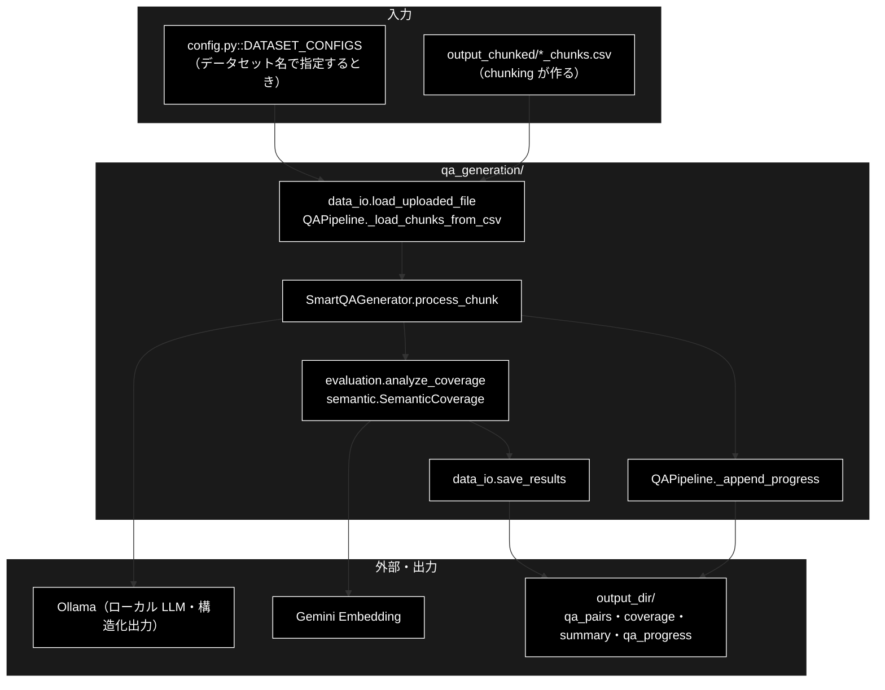
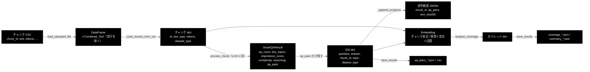

# qa_generation_data_flow.md - qa_generation/ データフロー

**Version 1.0** | 最終更新: 2026-10-14

データ準備の ② Q/A 生成で、**データがどんな形でどこに置かれ、どう変わるか**（CSV の列・dict のキー・LLM の構造化出力・途中経過の JSONL・
カバレッジの JSON・ファイル名と上書きの有無）をまとめる。
処理の順序と分岐は [`qa_generation_process_flow.md`](qa_generation_process_flow.md)、各関数の IPO は各モジュールの文書。
ディレクトリ全体の入口は [`README_qa_generation.md`](README_qa_generation.md)。③ 登録から先（Qdrant の payload・UI 用 CSV）は
[`qa_qdrant/docs/qa_qdrant_data_flow.md`](../../qa_qdrant/docs/qa_qdrant_data_flow.md)。

> 📝 §3 の例は 2026-10-14 に `QAPipeline(input_file=..., output_dir=...).run()` を実際に動かして出たファイルの抜粋である
> （LLM の `SmartQAGenerator.analyze_and_generate` と Embedding の `SemanticCoverage` はスタブ）。
> Q/A の文面とカバレッジの数値はスタブが作ったもので、実 LLM では 1 チャンクから 0〜5 件・自然な質問文になる。列・キー・ファイル名は実物と同じ。

---

## 目次

- [概要](#概要)
- [1. データの流れ全体](#1-データの流れ全体)
- [2. データ項目と形式](#2-データ項目と形式)
  - [2.1 入力（チャンク CSV）とチャンク dict](#21-入力チャンク-csvとチャンク-dict)
  - [2.2 LLM の構造化出力と Q/A dict](#22-llm-の構造化出力と-qa-dict)
  - [2.3 途中経過（JSONL）](#23-途中経過jsonl)
  - [2.4 カバレッジ](#24-カバレッジ)
  - [2.5 出力 4 ファイル](#25-出力-4-ファイル)
- [3. 変換の詳細](#3-変換の詳細)
- [4. 保存先・命名・上書き](#4-保存先命名上書き)
- [5. 関連ドキュメント](#5-関連ドキュメント)
- [6. 変更履歴](#6-変更履歴)

---

## 概要

チャンク CSV は **DataFrame → チャンク dict → （LLM の構造化出力）→ Q/A dict → Q/A CSV / JSON** の順に形を変える。
途中で 2 本の枝が出る: チャンクごとの結果を残す**途中経過の JSONL**（再開用。正常終了で消える）と、
チャンクと Q/A を Embedding して数える**カバレッジの JSON**。ファイルはすべて UTF-8 の CSV / JSON / JSONL である。

### 主な責務

- チャンク CSV を読み、本文の列と ID の列を決めてチャンク dict のリストにする
- チャンクごとの LLM の構造化出力（`SmartQAResult`）を Q/A dict に変える
- チャンクごとの結果を本文のハッシュつきで途中経過の JSONL に追記し、再開時に照合して復元する
- チャンクと Q/A を Embedding し、類似度からカバレッジを数える
- Q/A・カバレッジ・サマリーを 4 ファイルに書く

### 各責務対応のモジュール

| # | 責務 | 対応モジュール | 説明 |
|---|------|--------------|------|
| 1 | チャンク CSV → チャンク dict | `qa_generation/data_io.py`（`load_uploaded_file`）・`qa_generation/pipeline.py`（`QAPipeline._load_chunks_from_csv`） | `Combined_Text` を作って空行を落とし、本文と ID の列を決める |
| 2 | 構造化出力 → Q/A dict | `qa_generation/smart_qa_generator.py`（`SmartQAGenerator.process_chunk`）・`pipeline.py`（`_generate_sync`）・`celery_tasks.py`（`generate_qa_for_chunk_task`） | `SmartQAResult` の `qa_pairs` だけを残し、`chunk_id` / `dataset_type` を足す |
| 3 | 途中経過の追記と照合 | `pipeline.py`（`_append_progress` / `_load_progress_records`） | 1 行 = 1 チャンク。`text_sha256` で本文が変わったチャンクを作り直す |
| 4 | カバレッジ | `qa_generation/evaluation.py`（`analyze_coverage`）・`qa_generation/semantic.py`（`SemanticCoverage`） | チャンク本文と「質問 回答」を Embedding し、最大類似度を閾値 3 段で数える |
| 5 | 4 ファイルの保存 | `data_io.py`（`save_results`） | `qa_pairs_*.json` / `.csv`・`coverage_*.json`・`summary_*.json` |

### アーキテクチャ構成図



---

## 1. データの流れ全体



---

## 2. データ項目と形式

### 2.1 入力（チャンク CSV）とチャンク dict

| データ | 形式 | 作る側 | 使う側 | 置き場所 |
|-------|------|-------|-------|---------|
| チャンク CSV | 列 `chunk_id` / `text` / `tokens` / `chunk_idx` / `dataset_type` / `type` / `sentence_count` / `source_file`（チャンク化の出力。[`qa_qdrant_data_flow.md` §2.1](../../qa_qdrant/docs/qa_qdrant_data_flow.md)） | `chunking/` | `QAPipeline.load_data()` | `output_chunked/<入力名>_chunks.csv` |
| DataFrame | 入力の列 ＋ `Combined_Text`（本文の列を `clean_text()` したもの）。`Combined_Text` が空の行は落とす。`max_docs` があれば先頭から絞る | `data_io.load_uploaded_file()`（データセットは `load_preprocessed_data()`） | `_load_chunks_from_csv()` | メモリ |
| チャンク dict | `{id, text, type, tokens, dataset_type}` | `QAPipeline._load_chunks_from_csv()` | 生成・途中経過・カバレッジ | メモリ |

- `input_file` は **`.csv` だけ**を受ける（`.txt` は先にチャンク化する。`load_uploaded_file()` 自体は txt / json / jsonl も読めるが、`QAPipeline` が拒む）
- `Combined_Text` の元の列: `text_column`（指定時）→ 既存の `Combined_Text` → `text` / `content` / `chunk_text` / `body` / `document` / `answer` / `question` の最初に見つかった列
- チャンク dict の `text` の元の列: `text_column`（指定時）→ `text` → `Combined_Text` → `content` → `chunk_text`。**`text` 列があればそちらを使う**ので、`clean_text()` を通る前の本文になる（`Combined_Text` は空行の除外にだけ効く）
- `id`: `chunk_id` → `id` → `chunk_idx` の最初の列の値。どれも無ければ `<種別>_chunk_<行番号>`
- `type`: 入力の `type` 列（無ければ `pre_chunked`）。`tokens`: 入力の `tokens` 列（無ければ本文の文字数 ÷ 4 の概算）
- `dataset_type`: **入力の `dataset_type` 列ではなく `<種別>`**（`input_file` の stem かデータセット名）で上書きする

### 2.2 LLM の構造化出力と Q/A dict

| データ | 形式 | 作る側 | 使う側 |
|-------|------|-------|-------|
| `SmartQAResult`（構造化出力。Ollama には `response_format={"type": "json_schema"}` でスキーマを渡す） | `qa_count`（0〜5）/ `key_topics`（文字列のリスト）/ `importance_score`（0.0〜1.0）/ `complexity`（low / medium / high）/ `reasoning` / `qa_pairs`（`SmartQAPair` のリスト） | `SmartQAGenerator.analyze_and_generate()`（`generate_structured`） | `process_chunk()` |
| `SmartQAPair` | `question` / `answer`（50〜150 字程度）/ `topic`（既定 `その他`） | 同上 | 同上 |
| `process_chunk()` の戻り値 | `{analysis, qa_pairs, usage, success}`。`analysis` は `qa_pairs` 以外の 5 項目、`qa_pairs` は `{question, answer, topic}`、`usage` は `{input_tokens, output_tokens}`。失敗時は空・`success=False` | `process_chunk()` | `_generate_sync()` / Celery のタスク |
| Q/A dict | `{question, answer, chunk_id, topic, dataset_type}` | `_generate_sync()`（Celery では `generate_qa_for_chunk_task()`） | 途中経過・カバレッジ・保存 |

- **`analysis`（`qa_count` / `key_topics` / `importance_score` / `complexity` / `reasoning`）はどこにも保存しない。** ログに出るだけで、Q/A dict に入るのは `qa_pairs` の中身だけ
- `usage` はチャンクごとに合計してログ（`トークン使用量（合計）`）に出す。ファイルには残らない（ローカル LLM なので課金は無い）
- 構造化出力は `helper/helper_llm.py::OllamaClient.generate_structured` が `$defs` / `$ref` を展開したスキーマで制約付きデコードさせる。Ollama が `json_schema` に対応していないと `json_object` に落ち、スキーマ定義をそのまま返された場合は `SchemaEchoError` になる（`process_chunk()` は `success=False` を返し、そのチャンクは失敗として記録されない）
- Celery では、タスクの引数がチャンク dict・設定 dict（`type` を含む）・モデル名、戻り値が `{qa_pairs, usage}`（`qa_pairs` は Q/A dict）

### 2.3 途中経過（JSONL）

| データ | 形式 | 作る側 | 使う側 | 置き場所 |
|-------|------|-------|-------|---------|
| 途中経過 | 1 行 = 1 チャンク `{"chunk_id": "...", "qa_pairs": [Q/A dict...], "text_sha256": "<本文の SHA-256>"}` | `QAPipeline._append_progress()` | 再開時の `_load_progress_records()` | `<output_dir>/qa_progress_<種別>.jsonl` |

- 成功したチャンクだけを書く（Q/A が 0 件でも書く）。**LLM が失敗したチャンクは書かない**ので、再実行で作り直す
- 再開時は、今回の入力にある `chunk_id` で、かつ本文の `text_sha256` が一致する行だけを復元する。`text_sha256` の無い古い行は `chunk_id` だけで照合して警告を出す
- 保存（§2.5）が成功し、失敗したチャンクが無ければ消す。失敗したチャンクがあれば残す

### 2.4 カバレッジ

| 項目 | 形式 | 意味 |
|------|------|------|
| Embedding する文 | チャンク: `text`／Q/A: `"<question> <answer>"`（**空白区切り**） | どちらも L2 正規化して内積 = コサイン類似度。Gemini `gemini-embedding-001`（`config.py::ModelConfig.EMBEDDING_MODEL`） |
| `coverage_rate` / `covered_chunks` / `total_chunks` | 数値 | 各チャンクの最大類似度が `threshold` 以上のチャンクの割合・数・全体数 |
| `threshold` | 数値（既定 0.7） | `coverage_threshold` 指定時はその値 |
| `optimal_thresholds` | `{strict: 0.8, standard: 0.7, lenient: 0.6}` | データセットによらず固定 |
| `max_similarities` | 数値のリスト（チャンクの順） | 各チャンクと最も似た Q/A の類似度 |
| `uncovered_chunks` | 保存時は `{chunk_id, similarity, gap, text_preview}` のリスト（`text_preview` は本文の先頭 200 字 ＋ `...`） | `threshold` に届かなかったチャンク。メモリ上はチャンク dict を丸ごと持ち、保存時に縮める |
| `multi_threshold` | `strict` / `standard` / `lenient` ごとに `{threshold, covered_chunks, coverage_rate, uncovered_count, uncovered_chunks}` | 閾値 3 段で数え直した結果 |
| `chunk_analysis` | `by_length`（short < 100 / medium < 200 / long トークン）・`by_position`（beginning / middle / end の 3 等分）ごとに `{count, covered, avg_similarity, coverage_rate}`、`summary`（`total_chunks` / `total_qa_pairs` / `threshold_used` / `insights`） | チャンクの長さ・位置ごとの偏り。トークンは tiktoken の `cl100k_base` で数える |
| `dataset_type` | 文字列 | `<種別>` |

- Q/A が 0 件、または `analyze_coverage=False` のときは Embedding を呼ばず、`{coverage_rate: 0, covered_chunks: 0, total_chunks: N, uncovered_chunks: []}` だけになる
- Embedding が失敗してゼロベクトルが混じったら `RuntimeError` で止める（黙ってカバレッジを下げない）

### 2.5 出力 4 ファイル

| データ | 形式 | 作る側 | 使う側 | 置き場所 |
|-------|------|-------|-------|---------|
| Q/A JSON | Q/A dict の配列（インデント 2） | `data_io.save_results` | 人が読む用 | `<output_dir>/qa_pairs_<種別>_<日時>.json` |
| Q/A CSV | 列 `question` / `answer` / `chunk_id` / `topic` / `dataset_type` | 同上 | ③ 登録（`register_to_qdrant.py`・`make_qa_register_qdrant.py` の Phase 2・データ管理タブ） | `<output_dir>/qa_pairs_<種別>_<日時>.csv` |
| カバレッジ | §2.4 の dict（`uncovered_chunks` は縮めた形） | 同上 | 人が読む用 | `<output_dir>/coverage_<種別>_<日時>.json` |
| サマリー | `dataset_type` / `dataset_name` / `generated_at` / `total_qa_pairs` / `coverage_rate` / `files`（上 3 ファイルのパス） | 同上 | `make_qa.py` が最後にパスを出す | `<output_dir>/summary_<種別>_<日時>.json` |

`run()` の戻り値は `{saved_files, qa_count, coverage_results, failed_chunks, success}`（`saved_files` は上 4 ファイルのパス）。
データ管理タブはこれを `result` イベントで画面に返す。

---

## 3. 変換の詳細

入力（`chunks.csv`・3 行）:

```csv
chunk_id,text,tokens,chunk_idx,dataset_type,type,sentence_count,source_file
gov_faq_chunk_0,住民票の写しは市役所の窓口で取得できます。手数料は1通300円です。,33,0,gov_faq,llm_chunk,2,gov_faq.txt
gov_faq_chunk_1,マイナンバーカードがあればコンビニでも取得できます。利用時間は6時30分から23時までです。,45,1,gov_faq,llm_chunk,2,gov_faq.txt
gov_faq_chunk_2,転入届は引っ越しから14日以内に提出してください。,22,2,gov_faq,llm_chunk,1,gov_faq.txt
```

**① 1 回目（3 チャンク目で LLM が失敗）** — `run()` は `success=True` のまま `failed_chunks: ["gov_faq_chunk_2"]` を返し、
4 ファイルを書いたうえで途中経過を**残す**（Ollama が止まっていた・モデルが未 pull だった、などのときにこうなる）（`out/qa_progress_chunks.jsonl`・2 行）:

```json
{"chunk_id": "gov_faq_chunk_0", "qa_pairs": [{"question": "住民票の写しは市役所の窓口で取得できますについて教えてください", "answer": "住民票の写しは市役所の窓口で取得できます。", "chunk_id": "gov_faq_chunk_0", "topic": "手続き", "dataset_type": "chunks"}], "text_sha256": "f00a500110ade54346e8b878742a90e303b98cdea07edc64492a278b19952399"}
{"chunk_id": "gov_faq_chunk_1", "qa_pairs": [{"question": "マイナンバーカードがあればコンビニでも取得できますについて教えてください", "answer": "マイナンバーカードがあればコンビニでも取得できます。", "chunk_id": "gov_faq_chunk_1", "topic": "手続き", "dataset_type": "chunks"}], "text_sha256": "8316cbc115617e292c613e2859be83b5a35625b8fa03c1b2544b978cce4cc634"}
```

> 入力の `dataset_type` 列は `gov_faq` だが、Q/A の `dataset_type` は `chunks`（入力ファイル名の stem = `<種別>`）になる。

**② 2 回目（同じ引数で再実行）** — 2 チャンクを途中経過から復元し、`gov_faq_chunk_2` だけ LLM を呼ぶ。
失敗が無くなったので途中経過は消える。Q/A CSV（`out/qa_pairs_chunks_20261014_021344.csv`）:

```csv
question,answer,chunk_id,topic,dataset_type
住民票の写しは市役所の窓口で取得できますについて教えてください,住民票の写しは市役所の窓口で取得できます。,gov_faq_chunk_0,手続き,chunks
マイナンバーカードがあればコンビニでも取得できますについて教えてください,マイナンバーカードがあればコンビニでも取得できます。,gov_faq_chunk_1,手続き,chunks
転入届は引っ越しから14日以内に提出してくださいについて教えてください,転入届は引っ越しから14日以内に提出してください。,gov_faq_chunk_2,手続き,chunks
```

**③ カバレッジ**（`coverage_chunks_20261014_021344.json` の抜粋）:

```json
{"coverage_rate": 1.0, "covered_chunks": 3, "total_chunks": 3, "uncovered_chunks": [],
 "threshold": 0.7, "optimal_thresholds": {"strict": 0.8, "standard": 0.7, "lenient": 0.6},
 "chunk_analysis": {"by_length": {"short": {"count": 3, "covered": 3, "avg_similarity": 0.96, "coverage_rate": 1.0}},
                    "summary": {"total_chunks": 3, "total_qa_pairs": 3, "threshold_used": 0.7, "insights": []}}}
```

（ほかに `max_similarities`・`multi_threshold`・`chunk_analysis.by_position`・`dataset_type` のキーがある。`avg_similarity` は丸めて載せた）

**④ サマリー**（`summary_chunks_20261014_021344.json`）:

```json
{"dataset_type": "chunks", "dataset_name": "chunks", "generated_at": "20261014_021344",
 "total_qa_pairs": 3, "coverage_rate": 1.0,
 "files": {"qa_json": "out/qa_pairs_chunks_20261014_021344.json",
           "qa_csv": "out/qa_pairs_chunks_20261014_021344.csv",
           "coverage": "out/coverage_chunks_20261014_021344.json"}}
```

---

## 4. 保存先・命名・上書き

| 出力 | 既定の置き場所 | 名前 | 上書き |
|------|--------------|------|:-----:|
| Q/A JSON / CSV・カバレッジ・サマリー | `QAPipeline` の既定: カレント基準の `qa_output/pipeline/`<br>データ管理タブ: `qa_output/`（直下。`GET /api/files` が ③ 登録の選択肢として拾えるように）<br>`make_qa.py`: リポジトリ直下の `qa_output/pipeline/`（絶対パス） | `<接頭辞>_<種別>_<YYYYMMDD_HHMMSS>.<拡張子>` | しない（実行ごとに新しい名前） |
| 途中経過 | 同上 | `qa_progress_<種別>.jsonl` | 追記（失敗が無ければ正常終了で消える） |

- データ管理タブから走らせるときは、LLM ループの前に Ollama の疎通とモデルの pull 状況を確かめ、だめならジョブを `failed` にする（`backend/app/core/data_jobs.py::_ollama_unreachable_message` / `_model_not_pulled_message`。このときファイルは何も書かれない）
- `<種別>` は `input_file` なら入力ファイルの stem（`.txt` から作ったチャンク CSV なら `<入力名>_chunks`）、`dataset_name` ならデータセット名
- ⚠️ **途中経過のファイル名は `<種別>` だけで決まる。** 同じ名前の別ファイルを同じ `output_dir` で流すと同じ途中経過を読むが、
  本文のハッシュで照合するので、本文が違うチャンクは作り直す
- 4 ファイルは秒単位の日時で名前が決まるので、同じ秒に 2 回保存すると上書きになる（実際には LLM 呼び出しを挟むので起きにくい）

---

## 5. 関連ドキュメント

| 文書 | 内容 |
|------|------|
| [`README_qa_generation.md`](README_qa_generation.md) | `qa_generation/` の入口・モジュール索引・公開 API・既知の制約 |
| [`qa_generation_process_flow.md`](qa_generation_process_flow.md) | 処理の順序・分岐・失敗と再開・Celery の経路 |
| [`data_io.md`](data_io.md) / [`pipeline.md`](pipeline.md) / [`smart_qa_generator.md`](smart_qa_generator.md) / [`evaluation.md`](evaluation.md) / [`semantic.md`](semantic.md) | 各関数の IPO |
| [`qa_qdrant/docs/qa_qdrant_data_flow.md`](../../qa_qdrant/docs/qa_qdrant_data_flow.md) | チャンク CSV を作る前段と、Q/A CSV を Qdrant へ入れる後段（payload・UI 用 CSV） |
| [`data_jobs.md`](../../backend/app/core/docs/data_jobs.md) | データ管理タブからの呼び出し |

---

## 6. 変更履歴

| バージョン | 日付 | 変更内容 |
|---|---|---|
| 1.0 | 2026-10-14 | 新規作成（`a_cross_doc_md_format.md` §1.3）。grace_v2 の同名文書（同日新設）と同じ章立てで、実装（`data_io.py` / `pipeline.py` / `smart_qa_generator.py` / `evaluation.py` / `celery_tasks.py`）を読んで本リポジトリの事実で書いた。データの形は grace_v2 と同じで、違いは LLM（Ollama・`json_schema` の制約付きデコード・`SchemaEchoError`）とデータ管理タブの事前確認だけである。構造化出力の `analysis` が保存されないこと、チャンク本文が `clean_text()` 前の `text` 列になること、Q/A の `dataset_type` が入力の列ではなく `<種別>` になること、カバレッジの Q/A が空白区切りで Embedding されること（登録は改行区切り）を明記した。§3 の例は本リポジトリの `QAPipeline.run()` をスタブで 2 回実行（1 回目に 1 チャンク失敗 → 再開）して出たファイルから取った |
