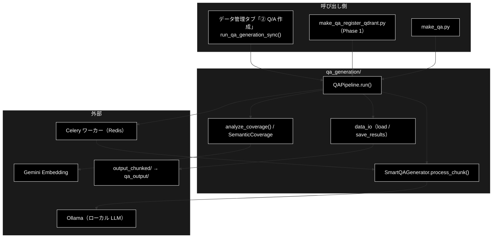
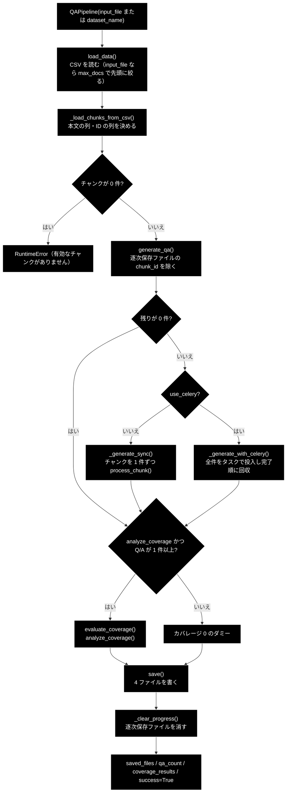
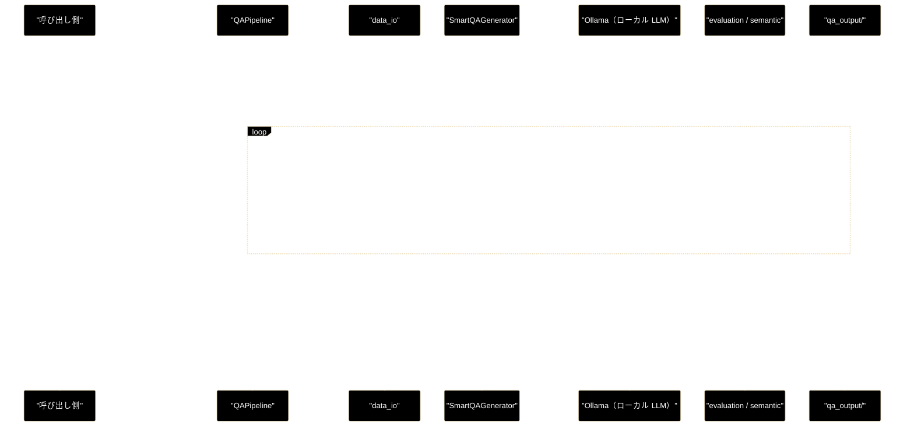

# qa_generation_process_flow.md - qa_generation/ 処理フロー

**Version 2.0** | 最終更新: 2026-10-11

チャンク済み CSV から Q/A を作り、カバレージを測って 4 ファイルを書くまでの**処理の流れ**（どの順で・どのモジュールが・どんな条件で分岐するか）をまとめる。
各関数の引数・戻り値は各モジュールの文書（IPO）に置き、ここには書かない。ディレクトリ全体の入口は [`README_qa_generation.md`](README_qa_generation.md)。

---

## 目次

- [概要](#概要)
- [1. 全体フロー](#1-全体フロー)
- [2. ステップ詳細](#2-ステップ詳細)
- [3. 分岐・例外・中断](#3-分岐例外中断)
- [4. シーケンス](#4-シーケンス)
- [5. 関連ドキュメント](#5-関連ドキュメント)
- [6. 変更履歴](#6-変更履歴)

---

## 概要

入口は 3 つあり、どれも `QAPipeline(...).run(...)` に行き着く: データ管理タブの「② Q/A 作成」（`services/data_pipeline_service.py::run_qa_generation_sync()` 経由）、
`qa_qdrant/make_qa_register_qdrant.py` の Phase 1、`qa_qdrant/make_qa.py`。
`run()` は **読み込み → チャンク変換 → Q/A 生成（同期または Celery）→ カバレージ → 保存** の順に進み、Q/A の生成だけがチャンクごとに LLM を呼ぶ。

### 主な責務

- チャンク CSV（またはデータセット）を読み、本文の列を決めてチャンクのリストにする
- 逐次保存ファイルを見て、済んだチャンクを飛ばす
- チャンクごとに LLM で Q/A を作り、1 件ずつ逐次保存ファイルへ追記する（同期／Celery）
- チャンクと Q/A を Embedding してカバレージを数える
- 4 ファイルを書き、逐次保存ファイルを消す

### 各責務対応のモジュール

| # | 責務 | 対応モジュール | 説明 |
|---|------|--------------|------|
| 1 | 読み込みとチャンク変換 | `pipeline.py` ＋ `data_io.py` | `QAPipeline.load_data()`（`load_uploaded_file()` / `load_preprocessed_data()`）→ `_load_chunks_from_csv()` |
| 2 | 再開 | `pipeline.py` | `generate_qa()` が `_load_progress()` で処理済みの `chunk_id` を除く |
| 3 | Q/A の生成と逐次保存 | `pipeline.py` ＋ `smart_qa_generator.py`（Celery では `celery_tasks.py`） | `_generate_sync()` / `_generate_with_celery()` → `SmartQAGenerator.process_chunk()` → `_append_progress()` |
| 4 | カバレージ | `evaluation.py` ＋ `semantic.py` | `evaluate_coverage()` → `analyze_coverage()` → `SemanticCoverage` |
| 5 | 保存と後片づけ | `pipeline.py` ＋ `data_io.py` | `save()` → `save_results()` → `_clear_progress()` |

### アーキテクチャ構成図

---

## 1. 全体フロー

---

## 2. ステップ詳細

| # | ステップ | 実装（ファイル::シンボル） | 入力 | 出力 | 失敗時の既定 |
|---|---------|--------------------------|------|------|------------|
| 0 | 初期化 | `pipeline.py::QAPipeline.__init__`（`_validate_inputs` / `_load_config`）・`SmartQAGenerator()` | `input_file` か `dataset_name`（どちらか 1 つ）・`model`・`output_dir`・`max_docs`・`text_column` | 設定（`type` = 入力ファイルの stem かデータセット名） | 両方・どちらも無し・未知のデータセット → `ValueError` |
| 1 | 読み込み | `QAPipeline.load_data` → `data_io.load_uploaded_file` / `load_preprocessed_data` | CSV（`input_file` は `.csv` だけ） | DataFrame（`Combined_Text` を補う。空行は落とす） | ファイルが無い → `FileNotFoundError`。`.csv` 以外 → `ValueError`。**`dataset_name` では `max_docs` が効かない** |
| 2 | チャンク変換 | `QAPipeline._load_chunks_from_csv` | DataFrame | `{id, text, type, tokens, dataset_type}` のリスト | `text_column` が無い列 → `ValueError`。0 件 → `RuntimeError` |
| 3 | 再開 | `QAPipeline.generate_qa` → `_load_progress` | チャンク・`<output_dir>/qa_progress_<種別>.jsonl` | 未処理のチャンク・復元した Q/A | 壊れた行は飛ばす（そのチャンクは作り直す） |
| 4a | 生成（同期） | `_generate_sync` → `SmartQAGenerator.process_chunk` → `_append_progress` | 未処理のチャンク | Q/A のリスト。成功したチャンクだけ 1 件ずつ JSONL へ追記（0 件も記録） | LLM の失敗 → そのチャンクは 0 件・**記録しない**（再開で作り直す） |
| 4b | 生成（Celery） | `_generate_with_celery` → `celery_tasks.submit_unified_qa_generation` / `collect_results`（ワーカーで `generate_qa_for_chunk_task` → `process_chunk`） | 未処理のチャンク | Q/A のリスト。完了したタスクから順に JSONL へ追記 | ワーカー無し → `RuntimeError`。LLM の失敗 → タスクは正常終了して 0 件・**処理済みとして記録される**。収集は `min(max(タスク数×10, 600), 1800)` 秒で打ち切り |
| 5 | カバレージ | `evaluate_coverage` → `evaluation.analyze_coverage` → `semantic.SemanticCoverage` | チャンク・Q/A | `coverage_rate` ほか | Q/A 0 件・`analyze_coverage=False` → 0 のダミー。キーが無い → `ValueError`。Embedding の失敗 → ゼロベクトルで 0% |
| 6 | 保存 | `save` → `data_io.save_results` | Q/A・カバレージ | `qa_pairs_<種別>_<日時>.json` / `.csv`・`coverage_*.json`・`summary_*.json` | 例外は上へ（逐次保存ファイルは残る） |
| 7 | 後片づけ | `_clear_progress` | — | 逐次保存ファイルを消す | 消せなければ警告だけ |

LLM の呼び出し回数は**未処理のチャンク数**（1 チャンク = 構造化出力 1 回）。Embedding はチャンク数＋Q/A 数。

---

## 3. 分岐・例外・中断

### 3.1 例外の扱い

`run()` は途中の例外をログ（`パイプライン実行エラー: ...`）に出して**そのまま上げる**。LLM の失敗は `process_chunk()` が握るので例外にならず、
全チャンクが失敗しても `success=True`・`qa_count=0` で終わる（[`README_qa_generation.md`](README_qa_generation.md) §5 の 3）。

### 3.2 中断と再開

チャンクの結果は出るたびに `qa_progress_<種別>.jsonl` へ追記されるので、途中で落ちても**同じ引数で `run()` し直せば済んだチャンクを飛ばす**
（ログ `📂 逐次保存ファイルから再開: 処理済み N チャンクをスキップ ...`。[`pipeline.md`](pipeline.md) §4.1.3）。保存（6）が成功すると消える。

- 同期は失敗したチャンクを記録しないので、再開で作り直す。Celery は失敗したチャンクも 0 件で記録するので作り直さない（§5 の 2）
- ファイル名は `<種別>` だけで決まり、入力の中身は照合しない（§5 の 5）
- カバレージ（5）や保存（6）で落ちたときもファイルは残るので、原因を直して再実行すれば LLM を呼び直さない

### 3.3 Celery の経路

`_generate_with_celery()` は、ワーカーが立っているかを `check_celery_workers(celery_workers)` で確かめ、全チャンクをタスクとしてまとめて投入し、
`collect_results()` が**完了した順に**回収する（先頭の遅いタスクが後続の回収を塞がない）。並列数はワーカーの `-c` で決まり、`run()` の `concurrency` はログに出すだけ。
ワーカーは `celery_tasks._get_generator()` がモデル名ごとにキャッシュした `SmartQAGenerator` を使う（ワーカーのプロセスからも Ollama に届く必要がある。`OLLAMA_BASE_URL`）。

---

## 4. シーケンス

---

## 5. 関連ドキュメント

| 文書 | 内容 |
|---|---|
| [`README_qa_generation.md`](README_qa_generation.md) | ディレクトリ概要・公開 API・データの形・既知の制約 |
| [`pipeline.md`](pipeline.md) | `QAPipeline` の IPO と使用例（同期・データ管理タブ・再開・Celery・本文列・データセット） |
| [`smart_qa_generator.md`](smart_qa_generator.md) | 1 チャンクの生成（構造化出力 `SmartQAResult`）と失敗時の戻り値 |
| [`evaluation.md`](evaluation.md) / [`semantic.md`](semantic.md) | カバレージの数え方と Embedding |
| [`data_io.md`](data_io.md) | 読み込み（`Combined_Text` の決め方）と 4 ファイルの形式 |
| [`qa_qdrant/docs/qa_qdrant_process_flow.md`](../../qa_qdrant/docs/qa_qdrant_process_flow.md) | ③ 登録まで含めた CLI の流れ |
| [`backend/docs/data_pipeline.md`](../../backend/docs/data_pipeline.md) | データ管理タブからの呼び出し |
| [`docs/celery_quick_start.md`](../../docs/celery_quick_start.md) | Celery ワーカーの起動 |

---

## 6. 変更履歴

| バージョン | 日付 | 変更内容 |
|---|---|---|
| 1.0 | — | 初版作成（QAPipeline v3.0、SmartQAGenerator v2.5 対応） |
| 1.1 | 2026-09-24 | 使用例を IPO 詳細の冒頭（`### 4.1 使用例`）へ移し、末尾の「## 6. 使用例」章を削除（基本フォーマット `a_class_method_md_format.md` v1.6〜 §6.1 に準拠。2026-09-24）。IPO の小節を 4.2 以降へ繰り下げ、後続の章番号を 1 つ繰り上げた。文書内の `§4.x` 参照も追随。あわせて **SmartQAGenerator の記述を現行実装（v3.0・構造化出力 1 回方式）へ是正**した: 廃止済みの `analyze_chunk()` / `generate_qa_pairs()` / `_generate_content()` を `analyze_and_generate()` に置き換え（§4.3 全面改稿・§1.2/§1.3/§2.2/§3.2/付録 A.2・B.2）、LLM を Gemini（`gemini-2.0-flash`・`google.genai`）と誤記していた箇所を Ollama（`get_default_ollama_model()`）へ、前提条件の API キー記述も是正。概要に「各責務対応のモジュール」（1:1）を追加 |
| 1.2 | 2026-09-24 | `QAPipeline` の引数の記述を実装に合わせた（2026-09-24）。削除済みの `use_smart_generation` を `generate_qa()` / `run()` / `_generate_sync()` のシグネチャ・引数表・使用例から外した |
| 1.3 | 2026-10-09 | `QAPipeline` から処理に効いていなかった `client` / `batch_chunks` を削除したのに追随（`__init__` には実装どおり `text_column` を記載）。`concurrency` はログ表示用である旨を注記（2026-10-09） |
| 1.4 | 2026-10-11 | `qa_qdrant/docs/` から `qa_generation/docs/` へ移した（対象の `QAPipeline` / `SmartQAGenerator` は `qa_generation/` にあるため。`a_cross_doc_md_format.md` §1.4）。相対リンクを移動先に合わせた。`qa_generation/` の構成整理のときに `pipeline.md` / `smart_qa_generator.md` へ統合する予定 |
| 2.0 | 2026-10-11 | **`make_qa_qapipeline.md`（`QAPipeline` と `SmartQAGenerator` の連携・IPO）を、`a_cross_doc_md_format.md` §1.3 の処理フローとして `qa_generation_process_flow.md` に書き直した**（grace_v2 と同じ整理。LLM の記述は Ollama のまま）。IPO（シグネチャ・引数表・使用例）は `pipeline.md` / `smart_qa_generator.md` と重複していたので外し、実装を読み直して全体フロー・ステップ詳細（失敗時の既定）・分岐（例外・中断と再開・Celery）・シーケンスを書いた。同期と Celery で LLM の失敗したチャンクの扱いが違うこと（Celery は処理済みとして記録する）を、Ollama の代わりのスタブサーバと Celery ワーカーで実行して確かめて書いた |
