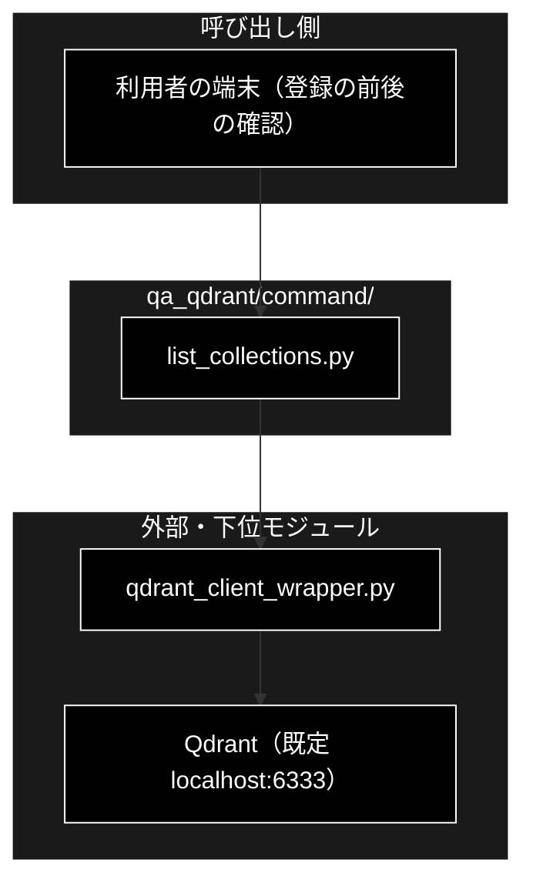

# README_command.md - qa_qdrant/command/ ディレクトリ概要

**Version 1.0** | 最終更新: 2026-10-11

`qa_qdrant/command/` の入口となる文書。Qdrant を**見るだけ**の小さなコマンドを置くディレクトリで、今は `list_collections.py` の 1 本だけがある。

---

## 目次

- [概要](#概要)
  - [主な責務](#主な責務)
  - [各責務対応のモジュール](#各責務対応のモジュール)
  - [アーキテクチャ構成図](#アーキテクチャ構成図)
- [1. モジュール一覧（索引）](#1-モジュール一覧索引)
- [2. 使い方（代表的なワークフロー）](#2-使い方代表的なワークフロー)
- [3. 公開 API（__init__.py）](#3-公開-api__init__py)
- [4. 処理フロー・データフロー](#4-処理フローデータフロー)
- [5. 既知の制約・残課題](#5-既知の制約残課題)
- [6. 変更履歴](#6-変更履歴)

---

## 概要

`qa_qdrant/command/` は、データ準備の ③ Qdrant 登録（親の [`qa_qdrant/`](../../docs/README_qa_qdrant.md)）の前後で、
**Qdrant の中身を確かめるためのコマンド**を置くディレクトリである。登録・削除のような変更はしない
（削除はリポジトリ直下の `qdrant_delete_collection.py`・[`docs/qdrant_delete_collection.md`](../../../docs/qdrant_delete_collection.md)）。

### 主な責務

- Qdrant のコレクションの一覧（名前・ポイント数・状態・ベクトル設定）の表示

### 各責務対応のモジュール

| # | 責務 | 対応モジュール | 説明 |
|---|------|--------------|------|
| 1 | コレクションの一覧の表示 | `list_collections.py` | `python -m qa_qdrant.command.list_collections [--detail] [--url URL]`。中身は `qdrant_client_wrapper.get_all_collections()` / `get_collection_stats()` |

### アーキテクチャ構成図



**データフロー**: 引数（`--url` / `--detail`）→ `QdrantClient` → コレクション名の一覧 → 各コレクションの `points_count` / `status`（`--detail` ならベクトル設定）→ 標準出力。ファイルは書かない。

---

## 1. モジュール一覧（索引）

| モジュール | 文書 | 種別 | 行数 | Ver | 概要 |
|---|---|---|---:|---|---|
| `list_collections.py`（51 行） | [`list_collections.md`](list_collections.md) | E | 320 | 1.0 | Qdrant のコレクション一覧（`--detail` でベクトル設定も）を表示する読み取り専用の CLI |

> 行数は文書の行数（実測）。`__init__.py` は空（0 行）なので文書を作らない（§3）。

---

## 2. 使い方（代表的なワークフロー）

登録の**前後**に件数と次元を確かめる。個々の引数は [`list_collections.md`](list_collections.md) §4.1。

```bash
# 1. 登録前: 同名のコレクションがあるか・何件あるか
python -m qa_qdrant.command.list_collections

# 2. 登録（--recreate で作り直す。Q/A CSV は make_qa.py などで作ったもの）
python qa_qdrant/register_to_qdrant.py \
  --input-file qa_output/pipeline/qa_pairs_document_chunks_20261011_101500.csv \
  --collection document_qa --recreate > /dev/null 2>&1

# 3. 登録後: 件数と次元（3072 = Gemini gemini-embedding-001）を確かめる
python -m qa_qdrant.command.list_collections --detail | grep -A1 "document_qa "

# 出力例:
#   - document_qa                               points=       4  status=green
#         vector[default]  size=3072  distance=Cosine
```

> 📝 **確かめ方（2026-10-11）**: 実物の Qdrant（`docker-compose`）と、Embedding だけスタブ（文字列から決まる 3072 次元）にした
> `register_to_qdrant.py` で実行した。入力は 4 件の Q/A CSV。
>
> ⚠️ **次元が 3072 でないコレクションは GRACE の検索に使えない**（Embedding は `config.py::GeminiConfig.EMBEDDING_DIMS` = 3072。CLAUDE.md §3）。
> 次元が合っていても Embedding モデルが違えば検索結果だけが壊れるので、モデルは payload の `embedding_model`
> （`register_to_qdrant.py` で登録したとき）で確かめる。

---

## 3. 公開 API（__init__.py）

公開 API なし（`__init__.py` は空）。`python -m qa_qdrant.command.list_collections` で実行する。

---

## 4. 処理フロー・データフロー

1 モジュールで閉じるので別文書は作らない。流れは上の構成図のデータフローと [`list_collections.md`](list_collections.md) §1.2。
コレクションを**作る側**の流れ（チャンク → Q/A → Embedding → Qdrant）は親ディレクトリの
[`qa_qdrant_process_flow.md`](../../docs/qa_qdrant_process_flow.md) / [`qa_qdrant_data_flow.md`](../../docs/qa_qdrant_data_flow.md)。

---

## 5. 既知の制約・残課題

| # | 内容 |
|---|------|
| 1 | 接続先の既定 `http://localhost:6333` は**直書き**（`config.QdrantConfig.URL` を参照しない）。`qdrant_delete_collection.py` も同じ |
| 2 | Qdrant に繋がらないと、整形したメッセージではなくトレースバックを出して終了コード 1 になる |
| 3 | テストは無い（表示に使う `qdrant_client_wrapper` の関数はほかのテストが間接に通る） |

---

## 6. 変更履歴

| バージョン | 日付 | 変更内容 |
|---|---|---|
| 1.0 | 2026-10-11 | 新規作成（`a_cross_doc_md_format.md` §1.2）。`qa_qdrant/command/` には `docs/` が無かった。§2 のワークフローを実物の Qdrant で実行して確かめた |
