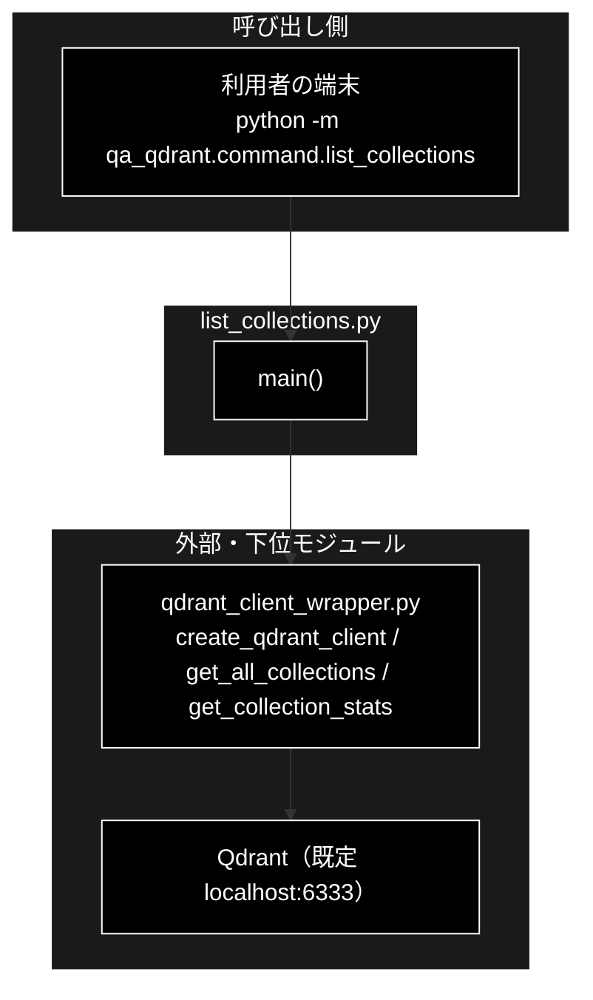
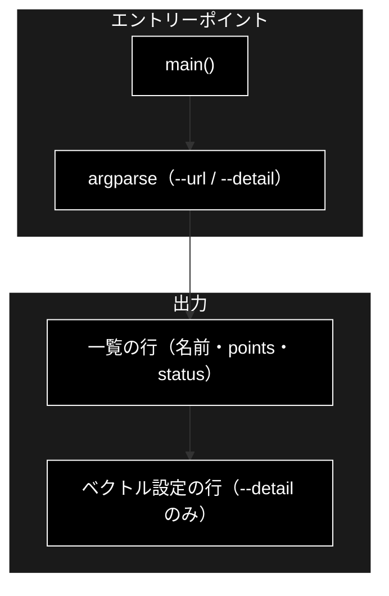
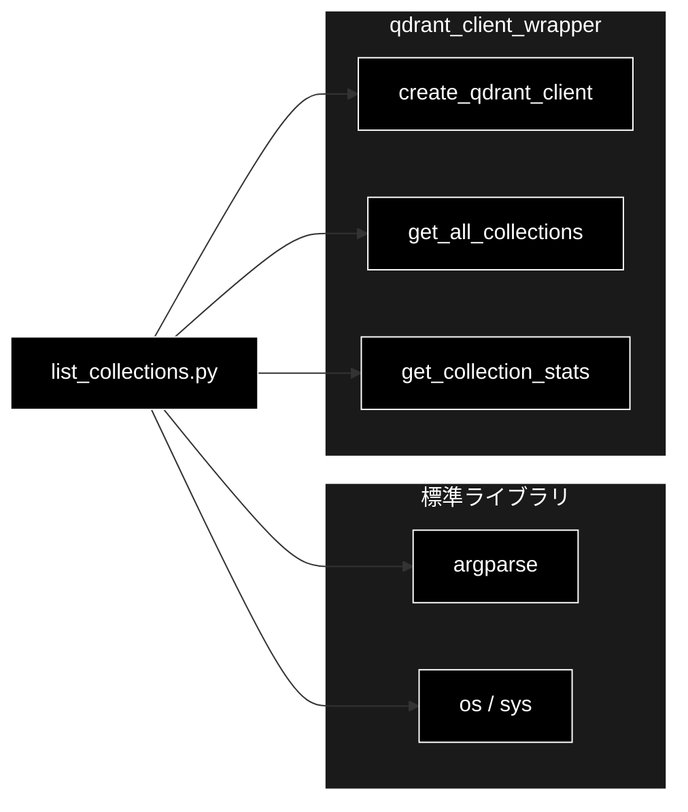

# list_collections.py - Qdrant コレクション一覧表示コマンド ドキュメント

**Version 1.0** | 最終更新: 2026-10-11

---

## 目次

1. [概要](#概要)
2. [アーキテクチャ構成図](#1-アーキテクチャ構成図)
3. [モジュール構成図](#2-モジュール構成図)
4. [クラス・関数一覧表](#3-クラス関数一覧表)
5. [クラス・関数 IPO詳細](#4-クラス関数-ipo詳細)
6. [設定・定数](#5-設定定数)
7. [エクスポート](#6-エクスポート)
8. [変更履歴](#7-変更履歴)
9. [付録: 依存関係図](#付録-依存関係図)

---

## 概要

`qa_qdrant/command/list_collections.py` は、Qdrant にあるコレクションの名前・ポイント数・状態を 1 行ずつ表示する**読み取り専用**の CLI です。
`--detail` を付けると、各コレクションのベクトル設定（名前・次元・距離）も表示します。登録（`qa_qdrant/register_to_qdrant.py` など）の前後に
「どのコレクションに何件あるか」「次元が 3072（Gemini `gemini-embedding-001`）か」を確かめるのに使います。

> 📌 同じ一覧は `python qdrant_delete_collection.py --list`（リポジトリ直下・[`docs/qdrant_delete_collection.md`](../../../docs/qdrant_delete_collection.md)）、
> データ管理タブの「④ コレクション管理」（`GET /api/qdrant/collections`・`backend/app/api/qdrant.py::list_collections()`）でも見られる。
> 本コマンドは**ベクトル設定まで見られる**のと、**何も変更しない**のが違い。

### 主な責務

- コマンドライン引数（接続先 URL・詳細表示）の解析
- Qdrant の全コレクションの名前・ポイント数・状態の表示
- コレクションごとのベクトル設定（名前・次元・距離）の表示（`--detail`）

### 各責務対応のモジュール

| # | 責務 | 対応モジュール | 説明 |
|---|------|--------------|------|
| 1 | 引数の解析 | `list_collections.py` | `main()` が `argparse` で `--url`（既定 `http://localhost:6333`）と `--detail` / `-d` を読む |
| 2 | 全コレクションの一覧 | `qdrant_client_wrapper.py` | `create_qdrant_client(url)` → `get_all_collections(client)`（名前・`points_count`・`status`） |
| 3 | ベクトル設定の表示 | `qdrant_client_wrapper.py` | `get_collection_stats(client, name)` の `vector_config`（単一ベクトルは `default` という名前で返る） |

### 主要機能一覧

| 機能 | 説明 |
|------|------|
| `main()` | CLI エントリーポイント。一覧を取得して標準出力へ書く |

---

## 1. アーキテクチャ構成図

### 1.1 システム全体構成



### 1.2 データフロー

1. `main()` が `--url` / `--detail` を読み、`create_qdrant_client(url=...)` でクライアントを作る
2. `get_all_collections()` が `client.get_collections()` で名前を取り、各コレクションの `get_collection()` で `points_count` / `status` を足す
3. 0 件なら `コレクションが存在しません。` と出して終わる
4. 1 件ずつ `  - <名前 40 桁>  points=<件数 8 桁・桁区切り>  status=<状態>` を出す。`--detail` なら続けて `get_collection_stats()` のベクトル設定を出す

---

## 2. モジュール構成図

### 2.1 内部モジュール構成



### 2.2 外部依存関係

| ライブラリ | 用途 |
|-----------|------|
| `argparse` / `os` / `sys`（標準） | 引数解析・プロジェクトルートの `sys.path` への挿入 |
| `qdrant-client`（`qdrant_client_wrapper` 経由） | Qdrant の REST API |

### 2.3 内部依存モジュール

| モジュール | 用途 |
|-----------|------|
| `qdrant_client_wrapper.create_qdrant_client` | `QdrantClient(url=..., timeout=30)` を作る |
| `qdrant_client_wrapper.get_all_collections` | 全コレクションの `{"name", "points_count", "status"}`。1 件の取得に失敗したら `points_count=0`・`status="unknown"` で残す |
| `qdrant_client_wrapper.get_collection_stats` | `{"total_points", "vector_config", "status"}`。取得できなければ `None`（その行は出さない） |

---

## 3. クラス・関数一覧表

### 3.1 クラス一覧

本モジュールはクラスを定義しません。

### 3.2 関数一覧

| 関数名 | 概要 |
|-------|------|
| `main()` | 引数を解析し、コレクションの一覧（と `--detail` ならベクトル設定）を表示する |

---

## 4. クラス・関数 IPO詳細

### 4.1 使用例

| # | パターン | いつ使うか | 例 |
|---|---------|-----------|----|
| 1 | **基本**: 一覧を出す（`python -m`） | 登録の前後に件数を見る | 4.1.1 |
| 2 | ベクトル設定も出す（`--detail`） | 次元（3072）・距離・名前付きベクトル（hybrid の有無）を確かめる | 4.1.2 |
| 3 | 接続先を変える（`--url`）・繋がらないとき | 別ホストの Qdrant を見る | 4.1.3 |
| 4 | Python から呼ぶ | スクリプトから同じ出力を得る | 4.1.4 |

> 📝 **確かめ方（2026-10-11）**: 4.1.1〜4.1.4 はすべて、`docker-compose` で起動した実物の Qdrant に対して実行した。
> 出力例のコレクションは、そのとき `qa_qdrant/` の使用例を確かめるために登録したもの（件数は環境で変わる）。

#### 4.1.1 基本: 一覧を出す

```bash
python -m qa_qdrant.command.list_collections

# 出力例:
# コレクション一覧 (3件):
#   - document_chunks_test                      points=       3  status=green
#   - document_qa                               points=       4  status=green
#   - ec_sample                                 points=       2  status=green
```

> 📌 `python qa_qdrant/command/list_collections.py` と直接実行しても同じ（冒頭でプロジェクトルートを `sys.path` に入れる）。
> 一覧の順番は Qdrant が返した順で、名前順ではない。

#### 4.1.2 ベクトル設定も出す

```bash
python -m qa_qdrant.command.list_collections --detail

# 出力例（抜粋）:
# コレクション一覧 (3件):
#   - document_chunks_test                      points=       3  status=green
#         vector[default]  size=3072  distance=Cosine
#   - document_qa                               points=       4  status=green
#         vector[default]  size=3072  distance=Cosine
```

> 📌 名前の無い単一ベクトルのコレクション（`qa_qdrant/` の 3 つの CLI が作るもの）は `vector[default]` と出る。
> hybrid 検索用に名前付きベクトルで作ったコレクションは、名前ごとに 1 行ずつ出る（疎ベクトル `text-sparse` は `get_collection_stats()` が見ないので出ない）。

#### 4.1.3 接続先を変える・繋がらないとき

```bash
# --url で接続先を指定する（既定は http://localhost:6333。環境変数は見ない）
python -m qa_qdrant.command.list_collections --url http://localhost:6333 | head -1
# コレクション一覧 (3件):

# 繋がらないと例外のトレースバックを出して終了コード 1（エラー文言の整形はしない）
python -m qa_qdrant.command.list_collections --url http://localhost:6399 2>&1 | tail -1
echo "exit=${PIPESTATUS[0]}"
# qdrant_client.http.exceptions.ResponseHandlingException: [Errno 111] Connection refused
# exit=1
```

#### 4.1.4 Python から呼ぶ

```python
import sys
from qa_qdrant.command.list_collections import main

sys.argv = ["list_collections", "--detail"]
main()   # 標準出力へ書く。戻り値は None

# 出力例は 4.1.2 と同じ
```

> 📌 一覧を**値として**使いたいときは `main()` ではなく `qdrant_client_wrapper.get_all_collections(create_qdrant_client())` を呼ぶ
> （`list[dict]`。`main()` は表示だけで何も返さない）。

### 4.2 エントリーポイント

#### `main`

**概要**: 引数を解析し、Qdrant の全コレクションを 1 行ずつ表示する。`--detail` ならベクトル設定も表示する。

```python
def main() -> None
```

| パラメータ | 型 | デフォルト | 説明 |
|------------|------|-----------|------|
| （なし） | — | — | `sys.argv` から CLI 引数を読む（§5.1） |

| 項目 | 内容 |
|------|------|
| **Input** | CLI 引数 `--url`（既定 `http://localhost:6333`）・`--detail` / `-d` |
| **Process** | 1. `argparse` で引数を解析<br>2. `create_qdrant_client(url=args.url)`<br>3. `get_all_collections(client)` で一覧を取る（繋がらなければ例外がそのまま上がる）<br>4. 空なら `コレクションが存在しません。` と出して戻る<br>5. 件数の見出しと、1 コレクション 1 行（名前・`points_count`・`status`）を出す<br>6. `--detail` なら各行のあとに `get_collection_stats()` の `vector_config` を `vector[<名前>]  size=<次元>  distance=<距離>` で出す（`None` なら何も出さない） |
| **Output** | `None`。標準出力への表示だけ。**終了コード**: 正常 `0`、Qdrant に繋がらないなど例外 `1`（Python の既定。トレースバックが出る） |

**戻り値例**:
```python
None
```

```python
# 使用例（4.1.4 と同じ）
import sys
from qa_qdrant.command.list_collections import main

sys.argv = ["list_collections"]
main()
```

---

## 5. 設定・定数

### 5.1 CLI 引数

| 引数 | 既定値 | 説明 |
|------|-------|------|
| `--url` | `http://localhost:6333` | Qdrant の URL。**直書き**で、`config.QdrantConfig.URL` や環境変数は見ない |
| `--detail`, `-d` | off | ベクトル設定（名前・次元・距離）も表示する |

### 5.2 モジュールの副作用

| 項目 | 値 |
|------|----|
| `sys.path` | import 時に先頭へプロジェクトルート（`qa_qdrant/command/` の 2 つ上）を挿入する |
| ログ設定 | しない（`print()` だけ） |

---

## 6. エクスポート

`__all__` の定義はありません。外から使う要素は `main` だけです（`__main__` 実行時に呼ぶ）。

```python
main   # CLI エントリーポイント
```

> 📌 本モジュールを import しているコード・テストはリポジトリ内に無い（2026-10-11 grep）。
> 表示の中身を作る `qdrant_client_wrapper.get_all_collections()` / `get_collection_stats()` は `tests/test_data_pipeline.py` などが間接に通る。

---

## 7. 変更履歴

| バージョン | 日付 | 変更内容 |
|---|---|---|
| 1.0 | 2026-10-11 | 新規作成。`qa_qdrant/command/` に文書が無かった（`check_docs.py --layout` が要対応として出していた）。実装（51 行）を読み、§4.1 の使用例 4 本を実物の Qdrant に対して実行して確かめた |

---

## 付録: 依存関係図


