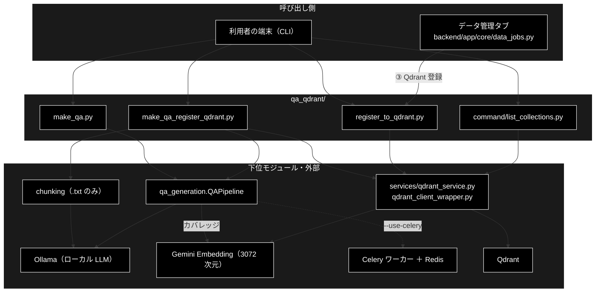

# README_qa_qdrant.md - qa_qdrant/ ディレクトリ概要

**Version 2.0** | 最終更新: 2026-10-11

`qa_qdrant/` の入口となる文書。ディレクトリの役割・モジュール索引・組み合わせ方・既知の制約をまとめる。
文書を新しく書く／直す前に、まずここを見る。

> 📌 **データ準備 3 工程のうち ② Q/A 生成・③ Qdrant 登録の CLI を持つ。**
> ① チャンク化は [`chunking/`](../../chunking/docs/README.md)、Q/A 生成の本体は [`qa_generation/`](../../qa_generation/docs/README.md)、
> 運用手順の入口は [`README_DATA.md`](../../README_DATA.md)、環境構築は [`docs/data_prep_install.md`](../../docs/data_prep_install.md)。
>
> ⚠️ **本リポジトリは Ollama 版。** Q/A 生成と `.txt` のチャンク化の LLM はローカル LLM（Ollama。`--model` / `--chunk-model` の既定は
> `config.py::get_default_ollama_model()` = `gemma4:26b-a4b-it-qat`・API キー不要）、Embedding は Gemini `gemini-embedding-001`（3072 次元・`GOOGLE_API_KEY`）。
> 姉妹リポジトリ `grace_v2` は Anthropic 版で、同名の文書でも LLM の記述と起動時の検査（`ANTHROPIC_API_KEY` ↔ Ollama の接続・pull）が違う。
> 文書をコピーで持ち込まないこと（CLAUDE.md §5）。Qdrant は両リポジトリで共用する。

---

## 目次

- [概要](#概要)
  - [主な責務](#主な責務)
  - [各責務対応のモジュール](#各責務対応のモジュール)
  - [アーキテクチャ構成図](#アーキテクチャ構成図)
- [1. モジュール一覧（索引）](#1-モジュール一覧索引)
- [2. 使い方（代表的なワークフロー）](#2-使い方代表的なワークフロー)
- [3. 公開 API（__init__.py）](#3-公開-api__init__py)
- [4. 処理フロー・データフロー](#4-処理フローデータフロー)
- [5. 既知の制約・残課題](#5-既知の制約残課題)
- [6. 変更履歴](#6-変更履歴)

---

## 概要

`qa_qdrant/` は、チャンク済みのテキストから **Q/A を生成**し、それを **Embedding して Qdrant に登録する**ための CLI を集めたディレクトリである。
生成の本体は `qa_generation.QAPipeline`、登録の本体は `services/qdrant_service.py` にあり、ここの 3 本は**入力の振り分け・順序制御・ファイル名の正規化・UI 用 CSV**を受け持つ。
データ管理タブ（Web）の「③ Qdrant 登録」は、ここの `register_to_qdrant.py` の関数をそのまま呼ぶ。

### 主な責務

- チャンク済み CSV（または事前定義データセット）から Q/A を生成する
- 既存の CSV（Q/A・本文）を Embedding して Qdrant に登録する
- テキスト・CSV から Q/A 生成と登録までを 1 本で通す
- Qdrant のコレクションの一覧を確かめる（サブディレクトリ `command/`）

### 各責務対応のモジュール

| # | 責務 | 対応モジュール | 説明 |
|---|------|--------------|------|
| 1 | Q/A の生成 | `make_qa.py` | `QAPipeline(...).run(...)` を呼ぶだけの CLI。`--use-celery` で並列 |
| 2 | 既存 CSV の登録 | `register_to_qdrant.py` | `register_to_qdrant()`（重複除去・Embedding の先読み・登録後の件数照合）。**データ管理タブもこれを呼ぶ** |
| 3 | 生成から登録まで 1 本で | `make_qa_register_qdrant.py` | `.txt` はチャンク化から。Q/A 済み CSV なら登録だけ |
| 4 | コレクションの一覧 | `command/list_collections.py` | 読み取り専用。[`command/docs/README_command.md`](../command/docs/README_command.md) |

### アーキテクチャ構成図



**データフロー**: テキスト（`.txt`）→ チャンク CSV（`output_chunked/`）→ Q/A CSV（`qa_output/pipeline/qa_pairs_<種別>_<日時>.csv`）→
Gemini Embedding → Qdrant のポイント（payload に Q/A）＋ UI 用 CSV（`qa_output/<日時を外した名前>`）。詳細は §4。

---

## 1. モジュール一覧（索引）

| モジュール | 文書 | 種別 | 行数 | Ver | 概要 |
|---|---|---|---:|---|---|
| `make_qa.py`（254 行） | [`make_qa.md`](make_qa.md) | E | 518 | 3.6 | Q/A 生成だけの CLI（チャンク済み CSV・データセット） |
| `make_qa_register_qdrant.py`（723 行） | [`make_qa_register_qdrant.md`](make_qa_register_qdrant.md) | E | 909 | 2.0 | 生成 → 登録の統合 CLI（Ollama の事前確認・`.txt` はチャンク化から・Q/A 済み CSV は登録だけ・Q/A 0 件なら終了コード 1）。旧手順書を統合 |
| `register_to_qdrant.py`（593 行） | [`register_to_qdrant.md`](register_to_qdrant.md) | E | 690 | 2.2 | 既存 CSV → Qdrant の登録 CLI と関数（データ管理タブが使う） |
| `command/list_collections.py`（51 行） | [`command/docs/list_collections.md`](../command/docs/list_collections.md) | E | 320 | 1.0 | コレクションの一覧（サブディレクトリ。索引は [`README_command.md`](../command/docs/README_command.md)） |
| （処理フロー） | [`qa_qdrant_process_flow.md`](qa_qdrant_process_flow.md) | A | 293 | 1.0 | CLI 3 本の受け持ち・Phase 1／2 のステップ・Web との対応・再開 |
| （データフロー） | [`qa_qdrant_data_flow.md`](qa_qdrant_data_flow.md) | A | 262 | 1.0 | チャンク CSV・Q/A 出力・payload・UI 用 CSV の形と置き場所 |

> 行数は文書の行数（2026-10-11 実測）。`__init__.py`（docstring だけ）は文書を作らない（§3）。
>
> **ほかの場所へ移した文書（2026-10-11）** — `a_cross_doc_md_format.md` §1.4 の寄せ先に従った:
>
> | 旧 `qa_qdrant/docs/` の文書 | 移した先 | 理由 |
> |---|---|---|
> | `README.md`（棚卸し索引） | 本書 | 索引は `README_<dir>.md` が持つ |
> | `make_qa_register_qdrant_ipo.md` | `make_qa_register_qdrant.md` | `.py` と 1 対 1 の名前へ |
> | `make_qa_register_qdrant.md`（手順書） | `make_qa_register_qdrant.md` §3.4・§5.1 に統合、原本は `archive/make_qa_register_qdrant_guide.md` | 1 モジュールの補足文書。原本は今は無いファイルを前提にしていた |
> | `qa_qdrant_architecture.md`（設計書 v3.0） | 本書の概要・[`qa_qdrant_process_flow.md`](qa_qdrant_process_flow.md)・[`qa_qdrant_data_flow.md`](qa_qdrant_data_flow.md)、原本は `archive/` | ディレクトリの概説・処理と出力の説明 |
> | `00_learning.md`（学習順・カテゴリー一覧） | 本書 §2 の読む順、原本は `archive/` | 学習メモ。行数などが古いまま |
> | `asyncio_vs_celery.md` / `generation_vs_SmartGeneration.md` / `smart_generation_upgrade.md` | `archive/`（要点は [`qa_qdrant_process_flow.md`](qa_qdrant_process_flow.md) §2.2・§3.4） | 意思決定の記録（種別 B）。本文は当時のまま |
> | `img_make_qa_register_qdrant.png` | `images/`（[`make_qa_register_qdrant.md`](make_qa_register_qdrant.md) §3.1 に掲載） | 画像は `images/` |
> | `qdrant_delete_collection.md` | [`docs/qdrant_delete_collection.md`](../../docs/qdrant_delete_collection.md) | 対象がリポジトリ直下の `qdrant_delete_collection.py` |
> | `make_qa_qapipeline.md` | [`qa_generation/docs/make_qa_qapipeline.md`](../../qa_generation/docs/make_qa_qapipeline.md) | 対象が `qa_generation/` の `QAPipeline` ＋ `SmartQAGenerator` |
> | `01_install.md` | [`docs/data_prep_install.md`](../../docs/data_prep_install.md) | `chunking/`・`qa_generation/`・`qa_qdrant/` にまたがる環境構築（種別 B） |
> | `celery_quick_start.md` | [`docs/celery_quick_start.md`](../../docs/celery_quick_start.md) | 対象が直下の `celery_config.py` / `celery_tasks.py` / `start_celery.sh` |
> | `qa_qdrant/_embedding_fix_note.txt` | `archive/embedding_fix_note.txt` | `run_registration()` を `question` だけのベクトル化へ寄せたときのメモ（コード片） |

---

## 2. 使い方（代表的なワークフロー）

**読む順**（旧 `00_learning.md` の「学習順」を現在の構成に合わせたもの）: 本書 → [`qa_qdrant_process_flow.md`](qa_qdrant_process_flow.md) →
[`qa_qdrant_data_flow.md`](qa_qdrant_data_flow.md) → 使う CLI の文書（§1）→ 生成の中身なら [`qa_generation/docs/pipeline.md`](../../qa_generation/docs/pipeline.md) /
[`smart_qa_generator.md`](../../qa_generation/docs/smart_qa_generator.md)、登録の中身なら [`services/docs/qdrant_service.md`](../../services/docs/qdrant_service.md)。

| # | ワークフロー | いつ使うか | 例 |
|---|------------|-----------|----|
| 1 | **2 段階**: 生成（`make_qa.py`）→ 確認 → 登録（`register_to_qdrant.py`） | 大きなデータ。生成した Q/A を見てから登録したい | 2.1 |
| 2 | **1 本で**: `make_qa_register_qdrant.py` | 小さなデータ・`.txt` から一気に | [`make_qa_register_qdrant.md`](make_qa_register_qdrant.md) §5.1 |
| 3 | **データ管理タブと同じ組み立て方**（Python） | アプリと同じ関数で生成・登録する | 2.2 |

> 📝 **確かめ方（2026-10-11）**: 2.1・2.2 は実行した。LLM は偽の Ollama サーバ（OpenAI 互換 API。Q/A はチャンクの先頭 1 文から 1 件）、
> Embedding（Gemini）はスタブ（文字列から決まる 3072 次元）、Qdrant は実物（`docker-compose`）。
> 入力は 4 行のチャンク CSV（`output_chunked/document_chunks.csv`）。

### 2.1 2 段階: 生成 → 確認 → 登録

```bash
# 1. Q/A を生成する（ollama serve とモデルの pull が要る。--output を付けると置き場所を固定できる）
python qa_qdrant/make_qa.py \
  --input-file output_chunked/document_chunks.csv \
  --output qa_output/pipeline

# 2. できた Q/A を確かめる（最新の 1 本）
QA_CSV=$(ls -t qa_output/pipeline/qa_pairs_document_chunks_*.csv | head -1)
head -3 "$QA_CSV"

# 3. 登録する（GOOGLE_API_KEY が要る）
python qa_qdrant/register_to_qdrant.py --input-file "$QA_CSV" --collection document_qa --recreate

# 4. 件数と次元を確かめる
python -m qa_qdrant.command.list_collections --detail | grep -A1 "document_qa "

# 出力例（2・4 の部分）:
# question,answer,chunk_id,topic,dataset_type
# 住民票の写しは市役所の窓口で取得できます…とは何ですか？,住民票の写しは市役所の窓口で取得できます。,document_chunk_0,要点,document_chunks
# 手数料は1通300円です。…とは何ですか？,手数料は1通300円です。,document_chunk_1,要点,document_chunks
#   - document_qa                               points=       4  status=green
#         vector[default]  size=3072  distance=Cosine
```

> 📌 1 の `--output` を省くと、`make_qa.py` は**リポジトリ直下の** `qa_output/pipeline/` に書く（カレントディレクトリ基準ではない・[`make_qa.md`](make_qa.md) §5.2）。
> 3 は `question` ＋ `answer` をベクトル化する。`make_qa_register_qdrant.py` と同じ `question` だけにするなら `--text-col question`（§5 の 2）。

### 2.2 データ管理タブと同じ組み立て方（Python）

```python
from services.data_pipeline_service import run_qa_generation_sync
from qa_qdrant.register_to_qdrant import register_to_qdrant
from config import get_default_ollama_model

# ② Q/A 作成ジョブと同じ（backend/app/core/data_jobs.py::_qa_runner）
result = run_qa_generation_sync(
    "output_chunked/document_chunks.csv",
    model=get_default_ollama_model(),
    output_dir="qa_output/pipeline",
    max_docs=None,
    use_celery=False,
    concurrency=8,
    analyze_coverage=False,
)
qa_csv = result["saved_files"]["qa_csv"]
print(result["qa_count"], qa_csv.endswith(".csv"))

# ③ Qdrant 登録ジョブと同じ（同 _register_runner。recreate=True のとき画面は承認を挟む）
ok = register_to_qdrant(
    input_file=qa_csv, collection_name="document_qa", recreate=True,
    batch_size=100, text_col=None, domain=None, max_docs=None, provider="gemini",
    normalize_filename=True, create_ui_csv=True, ui_output_dir="qa_output", embed_workers=2,
)
print(ok)

# 実行結果:
# 4 True
# True
```

> ⚠️ どちらも**失敗を例外ではなく戻り値で返す**ことがある（`register_to_qdrant()` は `False`、生成はチャンク単位の失敗を 0 件として続ける）。
> 画面のジョブは生成の前に Ollama を確かめ（`ollama_unreachable_message()` / `model_not_pulled_message()`）、件数を確かめて表示するので、
> Python から呼ぶときも同じ確認と `qa_count`・戻り値の確認をする。

---

## 3. 公開 API（__init__.py）

公開 API なし（`__init__.py` は docstring だけ・24 行）。各モジュールを直接 import する
（`from qa_qdrant.register_to_qdrant import register_to_qdrant` など）。

**`__init__.py` に処理を書かない。** 2026-09-21 まで、ここには `make_qa.py` の v3.0 以前の写し（236 行。現行 `make_qa.py` との差分 197 行）が入っていた。
2026-09-20〜21 に実測で調べて対処した（旧 `qa_qdrant/docs/README.md` §4。全文は git 履歴）:

| 論点 | 実測 |
|---|---|
| 参照されていたか | **No**（`main` / `PROJECT_ROOT` / `logger` を `qa_qdrant` から参照するコードは 0 件。git 履歴 1 件） |
| import の副作用 | データ管理タブの Qdrant 登録ジョブ（`backend/app/core/data_jobs.py` が `from qa_qdrant.register_to_qdrant import register_to_qdrant`）のたびに `qa_generation.pipeline`・`celery_config` まで読み込み、**+116 モジュール・約 +0.2 秒**（3 回計測） |
| ログ設定 | `__init__.py` のせいではない（`basicConfig()` をモジュールレベルで呼ぶファイルが 7 件あり、**先に走った 1 つが勝つ**）。ただし「どの書式が勝つか」は変えていた |
| 空にするとテストが壊れるか | **No**（当時 1906 passed） |

対処は 2 手: ① `register_to_qdrant.py` の書式を `celery_config.py` と同じ `[%(asctime)s] %(levelname)s [%(name)s] %(message)s` に揃え
（どちらが先に `basicConfig()` を呼んでもログの見た目が変わらない）、② `__init__.py` を docstring だけにした。対処後もログの書式と root のレベルは同じで、
消えたのは不要な依存だけだった。経緯は [`qa_generation/docs/__init__.md`](../../qa_generation/docs/__init__.md) にも記録がある。

> ⚠️ **本リポジトリには `__init__.py` に処理を書き戻していないことを固定するテストが無い**（grace_v2 は `tests/test_qa_qdrant_package_init.py`・2 件）。§5 の 7。

---

## 4. 処理フロー・データフロー

- **処理フロー** — [`qa_qdrant_process_flow.md`](qa_qdrant_process_flow.md)。CLI 3 本の受け持ち（チャンク化・生成・カバレッジ・登録のどれをやるか）、
  Phase 1（`QAPipeline`）と Phase 2（Embedding → upsert）のステップ表、データ管理タブとの対応、起動時の検査、途中で落ちたときの再開、Celery 並列。
- **データフロー** — [`qa_qdrant_data_flow.md`](qa_qdrant_data_flow.md)。チャンク CSV・Q/A CSV / JSON・カバレッジ・サマリー・途中経過の列とキー、
  Qdrant のポイント（ID は内容のハッシュ・payload）、UI 用 CSV、置き場所と上書きの有無。実行して出たファイルの抜粋つき。

要点: Q/A は 1 チャンク = LLM 呼び出し 1 回（構造化出力で 0〜5 件）。登録は Q/A 1 件 = 1 ポイント・3072 次元。
同じ内容は同じ ID になるので、`--recreate` なしで流し直しても件数は増えない。

---

## 5. 既知の制約・残課題

2026-10-11 に実装を読み、CLI を実行して確かめたもの。**コードは直していない**（本書の改訂は文書の整理のみ）。

| # | 内容 | 影響 | 詳細 |
|---|------|------|------|
| 1 | `make_qa.py` は Ollama への接続・モデルの pull を起動時に確かめず、Q/A が 0 件でも止まらない | Ollama が落ちていると全チャンクが失敗し「生成Q/A数: 0」のまま**終了コード 0**。`make_qa_register_qdrant.py` は 2026-09-26 に `require_ollama_ready()` と「0 件なら終了コード 1」で直してある | [`make_qa.md`](make_qa.md) §5.4 |
| 2 | **ベクトル化する文が道具で違う**: `make_qa_register_qdrant.py` は `question` だけ、`register_to_qdrant.py`（とデータ管理タブ）は `question` ＋ `answer` | 同じ Q/A CSV でも、どちらで登録したかで検索スコアが変わる。RAG のしきい値の測り直しにも関わるので、どちらへ揃えるかは**ユーザーの判断待ち** | [`register_to_qdrant.md`](register_to_qdrant.md) §5.4 の 2 |
| 3 | `register_to_qdrant.py --provider openai` は Embedding に効かず、payload に `text-embedding-3-small` と誤った名前を書く | payload を信じると Embedding モデルを取り違える | [`register_to_qdrant.md`](register_to_qdrant.md) §5.4 の 1 |
| 4 | `make_qa.py` / `make_qa_register_qdrant.py` のログ書式（`basicConfig(format=...)`）が効かない | ログが `INFO:__main__:...` の形になる（見た目だけ。`register_to_qdrant.py` は `celery_config.py` と同じ書式が効く） | [`make_qa_register_qdrant.md`](make_qa_register_qdrant.md) §6.3 |
| 5 | Qdrant の接続先は `localhost:6333` 固定（3 本の CLI に `--url` が無く、環境変数でも変わらない） | 別ホストの Qdrant へ登録できない | [`make_qa_register_qdrant.md`](make_qa_register_qdrant.md) §3.4 |
| 6 | `make_qa.py` の既定出力はリポジトリ直下基準、`make_qa_register_qdrant.py` はカレント基準 | 実行場所によって Q/A CSV の置き場所が分かれる | [`qa_qdrant_data_flow.md`](qa_qdrant_data_flow.md) §4 |
| 7 | `__init__.py` を docstring だけに保つテストが無い（grace_v2 にはある） | 処理を書き戻しても CI が気づかない | §3 |

### 5.1 文書を保守するときの約束とテスト件数

- **運用手順（Ollama・環境構築・ワーカーの起動）は [`docs/data_prep_install.md`](../../docs/data_prep_install.md) / [`docs/celery_quick_start.md`](../../docs/celery_quick_start.md) にだけ書く**。
  モジュール文書には IPO と使用例だけを書き、手順はリンクする（同じ手順を 2 か所に書くと片方だけ直して食い違う）。
- `archive/` の比較メモ（なぜ Celery か・なぜスマート生成か）は当時の記録。`gemini-2.0-flash` などの記述も当時の値として残す。
- 使用例は**動かして確かめてから**載せる（`a_class_method_md_format.md` §9.5）。LLM は偽の Ollama サーバ、Embedding はスタブ、Qdrant・Redis は `docker-compose` の実物でよい。

テスト件数（2026-10-11 に `pytest --collect-only` で数えた値）:

| テストファイル | 件数 | 対象 |
|---|---:|---|
| `tests/test_make_qa_register_qdrant_csv.py` | 2 | CSV 入力 |
| `tests/test_make_qa_register_qdrant_csv_fixed.py` | 1 | 同上（`run_registration()`） |
| `tests/test_make_qa_register_qdrant_exit_code.py` | 3 | 登録の成否・Q/A 0 件と終了コード |
| `tests/test_make_qa_register_qdrant_txt_input.py` | 3 | `.txt` のチャンク化 |
| `tests/test_make_qa_register_qdrant_startup_checks.py` | 5 | Ollama の事前確認・`--provider` の拒否 |
| `tests/test_qa_pipeline_text_column.py` | 6 | `--text-column` が `QAPipeline` へ渡る |
| `tests/test_register_qdrant_metadata.py` | 2 | 登録時のメタデータ |
| `tests/test_qa_pipeline_dataset_type.py` | 6 | `--dataset` の種別がデータセット名になる（**間接**） |
| `tests/integration/test_register_to_qdrant_live.py` | 4 | `register_to_qdrant()` を実 Qdrant へ（Qdrant が無ければ skip） |
| `tests/test_data_jobs.py` | 55 | データ管理タブのジョブ全体（登録ジョブが `register_to_qdrant` を呼ぶ・**間接**） |

```bash
uv run --no-sync pytest tests/test_make_qa_register_qdrant_*.py tests/test_qa_pipeline_text_column.py tests/test_register_qdrant_metadata.py -q
# 2026-10-11 実測: 22 passed（直接テスト 7 本。結合テストは Qdrant を起動して `uv run --no-sync pytest tests/integration/test_register_to_qdrant_live.py`）
```

> ⚠️ **`make_qa.py`・`list_collections.py`・`__init__.py` のテストは無い。** §5 の 1 を直すときは、修正前のコードで fail するテストを先に書く。

---

## 6. 変更履歴

| バージョン | 日付 | 変更内容 |
|---|---|---|
| 1.0 | 2026-09-20 | 新規作成（旧名 `qa_qdrant/docs/README.md`・棚卸し索引）。12 文書を形式別に整理 |
| 1.1〜1.13 | 2026-09-21〜2026-10-10 | `__init__.py` の実測調査と対処（§3）、文書の Version ヘッダー・LLM 表記（Ollama）の是正、`make_qa_register_qdrant.py` の IPO 文書の新設と既知の問題 6 件の修正への追随、テストの所在の移動、`services/docs/` の改名への追随（各版の内容は git 履歴） |
| 2.0 | 2026-10-11 | `a_cross_doc_md_format.md` §1.1〜§1.4 に合わせて `README_qa_qdrant.md` へ改名し、共通骨格（主な責務・各責務対応のモジュール・3 層構成図）を持つ構成に書き直した（姉妹リポジトリ grace_v2 と同じ整理）。12 文書を寄せ先へ移し（§1 の表）、`qa_qdrant_process_flow.md` / `qa_qdrant_data_flow.md` を新設、`command/docs/` を作った。旧 §4（`__init__.py` の調査）は §3 に要約した。§2 のワークフロー 2 本を偽の Ollama サーバ・実 Qdrant で実行して確かめ、実測で見つけた制約 7 件を §5 に、テスト件数を数え直して §5.1 に記録した |
