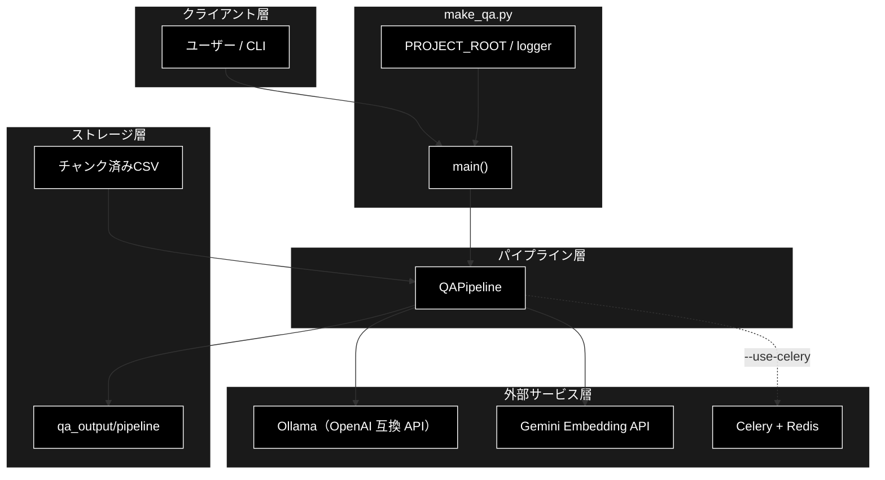
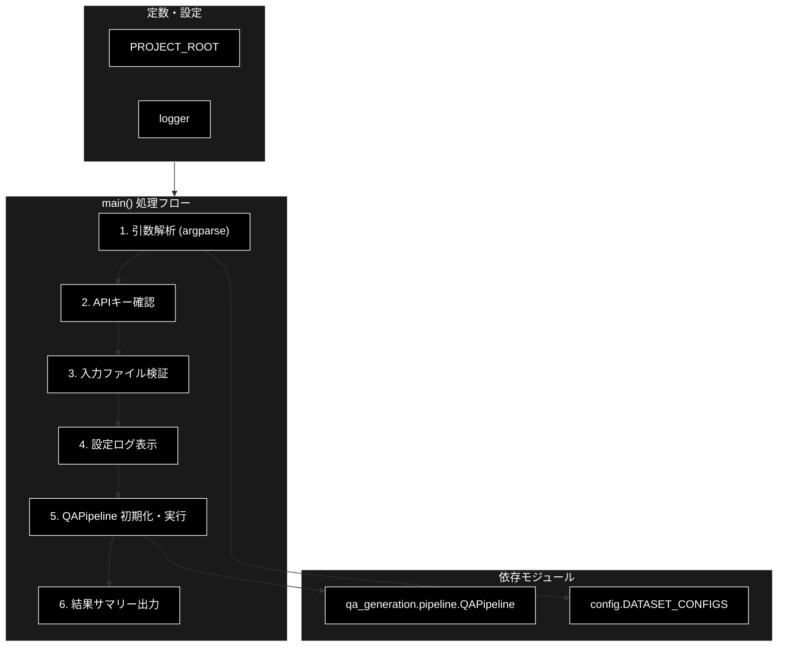
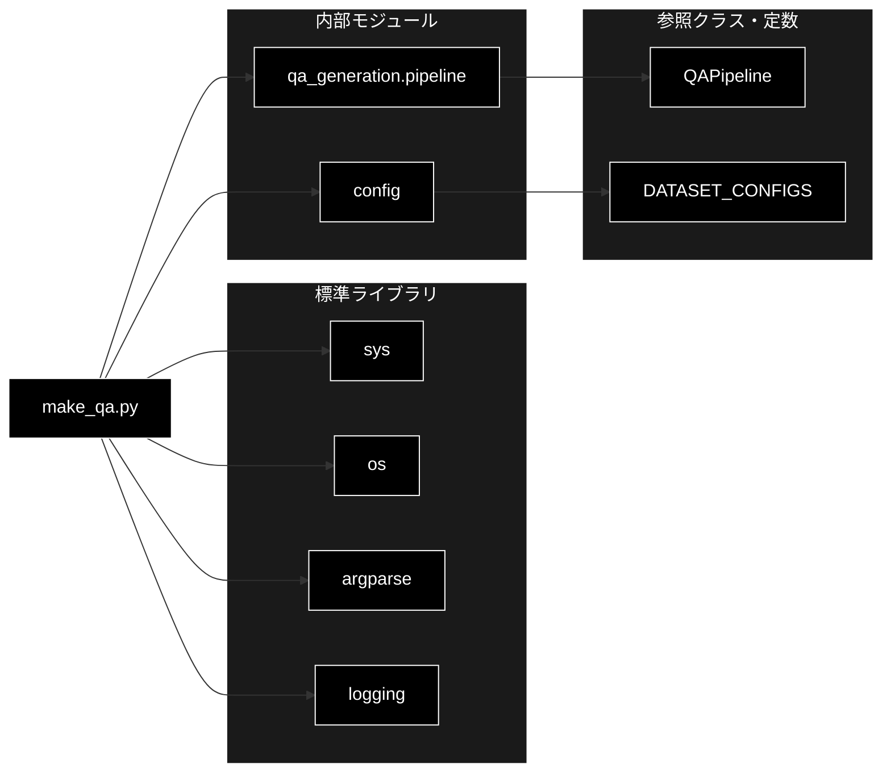

# make_qa.py - Q/Aペア生成 CLIエントリーポイント ドキュメント

**Version 3.7** | 最終更新: 2026-10-13

---

## 目次

1. [概要](#概要)
2. [1. アーキテクチャ構成図](#1-アーキテクチャ構成図)
3. [2. モジュール構成図](#2-モジュール構成図)
4. [3. クラス・関数一覧表](#3-クラス関数一覧表)
5. [4. クラス・関数 IPO詳細](#4-クラス関数-ipo詳細)
6. [5. 設定・定数](#5-設定定数)
7. [6. エクスポート](#6-エクスポート)
8. [7. 変更履歴](#7-変更履歴)
9. [付録: 依存関係図](#付録-依存関係図)

---

## 概要

`make_qa.py` は、チャンク済みCSVファイル（または事前定義データセット）からQ/Aペアを自動生成するCLIエントリーポイント。引数解析・環境変数/入力ファイル検証ののち、`qa_generation.pipeline.QAPipeline` を初期化・実行し、結果サマリーをログ出力する。

> 📝 **注意**: 本モジュールは **Q/A生成のみ** を担う。生成済みQ/AのQdrantベクトルDBへの登録は別モジュール（`qa_qdrant/register_to_qdrant.py` および `qa_qdrant/make_qa_register_qdrant.py`）が担当する。
> ディレクトリ全体の位置づけは [`README_qa_qdrant.md`](README_qa_qdrant.md)、処理の流れは [`qa_qdrant_process_flow.md`](qa_qdrant_process_flow.md)。
>
> ⚠️ **Ollama への接続とモデルの pull を起動時に確かめない**（[§5.4](#54-既知の問題2026-10-11-実測) の 1）。Ollama が落ちていると全チャンクの生成に失敗し、
> **「生成Q/A数: 0」のまま終了コード 0** で終わる。`make_qa_register_qdrant.py` では同じ問題を 2026-09-26 に直している（`require_ollama_ready()`・同書 §3.3 の 5・6）。

### 主な責務

- CLI引数の解析・検証（入力ソース・モデル・並列処理・カバレージ等）
- 環境変数 `GOOGLE_API_KEY` の存在確認（Ollama への接続は確かめない・§5.4）
- 入力ファイルの存在・形式（`.csv` 限定）検証
- `QAPipeline` の初期化と `pipeline.run()` の実行制御
- 実行結果サマリー（生成ファイルパス・Q/A数・カバレージ率）のログ出力

### 各責務対応のモジュール

| # | 責務 | 対応モジュール | 説明 |
|---|------|--------------|------|
| 1 | CLI引数の解析・検証 | `make_qa.py` | `argparse` で入力ソース・モデル・並列処理・カバレージ引数を定義 |
| 2 | 環境変数チェック | `make_qa.py` | `GOOGLE_API_KEY` 未設定時は `sys.exit(1)` |
| 3 | 入力ファイル検証 | `make_qa.py` | ファイル存在 + 拡張子 `.csv` を確認 |
| 4 | Q/A生成パイプライン制御 | `qa_generation.pipeline.QAPipeline` | チャンクCSVを読み込みLLMでQ/A生成 |
| 5 | 実行サマリー出力 | `make_qa.py` | 結果ファイル・Q/A数・カバレージ率をログ出力 |

### 主要機能一覧

| 機能 | 説明 |
|------|------|
| `main()` | CLIエントリーポイント関数。引数解析・検証・パイプライン実行・結果出力を一括して行う |
| `PROJECT_ROOT` | プロジェクトルートの絶対パス（デフォルト出力先の基準） |
| `logger` | モジュール用ロガー（`logging.getLogger(__name__)`） |

### 前提条件

- 入力CSVは事前にチャンク化済みであること（`chunking.csv_text_to_chunks_text_csv` 等で生成）
- `GOOGLE_API_KEY` 環境変数が設定されていること

### 技術スタック

| 役割 | プロバイダー / モデル |
|------|----------------------|
| LLM（Q/A生成・Agent応答） | ローカル LLM / Ollama（`gemma4:26b-a4b-it-qat`） — **APIキー不要**（`ollama serve` が前提） |
| Embedding（Qdrant登録・検索） | Gemini `gemini-embedding-001`（3072次元）— APIキー `GOOGLE_API_KEY` |
| 本モジュールで使う `--model` 既定値 | `get_default_ollama_model()` → `gemma4:26b-a4b-it-qat`（`make_qa.py:108`。`QAPipeline` 経由のLLM呼び出しに渡される値） |

---

## 1. アーキテクチャ構成図

### 1.1 システム全体構成



### 1.2 データフロー

1. ユーザーがCLI引数を指定して `python qa_qdrant/make_qa.py ...` を実行
2. `main()` が引数を解析し、`GOOGLE_API_KEY` と入力ファイルを検証
3. `QAPipeline` を初期化（`dataset_name`, `input_file`, `model`, `output_dir`, `max_docs`）
4. `pipeline.run()` を実行（`use_celery`, `concurrency`, `analyze_coverage`, `coverage_threshold` 等を渡す）
5. パイプラインがCSVを読み込み、LLM APIを呼び出してQ/Aペアを生成・保存
6. 結果サマリーをログ出力して終了

---

## 2. モジュール構成図

### 2.1 内部モジュール構成



### 2.2 外部依存関係

| ライブラリ | バージョン | 用途 |
|-----------|-----------|------|
| `argparse` | 標準 | CLI引数解析 |
| `logging` | 標準 | ログ出力 |
| `os` | 標準 | 環境変数・パス操作 |
| `sys` | 標準 | パス追加・終了コード制御 |

### 2.3 内部依存モジュール

| モジュール | 用途 |
|-----------|------|
| `qa_generation.pipeline.QAPipeline` | Q/A生成パイプラインクラス |
| `config.DATASET_CONFIGS` | 事前定義データセット名 → 設定辞書 |

---

## 3. クラス・関数一覧表

### 3.1 クラス一覧

本モジュールにクラス定義はありません。

### 3.2 関数一覧（カテゴリ別）

#### エントリーポイント

| 関数名 | 概要 |
|--------|------|
| `main()` | CLIエントリーポイント。引数解析・検証・`QAPipeline` 実行・結果出力 |

### 3.3 定数一覧

| 名称 | 概要 |
|------|------|
| `PROJECT_ROOT` | `make_qa.py` から見たプロジェクトルートの絶対パス |
| `logger` | モジュール用ロガー |

### 3.4 `main()` 内部構成

`main()` は単一関数ですが、内部は以下の6ブロックで構成されます。

| # | 処理ブロック | 概要 | 行範囲 |
|:-:|-------------|------|:------:|
| 1 | 引数解析 | `argparse` で4カテゴリの引数を定義し `parse_args()` で解析 | 60-160 |
| 2 | APIキー確認 | `GOOGLE_API_KEY` 未設定なら `sys.exit(1)` | 162-167 |
| 3 | 入力ファイル検証 | ファイル存在確認・`.csv` 拡張子チェック | 169-182 |
| 4 | 設定ログ表示 | 入力ソース・モデル・出力先・生成モード・並列設定をログ表示 | 184-207 |
| 5 | パイプライン実行 | `QAPipeline` を初期化し `pipeline.run()` を呼び出す | 209-230 |
| 6 | 結果サマリー出力・例外処理 | サマリーファイル・Q/A CSV・件数・カバレージ率をログ出力。例外はトレースバックを出して `sys.exit(1)` | 232-251 |

> 行範囲は 2026-10-11 に `make_qa.py`（254 行）で数え直した値（v3.7 までは 2026-06 頃の値のままで、10 行ほどずれていた）。

### 3.5 引数定義カテゴリ（ブロック1 詳細）

| # | カテゴリ | 引数数 | 含まれる引数 |
|:-:|---------|:------:|-------------|
| 1 | 入力ソース（排他的必須） | 2 | `--dataset`, `--input-file` |
| 2 | 共通パラメータ | 3 | `--model`, `--output`, `--max-docs` |
| 3 | カバレージ分析 | 2 | `--analyze-coverage`, `--coverage-threshold` |
| 4 | Celery並列処理 | 3 | `--use-celery`, `-c`/`--concurrency`, `--celery-workers` |
| | **合計** | **10** | |

---

## 4. クラス・関数 IPO詳細

### 4.1 使用例

| # | パターン | いつ使うか | 例 |
|---|---------|-----------|----|
| 1 | **基本**: チャンク済み CSV から同期で生成（カバレッジ分析つき） | 数十〜数百チャンク。Celery を用意しない | 4.1.1 |
| 2 | Celery 並列で生成 | 大量のチャンク。Redis・ワーカーを起動できる | 4.1.2 |
| 3 | 件数を絞って試す（`--max-docs`） | 本番の前にプロンプト・出力を確かめる | 4.1.3 |
| 4 | モジュールとして実行（`python -m`） | パスを気にせず呼びたい | 4.1.4 |
| 5 | 入力の検査で止まるとき | `.txt` を渡した・キーが無い・Ollama が落ちている | 4.1.5 |

> 📝 **確かめ方（2026-10-11）**: 4.1.1〜4.1.5 はすべて実行した。LLM は偽の Ollama サーバ（OpenAI 互換 API。Q/A はチャンクの先頭 1 文から 1 件）、
> Embedding（Gemini）はスタブ（文字列から決まる 3072 次元）、Redis と Celery ワーカーは実物
> （`docker compose` の Redis と、スタブを当てた `celery_config` のワーカー）。入力は 4 行のチャンク CSV（`output_chunked/document_chunks.csv`）。
> 出力例の件数はそのときのもので、実際の Ollama ではチャンクあたり 0〜5 件になる。カバレッジ率が 0.0% なのはスタブのベクトルが互いに直交するため。
> `--dataset`（事前定義データセット）は Hugging Face からの取得が要るので動かしていない。
> 後続の Qdrant 登録は [`register_to_qdrant.md`](register_to_qdrant.md) §4.1、生成から登録まで 1 本で行うなら [`make_qa_register_qdrant.md`](make_qa_register_qdrant.md) §5.1。

#### 4.1.1 基本: チャンク済み CSV から同期で生成する

```bash
# 前提: ollama serve 起動済み（既定モデル gemma4:26b-a4b-it-qat を pull 済み）、.env に GOOGLE_API_KEY（カバレッジ分析の Embedding・起動時に確かめる）
python qa_qdrant/make_qa.py \
    --input-file output_chunked/document_chunks.csv \
    --analyze-coverage

# 出力例（末尾）:
# INFO:__main__:✅ Make QA 完了
# INFO:__main__:サマリーファイル: <リポジトリ>/qa_output/pipeline/summary_document_chunks_20261011_023709.json
# INFO:__main__:Q/A CSVファイル: <リポジトリ>/qa_output/pipeline/qa_pairs_document_chunks_20261011_023709.csv
# INFO:__main__:生成Q/A数: 4
# INFO:__main__:カバレージ率: 0.0%
```

> 📌 `--output` を省くと**リポジトリ直下の** `qa_output/pipeline/` に書く（`PROJECT_ROOT` 基準の絶対パス・§5.1）。
> `make_qa_register_qdrant.py` の既定 `qa_output/pipeline` は**カレントディレクトリ基準**なので、リポジトリ直下以外で実行すると置き場所が分かれる。

#### 4.1.2 Celery 並列で生成する

```bash
# 1) Celery ワーカーを起動（別ターミナル）。キュー名に qa_generation は無い（CLAUDE.md §9.4）
./start_celery.sh start -c 8

# 2) -c はワーカーの -c と同じ値にそろえる（ログに出すだけで、実際の並列数はワーカーの -c）
python qa_qdrant/make_qa.py \
    --input-file output_chunked/document_chunks.csv \
    --use-celery \
    -c 8

# 出力例（抜粋）:
# INFO:__main__:並列処理: Celery（並列タスク数: 8）
# INFO:celery_tasks:✅ Celeryワーカーの準備完了
# INFO:celery_tasks:進捗: 4/4 (100%) | Q/A累計: 4 | 完了: 4 | 失敗: 0
# INFO:__main__:生成Q/A数: 4
```

> ⚠️ ワーカー（または Redis）が無いと `実行中にエラーが発生しました: Celery workers are not running` で終了コード 1。
> ワーカーの起動・停止・監視は [`data_prep_install.md` §5](../../docs/data_prep_install.md)。

#### 4.1.3 件数を絞って試す

```bash
# 先頭 2 チャンクだけ処理する（LLM 呼び出しも 2 回）
python qa_qdrant/make_qa.py \
    --input-file output_chunked/document_chunks.csv \
    --max-docs 2

# 出力例（末尾）:
# INFO:__main__:生成Q/A数: 2
```

> 📌 `--analyze-coverage` を付けないとカバレッジ分析をせず（Embedding を呼ばない）、最後の「カバレージ率」の行も出ない。

#### 4.1.4 モジュールとして実行する

```bash
python -m qa_qdrant.make_qa \
    --input-file output_chunked/document_chunks.csv \
    --max-docs 1

# 出力例（末尾）:
# INFO:__main__:生成Q/A数: 1
```

#### 4.1.5 入力の検査で止まるとき

```bash
# テキストファイルは受け付けない（先にチャンク化する。.txt も受け付けるのは make_qa_register_qdrant.py）
python qa_qdrant/make_qa.py --input-file data/document.txt
echo "exit=$?"
# ERROR:__main__:❌ CSVファイル以外は直接処理できません
# ERROR:__main__:   テキストファイルの場合は、先に csv_text_to_chunks_text_csv.py でチャンク化してください
# exit=1

# GOOGLE_API_KEY が無い → 終了コード 1
env -u GOOGLE_API_KEY python qa_qdrant/make_qa.py --input-file output_chunked/document_chunks.csv
echo "exit=$?"
# ERROR:__main__:GOOGLE_API_KEYが設定されていません
# exit=1

# ⚠️ Ollama に繋がらなくても止まらない（§5.4 の 1）。全チャンクが失敗し、0 件のまま終了コード 0
OLLAMA_BASE_URL=http://127.0.0.1:18499/v1 python qa_qdrant/make_qa.py --input-file output_chunked/document_chunks.csv --max-docs 1
echo "exit=$?"
# ERROR:qa_generation.smart_qa_generator:チャンク処理エラー（構造化出力に失敗）: Connection error.
# INFO:__main__:生成Q/A数: 0
# exit=0
```

### 4.2 エントリーポイント関数

#### `main`

**概要**: CLI引数を解析し、`QAPipeline` を初期化・実行するエントリーポイント関数。環境変数・入力ファイルの検証、設定ログ出力、結果サマリー出力、例外ハンドリングまでを含む。

```python
def main() -> None
```

| パラメータ | 型 | デフォルト | 説明 |
|------------|------|-----------|------|
| - | - | - | 引数なし（CLI引数は `sys.argv` 経由で取得） |

| 項目 | 内容 |
|------|------|
| **Input** | CLI引数（`sys.argv`）: `--dataset` or `--input-file`（排他必須）, `--model`, `--output`, `--max-docs`, `--analyze-coverage`, `--coverage-threshold`, `--use-celery`, `-c/--concurrency`, `--celery-workers` |
| **Process** | 1. `argparse.ArgumentParser` で引数定義し `parse_args()` で解析<br>2. `GOOGLE_API_KEY` 環境変数を確認（未設定なら `sys.exit(1)`）<br>3. `--input-file` 指定時はファイル存在 + `.csv` 拡張子を検証<br>4. 入力ソース・モデル・出力先・並列設定をログ出力<br>5. `QAPipeline(dataset_name, input_file, model, output_dir, max_docs)` を初期化<br>6. `pipeline.run(use_celery, celery_workers, concurrency, analyze_coverage, coverage_threshold)` を実行<br>7. サマリーファイルパス・Q/A CSVパス・生成Q/A数・カバレージ率をログ出力<br>8. 例外発生時は `traceback.print_exc()` 後 `sys.exit(1)` |
| **Output** | `None`（標準出力へのログのみ。Q/AファイルやサマリーJSONの出力は `QAPipeline` が担当） |

**終了コード**:

| コード | 条件 |
|--------|------|
| `0` | 正常終了 |
| `1` | `GOOGLE_API_KEY` 未設定 / 入力ファイル不在 / `.csv` 以外の入力 / 実行時例外 |

**戻り値例**:

```python
# 標準出力に出力されるサマリーログ（例）
# ============================================================
# ✅ Make QA 完了
# ============================================================
# サマリーファイル: /.../qa_output/pipeline/summary_20260617_xxxxx.json
# Q/A CSVファイル: /.../qa_output/pipeline/qa_pairs_20260617_xxxxx.csv
# 生成Q/A数: 1234
# カバレージ率: 87.5%
# ============================================================
```

```python
# 使用例（コマンドライン）
# $ python qa_qdrant/make_qa.py \
#       --input-file output_chunked/data_chunks.csv \
#       --use-celery \
#       -c 8 \
#       --analyze-coverage
```

---

## 5. 設定・定数

### 5.1 `PROJECT_ROOT`

プロジェクトルートディレクトリの絶対パス。デフォルト出力ディレクトリ（`{PROJECT_ROOT}/qa_output/pipeline`）の基準として使用される。

```python
PROJECT_ROOT = os.path.dirname(os.path.dirname(os.path.abspath(__file__)))
```

| 定数名 | 値 | 説明 |
|--------|------|------|
| `PROJECT_ROOT` | `make_qa.py` の2階層上のディレクトリ | デフォルト出力パスの基準 |

### 5.2 CLI引数のデフォルト値

| 引数 | デフォルト値 | 説明 |
|------|-------------|------|
| `--model` | `get_default_ollama_model()`（`gemma4:26b-a4b-it-qat`。環境変数 `OLLAMA_DEFAULT_MODEL` があればそちら） | 使用する LLM モデル名（Ollama・`QAPipeline` に渡される） |
| `--output` | `{PROJECT_ROOT}/qa_output/pipeline` | 出力ディレクトリ（**絶対パス**。カレントディレクトリによらずリポジトリ直下の `qa_output/pipeline/`） |
| `--max-docs` | `None` | 処理する最大チャンク数（無制限） |
| `--analyze-coverage` | `False` | カバレージ分析を実行するフラグ |
| `--coverage-threshold` | `None` | カバレージ判定の類似度閾値 |
| `--use-celery` | `False` | Celery 非同期並列処理を使用するフラグ |
| `-c`, `--concurrency` | `8` | 並列タスク数（**ログ表示用**。実際の並列数は `start_celery.sh -c` で決まるので同じ値を指定する） |
| `--celery-workers` | `1` | （非推奨）ワーカープロセス数チェック用 |

> ⚠️ **非推奨**: `--celery-workers` は非推奨。並列度は `-c/--concurrency` を使用してください。

### 5.3 CLI引数仕様

#### 入力ソース（排他的・必須）

| 引数 | 型 | 説明 |
|------|------|------|
| `--dataset` | str | 事前定義データセット名（`DATASET_CONFIGS` のキー） |
| `--input-file` | str | チャンク済みCSVファイルのパス |

> 📝 **注意**: `--dataset` と `--input-file` は排他的（`argparse.add_mutually_exclusive_group(required=True)`）。いずれか一方を必ず指定。

#### Q/A生成パラメータ

> 📝 **注意**: v3.0 以降、Q/A生成は `SmartQAGenerator`（構造化出力1回・チャンク1件 = LLM 呼び出し1回）に一本化されており、`--use-smart-generation` / `--no-smart-generation` などのフラグは廃止されています。
> `--batch-chunks`（1 回の API で処理するチャンク数）も、処理に使われていなかったため 2026-10-09 に削除しました。指定するとエラーになります。


### 5.4 既知の問題（2026-10-11 実測）

| # | 問題 | 実測・根拠 | 影響 |
|---|------|-----------|------|
| 1 | **Ollama への接続・モデルの pull を起動時に確かめない** | `main()` が確かめるのは `GOOGLE_API_KEY` だけ（`make_qa.py:163-167`）。Ollama に繋がらない状態で実行すると、各チャンクで `チャンク処理エラー（構造化出力に失敗）: Connection error.` を出し、`生成Q/A数: 0` で**終了コード 0**（4.1.5）。Q/A が 0 件になったとき（全チャンク `qa_count=0`）も終了コード 0 | シェルやジョブ管理から失敗を検知できない。0 件の Q/A CSV・サマリーが残る。`make_qa_register_qdrant.py` は同じ問題を 2026-09-26 に `require_ollama_ready()` と「0 件なら終了コード 1」で直している |
| 2 | **`GOOGLE_API_KEY` を常に要求する** | カバレッジ分析（`--analyze-coverage`）をしないときは Embedding を呼ばないが、起動時の検査は無条件 | Q/A 生成だけなら不要なキーを求められる（実害は小さい） |
| 3 | ログの書式が効かない | `logging.basicConfig(format=...)`（`make_qa.py:49`）より先に `qa_generation.smart_qa_generator` の `basicConfig(level=INFO)` が走るため、ログは `INFO:__main__:...` の形になる | 見た目だけ |

> 1・2 はコードを直していない（本書は文書の整理のみ）。直すときは、修正前のコードで fail するテストを先に書く（CLAUDE.md の作業原則）。

---

## 6. エクスポート

本モジュールは `__all__` を定義していません。CLIエントリーポイントとして `python qa_qdrant/make_qa.py` または `python -m qa_qdrant.make_qa` から `main()` が `__main__` ガード経由で実行されます。

```python
if __name__ == "__main__":
    main()
```

---

## 7. 変更履歴

| バージョン | 日付 | 変更内容 |
|---|---|---|
| 1.0 | - | 初版作成 |
| 2.0 | - | `a_class_method_md_format.md` 仕様に準拠して全面再構成 |
| 2.1 | 2025-02-07 | 「クラス・関数一覧表」セクション追加、`main()` 内部構成・引数定義カテゴリ表を追加 |
| 3.0 | - | `pipeline.py` v3.0 対応。`--input-chunks` を `--input-file` に統一、チャンク関連引数を削除、`-c/--concurrency` を追加 |
| 3.1 | 2026-06-17 | `--use-smart-generation` / `--no-smart-generation` の廃止を反映（実装と整合）。Q/A生成は `SmartQAGenerator` 一本化を明記。技術スタック表記（Anthropic Claude + Gemini Embedding）を追加。本モジュールは Q/A生成のみで Qdrant 登録は別モジュールである旨を明記。Mermaid 図を黒背景・白文字スタイルに刷新 |
| 3.2 | 2026-09-21 | **LLM 表記を Ollama へ是正**。技術スタック表・`--model` 既定値・Mermaid 図が `Anthropic Claude` / `claude-sonnet-4-6` / `ANTHROPIC_API_KEY` / `gemini-2.5-flash` のままだった。実装の既定は `get_default_ollama_model()`（`make_qa.py:108`・実値 `gemma4:12b-mlx`）で API キーは不要 |
| 3.3 | 2026-09-24 | 使用例を IPO 詳細の冒頭（`### 4.1 使用例`）へ移し、末尾の「## 6. 使用例」章を削除（基本フォーマット `a_class_method_md_format.md` v1.6〜 §6.1 に準拠。2026-09-24）。IPO の小節を 4.2 以降へ繰り下げ、後続の章番号を 1 つ繰り上げた。文書内の `§4.x` 参照も追随 |
| 3.4 | 2026-10-08 | 現在の既定モデルの記載 `gemma4:12b-mlx` を、2026-10-03 の変更後の値 `gemma4:26b-a4b-it-qat`（`config.py::get_default_ollama_model()` の戻り値）へ是正（技術スタック表） |
| 3.5 | 2026-10-09 | 処理に使われていなかった `--batch-chunks` を削除したのに追随（`QAPipeline` は同期でも Celery でもチャンク 1 件 = LLM 呼び出し 1 回で、値を一度も使っていなかった） |
| 3.6 | 2026-10-11 | `qa_qdrant/docs/` の構成整理（姉妹リポジトリ grace_v2 と同じ整理）に合わせて改訂。§4.1 の使用例を処理パターン（基本・Celery 並列・件数を絞る・`python -m`・入力の検査で止まるとき）ごとの 5 本に書き直し、入力を実在する名前にそろえ、偽の Ollama サーバ・Embedding のスタブと実 Redis・Celery ワーカーで実行して確かめた。実測で見つけた既知の問題（Ollama への接続を確かめず 0 件のまま終了コード 0 など）を §5.4 に記録。§3.4 の行範囲を数え直し、`--output` の既定が絶対パスであることを明記。§5.2 の `--model` 既定値が `gemini-2.5-flash` のままだったのを `get_default_ollama_model()` へ是正 |
| 3.7 | 2026-10-13 | Celery の参照先を docs/data_prep_install.md §5 へ（celery_quick_start.md を統合・削除） |

---

## 付録: 依存関係図


