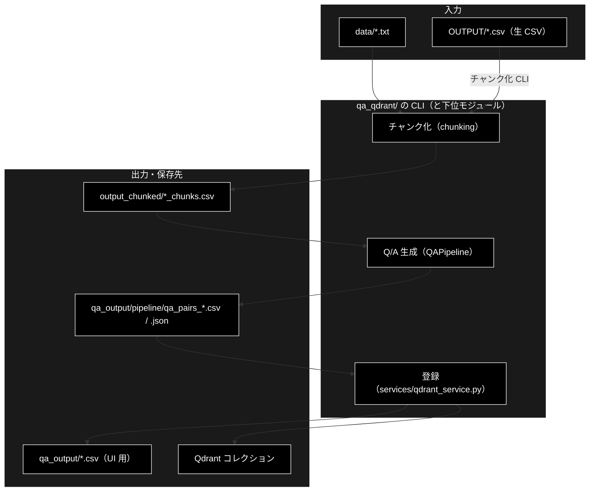
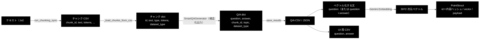

# qa_qdrant_data_flow.md - qa_qdrant/ データフロー

**Version 1.0** | 最終更新: 2026-10-11

データ準備の ② Q/A 生成・③ Qdrant 登録で、**データがどんな形でどこに置かれ、どう変わるか**（ファイルの列・JSON のキー・Qdrant の payload・ファイル名・上書きの有無）をまとめる。
処理の順序と分岐は [`qa_qdrant_process_flow.md`](qa_qdrant_process_flow.md)、各関数の IPO は各モジュールの文書。ディレクトリ全体の入口は [`README_qa_qdrant.md`](README_qa_qdrant.md)。

> 📝 §3 の例は CLI を実際に動かして出たファイルの抜粋である（姉妹リポジトリ grace_v2 で LLM と Embedding をスタブにして実行したもの。本リポジトリでも偽の Ollama サーバで同じ列・ファイル名になることを 2026-10-11 に確かめた。Qdrant は実物）。
> Q/A の文面はスタブが作ったもの（チャンクの先頭 1 文から 1 件）で、実際の Ollama では 1 チャンクから 0〜5 件・自然な質問文になる。列・キー・ファイル名は実物と同じ。

---

## 目次

- [概要](#概要)
- [1. データの流れ全体](#1-データの流れ全体)
- [2. データ項目と形式](#2-データ項目と形式)
  - [2.1 チャンク CSV](#21-チャンク-csv)
  - [2.2 Q/A 生成の出力](#22-qa-生成の出力)
  - [2.3 Qdrant のポイント](#23-qdrant-のポイント)
  - [2.4 UI 用 CSV](#24-ui-用-csv)
- [3. 変換の詳細](#3-変換の詳細)
- [4. 保存先・命名・上書き](#4-保存先命名上書き)
- [5. 関連ドキュメント](#5-関連ドキュメント)
- [6. 変更履歴](#6-変更履歴)

---

## 概要

入力（テキスト・CSV）は、**チャンク CSV → Q/A CSV → Qdrant のポイント**の順に形を変える。ファイルはすべて UTF-8 の CSV / JSON で、
Qdrant には「Q/A 1 件 = 1 ポイント・3072 次元の単一ベクトル・payload に元の Q/A」で入る。

### 主な責務

- チャンク CSV（本文とチャンク ID）を Q/A 生成の入力として読む
- 生成した Q/A を CSV / JSON に書き、カバレッジとサマリーを JSON に書く
- Q/A をベクトルと payload に変えて Qdrant へ書く
- 日時を外した名前の UI 用 CSV を書く

### 各責務対応のモジュール

| # | 責務 | 対応モジュール | 説明 |
|---|------|--------------|------|
| 1 | チャンク CSV を読む | `qa_generation/pipeline.py`（`QAPipeline._load_chunks_from_csv`） | 本文列（`text` ほか）と ID 列（`chunk_id` ほか）を拾う |
| 2 | Q/A・カバレッジ・サマリーを書く | `qa_generation/data_io.py`（`save_results`） | `qa_pairs_*.csv` / `.json`・`coverage_*.json`・`summary_*.json` |
| 3 | ベクトルと payload を作って書く | `services/qdrant_service.py`（`build_points_for_qdrant`） | ID は内容のハッシュ。`register_to_qdrant.py` は `embedding_provider` / `embedding_model` を足す |
| 4 | UI 用 CSV を書く | `qa_qdrant/make_qa_register_qdrant.py` / `register_to_qdrant.py` | `normalize_source_filename()` の名前・2 列 |

### アーキテクチャ構成図



---

## 1. データの流れ全体



---

## 2. データ項目と形式

### 2.1 チャンク CSV

| データ | 形式 | 作る側 | 使う側 | 置き場所 |
|-------|------|-------|-------|---------|
| チャンク CSV | 列 `chunk_id`（`<入力名>_chunk_<n>`）/ `text` / `tokens` / `chunk_idx` / `dataset_type` / `type`（`llm_chunk`）/ `sentence_count` / `source_file` | `chunking/csv_text_to_chunks_text_csv.py`（`.txt` は `make_qa_register_qdrant.py` が同じ関数を呼ぶ） | `QAPipeline`・`register_to_qdrant.py`（本文のまま登録するとき） | `output_chunked/<入力名>_chunks.csv` |
| 簡易版 | 列 `Text` だけ | 同上 | 人が読む用（パイプラインは読まない） | `output_chunked/<入力名>_chunks_simple.csv` |

`QAPipeline` が本文として読む列は `text` → `Combined_Text` → `content` → `chunk_text` の順（`text_column` 指定時はその列だけ）、
ID として読む列は `chunk_id` → `id` → `chunk_idx`（無ければ `<種別>_chunk_<行番号>`）。

### 2.2 Q/A 生成の出力

| データ | 形式 | 作る側 | 使う側 | 置き場所 |
|-------|------|-------|-------|---------|
| Q/A CSV | 列 `question` / `answer` / `chunk_id` / `topic` / `dataset_type` | `qa_generation/data_io.py::save_results` | `register_to_qdrant.py`・`make_qa_register_qdrant.py` の Phase 2 | `<出力先>/qa_pairs_<種別>_<日時>.csv` |
| Q/A JSON | 上と同じキーの配列 | 同上 | 人が読む用 | `<出力先>/qa_pairs_<種別>_<日時>.json` |
| カバレッジ | `coverage_rate` / `covered_chunks` / `total_chunks` / `uncovered_chunks`（`chunk_id`・`similarity`・`gap`・`text_preview`）/ `max_similarities` / `threshold` / `multi_threshold`（閾値 3 段）/ `chunk_analysis`（長さ別・位置別）/ `dataset_type` / `optimal_thresholds` | 同上 | 人が読む用 | `<出力先>/coverage_<種別>_<日時>.json` |
| サマリー | `dataset_type` / `dataset_name` / `generated_at` / `total_qa_pairs` / `coverage_rate` / `files`（上 3 ファイルのパス） | 同上 | `make_qa.py` が最後にパスを出す | `<出力先>/summary_<種別>_<日時>.json` |
| 途中経過 | JSONL。1 行 = `{"chunk_id": "...", "qa_pairs": [...]}` | `QAPipeline._append_progress` | 再実行時の `QAPipeline._load_progress` | `<出力先>/qa_progress_<種別>.jsonl`（**正常終了で消える**） |

`<種別>`: `--input-file` ならファイル名から拡張子を除いたもの（`.txt` 入力ではチャンク CSV の名前なので `<入力名>_chunks`）、`--dataset` ならデータセット名。

### 2.3 Qdrant のポイント

| 項目 | 値 | 作る側 |
|------|----|-------|
| ベクトル | 名前なしの単一ベクトル・3072 次元・Cosine（`config.py::GeminiConfig.EMBEDDING_MODEL` = `gemini-embedding-001`。`register_to_qdrant.py` の payload は文字列を直書き） | `create_or_recreate_collection_for_qdrant()` / `embed_texts_for_qdrant()` |
| ID | `stable_point_id()`（内容のハッシュ）。Q/A なら `"<domain>|qa|<question>|<answer>"`、本文だけなら `"<domain>|text|<本文>"` が元（空白を正規化）。**同じ内容・同じ domain なら同じ ID**（再登録で増えない） | `build_points_for_qdrant()` |
| payload `domain` | コレクション名（`register_to_qdrant.py --domain` で変更可） | 同上 |
| payload `question` / `answer` | CSV の値（列が無ければ空文字）。**GRACE-Support の検索はこれを本文として使う** | 同上 |
| payload `source` | UI 用 CSV と同じ正規化名（日時を外したファイル名） | 同上・両 CLI が上書き |
| payload `created_at` / `schema` | 登録時刻（UTC・ISO 8601）/ `"qa:v1"` | 同上 |
| payload `chunk_id` / `topic` / `doc_id` | CSV に列があれば入れる（来歴） | 同上 |
| payload `embedding_provider` / `embedding_model` | **`register_to_qdrant.py` で登録したときだけ**。`"gemini"` / `"gemini-embedding-001"`（`--provider openai` だと `text-embedding-3-small` と誤って書く・[`register_to_qdrant.md`](register_to_qdrant.md) §5.4） | `register_to_qdrant()` |

**ベクトル化する文**は道具で違う: `make_qa_register_qdrant.py` は `question` だけ、`register_to_qdrant.py`（とデータ管理タブ）は `question` ＋改行＋`answer`
（`--text-col` で変更可。本文 CSV なら `Combined_Text` → `text`）。payload は同じでもベクトルが違う。

### 2.4 UI 用 CSV

| データ | 形式 | 作る側 | 使う側 | 置き場所 |
|-------|------|-------|-------|---------|
| UI 用 CSV | 列 `question` / `answer` の 2 列だけ | 両 CLI の登録の最後 | データ管理タブ「③ Qdrant 登録」の入力の選択肢（`qa_output/` 直下を列挙） | `<ui 出力先>/<正規化名>`（既定 `qa_output/`） |

---

## 3. 変換の詳細

入力（`data/document.txt`・4 文）:

```text
住民票の写しは市役所の窓口で取得できます。手数料は1通300円です。

マイナンバーカードがあればコンビニでも取得できます。利用時間は6時30分から23時までです。
```

**① チャンク CSV**（`output_chunked/document_chunks.csv`・先頭 2 行）:

```csv
chunk_id,text,tokens,chunk_idx,dataset_type,type,sentence_count,source_file
document_chunk_0,住民票の写しは市役所の窓口で取得できます。,23,0,document,llm_chunk,1,document.txt
document_chunk_1,手数料は1通300円です。,10,1,document,llm_chunk,1,document.txt
```

**② Q/A CSV**（`qa_output/pipeline/qa_pairs_document_chunks_20261011_023620.csv`・先頭 2 行）:

```csv
question,answer,chunk_id,topic,dataset_type
住民票の写しは市役所の窓口で取得できます…とは何ですか？,住民票の写しは市役所の窓口で取得できます。,document_chunk_0,要点,document_chunks
手数料は1通300円です。…とは何ですか？,手数料は1通300円です。,document_chunk_1,要点,document_chunks
```

> チャンク CSV の `dataset_type` は `document`（入力名）、Q/A CSV の `dataset_type` は `document_chunks`（Q/A 生成の種別 = チャンク CSV の名前）になる。

**③ サマリー**（`summary_document_chunks_<日時>.json`）:

```json
{"dataset_type": "document_chunks", "dataset_name": "document_chunks", "generated_at": "20261011_023531",
 "total_qa_pairs": 4, "coverage_rate": 0.0,
 "files": {"qa_json": "qa_output/pipeline/qa_pairs_document_chunks_20261011_023531.json",
           "qa_csv": "qa_output/pipeline/qa_pairs_document_chunks_20261011_023531.csv",
           "coverage": "qa_output/pipeline/coverage_document_chunks_20261011_023531.json"}}
```

**④ Qdrant のポイント**（`make_qa_register_qdrant.py` で登録・1 件の payload）:

```json
{"domain": "qq_doc", "question": "住民票の写しは市役所の窓口で取得できます…とは何ですか？",
 "answer": "住民票の写しは市役所の窓口で取得できます。", "source": "qa_pairs_document_chunks.csv",
 "created_at": "2026-10-11T02:35:32.009118+00:00", "schema": "qa:v1",
 "chunk_id": "document_chunk_0", "topic": "要点"}
```

`register_to_qdrant.py` で本文 CSV（チャンク CSV）を登録したときの payload（`question` / `answer` が空になる）:

```json
{"domain": "document_chunks_test", "question": "", "answer": "", "source": "document_chunks.csv",
 "created_at": "2026-10-11T07:15:21.921742+00:00", "schema": "qa:v1", "chunk_id": "document_chunk_2",
 "embedding_provider": "gemini", "embedding_model": "gemini-embedding-001"}
```

**⑤ UI 用 CSV**（`qa_output/qa_pairs_document_chunks.csv`・先頭 2 行）:

```csv
question,answer
住民票の写しは市役所の窓口で取得できます…とは何ですか？,住民票の写しは市役所の窓口で取得できます。
```

---

## 4. 保存先・命名・上書き

| 出力 | 既定の置き場所 | 名前 | 上書き |
|------|--------------|------|:-----:|
| チャンク CSV（`.txt` 入力） | `output_chunked/`（`--chunk-output`・カレント基準） | `<入力名>_chunks.csv` / `_chunks_simple.csv` | **する**（CLAUDE.md §8.2） |
| チェックポイント（`.txt` 入力） | カレントの `checkpoints/<日時>/` | `step1.json`〜`step3.json` | しない（実行ごとに増える） |
| Q/A CSV / JSON・カバレッジ・サマリー | `make_qa.py`: **リポジトリ直下の** `qa_output/pipeline/`（絶対パス）<br>`make_qa_register_qdrant.py`: カレント基準の `qa_output/pipeline/` | `<接頭辞>_<種別>_<YYYYMMDD_HHMMSS>.<拡張子>` | しない（実行ごとに新しい名前） |
| 途中経過 | Q/A CSV と同じ | `qa_progress_<種別>.jsonl` | 追記（正常終了で消える） |
| UI 用 CSV | `qa_output/`（`--ui-output` / `--ui-output-dir`・カレント基準） | Q/A CSV 名から `_\d{8}_\d{6}` を除いた名前 | **する** |
| Qdrant | `localhost:6333`（固定） | `--collection` | `--recreate` で作り直す。無しなら追記（同じ内容は同じ ID で上書き） |

> ⚠️ **同じ種別の UI 用 CSV は上書きされる。** 例えば `qa_pairs_document_chunks_20261011_101500.csv` と `..._20261012_090000.csv` は
> どちらも `qa_output/qa_pairs_document_chunks.csv` になる。Qdrant の payload `source` も同じ名前になるので、どの回の Q/A かは区別できない。
>
> ⚠️ **Embedding モデルを変えると既存コレクションは使えない**（次元が同じでもベクトルの意味が変わり、エラーにならずに検索だけが壊れる。CLAUDE.md §3）。
> 変えたら全コレクションを `--recreate` で登録し直す。

---

## 5. 関連ドキュメント

| 文書 | 内容 |
|------|------|
| [`README_qa_qdrant.md`](README_qa_qdrant.md) | `qa_qdrant/` の入口・モジュール索引 |
| [`qa_qdrant_process_flow.md`](qa_qdrant_process_flow.md) | 処理の順序・分岐・再開 |
| [`qa_generation/docs/data_io.md`](../../qa_generation/docs/data_io.md) | `save_results()` の IPO |
| [`services/docs/qdrant_service.md`](../../services/docs/qdrant_service.md) | `build_points_for_qdrant()` ほか |
| [`chunking/docs/README.md`](../../chunking/docs/README.md) | チャンク CSV を作る側 |

---

## 6. 変更履歴

| バージョン | 日付 | 変更内容 |
|---|---|---|
| 1.0 | 2026-10-11 | 新規作成（`a_cross_doc_md_format.md` §1.3。姉妹リポジトリ grace_v2 と同じ構成）。旧 `qa_qdrant_architecture.md` の「出力ファイル」を実装に合わせて書き直し、チャンク CSV・Q/A 出力・Qdrant の payload と ID・UI 用 CSV の形式と置き場所・上書きの有無をまとめた。§3 の例は CLI を実行して出たファイルから取った |
