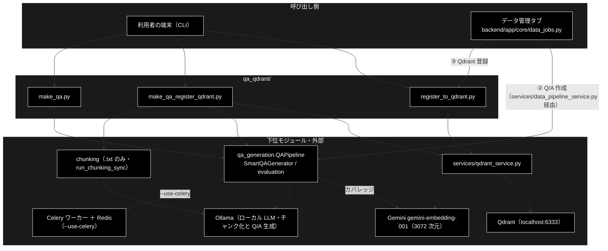
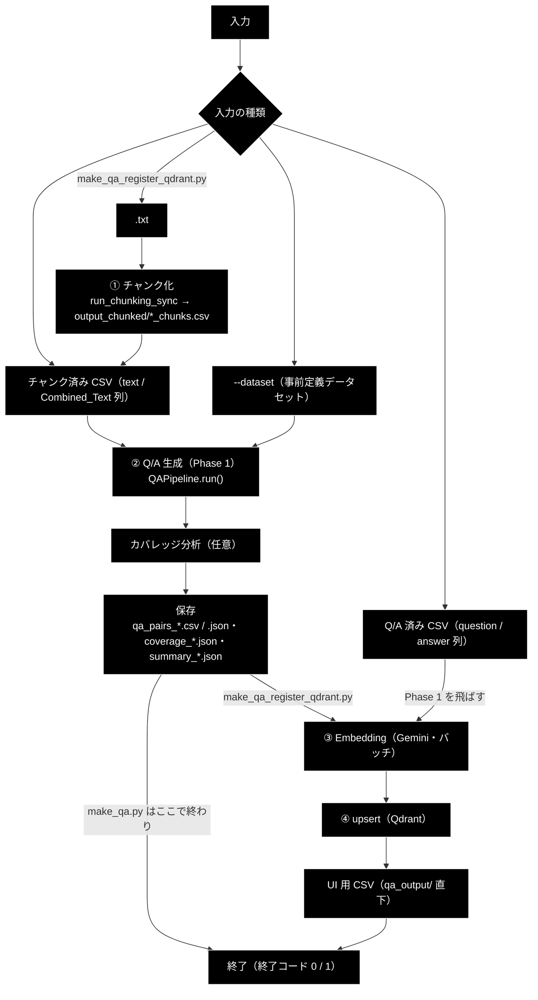
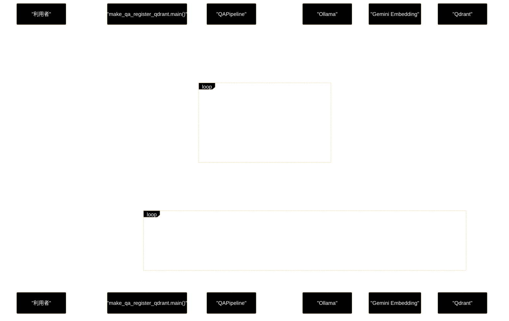

# qa_qdrant_process_flow.md - qa_qdrant/ 処理フロー

**Version 1.2** | 最終更新: 2026-10-12

データ準備の ② Q/A 生成・③ Qdrant 登録を `qa_qdrant/` の CLI から動かしたときの**処理の流れ**（どの順で・どのモジュールが・どんな条件で分岐するか）をまとめる。
各関数の引数・戻り値は各モジュールの文書（IPO）に、ファイルの列・payload の形は [`qa_qdrant_data_flow.md`](qa_qdrant_data_flow.md) に置き、ここには書かない。
ディレクトリ全体の入口は [`README_qa_qdrant.md`](README_qa_qdrant.md)。

> 📎 旧 [`archive/qa_qdrant_architecture.md`](archive/qa_qdrant_architecture.md)（設計書 v3.0）の「処理フロー詳細」を、2026-10-11 の実装に合わせて書き直したもの。
> 旧書の Phase 0（CSV 行結合 `--combine-rows`）・従来方式（Legacy 生成）・`analyze_chunk()` → `generate_qa_pairs()` の 2 段呼び出しは**もう無い**。

---

## 目次

- [概要](#概要)
- [1. 全体フロー](#1-全体フロー)
- [2. ステップ詳細](#2-ステップ詳細)
  - [2.1 CLI 3 本の受け持ち](#21-cli-3-本の受け持ち)
  - [2.2 Phase 1: Q/A 生成（QAPipeline）](#22-phase-1-qa-生成qapipeline)
  - [2.3 Phase 2: Qdrant 登録](#23-phase-2-qdrant-登録)
  - [2.4 データ管理タブ（Web）との対応](#24-データ管理タブwebとの対応)
- [3. 分岐・例外・中断](#3-分岐例外中断)
- [4. シーケンス](#4-シーケンス)
- [5. 関連ドキュメント](#5-関連ドキュメント)
- [6. 変更履歴](#6-変更履歴)

---

## 概要

入口は CLI 3 本（`make_qa.py` = 生成だけ・`register_to_qdrant.py` = 登録だけ・`make_qa_register_qdrant.py` = 両方）。
生成は `qa_generation.QAPipeline`（`SmartQAGenerator`・チャンク 1 件 = LLM 呼び出し 1 回）、登録は `services/qdrant_service.py`（Gemini Embedding → upsert）に委ね、
`qa_qdrant/` 自身は**入力の振り分け・順序制御・ファイル名の正規化・UI 用 CSV**だけを持つ。

### 主な責務

- 入力（`.txt` / チャンク済み CSV / Q/A 済み CSV / 事前定義データセット）を見て、どの段から始めるかを決める
- チャンク済み CSV から Q/A を生成し、途中経過を逐次保存して、落ちても再開できるようにする
- 生成した Q/A のカバレッジを分析する（任意）
- Q/A（または本文）を Embedding して Qdrant へ upsert し、件数を確かめる
- 日時を外した名前で UI 用 CSV を書き、データ管理タブから選べるようにする

### 各責務対応のモジュール

| # | 責務 | 対応モジュール | 説明 |
|---|------|--------------|------|
| 1 | 入力の振り分け | `qa_qdrant/make_qa_register_qdrant.py` | `main()` が拡張子・列で分岐（[`make_qa_register_qdrant.md`](make_qa_register_qdrant.md) §3.1）。`make_qa.py` は CSV だけ、`register_to_qdrant.py` は登録だけ |
| 2 | Q/A 生成と途中経過 | `qa_generation/pipeline.py`（`QAPipeline`） | `run()` → `load_data()` → `generate_qa()`（`qa_progress_<種別>.jsonl` へ逐次追記）→ `save()` |
| 3 | カバレッジ分析 | `qa_generation/evaluation.py` | `analyze_coverage()`（チャンクと Q/A を Gemini で Embedding して類似度行列） |
| 4 | Embedding と upsert | `services/qdrant_service.py` | `embed_texts_for_qdrant()` / `build_points_for_qdrant()` / `upsert_points_to_qdrant()` |
| 5 | UI 用 CSV | `qa_qdrant/make_qa_register_qdrant.py` / `register_to_qdrant.py` | `normalize_source_filename()` の名前で `question` / `answer` の 2 列を書く |

### アーキテクチャ構成図

---

## 1. 全体フロー

---

## 2. ステップ詳細

### 2.1 CLI 3 本の受け持ち

| CLI | ① チャンク化 | ② Q/A 生成 | カバレッジ | ③④ 登録 | ベクトル化する文 | 文書 |
|-----|:----------:|:---------:|:---------:|:-------:|---------------|------|
| `make_qa.py` | ❌（`.txt` はエラー） | ✅ | `--analyze-coverage` のときだけ | ❌ | — | [`make_qa.md`](make_qa.md) |
| `make_qa_register_qdrant.py` | `.txt` のときだけ | ✅（Q/A 済み CSV なら飛ばす） | **常に** | ✅ | `question` ＋改行＋`answer`（2026-10-11 までは `question` だけ） | [`make_qa_register_qdrant.md`](make_qa_register_qdrant.md) |
| `register_to_qdrant.py` | ❌ | ❌ | ❌ | ✅ | `question` ＋改行＋`answer`（列があれば・`--text-col` で変更可） | [`register_to_qdrant.md`](register_to_qdrant.md) |

### 2.2 Phase 1: Q/A 生成（QAPipeline）

| # | ステップ | 実装（ファイル::シンボル） | 入力 | 出力 | 失敗時の既定 |
|---|---------|--------------------------|------|------|------------|
| 1 | 設定の決定 | `qa_generation/pipeline.py::QAPipeline._load_config` | `input_file` か `dataset_name` | 種別（`--input-file` ならファイル名の拡張子なし、`--dataset` ならデータセット名） | 未知のデータセットは `ValueError` |
| 2 | 読み込み | `QAPipeline.load_data` | CSV | DataFrame（`max_docs` で先頭を切る） | `.csv` 以外・本文列なしは `ValueError` |
| 3 | チャンク化（変換だけ） | `QAPipeline._load_chunks_from_csv` | DataFrame | `{"id", "text", "type", "tokens", "dataset_type"}` のリスト（本文が空の行は捨てる） | 0 件なら `RuntimeError("有効なチャンクがありません")` |
| 4 | 途中経過の読み戻し | `QAPipeline._load_progress` | `<出力先>/qa_progress_<種別>.jsonl` | 処理済みチャンクの Q/A | 壊れた行は飛ばす（そのチャンクは作り直す） |
| 5 | 生成 | `QAPipeline._generate_sync` / `_generate_with_celery` → `SmartQAGenerator.process_chunk` | 未処理のチャンク | Q/A のリスト。1 件ごとに途中経過へ 1 行追記 | チャンク単位の失敗はログを出して 0 件扱い（**全体は止めない**） |
| 6 | カバレッジ | `QAPipeline.evaluate_coverage` → `qa_generation/evaluation.py::analyze_coverage` | チャンク・Q/A | 閾値 3 段（0.8 / 0.7 / 0.6）のカバレッジ率・長さ別・位置別 | Q/A が 0 件なら分析しない（率 0） |
| 7 | 保存 | `QAPipeline.save` → `qa_generation/data_io.py::save_results` | Q/A・カバレッジ | `qa_pairs_<種別>_<日時>.csv` / `.json`・`coverage_*.json`・`summary_*.json` | 例外は上へ（CLI は終了コード 1） |
| 8 | 途中経過の削除 | `QAPipeline._clear_progress` | — | `qa_progress_<種別>.jsonl` を消す | 消せなければ警告だけ |

> 📌 **Q/A の数は LLM が決める**（`SmartQAResult.qa_count`・チャンクあたり 0〜5 件。構造化出力 1 回で分析と生成を同時に行う）。
> この方式に一本化した経緯は [`archive/generation_vs_SmartGeneration.md`](archive/generation_vs_SmartGeneration.md) / [`archive/smart_generation_upgrade.md`](archive/smart_generation_upgrade.md)（当時の記録）。

### 2.3 Phase 2: Qdrant 登録

| # | ステップ | 実装（ファイル::シンボル） | 入力 | 出力 | 失敗時の既定 |
|---|---------|--------------------------|------|------|------------|
| 1 | 読み込み・列の判定 | `register_to_qdrant.py::detect_text_column` / `make_qa_register_qdrant.py::run_registration` | CSV | ベクトル化する文のリスト | 列が無ければ `False`（CLI は終了コード 1） |
| 2 | 重複除去（`register_to_qdrant.py` のみ） | `register_to_qdrant.py::register_to_qdrant` §3.5 | 文のリスト | 空白を正規化して同じ文を 1 件に | — |
| 3 | コレクションの用意 | `services/qdrant_service.py::create_or_recreate_collection_for_qdrant` | 名前・`recreate` | 3072 次元・Cosine の単一ベクトル | 繋がらなければ `False` |
| 4 | Embedding | `services/qdrant_service.py::embed_texts_for_qdrant` | `--batch-size` 件ずつ | 3072 次元ベクトル（空文字は 0 ベクトル） | 空を返したバッチは警告して**飛ばす**（全体は `True`） |
| 5 | ポイントの組み立て | `services/qdrant_service.py::build_points_for_qdrant` | 行・ベクトル | `PointStruct`（ID は内容のハッシュ・payload は [`qa_qdrant_data_flow.md`](qa_qdrant_data_flow.md) §2.3） | 件数が合わなければ `ValueError` |
| 6 | upsert | `services/qdrant_service.py::upsert_points_to_qdrant` | ポイント | Qdrant へ書く | 例外は `False` |
| 7 | 件数の照合（`register_to_qdrant.py` のみ） | `register_to_qdrant` §5.5 | コレクション | `points_count` と処理件数の比較 | `recreate=True` で食い違えば警告 |
| 8 | UI 用 CSV | 両 CLI | DataFrame | `<ui 出力先>/<正規化名>`（`question` / `answer`） | 失敗しても警告だけ |

> 📌 `register_to_qdrant.py` は Embedding を**スレッドで先読み**し（`--embed-workers`・既定 2。先読みは `embed_workers + 1` バッチまで）、upsert と重ねる。
> `make_qa_register_qdrant.py` の `run_registration()` は 1 バッチずつ直列。

### 2.4 データ管理タブ（Web）との対応

| タブの工程 | 呼ぶもの | CLI との関係 |
|-----------|---------|-------------|
| ① チャンキング | `services/data_pipeline_service.py::run_chunking_sync`（前に Ollama の事前確認） | `make_qa_register_qdrant.py` の `.txt` 入力と同じ関数 |
| ② Q/A 作成 | `services/data_pipeline_service.py::run_qa_generation_sync` → `QAPipeline` | Phase 1 と同じ（CLI は通らない） |
| ③ Qdrant 登録 | `qa_qdrant/register_to_qdrant.py::register_to_qdrant` | **本ディレクトリの関数をそのまま呼ぶ**（`recreate=True` のときは HITL の確認を挟む） |
| ④ コレクション管理 | `backend/app/api/qdrant.py`（`qdrant_client_wrapper`） | `qa_qdrant/command/list_collections.py` と同じ一覧 |

> ③ で選べる入力は `qa_output/` **直下**のファイル（`services/data_pipeline_service.py::list_input_files()`）。CLI の UI 用 CSV（既定 `qa_output/`）はそこに現れ、
> Q/A CSV の既定出力先 `qa_output/pipeline/` は現れない。

---

## 3. 分岐・例外・中断

### 3.1 入力の振り分け

`make_qa_register_qdrant.py` の判定順（上から最初に当てはまったもの）: `--dataset` → `.txt` → CSV に `question` と `answer` → CSV に `--text-column`（既定 `text`）か `Combined_Text` → エラー。
詳細と図は [`make_qa_register_qdrant.md`](make_qa_register_qdrant.md) §3.1。`QAPipeline` 自身は列を `text` → `Combined_Text` → `content` → `chunk_text` の順で探す（`text_column` 指定時はその列だけ）。

### 3.2 起動時の検査と終了コード

| 検査 | `make_qa.py` | `make_qa_register_qdrant.py` | `register_to_qdrant.py` |
|------|:-----------:|:---------------------------:|:-----------------------:|
| `GOOGLE_API_KEY` | ✅（無条件） | ✅（無条件） | ✅（`--provider gemini` のとき） |
| Ollama の接続・モデルの pull | ❌（**落ちていても 0 件で終了コード 0**） | ✅（Q/A を生成するときだけ。`require_ollama_ready()`） | —（LLM を使わない） |
| Q/A が 0 件 | ❌（終了コード 0） | ✅（終了コード 1・登録しない） | — |
| `--provider` の値 | — | `gemini` だけ（他は終了コード 2） | `gemini` / `openai`（**`openai` は Embedding に効かない**） |
| 登録の失敗 | — | 終了コード 1 | 終了コード 1 |

いずれも 2026-10-11 に実行して確かめた（各モジュール文書の使用例）。食い違いは [`README_qa_qdrant.md`](README_qa_qdrant.md) §5 にまとめてある。

### 3.3 再開（途中で落ちたとき）

- **Q/A 生成**: `qa_progress_<種別>.jsonl` が残っていれば、同じ入力（同じ種別）で再実行すると処理済みチャンクを飛ばして続きから生成する。
  ファイルは最後の保存のあと消えるので、正常に終わった入力をもう一度流すと**最初から**生成し直す。
- **チャンク化（`.txt`）**: `make_qa_register_qdrant.py` からは再開できない（`--resume` が無い）。大きな文書はチャンク化 CLI（`python -m chunking.csv_text_to_chunks_text_csv --resume`）で先に作る。
- **登録**: ポイント ID が内容から決まるので、同じ CSV を `recreate` なしで流し直しても件数は増えない（上書き）。

### 3.4 並列処理

- `--use-celery` のとき、`QAPipeline` は**全チャンクをまとめてタスクとして投入**し、ワーカーが `-c` 個ずつ消費する。CLI の `-c` / `--concurrency` はログに出すだけ。
- 結果は完了順に回収し、1 件ごとに途中経過へ追記する。回収のタイムアウトは `min(max(タスク数 × 10, 600), 1800)` 秒。
- ワーカー（または Redis）が無いと `RuntimeError("Celery workers are not running")` で止まる（CLI は終了コード 1）。
- なぜ asyncio ではなく Celery か: [`archive/asyncio_vs_celery.md`](archive/asyncio_vs_celery.md)（当時の比較の記録）。ワーカーの起動・監視は [`docs/celery_quick_start.md`](../../docs/celery_quick_start.md)。

---

## 4. シーケンス

`make_qa_register_qdrant.py --input-file <チャンク CSV> --collection <名前>`（同期）の往復。

---

## 5. 関連ドキュメント

| 文書 | 内容 |
|------|------|
| [`README_qa_qdrant.md`](README_qa_qdrant.md) | `qa_qdrant/` の入口・モジュール索引・既知の制約 |
| [`qa_qdrant_data_flow.md`](qa_qdrant_data_flow.md) | 各段のファイル・列・payload と実データの例 |
| [`make_qa.md`](make_qa.md) / [`make_qa_register_qdrant.md`](make_qa_register_qdrant.md) / [`register_to_qdrant.md`](register_to_qdrant.md) | 各 CLI の IPO と使用例 |
| [`qa_generation/docs/pipeline.md`](../../qa_generation/docs/pipeline.md) / [`smart_qa_generator.md`](../../qa_generation/docs/smart_qa_generator.md) | Phase 1 の中身 |
| [`services/docs/qdrant_service.md`](../../services/docs/qdrant_service.md) | Phase 2 の Embedding・ポイント・upsert |
| [`data_jobs.md`](../../backend/app/core/docs/data_jobs.md) | データ管理タブ（Web）の設計 |
| [`docs/celery_quick_start.md`](../../docs/celery_quick_start.md) / [`docs/data_prep_install.md`](../../docs/data_prep_install.md) | Celery ワーカー・環境構築 |

---

## 6. 変更履歴

| バージョン | 日付 | 変更内容 |
|---|---|---|
| 1.0 | 2026-10-11 | 新規作成（`a_cross_doc_md_format.md` §1.3。姉妹リポジトリ grace_v2 と同じ構成で、LLM と起動時の検査を Ollama 版に合わせた）。旧 `qa_qdrant_architecture.md`（`archive/` へ移した）の処理フローを実装に合わせて書き直し、CLI 3 本の受け持ち・Phase 1／2 のステップ表・Web との対応・起動時の検査・再開・並列処理をまとめた。起動時の検査と終了コードは CLI を実行して確かめた |
| 1.1 | 2026-10-11 | 入口の比較表の `make_qa_register_qdrant.py` のベクトル化する文を直した |
| 1.2 | 2026-10-12 | backend/docs/ の廃止（2026-10-12）に追随し、参照先を backend/app/docs/README_app.md・backend/app/api/docs/README_api.md・backend/app/core/docs/core_process_flow.md などへ付け替えた（テストの地図は docs/testing.md、実行例の txt は docs/examples/） |
