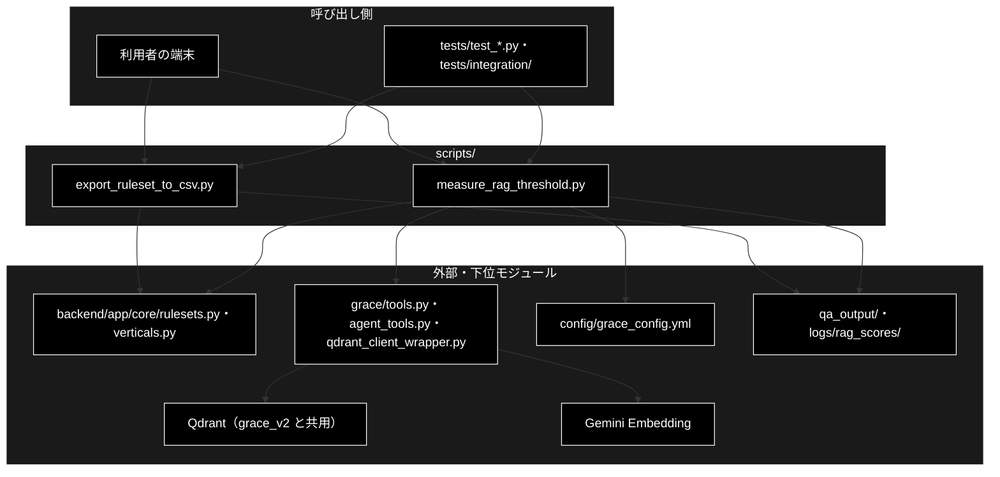

# README_scripts.md - scripts/ ディレクトリ概要

**Version 1.0** | 最終更新: 2026-10-11

`scripts/` の入口となる文書。アプリの実行時には使わない**運用・計測ツール**（テストではない）を置くディレクトリで、
各スクリプトの引数・戻り値は各モジュールの文書（IPO）に置き、ここには書かない。

> ⚠️ **本リポジトリは Ollama 版。** ここにあるスクリプトは LLM を呼ばない（Embedding は Gemini `gemini-embedding-001`、検索先は Qdrant）ので、`ollama serve` は要らない。
> 姉妹リポジトリ `grace_v2`（Anthropic 版）の `scripts/` には、E2E 用の実データを運ぶ `qdrant_snapshot.py` もある（Qdrant は共用なので、
> スナップショットは grace_v2 からだけ作る）。文書をコピーで持ち込まないこと（CLAUDE.md §5）。

---

## 目次

- [概要](#概要)
  - [主な責務](#主な責務)
  - [各責務対応のモジュール](#各責務対応のモジュール)
  - [アーキテクチャ構成図](#アーキテクチャ構成図)
- [1. モジュール一覧（索引）](#1-モジュール一覧索引)
- [2. 使い方（代表的なワークフロー）](#2-使い方代表的なワークフロー)
- [3. 公開 API（__init__.py）](#3-公開-api__init__py)
- [4. 処理フロー・データフロー](#4-処理フローデータフロー)
- [5. 既知の制約・残課題](#5-既知の制約残課題)
- [6. 変更履歴](#6-変更履歴)

---

## 概要

`scripts/` は、Qdrant の**実データまわりの運用**を助けるコマンドを置くディレクトリである。GRACE-Review の規程コレクションの雛形を作る、
RAG のしきい値を実測で決める、の 2 つ。どちらも端末から手で実行し、アプリ（`backend/`）からは呼ばれない。

### 主な責務

- GRACE-Review のルールセットの条文情報を、Qdrant 登録用の CSV に書き出す
- RAG の採用の下限・Web 検索の要否のしきい値を、範囲内・範囲外の質問のスコアから実測で決める

### 各責務対応のモジュール

| # | 責務 | 対応モジュール | 説明 |
|---|------|--------------|------|
| 1 | 規程コレクションの CSV の雛形 | `export_ruleset_to_csv.py` | `backend/app/core/rulesets.py` の `RuleSet` → `question` / `answer` / `topic` の CSV（`qa_output/ec_ad_rules.csv`）。登録は `qa_qdrant/register_to_qdrant.py` |
| 2 | RAG のしきい値の実測 | `measure_rag_threshold.py` | 本番と同じ候補一覧・検索関数で最良スコアを測り、推奨値と今のしきい値での振る舞いを出す。反映先は `config/grace_config.yml`（grace_v2 と同じスクリプト） |

### アーキテクチャ構成図



**データフロー（要点）**: `RuleSet` → CSV（`export_ruleset_to_csv`）→ 登録（`register_to_qdrant`・別ディレクトリ）→ Qdrant のコレクション →
スコアの実測（`measure_rag_threshold`）→ `config/grace_config.yml` のしきい値。詳細は §4。

---

## 1. モジュール一覧（索引）

| モジュール | 文書 | 種別 | 行数 | Ver | 概要 |
|---|---|---|---:|---|---|
| `export_ruleset_to_csv.py`（144 行） | [`export_ruleset_to_csv.md`](export_ruleset_to_csv.md) | E | 380 | 1.0 | `RuleSet` の条文情報 → Qdrant 登録用 CSV（読み取りのみ。Qdrant に触れない） |
| `measure_rag_threshold.py`（518 行） | [`measure_rag_threshold.md`](measure_rag_threshold.md) | E | 465 | 1.0 | RAG のしきい値を実測で決める（LLM を呼ばない。Qdrant に書き込まない） |

> 行数は文書の行数（実測）。`__init__.py` は無い（名前空間パッケージ。§3）。処理フロー・データフローは 1 スクリプトで閉じるので別文書にしていない（§4）。

---

## 2. 使い方（代表的なワークフロー）

> 📝 **確かめ方（2026-10-11）**: §2.1 は VM の実物の Qdrant に対して実行した（Embedding だけスタブ。登録したコレクションは確かめたあと消した）。
> 各スクリプト単独の使い方は、それぞれの文書の使用例（§4.1）にある。

| やりたいこと | 入口 | 使用例 |
|---|---|---|
| GRACE-Review の規程コレクションを作る | `export_ruleset_to_csv.py` → `qa_qdrant/register_to_qdrant.py` | §2.1・[`export_ruleset_to_csv.md`](export_ruleset_to_csv.md) §4.1 |
| Embedding モデル・データを変えたあと、しきい値を決め直す | `measure_rag_threshold.py --vertical each` → `config/grace_config.yml` | [`measure_rag_threshold.md`](measure_rag_threshold.md) §4.1 |

### 2.1 規程コレクションを作って確かめる

```bash
# 1. RuleSet → CSV（23 行）
PYTHONPATH=. python3 scripts/export_ruleset_to_csv.py --output qa_output/ec_ad_rules.csv

# 2. Qdrant へ登録（question + answer を Embedding）。--no-create-ui-csv は表示される案内に無いので自分で足す（§5 の 1）
python qa_qdrant/register_to_qdrant.py --input-file qa_output/ec_ad_rules.csv \
  --collection ec_ad_rules_anthropic --recreate --no-create-ui-csv

# 3. 件数を確かめる
python -m qa_qdrant.command.list_collections | grep ec_ad

# 出力例（抜粋）:
# ✅ 23 行を書き出しました: qa_output/ec_ad_rules.csv
# 📝 ベクトル化対象: 'question' + 'answer' の結合
# 🔍 登録後検証: Qdrant側件数=23 / 今回処理=23
#    登録件数     : 23 件
#   - ec_ad_rules_anthropic                     points=      23  status=green
```

> ⚠️ **規程コレクション `ec_ad_rules_anthropic` は grace_v2 と共用の Qdrant にある。** 登録し直すと両方の GRACE-Review の結果が変わる。
> 実運用では、条文本文を入れた grace_v2 の `qa_output/ec_ad_rules_statutes_template.csv` を `--input-file ../grace_v2/qa_output/ec_ad_rules_statutes_template.csv` で登録する
> （本リポジトリへコピーしない。[`docs/port_from_grace_v2_todo.md`](../../docs/port_from_grace_v2_todo.md) §12）。1 の CSV は雛形で、`answer` はこのリポジトリ自身の要約。

---

## 3. 公開 API（__init__.py）

公開 API なし（`__init__.py` は無い）。各スクリプトは `PYTHONPATH=. python3 scripts/<名前>.py` で実行し、Python からは
プロジェクトルートを `sys.path` に入れたうえで `from scripts.<名前> import …` で読む（名前空間パッケージ。テストもこの形）。
どちらのスクリプトも import 時にプロジェクトルートを `sys.path` の先頭へ入れ、重い依存（`backend` / `grace` / `agent_tools`）は関数の中で import する。

---

## 4. 処理フロー・データフロー

2 本は互いに import しない。つながりはファイルと Qdrant を介したものだけで、各スクリプトの流れは各文書の §1.2 にある。

| データ | 形式 | 作る側 | 使う側 | 置き場所 |
|---|---|---|---|---|
| 規程の CSV | 列 `question`（法令・条・タイトル）/ `answer`（要旨）/ `topic`（分類） | `export_ruleset_to_csv.py` | `qa_qdrant/register_to_qdrant.py` | `qa_output/ec_ad_rules.csv`（既定） |
| 計測結果 | JSON（`vertical` / `thresholds` / `summary` / `results`） | `measure_rag_threshold.py` | 人（`config/grace_config.yml` へ反映） | `logs/rag_scores/rag_scores_<日時>.json` |

---

## 5. 既知の制約・残課題

| # | 内容 | 詳細 |
|---|------|------|
| 1 | **`export_ruleset_to_csv.py` が表示する登録コマンドに `--no-create-ui-csv` が無い**。そのまま流すと、入力が `qa_output/` にあるとき入力 CSV 自身が `question` / `answer` の 2 列版で上書きされ `topic` 列が消える。表示される注意の「answer は RuleItem.description」も古い言い方（実際は `public_description()`）。grace_v2 版は案内に `--no-create-ui-csv` を足してある（テストはこちら 10 件・grace_v2 18 件） | [`export_ruleset_to_csv.md`](export_ruleset_to_csv.md) §4.1.1 |
| 2 | `export_ruleset_to_csv.py` の `answer` は法務監修済みの条文ではない（雛形） | 同 概要 |
| 3 | `measure_rag_threshold.py` の既定の質問は**出発点**。実運用の質問ログで置き換えて測り直す。他業界の質問は判定に混ぜない | [`measure_rag_threshold.md`](measure_rag_threshold.md) §5 |
| 4 | `measure_rag_threshold.py` の推奨閾値は `round(中点, 2)`（偶数丸め）なので、表の「中点」と最大 0.005 違うことがある | 同 §4.1.1 |

### 5.1 テスト件数

2026-10-11 に `pytest --collect-only` で数えた値（結合テストは Qdrant が無ければ skip）:

| テストファイル | 件数 | 対象 |
|---|---:|---|
| `tests/test_export_ruleset_to_csv.py` | 10 | `export_ruleset_to_csv.py` |
| `tests/test_measure_rag_threshold.py` | 37 | `measure_rag_threshold.py`（Qdrant を使わない部分） |
| `tests/integration/test_measure_rag_threshold_live.py` | 1 | 同（実 Qdrant） |

```bash
PYTHONPATH=. .venv/bin/python -m pytest tests/test_export_ruleset_to_csv.py tests/test_measure_rag_threshold.py \
  tests/integration/test_measure_rag_threshold_live.py -q
# 2026-10-11 実測: 48 passed（VM の Qdrant を起動した状態）
```

---

## 6. 変更履歴

| バージョン | 日付 | 変更内容 |
|---|---|---|
| 1.0 | 2026-10-11 | 新規作成（`a_cross_doc_md_format.md` §1.2。grace_v2 と同じ構成で、本リポジトリにある 2 本だけを載せた）。`scripts/` には `docs/` が無かった（`check_docs.py --layout` が要対応として出していた）。2 本の文書を作り、§2.1 を VM の実物の Qdrant で実行して確かめ、§5.1 のテスト件数を数えた。`export_ruleset_to_csv.py` の案内が grace_v2 より古いこと（`--no-create-ui-csv` が無い）を §5 の 1 に記録した |
