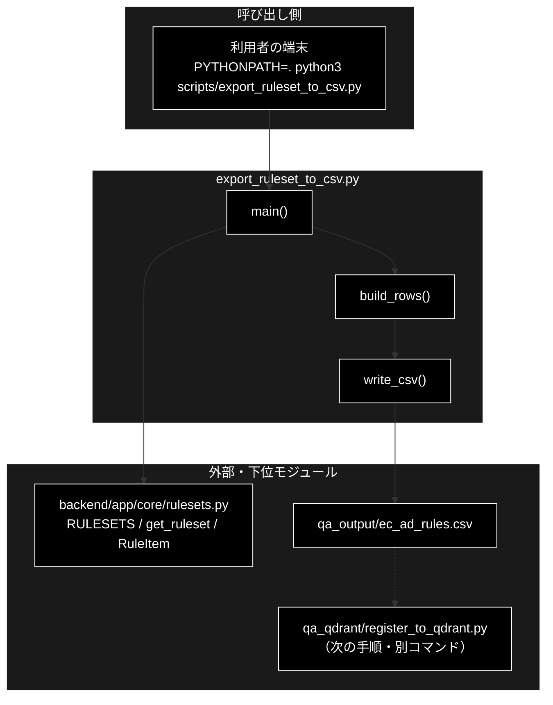
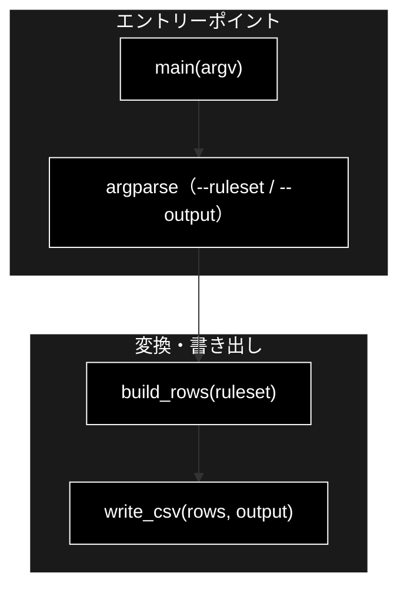
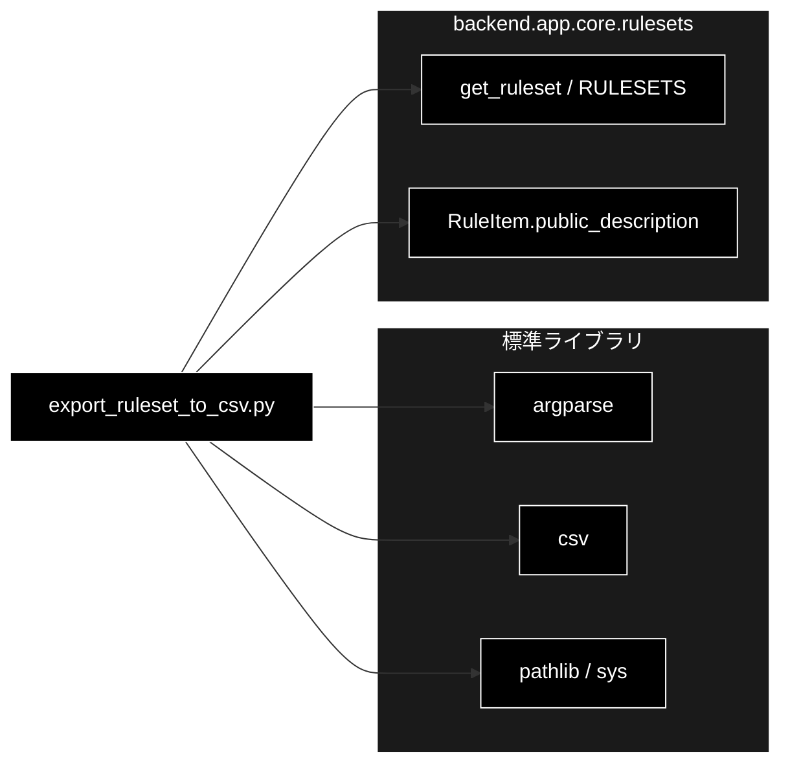

# export_ruleset_to_csv.py - RuleSet の条文 → Qdrant 登録用 CSV 書き出し ドキュメント

**Version 1.0** | 最終更新: 2026-10-11

---

## 目次

1. [概要](#概要)
2. [アーキテクチャ構成図](#1-アーキテクチャ構成図)
3. [モジュール構成図](#2-モジュール構成図)
4. [クラス・関数一覧表](#3-クラス関数一覧表)
5. [クラス・関数 IPO詳細](#4-クラス関数-ipo詳細)
6. [設定・定数](#5-設定定数)
7. [エクスポート](#6-エクスポート)
8. [変更履歴](#7-変更履歴)
9. [付録: 依存関係図](#付録-依存関係図)

---

## 概要

`scripts/export_ruleset_to_csv.py` は、GRACE-Review のルールセット（`backend/app/core/rulesets.py` の `RuleSet`）が持っている条文情報を、
`qa_qdrant/register_to_qdrant.py` でそのまま登録できる **`question` / `answer` / `topic` の 3 列の CSV** に書き出す CLI です。
Qdrant には触れません（読み取りと CSV の書き出しだけ）。

> ⚠️ **書き出す `answer` は法務監修済みの条文ではない。** `RuleItem.public_description()`（`description` の第 1 段落。LLM 向けの指示文は含めない）、
> つまりこのリポジトリ自身の要約である。登録しただけでは、根拠の中身は条文フォールバック（`RuleItem.citation()`）と同じになる。
> 本スクリプトの役割は、① 規程コレクションを実在させて Review の ② Retrieve が実際に規程を引く経路を通すことと、② 列構成の正しい雛形を作ること、の 2 つに限られる。
> 条文本文を入れた雛形は姉妹リポジトリ grace_v2 の `qa_output/ec_ad_rules_statutes_template.csv`（本リポジトリへはコピーしない。登録し直すときは
> `--input-file ../grace_v2/qa_output/ec_ad_rules_statutes_template.csv` を指す。[`docs/port_from_grace_v2_todo.md`](../../docs/port_from_grace_v2_todo.md) §12）。
> 規程コレクション `ec_ad_rules_anthropic` は grace_v2 と共用の Qdrant にあり、名前の `_anthropic` は LLM とは無関係な実データの名前である。
>
> ⚠️ **表示される登録コマンドに `--no-create-ui-csv` が無い**（§4.1.1。grace_v2 版は 2026-09 に足してある）。そのまま流すと、入力が `qa_output/` にあるとき
> 入力 CSV 自身が `question` / `answer` の 2 列版で上書きされる。登録するときは自分で `--no-create-ui-csv` を足す（[`README_scripts.md`](README_scripts.md) §5）。

### 主な責務

- ルールセット ID から `RuleSet` を引き、未知の ID を選択肢つきで拒否する
- 各ルールを 1 行（`question` = 法令・条・タイトル、`answer` = 公開用の要旨、`topic` = 分類）に変換する
- CSV を書き出し、登録コマンドを案内する

### 各責務対応のモジュール

| # | 責務 | 対応モジュール | 説明 |
|---|------|--------------|------|
| 1 | ルールセットの解決 | `export_ruleset_to_csv.py` ＋ `backend/app/core/rulesets.py` | `main()` が `get_ruleset(args.ruleset)` を呼ぶ。`None` なら `SystemExit("unknown ruleset: …（選択肢: …）")` |
| 2 | 1 ルール = 1 行への変換 | `export_ruleset_to_csv.py` | `build_rows(ruleset)`。`question` は `f"{rule.law} {rule.article}（{rule.title}）"` |
| 3 | 書き出しと案内 | `export_ruleset_to_csv.py` | `write_csv(rows, output)`（親ディレクトリを作る・UTF-8・ヘッダーつき）→ 登録コマンド（`--recreate`。`--no-create-ui-csv` は表示しない）と注意を表示 |

### 主要機能一覧

| 機能 | 説明 |
|------|------|
| `build_rows()` | `RuleSet` の各ルールを `{question, answer, topic}` の dict にする |
| `write_csv()` | 行を `FIELDNAMES` の順で CSV に書く |
| `main()` | CLI エントリーポイント。終了コードを返す |

---

## 1. アーキテクチャ構成図

### 1.1 システム全体構成



### 1.2 データフロー

1. `main()` が `--ruleset`（既定 `ec_ad`）・`--output`（既定 `qa_output/ec_ad_rules.csv`）を読む
2. `get_ruleset()` で `RuleSet` を引く（`backend.app.core.rulesets` は `main()` の中で import する）
3. `build_rows()` が `ruleset.rules` を順に `{question, answer, topic}` へ変換する（`ec_ad` は 23 行）
4. `write_csv()` が `FIELDNAMES = ("question", "answer", "topic")` の順で書き、登録コマンドを表示する

**なぜ `question` に法令・条・タイトルを置くか**: Review の ② Retrieve の検索クエリは `f"{rule.title} {rule.public_description()}"`
（`RuleItem.retrieval_query`）で、登録時は `question + "\n" + answer` を Embedding する（`register_to_qdrant.detect_text_column()`）。
両者がほぼ同じ文になるので、`RuleSet.evidence_min_score`（既定 0.70）を余裕で超える。あわせて `question` は UI の引用ラベル
（`[規程] 特定商取引法 第11条（販売価格・送料の明示）`）になる。

---

## 2. モジュール構成図

### 2.1 内部モジュール構成



### 2.2 外部依存関係

| ライブラリ | 用途 |
|-----------|------|
| `argparse` / `csv` / `pathlib` / `sys`（標準） | 引数解析・CSV の書き出し・プロジェクトルートの `sys.path` への挿入 |

### 2.3 内部依存モジュール

| モジュール | 用途 |
|-----------|------|
| `backend.app.core.rulesets.get_ruleset` / `RULESETS` | ルールセットの解決と、未知の ID のときの選択肢の表示 |
| `RuleItem.law` / `article` / `title` / `category` / `public_description()` | 1 行の中身 |

---

## 3. クラス・関数一覧表

### 3.1 クラス一覧

本モジュールはクラスを定義しません。

### 3.2 関数一覧

| 関数名 | 概要 |
|-------|------|
| `build_rows(ruleset)` | 各ルールを `{question, answer, topic}` にする |
| `write_csv(rows, output)` | CSV を書く（親ディレクトリを作る） |
| `main(argv=None)` | CLI エントリーポイント。成功で `0` を返す |

---

## 4. クラス・関数 IPO詳細

### 4.1 使用例

| # | パターン | いつ使うか | 例 |
|---|---------|-----------|----|
| 1 | **基本**: CLI で CSV を書き出し、続けて登録する | 規程コレクション `ec_ad_rules_anthropic` を作る | 4.1.1 |
| 2 | Python から行を作る（`build_rows()`） | 書き出す前に中身を確かめる・別の形式に流す | 4.1.2 |
| 3 | 未知のルールセット | 引数の誤りを知る | 4.1.3 |

> 📝 **確かめ方（2026-10-11）**: 4.1.1〜4.1.3 はすべて実行した（LLM・Embedding・Qdrant は使わない）。4.1.1 の登録コマンドは表示されるだけで、ここでは実行していない
> （登録は [`qa_qdrant/docs/register_to_qdrant.md`](../../qa_qdrant/docs/register_to_qdrant.md) §4.1）。

#### 4.1.1 基本: CLI で CSV を書き出す

```bash
PYTHONPATH=. python3 scripts/export_ruleset_to_csv.py                      # 既定: --ruleset ec_ad --output qa_output/ec_ad_rules.csv
PYTHONPATH=. python3 scripts/export_ruleset_to_csv.py --output out/ec_ad_rules.csv
head -3 out/ec_ad_rules.csv

# 出力例:
# ✅ 23 行を書き出しました: out/ec_ad_rules.csv
#
# 次の手順で Qdrant へ登録してください:
#
#     python qa_qdrant/register_to_qdrant.py \
#       --input-file out/ec_ad_rules.csv \
#       --collection ec_ad_rules_anthropic \
#       --recreate
#
# ⚠️ answer は RuleItem.description（このリポジトリ自身の要約）です。
#    実際の条文・ガイドライン本文へ置き換えるまで、根拠の中身は
#    条文フォールバックと同じままです（法務監修が必要）。
#
# question,answer,topic
# 景品表示法 第5条第1号（優良誤認表示）,商品・サービスの品質、規格その他の内容について、…,優良誤認
# 景品表示法 第5条第2号（有利誤認表示）,価格その他の取引条件について、…,有利誤認
```

> ⚠️ **登録には `--no-create-ui-csv` を自分で足す**（表示されるコマンドには無い）。登録スクリプトは既定で `question` / `answer` の 2 列だけの「UI 用 CSV」を
> `qa_output/<入力と同じファイル名>` へ書くので、入力が `qa_output/` にあると**入力 CSV 自身が 2 列版で上書き**され `topic` 列が消える
> （登録済みの payload には影響しない）。コレクション名は `<ルールセット ID>_rules_anthropic` を案内する。
> 表示される「answer は RuleItem.description」は古い言い方で、実際に書くのは `RuleItem.public_description()`（`description` の第 1 段落・LLM 向けの指示文を除く）。

#### 4.1.2 Python から行を作る

```python
from backend.app.core.rulesets import get_ruleset
from scripts.export_ruleset_to_csv import FIELDNAMES, build_rows

rows = build_rows(get_ruleset("ec_ad"))
print(len(rows), FIELDNAMES)
print(rows[0]["question"])
print(rows[0]["answer"][:40], "|", rows[0]["topic"])
print(sorted({r["topic"] for r in rows}))

# 実行結果:
# 23 ('question', 'answer', 'topic')
# 景品表示法 第5条第1号（優良誤認表示）
# 商品・サービスの品質、規格その他の内容について、実際のものよりも著しく優良である | 優良誤認
# ['おとり広告', '優良誤認', '効能効果', '原産国', '打消し表示', '景品類', '有利誤認', '表記漏れ', '規程不一致']
```

> 📌 `scripts/` はパッケージではない（`__init__.py` が無い）が、プロジェクトルートを `PYTHONPATH` に入れれば
> `from scripts.export_ruleset_to_csv import …` で読める（名前空間パッケージ）。テストも同じ形で import する。

#### 4.1.3 未知のルールセット

```bash
PYTHONPATH=. python3 scripts/export_ruleset_to_csv.py --ruleset nope; echo "exit=$?"

# 出力例:
# unknown ruleset: nope（選択肢: ec_ad）
# exit=1
```

### 4.2 `build_rows`

**概要**: `RuleSet` の各ルールを 1 行の dict にする。

```python
def build_rows(ruleset) -> List[dict]
```

| パラメータ | 型 | デフォルト | 説明 |
|------------|------|-----------|------|
| `ruleset` | `RuleSet` | — | `get_ruleset()` の戻り値 |

| 項目 | 内容 |
|------|------|
| **Input** | `ruleset.rules`（`RuleItem` のリスト） |
| **Process** | ルールごとに `question = f"{rule.law} {rule.article}（{rule.title}）"`・`answer = rule.public_description()`・`topic = rule.category` を作る |
| **Output** | `List[dict]`（ルールの定義順）。`ec_ad` は 23 行 |

**戻り値例**:
```python
[{"question": "景品表示法 第5条第1号（優良誤認表示）", "answer": "商品・サービスの品質、…", "topic": "優良誤認"}, ...]
```

```python
# 使用例（4.1.2）
rows = build_rows(get_ruleset("ec_ad"))
```

### 4.3 `write_csv`

**概要**: 行を CSV に書く。

```python
def write_csv(rows: List[dict], output: Path) -> None
```

| パラメータ | 型 | デフォルト | 説明 |
|------------|------|-----------|------|
| `rows` | `List[dict]` | — | `build_rows()` の戻り値 |
| `output` | `Path` | — | 出力先。親ディレクトリが無ければ作る |

| 項目 | 内容 |
|------|------|
| **Input** | 行と出力先 |
| **Process** | `output.parent.mkdir(parents=True, exist_ok=True)` → UTF-8・`newline=""` で開き、`csv.DictWriter(fieldnames=FIELDNAMES)` でヘッダーと行を書く |
| **Output** | `None`。既存のファイルは上書きする |

```python
# 使用例
from pathlib import Path
write_csv(build_rows(get_ruleset("ec_ad")), Path("out/ec_ad_rules.csv"))
```

### 4.4 `main`

**概要**: 引数を解析して CSV を書き出し、登録の手順を表示する。

```python
def main(argv: Optional[List[str]] = None) -> int
```

| パラメータ | 型 | デフォルト | 説明 |
|------------|------|-----------|------|
| `argv` | `Optional[List[str]]` | `None` | 引数（`None` なら `sys.argv[1:]`） |

| 項目 | 内容 |
|------|------|
| **Input** | `--ruleset`（既定 `ec_ad`）・`--output`（既定 `qa_output/ec_ad_rules.csv`） |
| **Process** | 1. 引数を解析<br>2. `get_ruleset()`。`None` なら `SystemExit("unknown ruleset: …（選択肢: …）")`<br>3. `build_rows()` → `write_csv()`<br>4. 件数・登録コマンド（`--recreate`）・注意（`answer` の中身）を表示 |
| **Output** | `0`。未知のルールセットは `SystemExit`（終了コード 1） |

```python
# 使用例
from scripts.export_ruleset_to_csv import main
main(["--output", "out/ec_ad_rules.csv"])   # → 0
```

---

## 5. 設定・定数

| 名前 | 値 | 説明 |
|------|----|------|
| `DEFAULT_OUTPUT` | `Path("qa_output/ec_ad_rules.csv")` | 既定の出力先。`services.data_pipeline_service.ALLOWED_INPUT_DIRS` に入るので、CLI からもデータ管理タブの「③ Qdrant 登録」からも入力に選べる |
| `FIELDNAMES` | `("question", "answer", "topic")` | 列の順 |

| CLI 引数 | 既定値 | 説明 |
|------|-------|------|
| `--ruleset` | `ec_ad` | ルールセット ID（`backend/app/core/rulesets.py::RULESETS`） |
| `--output` | `qa_output/ec_ad_rules.csv` | 出力先 CSV |

> 📌 import 時にプロジェクトルートを `sys.path` の先頭へ入れる。`backend.app.core.rulesets` は `main()` の中で import する。

---

## 6. エクスポート

`__all__` の定義はありません。外から使う要素は `build_rows` / `write_csv` / `main` / `FIELDNAMES` / `DEFAULT_OUTPUT` です。

```python
from scripts.export_ruleset_to_csv import DEFAULT_OUTPUT, FIELDNAMES, build_rows, main, write_csv
```

> 📌 テストは `tests/test_export_ruleset_to_csv.py`（10 件。列が登録スクリプトの期待と合うこと・全ルールが 1 行になること・空欄が無いこと・
> `question` が引用ラベルとして読めること・`answer` が根拠本文になること・`topic`・Embedding 対象に検索語が入ること・社内方針のルールも含むこと・
> 未知のルールセットの拒否・出力先ディレクトリの作成）。grace_v2 版は 18 件。

---

## 7. 変更履歴

| バージョン | 日付 | 変更内容 |
|---|---|---|
| 1.0 | 2026-10-11 | 新規作成（`scripts/docs/` の新設。`check_docs.py --layout` が要対応として出していた）。実装（144 行）とモジュールの docstring を読み、§4.1 の使用例 3 本を実行して確かめた（grace_v2 と同じ構成。表示される登録コマンドに `--no-create-ui-csv` が無い点は本リポジトリの版に合わせて書いた） |

---

## 付録: 依存関係図


