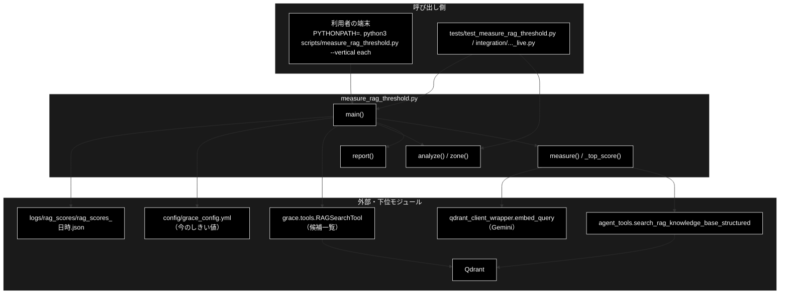
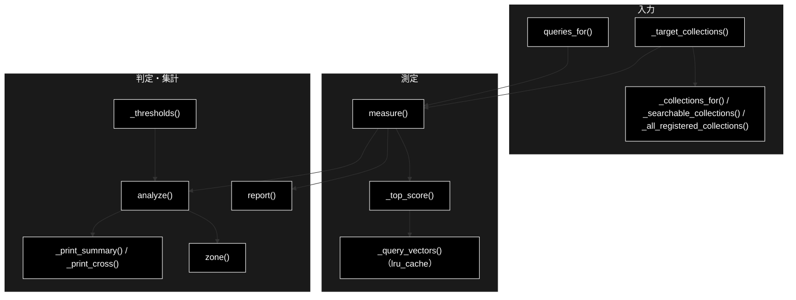
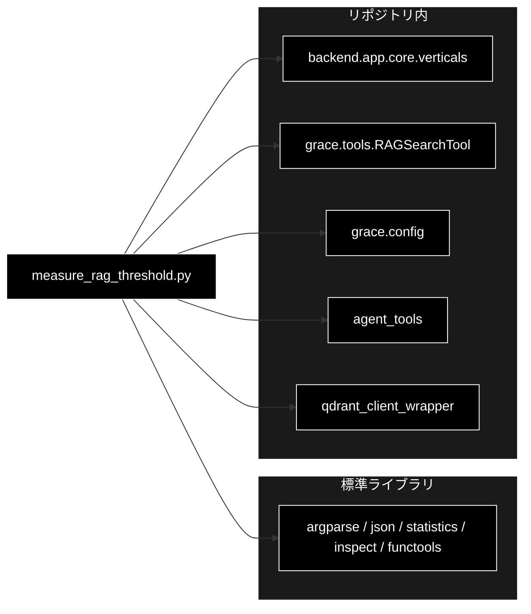

# measure_rag_threshold.py - RAG のしきい値を実測で決める計測スクリプト ドキュメント

**Version 1.0** | 最終更新: 2026-10-11

---

## 目次

1. [概要](#概要)
2. [アーキテクチャ構成図](#1-アーキテクチャ構成図)
3. [モジュール構成図](#2-モジュール構成図)
4. [クラス・関数一覧表](#3-クラス関数一覧表)
5. [クラス・関数 IPO詳細](#4-クラス関数-ipo詳細)
6. [設定・定数](#5-設定定数)
7. [エクスポート](#6-エクスポート)
8. [変更履歴](#7-変更履歴)
9. [付録: 依存関係図](#付録-依存関係図)

---

## 概要

`scripts/measure_rag_threshold.py` は、GRACE-Support の executor が RAG の最高スコアで決める 2 つのしきい値を**実測で決める**ための CLI です。
「拾うべき質問（範囲内）の最低スコア」と「拾ってはいけない質問（範囲外＝無関係）の最高スコア」を測り、分かれていればその中間を推奨値として出し、
あわせて**今のしきい値**で各質問がどの帯（不採用・強制 Web・適合性チェック）に入るかを数えます。

| しきい値（`config/grace_config.yml`） | 既定 | 意味 |
|---|---|---|
| `executor.reasoning_min_rag_score` | 0.64 | これ以上の結果だけを推論に使い、出典に載せる（採用の下限） |
| `qdrant.rag_sufficient_score` | 0.64 | これ未満なら Web 検索を差し込む。以上なら LLM の適合性チェックが決める。採用の下限以下にする |

**LLM は呼ばない**（Gemini Embedding と Qdrant だけ。Qdrant には書き込まない）。Embedding モデルを変えたら必ず測り直す（CLAUDE.md §3）。
grace_v2 にも**同じ内容**で置く（Qdrant と Embedding が共用なのでスコアは同じ。しきい値は各リポジトリの yml から読む）。LLM（Ollama）は使わないので、`ollama serve` は要らない。

### 主な責務

- 業界ごとの質問セット（範囲内・範囲外＝無関係・他業界）を用意する（既定か JSON）
- 本番と同じ候補一覧と検索関数で、各質問の「全コレクション中の最良スコア」を測る
- 範囲内の最小と範囲外の最大から、分離できるかを判定して推奨値を出す
- 今のしきい値での振る舞い（帯ごとの件数）を業界ごとに集計し、JSON に残す

### 各責務対応のモジュール

| # | 責務 | 対応モジュール | 説明 |
|---|------|--------------|------|
| 1 | 質問セット | `measure_rag_threshold.py` | `queries_for(vertical, payload)`。既定は `DEFAULT_IN_SCOPE`（業界ごと）・`DEFAULT_OUT_OF_SCOPE`（共通）、業界指定なら他業界の範囲内を「参考」に足す |
| 2 | 測定 | `measure_rag_threshold.py` ＋ `grace/tools.py` / `agent_tools.py` / `qdrant_client_wrapper.py` | `_target_collections()` が `RAGSearchTool._get_all_collections_dynamic()` で候補を作り、`measure()` → `_top_score()` が `search_rag_knowledge_base_structured()` で検索 |
| 3 | 判定 | `measure_rag_threshold.py` | `report(in_rows, out_rows)`: 分離できれば推奨値（終了コード 0）、できなければ 1、スコア不足は 2 |
| 4 | 集計と保存 | `measure_rag_threshold.py` ＋ `grace/config.py` | `_thresholds()` で今のしきい値を読み、`analyze()` / `zone()` で帯ごとに数えて `logs/rag_scores/rag_scores_<日時>.json` へ |

### 主要機能一覧

| 機能 | 説明 |
|------|------|
| `main()` | CLI エントリーポイント。終了コードを返す |
| `measure()` | 質問ごとの最良スコアとそのコレクション |
| `report()` | 分離の判定と推奨値の表示 |
| `analyze()` / `zone()` | 今のしきい値での帯ごとの集計（純関数） |
| `queries_for()` | 質問セットの組み立て |

---

## 1. アーキテクチャ構成図

### 1.1 システム全体構成



### 1.2 データフロー

1. `--vertical`（`all` / `gov` / `saas` / `ec` / `each`）と `--queries-file` から、業界ごとに `(範囲内, 範囲外, 他業界)` の質問を作る
2. `_target_collections()` が本番と同じ候補（次元不一致・空・`qdrant.excluded_collections` を落とす）を作る。業界指定ならプロファイルの許可コレクションに絞り（部分一致）、除外は重ねない
3. `measure()` が質問ごとに全候補を検索し、**最良**のスコアとコレクションを取る（`RAGSearchTool` が緩和時に最高スコアのコレクションを採用するのと合わせる）。質問ベクトルは `lru_cache` で 1 回だけ作る
4. `report()` が範囲内の最小（TP フロア）と範囲外の最大（FP シーリング）を比べる。**他業界の質問は判定に混ぜない**
5. `analyze()` が業界ごと・全体で、範囲内の不採用／強制 Web、範囲外の採用、他業界の採用を数える。結果を JSON に書く

---

## 2. モジュール構成図

### 2.1 内部モジュール構成



### 2.2 外部依存関係

| ライブラリ | 用途 |
|-----------|------|
| `argparse` / `json` / `statistics` / `inspect` / `functools`（標準） | 引数・JSON・中央値・本番の関数の引数の有無の判定・ベクトルのキャッシュ |

### 2.3 内部依存モジュール

| モジュール | 用途 |
|-----------|------|
| `backend.app.core.verticals.PROFILES` | 業界プロファイルの許可コレクション |
| `grace.tools.RAGSearchTool._get_all_collections_dynamic()`（と grace_v2 の `_apply_excluded_collections()`） | 本番と同じ候補一覧 |
| `agent_tools.search_rag_knowledge_base_structured()` | 本番と同じ検索（sparse が使えれば hybrid。緩和閾値 0.5 未満は「なし」） |
| `qdrant_client_wrapper.embed_query` / `embed_sparse_query_unified` / `get_qdrant_client` | 質問のベクトル・登録済みコレクションの一覧 |
| `grace.config.get_config()` | 今のしきい値 |

---

## 3. クラス・関数一覧表

### 3.1 クラス一覧

本モジュールはクラスを定義しません（`Row = Tuple[str, Optional[float], str]` は型の別名）。

### 3.2 関数一覧

| 関数名 | 区分 | 概要 |
|-------|------|------|
| `main(argv=None)` | 公開 | CLI。終了コードを返す |
| `queries_for(vertical, payload=None)` | 公開 | `(範囲内, 範囲外, 他業界)` |
| `measure(queries, collections)` | 公開 | 質問ごとの最良スコア（`List[Row]`） |
| `report(in_rows, out_rows)` | 公開 | 分離の判定と推奨値（戻り値は終了コード） |
| `analyze(rows, adopt, sufficient)` | 公開 | 業界ごとの集計（純関数） |
| `zone(score, adopt, sufficient)` | 公開 | スコアの帯（`rejected` / `forced_web` / `relevance`） |
| `_collections_for` / `_searchable_collections` / `_all_registered_collections` / `_target_collections` | 内部 | 候補一覧 |
| `_query_vectors` / `_top_score` | 内部 | 検索 |
| `_scores` / `_r` / `_print_summary` / `_print_cross` / `_thresholds` | 内部 | 集計・表示・設定 |

---

## 4. クラス・関数 IPO詳細

### 4.1 使用例

| # | パターン | いつ使うか | 例 |
|---|---------|-----------|----|
| 1 | **基本**: CLI で測る（業界ごと・自分の質問で） | Embedding モデルやデータを変えたあと、しきい値を決め直す | 4.1.1 |
| 2 | 判定と集計だけを使う（純関数） | 別に測ったスコアから推奨値・帯を出す・テストする | 4.1.2 |
| 3 | 検索対象が無いとき | データの無い Qdrant で流したときの振る舞いを知る | 4.1.3 |

> 📝 **確かめ方（2026-10-11）**: VM の Qdrant には実データが無いので、4.1.1 は**検索（`_top_score`）・候補一覧（`_target_collections`）・
> しきい値（`_thresholds`）だけを固定値に差し替えて** `main()` を流した（測定 → 判定 → 集計 → JSON の流れは本物）。
> 4.1.2 は純関数なのでそのまま、4.1.3 は実物の Qdrant（データ無し）に対して実行した。実データでの値は Mac で測る
> （実例: 2026-10-05・grace_v2_local の Mac で範囲内の最小 0.6650・範囲外の最大 0.6190・中点 0.64）。

#### 4.1.1 基本: CLI で測る

```bash
# 前提: Qdrant に実データ・.env に GOOGLE_API_KEY（Embedding）
PYTHONPATH=. python3 scripts/measure_rag_threshold.py                  # = --vertical all（業界指定なしの「基本版」と同じ候補）
PYTHONPATH=. python3 scripts/measure_rag_threshold.py --vertical each  # gov / saas / ec を順に
PYTHONPATH=. python3 scripts/measure_rag_threshold.py --vertical gov --queries-file queries.json
```

`queries.json`（業界ごとの形。`cross_vertical` は省略可。業界を分けない `{"in_scope": [...], "out_of_scope": [...]}` も可）:

```json
{"gov": {"in_scope": ["住民票の写しの取り方は？", "転入届の提出期限は？"],
         "out_of_scope": ["明日の東京の天気は？", "カレーの作り方を教えて"],
         "cross_vertical": ["サポート窓口の受付時間は？"]}}
```

```
# 出力例（検索スコアを 0.81 / 0.67 / 0.58 / なし / 0.70 に固定したとき）:
in_scope（拾いたい）
  0.8100  gov_faq_anthropic            住民票の写しの取り方は？
  0.6700  gov_faq_anthropic            転入届の提出期限は？

out_of_scope（拾ってはいけない・無関係）
  0.5800  gov_faq_anthropic            明日の東京の天気は？
    なし  -                            カレーの作り方を教えて

cross_vertical（他業界・参考。判定には使わない）
  0.7000  gov_faq_anthropic            サポート窓口の受付時間は？

========================================================================
集計
========================================================================
  in_scope  : n=2 最小=0.6700 中央=0.7400 最大=0.8100
  out_scope : n=1 最小=0.5800 中央=0.5800 最大=0.5800

  TP フロア（これ未満にすると取りこぼす）  : 0.6700
  FP シーリング（これ以下だと誤採用する）  : 0.5800

  ✓ 分離できる。推奨閾値 = 0.62（0.5800 〜 0.6700 の中間）

  反映先: config/grace_config.yml
    executor:
      reasoning_min_rag_score: 0.62

今のしきい値（採用の下限 0.64 / Web 検索の要否 0.64）での振る舞い
業界     範囲内(n・最小・中央)        範囲外(n・最大)   幅       中点     範囲内:不採用/強制Web  範囲外:採用  他業界(n・最大・採用)
(all)     2・0.67・0.74    2・0.58   0.09   0.625   0/0   0   1・0.7・1
gov       2・0.67・0.74    2・0.58   0.09   0.625   0/0   0   1・0.7・1

参考: 採用の下限 0.64 を超えた他業界の質問 1 件（判定には使わない）
  別の業界のデータにも答えがある質問なら、採用は誤りではない。無いのに上位なら、
  採用後の LLM の適合性チェック・根拠検証・回答ゲートが止めているかを E2E で確かめる。
  0.7000  gov   gov_faq_anthropic            サポート窓口の受付時間は？

結果: logs/rag_scores/rag_scores_<日時>.json
```

> 📌 **反映はコード変更不要**。推奨値を `config/grace_config.yml` の `executor.reasoning_min_rag_score`（と、それ以下に `qdrant.rag_sufficient_score`）へ書く。
> 終了コードは、分離できれば `0`、できなければ `1`（閾値ではなく Embedding モデル・チャンク粒度・コレクション分割の問題）、スコアの取れた質問が足りなければ `2`。
> JSON のキーは `vertical` / `thresholds` / `summary` / `results`。
>
> ⚠️ **推奨閾値と「中点」は四捨五入の仕方が違う**。推奨閾値は `round(中点, 2)`（Python の偶数丸めなので 0.625 → 0.62）、表の「中点」は小数 4 桁（0.625）。
> 範囲内の質問は「本当に社内ナレッジに答えがあるもの」だけにする（無い質問を入れると TP フロアが下がり、閾値を過小評価する）。

#### 4.1.2 判定と集計だけを使う

```python
from scripts.measure_rag_threshold import analyze, queries_for, report, zone

# スコアの帯（採用の下限 0.64・Web 検索の要否 0.64）
print([zone(s, 0.64, 0.64) for s in (None, 0.50, 0.64, 0.80)])
print([zone(s, 0.64, 0.70) for s in (0.66, 0.75)])     # 2 つのしきい値が食い違うと「強制 Web」の帯ができる

# 既定の質問セット（業界指定なら他業界の質問も「参考」として入る）
ins, outs, cross = queries_for("gov")
print(len(ins), len(outs), len(cross), ins[0], "/", outs[0])

# 判定: 範囲内の最小 > 範囲外の最大なら中点を推奨する（Qdrant・Embedding を使わない）
in_rows = [("住民票の写しの取り方は？", 0.81, "gov_faq_anthropic"), ("転入届の期限は？", 0.67, "gov_faq_anthropic")]
out_rows = [("明日の東京の天気は？", 0.58, "gov_faq_anthropic"), ("カレーの作り方を教えて", None, "-")]
print("終了コード:", report(in_rows, out_rows))   # 4.1.1 と同じ「集計」の表示が出る

rows = [{"vertical": "gov", "label": l, "query": q, "top": s, "collection": c}
        for l, rs in (("in", in_rows), ("out", out_rows)) for q, s, c in rs]
summary = analyze(rows, adopt=0.64, sufficient=0.64)
print(summary["gov"]["margin"], summary["gov"]["midpoint"], summary["gov"]["in_rejected"], summary["gov"]["out_adopted"])

# 実行結果（report の表示は省略）:
# ['rejected', 'rejected', 'relevance', 'relevance']
# ['forced_web', 'relevance']
# 7 7 18 住民票の写しの取り方は？ / 明日の東京の天気は？
# 終了コード: 0
# 0.09 0.625 0 0
```

#### 4.1.3 検索対象が無いとき

```bash
# 実データの無い Qdrant（VM）で業界を指定して流す
PYTHONPATH=. python3 scripts/measure_rag_threshold.py --vertical gov; echo "exit=$?"

# 出力例（末尾）:
# （検索可能な実体が無いためスキップ: gov_faq_anthropic, gov_laws_anthropic）
# 検索対象のコレクションが 1 つも無い（gov）
# exit=1
```

> 📌 業界プロファイルの許可コレクションが Qdrant に無い・次元が合わない・空のときは候補から落ち、1 つも残らなければ `SystemExit`。
> E2E 用の実データを VM へ運ぶスクリプト（`qdrant_snapshot.py`）は grace_v2 にだけある（Qdrant は共用）。

### 4.2 `queries_for`

**概要**: 業界ごとの質問セット `(範囲内, 範囲外＝無関係, 他業界)` を返す。

```python
def queries_for(vertical: str, payload: Optional[Dict] = None) -> Tuple[List[str], List[str], List[str]]
```

| 項目 | 内容 |
|------|------|
| **Input** | `vertical`（`all` / 業界 ID）・`payload`（`--queries-file` の JSON。業界ごとの形か、`in_scope` / `out_of_scope` を直に持つ形） |
| **Process** | `payload` があればその業界の節（無ければ全体）を読み、`in_scope` / `out_of_scope` が無ければ `SystemExit`。無ければ既定: `all` は全業界の範囲内＋共通の範囲外、業界指定はその業界の範囲内＋共通の範囲外＋**他業界の範囲内** |
| **Output** | 3 つのリスト。他業界は判定に混ぜない（`report()` に渡さない） |

### 4.3 `measure`

**概要**: 質問ごとに全候補を検索し、最良のスコアとそのコレクションを返す（表示もする）。

```python
def measure(queries: List[str], collections: List[str]) -> List[Row]
```

| 項目 | 内容 |
|------|------|
| **Input** | 質問・候補コレクション |
| **Process** | 質問ごとに `_top_score(query, collection)` を全候補で呼び、最大を取る。`_top_score` は `_query_vectors`（dense ＋ sparse。sparse が取れなければ dense だけ）と `search_rag_knowledge_base_structured()` を使い、0 件・文字列（エラー）なら `None`、例外は 1 コレクションの失敗として標準エラーへ出して `None` |
| **Output** | `List[(質問, 最良スコア or None, コレクション or "-")]` |

### 4.4 `report`

**概要**: 範囲内の最小と範囲外の最大で分離できるかを判定し、推奨値を表示する。

```python
def report(in_rows, out_rows) -> int
```

| 項目 | 内容 |
|------|------|
| **Input** | `measure()` の結果（範囲内・範囲外） |
| **Process** | スコアの取れた質問が片方でも無ければ `2`。`FP シーリング >= TP フロア` なら分離できない（最も低い範囲内・最も高い範囲外を表示して `1`）。分離できれば `round((TP + FP) / 2, 2)` を推奨して `0` |
| **Output** | 終了コード（`0` / `1` / `2`） |

### 4.5 `zone` / `analyze`

**概要**: 今のしきい値でのスコアの帯と、その件数の集計（純関数）。

```python
def zone(score: Optional[float], adopt: float, sufficient: float) -> str
def analyze(rows: List[Dict], adopt: float, sufficient: float) -> Dict[str, Dict]
```

| 帯（`zone`） | 条件 | executor の振る舞い |
|---|---|---|
| `rejected` | `None` か スコア < 採用の下限 | 0 件扱い → Web へ（範囲内なら取りこぼし） |
| `forced_web` | 採用の下限 ≤ スコア < Web 検索の要否 | 採用するのに無条件で Web も検索する（2 つが食い違うときだけ起きる） |
| `relevance` | Web 検索の要否 ≤ スコア | 採用し、LLM の適合性チェックが Web の要否を決める |

| 項目 | 内容（`analyze`） |
|------|------|
| **Input** | `rows`（`{vertical, label: in/out/cross, query, top, collection}`）・2 つのしきい値 |
| **Process** | 全体（`(all)`）と業界ごとに、範囲内の n・最小・中央値・最大、範囲外の n・最大、範囲内の不採用／強制 Web、範囲外の採用、他業界の n・最大・採用を数える。範囲内と範囲外の両方があれば幅（最小 − 最大）と、幅が正のときだけ中点 |
| **Output** | `{"(all)": {...}, "gov": {...}, ...}`（値は小数 4 桁） |

### 4.6 `main`

```python
def main(argv: Optional[List[str]] = None) -> int
```

| 項目 | 内容 |
|------|------|
| **Input** | `--vertical`（既定 `all`）・`--queries-file`・`--include-excluded`・`--out` |
| **Process** | 業界ごとに 質問 → 候補 → `measure()`（範囲内・範囲外・他業界）→ 全業界ぶんをまとめて `report()` → `_thresholds()` → `analyze()` → 表示 → JSON |
| **Output** | `report()` の終了コード。JSON は `--out`（既定 `logs/rag_scores/rag_scores_<日時>.json`） |

---

## 5. 設定・定数

| 名前 | 説明 |
|------|------|
| `ROOT` | プロジェクトルート（`scripts/` の 1 つ上）。`sys.path` へ入れ、既定の出力先 `logs/rag_scores/` の基準にする |
| `VERTICALS` | `("gov", "saas", "ec")`。`--vertical each` の順 |
| `DEFAULT_IN_SCOPE` | 業界ごとの範囲内の質問（gov 7・saas 9・ec 9）。前半は 2026-10-04 の Mac の E2E の回答に実際に出た内容から作った。**出発点**なので実運用の質問ログで置き換える |
| `DEFAULT_OUT_OF_SCOPE` | どの業界にも答えの無い質問 7 件（天気・株価など）。分離の判定はこれだけで行う |

| CLI 引数 | 既定値 | 説明 |
|------|-------|------|
| `--vertical` | `all` | `all` / `gov` / `saas` / `ec` / `each` |
| `--queries-file` | なし | 質問の JSON（§4.1.1） |
| `--include-excluded` | off | `qdrant.excluded_collections`（汎用コーパス）も測る（除外の効果を before / after で見る） |
| `--out` | `logs/rag_scores/rag_scores_<日時>.json` | 結果 JSON |

> 📌 import 時にプロジェクトルートを `sys.path` の先頭へ入れる。重い依存（`grace` / `agent_tools` / `qdrant_client_wrapper`）は関数の中で import する。

---

## 6. エクスポート

`__all__` の定義はありません。テストが使うのは `analyze` / `zone` / `report` / `queries_for` / `measure` / `main` / `_collections_for` / `_searchable_collections` です。

> 📌 テストは `tests/test_measure_rag_threshold.py`（37 件。帯の判定・集計・質問セット・他業界を判定に混ぜないこと・本番と同じ候補一覧を使うこと〔次元不一致・除外〕・
> CLI の終了コードと JSON）と、`tests/integration/test_measure_rag_threshold_live.py`（1 件。実 Qdrant に一時コレクションを作り、Embedding だけ固定ベクトルにして、本番と同じ検索で最良のスコアを拾うこと・緩和閾値 0.5 未満を「なし」にすることを見る。Qdrant が無ければ skip）。

---

## 7. 変更履歴

| バージョン | 日付 | 変更内容 |
|---|---|---|
| 1.0 | 2026-10-11 | 新規作成（`scripts/docs/` の新設。スクリプトは grace_v2 と同一なので、文書も grace_v2 と同じ構成）。実装（518 行）とモジュールの docstring を読み、§4.1 の使用例 3 本を本リポジトリで実行して確かめた（4.1.1 は検索だけを固定値に差し替えた）。推奨閾値と「中点」の丸め方の違いを §4.1.1 に注記した |

---

## 付録: 依存関係図


